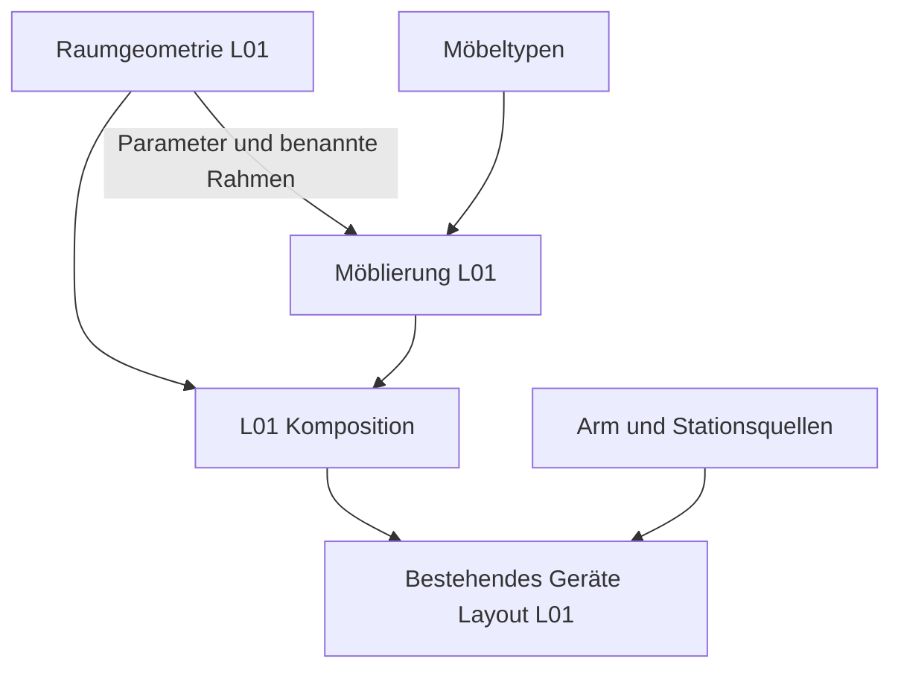
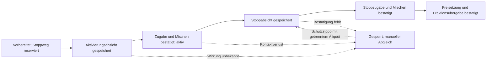

# Architektur der Arbeitsumgebungen und Ausstattung

Die [Modellgalerie](docs/models/README.md) führt mit Bildern durch diese Ebenen
und verknüpft jede Ansicht mit den gemeinsamen Quellen und der Fachdokumentation.

Das Zielmodell trennt Arbeitsumgebung, Möbeltypen, Möblierung und
Geräteausstattung. Jede Konstruktion besitzt eine führende Quelle. Ein Standort
referenziert diese Quelle und beschreibt seine Instanzen mit Parametern,
Transformationen und benannten Bezugssystemen. CAD-Dateien bleiben Ableitungen.

FreeCAD und SolidCraft erzeugen ihre Geometrie unabhängig aus diesen Quellen.
Der Vergleich beider Ergebnisse ist eine zusätzliche Prüfung. Insbesondere
erzeugt der eigenständige CF01-SolidCraft-Adapter native Konstruktionsfeatures
und gemeinsame Protokollstellungen ohne FreeCAD-Dateien als Eingabe. Erhaltene
Hersteller-Gehäuseteile können unter einer gemeinsamen semantischen Geräte-ID
mehrere starre CAD-Körper bilden; ihre Zuordnung wird im Build-Bericht geführt.

## Projektweite Bewegungsvorgabe

Fließende Bewegung ist eine allgemeine Anforderung, auch bei leeren Fahrten
und Raumsondierung. Ein Wegpunkt erzeugt keine Pause. Eine notwendige
Wartebedingung benennt die erwartete Beobachtung beziehungsweise den Abschluss
eines anderen Vorgangs. Jeder neu entwickelte oder erneuerte
beladene Transport verbindet Griff und Ablage beziehungsweise Übergabe ohne
unnötige Zwischenhalte. Durchgangsziele, Freiraumereignisse und Stations-
quittungen werden von erforderlichen Prozess- und Schutzhalten getrennt.
Ein Sicherheitsstopp darf nicht zur Einhaltung dieser Bewegungsregel entfallen.

Die gemeinsamen PVA-Kurven und FK-Ableitungen unter
`solidcraftbot_ros/motion.py` und `scripts/sample_motion.py` bilden den vorhandenen
Rechenkern für die Sechsachs-Armbahnen. Grenzen und Kein-Halt-Kriterium werden
an der tatsächlichen Kurve und nach Export geprüft; die wissenschaftliche
Belastbarkeit der Proben bleibt eine gesonderte Qualifikationsaufgabe. Es gibt
keinen automatischen Glätter beliebiger Szenen und kein neues universelles
Transportschema. Weitere Programme müssen ihre unterstützten Quellen und
Adapter entsprechend erweitern und neu nachweisen.

Die aktuelle Drei-Proben-Entnahme erfüllt die numerischen synthetischen
Prüfkriterien für beladene und leere Fahrten. Die L01-Umstellung beschreibt
sechs durchgehende Bewegungsepisoden mit demselben PVA-/FK-Kern statt der
älteren linearen Wegpunktillustration. Ihr Heberrückzug läuft nach geprüfter
Gefäßfreigabe parallel zum Transport. FreeCAD wertet die tatsächlichen Kurven
aus; die native SolidCraft-Studie bleibt ausdrücklich eine diskrete lineare
Vorschau ohne PVA-Schnittstelle. Die Nachweise und Grenzen stehen in
[docs/lab-transfer-l01.md](docs/lab-transfer-l01.md).

Die historische CF01-Einzelbahn und statische Zweiarm-Prüfstellungen sind
kein solcher Bewegungsnachweis. Die alte nackte Arm-Demo
`base_sweep_return` in `model/robot.json` verwendet weiterhin `joint_linear`;
sie ist keine nach dieser Vorgabe freigegebene Sondierungsbahn. Ihre Migration
einschließlich der abhängigen Arm-/CAD-Revisionen ist gesonderte Folgearbeit.
Abstrakte manuelle Übergaben führen keine Roboterbahn aus. Notwendige Mess-,
Pipettier-, Inkubations- und Übernahmehalte bleiben Prozesszustände.
Die [Anforderungen](docs/requirements.md#fließender-probentransport) gelten vor
der Überführung dieser Altstände in aktuelle Transportprogramme.

## Vier Beschreibungsebenen

| Ebene | Verantwortung | Abgrenzung |
|---|---|---|
| Arbeitsumgebung | Geschosse, Labore, Flure, Raumkonturen, Wände, Stützen, Fenster, Öffnungen und feste Gebäudeanschlüsse | Keine Möbel- oder Geräteinstanzen |
| Möbeltypen | Wiederverwendbare parametrische Möbel und Zubehörtypen mit lokalen Montage- und Aufstellrahmen | Keine Standorte oder L01-Koordinaten |
| Möblierung | Konkrete Möbelinstanzen mit Typreferenz, Abmessungsbindungen und Aufstellung in einem Raum oder Flur | Keine kopierten Möbelrezepte |
| Geräteausstattung | Geräteinstanzen mit Referenz auf vorhandene Quellen, Zustand und Aufstellung auf Möbeln oder direkt im Raum | Keine zweite Arm-, Stations- oder Gerätebeschreibung |

Räume und Flure sollen später eine gemeinsame Umgebung bilden. Gemeinsam
verwendete Türen und Öffnungen werden dabei einmal beschrieben; die verbundenen
Bereiche referenzieren dieselbe Öffnungs-ID. Raumgeometrie und die Topologie der
Verbindungen sind getrennte Informationen. Die Mehrraum- und Flurtopologie ist
in diesem ersten Schritt noch nicht implementiert. Die separate
[relative Geschossansicht F03](docs/floorplan-f03.md) ergänzt inzwischen einen
einmalig beschriebenen Wand-/Öffnungsgraphen und Bereichsnachbarschaften;
metrische Gebäudeintegration, Passierbarkeit und Navigation bleiben offen.

Die [Konzeptkomposition mit Keller und vier oberirdischen Geschossen](docs/building-stack.md) referenziert
F03 für drei Obergeschosse sowie eigene registrierte relative KG- und EG-Quellen.
4.000 mm lichte Höhe sind eine Eigentümerannahme; mit vorläufig 250 mm
Geschossplatte entstehen 4.250 mm Geschossabstand. Nur im EG wird die vorhandene
Atriumkontur durch die tatsächlichen EG-Foyer-/Flurböden gemeinsam abgedeckt.
Die oberen Atriumflächen bleiben zwischen den Geschossen offen; ein gewölbtes
Glasdach bildet den oberen Abschluss. Der Kellerplan ist separat nachgezeichnet;
Kellerhöhe, metrische Registrierung und Aufmaß stehen aus. KG verwendet vorläufig
denselben Darstellungsabstand unter EG.
Die horizontale Darstellungsproportion verweist auf die ungemessene L01-Breite,
ohne F03 zu kalibrieren oder Möbel und Geräte zu übertragen. Geschossinstanzen
besitzen eigene IDs; Raumnummern der Vorlage sind keine bestätigten Nummern
der anderen Geschosse. Das blaue Austauschvolumen ist ein Konzeptmarker für
den Antrag, keine ausgewählte Fördertechnik, Transportbahn oder Zugangszusage.

Die Gebäudeerschließung wird als eigene semantische Ergänzung dieser
Komposition aus den Quellbezügen abgeleitet: ein inneres rechtes Treppenhaus
`R3_028` vom Keller bis zum 3. OG und eine eigene äußere Metalltreppe `R3_017`
vom Dach zum Boden, mit EG-Ende neben Zugang 22. Ein Flur und seitlicher Versatz
trennen sie vom alleinstehenden Aufzug. Verbundene Läufe und Podeste besitzen
passende Geschossöffnungen; Metalltreads und Stringer sind eigene Darstellrollen.
Aufzugschacht,
eine stationäre Kabine und geschossabhängige Türseiten sind getrennt vom
blauen Atrium-Marker. Die vom Eigentümer bestätigten Seiten sind außen links
zum Flur `C3_020` und innen rechts zum `NorthCore`. EG erhält beide Seiten,
die Obergeschosse nur außen und KG nur innen. Der Kellerstopp und die
KG–EG-Treppe besitzen statische Konzeptgeometrie mit angenommener Höhe. `NorthCore` bleibt in der Obergeschossvorlage unbekannt.
Das EG führt stattdessen seine eigenen Flurflächen an den Türseiten; die
Darstellung beweist auch dort keinen qualifizierten begehbaren Anschluss. Die ursprüngliche
F03-Klassifikation und ihre Nachweise werden dadurch nicht rückwirkend geändert.

Die Fotoergänzung `exterior` in der Gebäudekomposition ersetzt gezielt die
Fassaden-Platzhalterwand und zwei Atrium-/Flurkanten durch transparente Verglasung
beziehungsweise offene Metallgeländer. Raumtürfarbe und Erdreich-Höhenbezug
werden aus derselben Quelle in beiden CADs abgeleitet. Größen und Foto-/Planlage
bleiben Darstellungsannahmen, keine Gebäude- oder Sicherheitsqualifikation.
Siehe [Fotoableitung](docs/building-exterior.md).

`model/ground-floor-eg.shared.json` führt Seminarraum, Foyer und verlegte
Toiletten einmalig. Ein Loader löst gemeinsame Kernvertices aus F03 auf und
validiert den vorhandenen relativen Wand-/Flächengraphen. Die manuelle Einpassung
der bereits orientierten Literalvektoren ist kein vermessener Maßstab und keine
starre Fotoregistrierung. Die Dachkomposition referenziert den Hauptgebäudeumriss,
Glaswölbung mit X-Achse und Y/Z-Querprofil sowie nach außen überstehende Ränder.
Die Glasgrundfläche bindet Atrium, alle vier Flure und den eingeschlossenen Kern
an ihre gemeinsamen Bereichskonturen; sie ist von der kleineren Atriumöffnung
der Geschossböden getrennt. Nur die Dachöffnung wird erweitert. Maße und
Schutzwirkung bleiben unqualifiziert. Das Dach ist ein Abschluss und kein zusätzliches Geschoss.

Ein optionales Anforderungsprofil kann später erwartete Möbel- und Gerätearten
benennen. Solche Anforderungen erzeugen noch keine tatsächlich aufgestellten
Gegenstände. Bewegliche Geräte behalten ihre Identität beim Raumwechsel;
Betriebspositionen werden später von der geplanten Aufstellung getrennt.

## Implementierter erster Schritt für L01

| Quelle | Inhalt |
|---|---|
| `model/lab-room-l01.shared.json` | Schlankes Kompositionsmanifest mit Revisionen der drei Quellen |
| `model/environments/l01.geometry.json` | Raumparameter, Fassade, Öffnungen, Verglasung und Betonstütze |
| `model/furniture/laboratory.catalog.json` | Neun Möbel- und Zubehörtypen mit lokalen Maßverträgen |
| `model/furnishings/l01.furnishings.json` | L01-Möbelinstanzen, Parameterbindungen und konkrete Aufstellungen |
| `model/lab-layout-l01.shared.json` | Referenzierte Geräteaufstellung einschließlich Waage, Kühlschrank und −20-°C-Schrank |

Die Raumschale ist über `room_geometry_model` unabhängig von Möbeln auswertbar.
Sie enthält neun Körper. `furniture_model` instanziiert Möbel aus dem Katalog;
`lab_room_model` kombiniert die drei Quellen für die bisherigen CAD-Adapter.
Die Einrichtung erhält die bisherigen Gebäude- und Möbelbezüge. Hohle
Schrankkorpusse ersetzen die früheren Stauraumhüllen; Türen und Hockersitze
ergänzen bewegliche Gruppen. Die sechs bisherigen festen Gruppen bleiben
erhalten. Der Standardraum umfasst jetzt 197 Körper und zusätzliche Bezüge.

Für die Kaltlagerung reserviert die Möblierung 640 mm am hinteren Ende der
linken Seitenbank; ihr Hängeschrank wird entsprechend gekürzt. Die rechte
Bank und ihr Hängeschrank behalten ihre Länge. Der Kühlschrank steht mit
dem Rücken an der rechten Seitenwand im freien Bereich hinter Tür B und
öffnet zum Gang. Die Gerätequelle
liefert ihre Maße einmalig. Das Layout leitet daraus benannte Maßansichten
für die Aufstellung ab und prüft die tatsächlichen Geräte gegen die
Möbelreservierungen. Die linke CF01-/ArmC-/TR01-/Rackgruppe wird über einen
gemeinsamen Versatz um 800 mm zum Eingang verschoben. Das manuelle
Kellerlager gehört nicht zu L01; ein Kellerraum wird nicht ergänzt.

Vorne links reserviert die Möblierung Platz für einen Nassplatz und den direkt
anschließenden Abzug. Die restliche linke Bank und die oberen offenen Regale
beginnen bei Y=2.800 mm. Der Nassplatz und die drei Hocker gehören zum
Möbelkatalog; Wasserbad und Abzug zur referenzierten Gerätebibliothek.
Unterschränke besitzen zwei Einlegeböden je Fach. Je zwei gegenläufig
angeschlagene Türen schließen ein gemeinsames Fach ohne Mittelsteg ein;
bei ungerader Türzahl endet die Bank mit einem Einzeltürfach.
`door_grouping: "single"` an einer Instanz trennt alle Türen in eigene Fächer.
Trennwände, Böden, Scharnierlagen und Zugangsproben entstehen gemeinsam
aus demselben Rezept, auch im Abzugunterbau. Die bisherigen
oberen Schrankinstanzen behalten ihre IDs, werden aber als offene Regale
erzeugt. Geschlossener Zustand, Öffnungsraum und tatsächliche Zugangsproben
werden getrennt ausgewiesen. Wasser, Abwasser und Abluft sind nicht angeschlossen.

Die Analysenwaage, beide Laborschränke, Wasserbad und Abzug entstehen in beiden CADs direkt
aus dem Gerätefamilienrezept. SolidCraft setzt diese Modelle und die bereits
geprüften nativen Armmodelle als platzierte Verknüpfungen ein. Die Aufstellung
bleibt eine statische Ansicht; Gerätestellungen werden zusätzlich diskret auf
Zugang und Überschneidungen geprüft. Diese Prüfung ist kein neues
Robotertransportprogramm.

Die Typen umfassen Stauraumbank, offene angepasste Bank, Regalbrett, Stütze,
offenes Regal, Nassplatz und Laborhocker sowie seitliche und mittige passgenaue Abdeckungen. Unterschiedliche
Bänke und Schränke verwenden dieselben Rezepte. Die Abdeckungen sind Zubehör
der Einrichtung, dessen Zuschnitt an Raumkontur und Banklage gebunden ist;
sie beschreiben keine Heizungsanlage. Die bisherige Darstellungsgruppe
`BuildingServices` bleibt zur Identitätswahrung erhalten.

Möbelabmessungen und Raummesswerte besitzen getrennte Parametertabellen ohne
überlappende Namen. Ein Möbeltyp kennt nur lokale Abmessungen. Die Möblierung
bindet diese beispielsweise an `bench_height` oder eine freie Länge zwischen
Raumgrenzen. Verankerungen wie die Bankanpassung an die Stützenfront verwenden
den benannten Raumrahmen `L01.ConcreteSupport`.

Möbelposen bestehen derzeit aus drei Koordinaten in mm und einer festen Drehung
um die vertikale Achse in Grad. Gedrehte Quader werden als Polygonprismen
abgeleitet; Möbelrahmen drehen mit. Die eingepassten Abdeckungen verwenden
explizit die Raumkontur und bleiben im Raumbezugssystem. Allgemeine räumliche
Montagebeziehungen mit Neigung sind in diesem Schritt nicht implementiert.

## Ableitung und Revisionen

Der Einstieg bleibt `python scripts/build_lab_room.py`. FreeCAD und SolidCraft
verarbeiten dieselben ausgewerteten Primitive. Symbolische Maßabhängigkeiten
bleiben bis zu den Adaptern erhalten, damit native Parameteränderungen auch
Geometrie und Bezugssysteme gemeinsam verändern.

Das Kompositionsmanifest bindet jede Teilquelle mit SHA-256. Persistente
Änderungen an Raum, Katalog oder Möblierung erfordern eine bewusste Übernahme
in dieses Manifest; anschließend wird die Raumreferenz des Geräte-Layouts
aktualisiert. Der Build-Bericht führt die drei Quellen, deren Schemas und
Generatoren auf. Ein alter Bericht gilt nicht für die neue Kompositionsrevision.

Die Verträge sind in `room-composition.schema.json`, `room-geometry.schema.json`,
`furniture-catalog.schema.json` und `furnishings.schema.json` beschrieben.
Zusätzlich zu den Schemas prüfen die Generatoren Referenzen, Einheiten,
Wertebereiche, eindeutige IDs, Ausdruckszyklen und geometrische Bedingungen.

## Erhalt und Prüfgrenzen

`tests/fixtures/l01-before-layer-split.json` hält die ausgewerteten Primitive,
Konstruktionsfolgen, Rahmen und Gerätepositionen des vorherigen Stands für fünf
Parametervarianten fest. Die Regression prüft auch die bisherigen Übergabeziele.
Historische Testdaten sind keine zweite führende Raum- oder Möbelquelle.

Der native Vergleich prüft beide CAD-Kerne, gespeicherte Modelle und die
vorhandenen nativen Parameteränderungen. Das belegt geometrische Übereinstimmung,
keine Fertigungsfreigabe oder sichere Laboraufstellung. Die bisherigen
Durchgangsformeln beschreiben das nominale L01-Arrangement; frei versetzte Möbel
benötigen neue räumliche Freiraumprüfungen. Die heutigen Durchgänge und Geräte-
Betriebsbereiche sind weiterhin nicht sicherheitstechnisch qualifiziert.

## Synthetische minimale Testumgebungen

Neben einem realitätsbezogenen Labor ist ein ausdrücklich synthetisches
Umgebungsprofil implementiert: ein unbegrenzter Raum ohne beschriebene Wände,
Fenster, Türen oder lange Verkehrswege. Eine einzige Bank beziehungsweise
Referenzarbeitsfläche liefert Orientierung, Maßstab und Aufstellrahmen. Dieses
Profil gehört zur selben Vier-Ebenen-Architektur und benötigt keinen künstlich
riesigen Laborgrundriss.

Unbegrenztheit muss ein eigener, eindeutiger Modus sein. `null` bleibt einem
unbekannten Wert vorbehalten; sehr große Raumabmessungen und nicht endliche
Zahlen sind kein Ersatz für diesen Modus. Ein unbeschriebener Boden oder eine
fehlende Wand erzeugt keinen CAD-Körper. Ein Ausschnitt, Kameraraster oder
optional gezeichneter Boden dient nur der Darstellung und begrenzt die
Testumgebung nicht.

| Ebene | Kompakte Testumgebung |
|---|---|
| Arbeitsumgebung | Synthetischer unbegrenzter Raum mit eindeutigem Weltbezug; keine Gebäudevermessung oder Raumkontur |
| Möbeltypen | Referenz auf eine Bank oder Arbeitsfläche über den gemeinsamen Möbelvertrag |
| Möblierung | Eine Bankinstanz mit benanntem Arbeitsflächenrahmen |
| Geräteausstattung | Dicht angeordnete Instanzen der zu prüfenden Geräte; dieselben Gerätequellen wie im realen Layout |

Die Bank ist eine Referenz für die Anordnung, keine Voraussetzung für die
Kommunikation. Geräte sollen für kurze Übergaben in einem gemeinsamen
Arbeitsbereich angeordnet werden. Ein in der Realität bodengebundenes Gerät
kann daneben stehen oder durch einen ausdrücklich gekennzeichneten Mock
vertreten sein; seine Konstruktion wird dafür nicht in ein Tischgerät geändert.
Ungeprüfte mechanische Erreichbarkeit oder abstrahierte Transportübergaben
bleiben kenntlich.

### Kommunikation und Testlauf getrennt beschreiben

`model/cf01-rack-batch.protocol.json` bindet die Umgebung und den vorhandenen
CF01-Befehlsvertrag an einen lokalen Mock-Testlauf. Die zwölf Proben haben stabile
IDs und eine explizite Zuordnung von Rack- zu Rotorplätzen. Die Rückgabe erfolgt
an den ursprünglichen Rackplatz, unabhängig von der gewählten Rotorplatzfolge.
Der Transporter ist ausschließlich die externe Vorbedingung „Rack bereitgestellt“.

`scripts/run_cf01_rack_batch.py` führt den vollständigen Ablauf mit den
vorhandenen CF01-Simulator- und Protokollklassen aus: beladen, starten, Lauf und
Abbremsen abwarten, entnehmen und zurückstellen. `--transport ros2` und
`--transport sila2` wählen die bereits vorhandenen lokalen Vertragsdecoder.
Es werden dabei keine Netzwerkserver oder Hardware angesprochen. Der separate
[CF01-SiLA-Netzwerk-Chargenrunner](docs/sila2-network.md) verwendet denselben
Simulator-/Protokollkern über tatsächliches TLS/gRPC; er bindet den gemeinsamen
CF01/NanoDrop/Qubit-Laborablauf noch nicht an das Netzwerk an. Roboterrückmeldungen
für Greifen, Freigeben und Absetzen sind ausdrücklich synthetische Eingaben;
der Chargenlauf führt weder Beladungs- noch Rückgabebahnen aus.
Der bestehende Bewegungsbaustein Rotorplatz 01 → Rackplatz 01 besitzt eine
eigene Zeitachse und wird vom Chargenrunner nicht aufgerufen.

Bei falscher Probenidentität, fehlender Bestätigung, Eigentümer-Timeout oder
unwuchtiger Testbeladung endet der Lauf ohne Erfolg. Bei einer unvollständigen
Übergabe bleiben die letzte vollständig bestätigte Buchführung und die
synthetische Ortsbeobachtung getrennt erhalten. `pending_handoff` nennt Probe,
Quelle, Ziel und eingegangene Quittungen. Während der Bearbeitung heißt die
Zuordnung `pending`; erst nach einem Fehler `unresolved`. Dies verhindert
eine behauptete eindeutige Zuordnung. Ein Greifereintrag in dieser Buchführung
ist bei ungeklärter Übergabe keine gesicherte Aussage über den physischen Ort. Der Erfolg
verlangt den abgeschlossenen Schleuderlauf, bestätigten Stillstand, einen leeren
Rotor und exakt dieselbe Rackreihenfolge wie am Anfang. Testmassen und
Qualifikationsgrenzen stehen nur im explizit fiktiven Testprofil; die reale
CF01-Quelle erhält dadurch keine Freigabe.

Für schnelle Tests sind insbesondere Befehlsreihenfolge, Besitzübergaben,
Bestätigungen, Zeitüberschreitungen, Fehlerantworten und Wiederanlauf relevant.
Lange Fahrwege entfallen in diesem Szenario. Simulierte Wartezeiten können in
einem expliziten Testzeitmodell vorgerückt werden; sie dürfen nicht durch
vorgegebene Erfolgsmeldungen ersetzt werden. Ein Ablauf soll auch bei fehlender
Bestätigung oder Kommunikationsausfall korrekt anhalten.

Ein geometrisch kurzer Weg allein prüft keine Kommunikation. Eine lokale
Mock-Schnittstelle ist kein Netzwerkserver; eine Animation ist kein Nachweis
von ROS-/SiLA-Interoperabilität, realer Latenz oder Hardwarefunktion. Die
bestehenden Programm- und Protokollgrenzen bleiben auch im synthetischen Raum
sichtbar. Die Testumgebung liefert keine Freigabe einer realen Laboraufstellung.

### README Interaktion als erster Referenzfall

Die im README gezeigte Entnahme aus CF01 mit Ablage im Rack ist der erste
implementierte Integrationsfall für dieses Profil. Raum und Referenzbank werden
aus der minimalen Umgebung und Möblierung abgeleitet. Arm und CF01
referenzieren weiterhin `model/robot.json` beziehungsweise
`model/centrifuge-cf01.shared.json`; die Entnahme-, Greifer- und Rackbeziehungen
bleiben an ihre vorhandene Szenenquelle und das CF01-Protokoll gebunden.
Es entsteht keine zweite Beschreibung dieser Geräte oder des Ablaufs.

Die Überführung erhält Bankoberfläche, Geräteposen,
Gelenkstellungen und Gefäßübergaben. Die Bankoberfläche liegt im
bisherigen Szenenbezug bei Z = 0; ein neuer Welt- oder Bankrahmen darf die
Darstellung nicht unbeabsichtigt verschieben. Anschließend kann dieselbe
Interaktion mit einer anderen Aufstellung, etwa in L01, verbunden werden.
Dort kommen die realen Wege und zusätzlichen räumlichen Randbedingungen hinzu.

Die Quelle `model/synthetic-cf01-workspace.shared.json` bindet die vier Ebenen:

| Quelle | Inhalt |
|---|---|
| `model/environments/synthetic-unbounded.json` | Unbegrenztheit ohne Raumschale oder Ersatzabmessungen |
| `model/furniture/reference-bench.catalog.json` | Referenzarbeitsfläche über das vorhandene Möbelrezept |
| `model/furnishings/cf01-reference-bench.json` | Eine Bankinstanz und ihr Arbeitsflächenrahmen |
| `model/equipment/cf01-workspace.json` | Referenzierte Geräte und lokale Posen am Bankrahmen |

Die Rackkonstruktion steht einmal in `model/guided-tube-rack.shared.json`.
Die Entnahmeszene referenziert die Umgebung; Bankgeometrie, Gerätepositionen und
Armvariante sind daraus abgeleitete Ansichten. Bankoberfläche, Geräteposen und
Bewegungsziele bleiben erhalten. Die bisherige Einzelentnahme nutzt unabhängig
interpolierte Roboter-, Stations- und Greiferkanäle: Nach der synthetischen
Freigabe von Arm und Gefäß bei 29,5 s fährt der Arm weiter, während Heber und
Deckel ihren Ablauf abschließen. Dadurch dauert der Baustein 47,5 s mit 191
Samples; die früheren 60 s mit 241 Samples bleiben in den historischen Medien
erhalten. Die eigene Bewegungszeitachse wird vom Chargenrunner nicht aufgerufen
und ist nicht an dessen Schleuderlauf gekoppelt. Ein ROS-Export übernimmt den
Armkanal für den vorhandenen Trajektorienclient. Integrierte Greifer- und
Stationssteuerung, ROS-Laufzeit und reale Sensor-/Qualitätsrückmeldungen sind ungeprüft.

Die historische interaktive README-Demo zeigt diesen Bewegungsausschnitt und zusätzlich die
Aufzeichnung des vollständigen lokalen Chargenprotokolls mit Rack-, Rotor- und
Greiferinventar. Die Aufzeichnung ist kein im Browser laufender Geräteadapter.
Das damalige kurze Video zeigt den Entnahmebaustein; die physische Beladung
aller zwölf Rotorplätze wird damit nicht als geprüft dargestellt.

Die aktuelle [geglättete Entnahme](docs/cf01-smooth-unloading.md) ergänzt mit
`model/cf01-unload-demo.motion.json` eine eigene, referenzierende Bewegungsquelle:
zwölf Gefäße nach dem synthetischen Spin, Sample01–03 in ursprünglicher
Rackreihenfolge zurück, neun verbleiben im Rotor. Ein gemeinsames kompiliertes
Programm liefert separate Arm-/Stations-/Greiferkanäle, Eigentümerereignisse
und C2-Quintiken mit Position, Geschwindigkeit und Beschleunigung für native
Prüfung, Browser und ROS-Armexport. Die gesamte beladene Fahrt vom bestätigten
Griff zur Rackankunft erhält einen IK-Durchlauf, einen Kurvenfit und eine
gemeinsame Zeitskalierung; axiale Entnahme und vertikale Ablage sind durch
krümmungsstetige Übergänge verbunden. Zwischen ihnen gibt es keinen Ruhepunkt.
Entnahme- und Freiraumbestätigung werden aus der tatsächlichen FK-Kurve
abgeleitet, statt dafür Haltezeiten einzufügen. Ruck bleibt begrenzt, kann an Knoten springen;
biologische Toleranzen sind unbekannt. Geometrie wird nur mit gültigen Quellen-
und Artefaktbindungen übernommen; die neue Bahn erhält eine eigene diskrete
native Prüfung einschließlich Nachbargeräten und belegter Rackplätze.
Konservative FK-Intervallhüllen werden adaptiv vom Profilstart mit vier bis
höchstens 256 Teilintervallen im jeweils begrenzenden Abschnitt verfeinert.
Tatsächliche Auswertungen steuern diese Auswahl; sie ersetzen keine obere
Grenze. Der Abbruchgrund und die verwendeten Auflösungen stehen im Bericht.
Auch leere Anfahrten und Rückzüge besitzen durchgehende verrundete Bahnen;
eine reine Präsentationspause entfällt. Die letzten 25 mm der Anfahrt bleiben
axial, die ersten 96 mm des Rückzugs senkrecht. Das aktuelle Programm umfasst
3.876 Armknoten und 99,674 s Animationszeit; der erste Griff bis zur bestätigten
Rackabstützung dauert unverändert 11,611 s. Gegenüber der ersten durchgehenden
Fassung mit 80,759 s dauert das Gesamtprogramm durch die nun ebenfalls
verrundeten leeren Fahrten bei unveränderten Grenzen länger. Daraus folgt kein
Geschwindigkeits- oder Optimalitätsnachweis.
Build und Provenienz binden diese Modellzeiten; sie sind kein Chargenrunner-
oder Hardwarebenchmark. Die
Prüfung ersetzt weder einen kontinuierlichen Kollisionsnachweis noch ROS-/
Hardwareausführung; eine neue native SolidCraft-Bewegungsstudie liegt nicht vor.

Für diesen Entnahmeausschnitt bleibt der Deckel zwischen den Proben offen.
`model/cf01-open-lid-index.protocol.json` pinnt dafür eine additive,
simulationsgebundene Erweiterung. Nur der ausdrücklich gewählte
`OpenLidIndexSimulator` kennt `index_open_lid`; er verwendet die vorhandenen
Stillstands-, Brems-, Sitz-, Heber- und Freiraumprädikate sowie die
Indexgrenze der Stationsquelle. Der Basisbefehl `index` und der Schleuderstart
verlangen weiter den geschlossenen, verriegelten Deckel. Der neue Befehl wird
nicht in Standardsimulator, MockProtocol, ROS-Interfaces oder SiLA registriert.
Der vorhandene Zwölferlauf liefert ausschließlich einen Identitäts- und
Reihenfolgenbeleg; die neue Stationsfolge wird separat im Opt-in-Simulator
abgespielt. Weder bisheriger Chargenrunner noch gemeinsamer Laborworkflow
führen diese Erweiterung aus. Die logische Replay-Uhr ist kein Watchdog-Nachweis;
Hardware-, Sicherheitsqualifikation und ein bedingter Abbruchzweig des
Armprogramms bleiben offen.

### Koordinatenverträge und spätere Migration

Im bestehenden `lab-layout/1` bezeichnet `host` eine unterstützende Fläche für
Aufstellungsprüfungen. `xyz` und `yaw_deg` beziehen sich auf das Labor-Weltsystem;
`host` transformiert diese Werte nicht. Im `equipment-layout/1` mit
`equipment_instance` benennt `host` dagegen den Elternrahmen; Position und
Drehung sind lokal zu diesem Rahmen. Die Schemas beschreiben beide Bedeutungen
an den jeweiligen Verträgen. Die L01- und CF01-Posen werden dadurch nicht geändert.

Eine spätere allgemeine Gerätebindung muss Unterstützungsfläche und
Koordinatenbezug in einem versionierten Vertrag ausdrücklich unterscheiden.
`host` darf dafür nicht global umgedeutet werden; bestehende Weltposen müssten
gezielt in lokale Posen überführt und geometrisch erneut geprüft werden.
Diese Migration und die gemeinsame CF01-/NanoDrop-Komposition sind separate
Aufgaben.

## Manuelle Aufgaben als eigene Ausführungsebene

Der [erste NanoDrop-Ablauf](docs/nanodrop-manual-workflow.md) ergänzt die räumlichen
Ebenen um einen lokalen, vollständig synthetischen Arbeitsablauf. Gerätetypen und
Fähigkeiten stehen in `model/nanodrop.catalog.json`; One und UltraC referenzieren
dasselbe Protokoll `model/nanodrop-manual.protocol.json` für Mikrovolumen-
Absorption. `model/nanodrop-manual.synthetic.json` bindet eine logische Geräte-
instanz, Rackinstanz und Proben an die vorhandenen Quellen für unbegrenzten Raum,
Referenzbank und Rack. Neue CAD-Geometrie oder Gerätepositionen entstehen nicht.
Der formale Profilvertrag steht in `model/nanodrop-manual.schema.json`.

Verantwortliche Person, physischer Gefäßort und reservierte Ressource sind
getrennte Informationen. Platzkennungen aus der gemeinsamen Rackquelle werden
zusammen mit der Rackinstanz verwendet. Entnahmen verbinden Originalprobe,
Quellgefäß, Aliquot, berichtetes Volumen und die Messungskennung. Eine gespeicherte
Messabsicht muss vor Wiederholung oder Wiederaufnahme ausdrücklich aufgelöst
werden. Unbekannte Restvolumina bleiben unbekannt; frühere Massenbestätigungen
sind nach Entnahmen überholt.

`scripts/manual_tasks.py` speichert Ereignisse, Zustandsansichten, exklusive
Ressourcen und unveränderte Importdateien transaktional in SQLite unter dem
ignorierten `exports/manual-workflows/`. Laufzeitdaten gehören nicht nach
`model/`. `scripts/manual_workflow.py` bündelt Profilbindung, Sitzung, Gewahrsam,
Gefäßreservierungen, Verbrauch, Wiederaufnahme und Importhülle. NanoDrop und Qubit
verwenden gerätespezifische Adapter auf diesem Kern; die gemeinsame CLI liegt in
`scripts/manual_workflow_cli.py`. Dateiimporte werden über eindeutige
laufbezogene Messungsnamen zugeordnet; fremde, fehlende oder doppelte Messungen
blockieren den Abschluss. Originalmeldungen und ausdrückliche Bewertungen bleiben
getrennt. Nach Neustart, widersprüchlicher Beobachtung oder Aufgabenfrist bleiben
Reservierungen bis zum bestätigten Abgleich bestehen. Rückgabe, Ergebnisfreigabe
und abschließende Arbeitsplatzfreigabe sind eigene Bedingungen.

Der Einstieg `python3 scripts/run_nanodrop_manual.py demo` erzeugt ausschließlich
synthetische Eingaben und eine synthetische CSV-Datei. Tests prüfen auch einen
harten Prozessabbruch mit anschließendem Neustart. Ein echter Geräteexport,
eine reale SOP, Scanner, Schutzfunktion, Hardware- oder Netzwerkkommunikation
sind nicht validiert. Netzwerkadapter und eine Fortsetzung in CF01 folgen
später; der bestehende CF01-Chargenrunner wird hierfür nicht erweitert.

### Synthetischer Qubit-4-Ablauf

Der [Qubit-4-Durchstich](docs/qubit-4-manual-workflow.md) verwendet einen eigenen
Gerätetypenkatalog und die führenden Quellen `model/qubit-4-manual.protocol.json`
sowie `model/qubit-4-manual.synthetic.json`. Der Profilvertrag steht in
`model/qubit-4-manual.schema.json`. Bestehende NanoDrop-Quellenpins, Rack- und
Raumdefinitionen bleiben erhalten. Ansatz- und Standardgefäße besitzen deklarierte
logische Plätze ohne erfundene Geometrie.

Die separaten [NanoDrop- und Qubit-Anschauungsmodelle](docs/instrument-concepts.md)
besitzen nun eigene gemeinsame Geometriequellen und zwei native CAD-Ableitungen.
Ihre Maße sind Annahmen. Die synthetische Geräteaufstellung referenziert sie nun
als Instanzen auf der Armseite der Referenzbank. Statische Referenz-TCP-Ziele
an beiden Messpunkten und native Annäherungsstellungen werden daraus geprüft;
Werkzeugauslegung, Bindungen der logischen Messabläufe an CAD-Gelenke und
verbindende Roboterwege zu den Messgeräten sind nicht implementiert.

Eine Ansatzabsicht identifiziert das ausgewählte leere Gefäß vor dem Transfer.
Die Bestätigung erzeugt einen Transferdatensatz; nur dort wird die Originalprobe
einmalig belastet. Die spätere Messung verbraucht nicht noch einmal dieselbe
Probe. Alle Gefäße sind Teil des Wiederaufnahmeinventars. Nicht durchgeführte
Ansatzversuche benötigen bestätigte Entsorgung und neue IDs für einen erneuten
Versuch. Originalgefäße müssen an ihre ursprünglichen Plätze zurückkehren.

Die synthetische Prozesszeit ist im Lauf gebunden und schreitet ausschließlich
durch Ereignisse voran. Derselbe Zeitbezug prüft Inkubation, Kalibrierungsablauf
und Aufgabenfrist. Eine Kalibrierung pro Lauf wird nach bestätigten Standards
ausdrücklich freigegeben und an Gerät, Assayrevision, Chargen und Messungs-IDs
gebunden. Jede Probenmessabsicht friert diesen Bezug als `workflow_record` ein.
Eine außerhalb des Ablaufs erfolgte Gerätekalibrierung wäre nicht erkennbar.

Der finale Dateiimport verlangt sowohl Proben- als auch Standardmessungen.
Berichtete Ansatz- und Originalkonzentrationen bleiben getrennt. Eine berichtete
Originalkonzentration verlangt Proben- und Gesamtvolumen derselben Zeile passend
zum bestätigten Ansatz; sonst bleibt der Import in Quarantäne. Fehlt die
Originalkonzentration, wird sie mit dokumentierter Formel und Einheitenumrechnung
aus dem bestätigten Ansatz abgeleitet. Fehlende Gefäße, ungeklärte Absichten,
ungültige Messungen oder nicht bestätigte Entsorgung verhindern die Freigabe.
Ein neues Laufprofil deklariert eigene Anfangsmengen; ein laufübergreifendes
Volumenbuch und echte Kalibrierkurven sind nicht implementiert.

### Integrierter synthetischer Gesamtlauf

Der [gemeinsame Ablauf](docs/synthetic-lab-workflow.md) verbindet zwölf Originale
in der festen Folge CF01 → NanoDrop → Qubit 4. Führend ist das Manifest
`model/synthetic-lab-workflow.manifest.json`; die Komposition und ihr Schema
binden Aufstellung, Geräteprotokolle, Parameter, Uhrmodus und Platzrollen.
Die alten drei beziehungsweise zwölf Proben umfassenden Einzeldemos sind
unabhängige Fixtures, keine zusätzlich zu synchronisierenden Bestände.

Ein Rootzustand enthält Inventar, Buchungen, Massenbestätigungen, Reservierungen
und die ereignisgesteuerte Prozesszeit. Unter `stages[stage_id]` stehen getrennte
Gerätezustände mit Messungen, Importen, Bewertungen, Akteuren und Fristen.
`scripts/lab_workflow_stages.py` bindet die gemeinsamen Geräteoperationen über
ausdrückliche Ansichten an Root und Stufe. Alte Laufartprüfungen werden nicht
durch Umschreiben von Formaten umgangen. Die Restmenge ist eine Projektion aus
Anfangsmenge und eindeutig zugeordneten bestätigten Entnahmen. Unsichere
Durchführungen bleiben gesperrt; die geplante Entnahme ist keine Obergrenze.

Der Gesamtlauf verwendet die bestehende Rackinstanz `Rack` und lokale Plätze
wie `Slot01`. Historische geometrische IDs bleiben abgeleitete Referenzen.
Die gemeinsame Bankfläche wird über `SYN.Bench.Worktop` gebunden; der logische
Arbeitsbereich bleibt `SYN.NanoDrop.WorkArea`. Daraus entsteht kein zusätzlicher
Racktransport. NanoDrop und Qubit besitzen zusätzlich referenzierte CAD-Positionen
auf der bestehenden Bank; die Gesamtansicht entsteht mit
`python3 scripts/build_synthetic_lab_scene.py`. Der Root hält Rack, Gefäße und Arbeitsfläche über die
Gerätewechsel; Station, Arm und Messgeräte sind zusätzliche Stufenressourcen.
Ort, Akteursverantwortung und Ressourcenbesitz sind getrennte Informationen.

Neue synthetische Massenbestätigungen sind an Gefäß und Inhaltsrevision gebunden.
Entnahmeabsichten und Verbrauch entwerten sie; CF01 bekommt nur aktuelle Werte.
Qubit verarbeitet zwölf Proben seriell, sodass Halterplätze nach bestätigter
Entsorgung wiederverwendbar sind. Die Messkammer ist kein Vorbereitungsplatz.
NanoDrop-Blank und Qubit-Kalibrierung bleiben gerätespezifische Voraussetzungen;
der Kalibrierungsbezug ist weiterhin `workflow_record`.

Der CF01-Runner verwendet dieselbe Ausführung mit optionalen synchronen
Checkpoint- und Uhr-Callbacks. Absicht, rohe Antwort, Roboterbeobachtung und
vollständige Übergabe werden getrennt gespeichert. Wiederholte Heartbeatdetails
werden gezählt; der vollständige CF01-Bericht liegt einmal als Originalartefakt
vor. Rootzustände enthalten die letzte kompakte Ansicht, keine wiederholte
vollständige CF01-Trace. Bei Speicherfehlern wird nicht normal weitergearbeitet.
Der Journal-Präfixpfad vergleicht aktuellen Datenbank-Tail und Revision unter
derselben Schreibtransaktion; Öffnen, Bericht und Endabschluss prüfen die
gesamte Kette. Auch die Artefakte früherer Stufen werden beim Abschluss geprüft.

Nach Neustart innerhalb CF01 bleibt der Versuch gehalten; ein neuer Simulator
ist keine Wiederaufnahme. Die erste Fassung setzt aktive Mock-Jobs nicht fort.
Ein vollständiger Abbruchabgleich bestätigt alle Gefäße, Rotorplätze, Greifer,
Stillstand, Parkbremse, geparkten Heber und freien Arbeitsbereich ausdrücklich
als `synthetic_operator_confirmation`. Der alte Versuch wird mit seinen offenen
Quittungen stillgelegt, nicht nachträglich erfolgreich gemacht. An bestätigten
Stufengrenzen ist die manuelle Fortsetzung nach Abgleich möglich.

Die Runtime liegt im bisherigen gemeinsamen SQLite-Store unter `exports/`.
Unabhängige Gesamtläufe übernehmen Bestände nicht automatisch. Reagenzvorräte,
Netzwerkimport in diesen Gesamtlauf, Hardware, echte Exporte, neue Geometrie,
Roboterbahnen und
qualifizierte Schutzfunktionen sind damit nicht implementiert oder nachgewiesen.

Der [Plan zur laufübergreifenden Bestandsführung](docs/stock-continuation.md)
beschreibt den nächsten Ausbau: einmalige Einführung oder geprüfte Übernahme
eines abgeschlossenen Laufs, fortgeschriebene Restmengen und Inhaltsrevisionen
sowie ein atomarer Root-/Stock-Schreibpfad mit exklusiver persistenter Lease,
Kopfvergleich und Fencing. Diese Verträge und Befehle sind noch nicht implementiert.

### Asynchroner Transport zwischen Laboren: synthetisches T0/T1

Der [Transportvertrag](docs/async-lab-transport.md) ergänzt das Gebäude als
räumlichen Kontext um agentenneutrale Kindaufträge für Boten und Roboter.
T0/T1 führt einen frischen synthetischen Owner mit dem gemeinsamen Material-
Ledger im vorhandenen Journal. Inbox, Outbox, Requestquittungen, Job-Unterclaims
und Ressourcenprojektion liegen gemeinsam im Rootzustand; ein Journal-CAS
speichert sie atomar. Es entstehen keine zweite Datenbank und keine eigene
Mengenbilanz. Die reine Domäne und beide Adapter verwenden dieselben versionierten
Protokoll-, Manifest- und Rollenregeln.

`python3 scripts/run_async_transport.py demo` führt den A/B-Testfall aus.
Beide Agenten verwenden die ausdrücklich erfundene Ausführung `teleportation_mock`
mit null Fahrzeit. Sie liefern einen Workerclaim und vier getrennte synthetische
Rollenquittungen; Gewahrsam ändert sich erst nach den passenden Abhol-/Ablieferungs-
paaren. Die Inbox erhält ungeordnete Belege und wendet sie kausal an. Dispatch
wird vor dem Adapteraufruf gespeichert. Resume hält offene Aufträge und entwertet
die alte Sitzung; unbekannte Ausgänge werden nicht erneut ausgeführt.
Späte widersprüchliche Belege sperren auch Folgeaufträge desselben Racks.
Für nachträglich gehaltene terminale Jobs fehlt in T1 noch eine Freigabe-API;
das Rack bleibt gesperrt, historische Erfolgsereignisse bleiben erhalten.

Fixture und Inventar werden erst mit atomarer Admission angenommen; bestehende
IDs oder Mengen dürfen nicht neu eingeführt werden. Basisholds und belegte
Empfangsplätze bleiben beim Owner, während geklärte Agentenzuteilungen frei werden.
T1 pumpt Nachrichten lokal über CLI/Python-API; Netzwerk, Hintergrundworker,
reale Authentifizierung, physische Übergabe, ROS-/Roboterbewegung und Schutzfunktion
sind damit nicht nachgewiesen. Die zusätzliche T2-Komposition bindet denselben
Kern an den synthetischen Laborworkflow; Ownerwechsel benötigt weiterhin den Stockvertrag. Die bestehende
Vorgabe fließender Bewegungen gilt für spätere reale Adapter weiter.

### T2: asynchroner Transport im Labor-Owner

`model/synthetic-lab-workflow.transport.json` referenziert die vorhandene
CF01–NanoDrop–Qubit-Komposition und beschreibt ausschließlich logische Endpunkte,
Agenten und Routen. `scripts/lab_transport_sources.py` bindet beide Quellen und
ihre Schemas; `TransportWorkflow` verwendet die bisherigen Geräteoperationen mit
der ausdrücklich gewählten Laufart `solidcraftbot.synthetic-lab-transport-state/2`.
Bestehende V1-Läufe und Standalone-Fixtures werden nicht umgestellt.

Der Root bleibt die einzige Inventar- und Verbrauchsautorität. Seine Transportqueue
enthält keine Mengen oder Inventarkopie; der eingebettete Domänenport erhält nur
eine nicht gespeicherte Identitäts-/Inhaltsrevisionsansicht. `SampleID` belegt darin
das gemeinsame Feld `material_id`, ohne neue Materialidentität oder Herkunft zu
erzeugen. Queue, Requestquittung, Inbox/Outbox, Routenbindung und Ressourcen werden
atomar mit derselben Journalrevision gespeichert. T1 und T2 teilen Transitionen
und Übergabeprüfungen; historische Jobmanifeste überleben spätere Inhaltsrevisionen.

Die Empfangsstufe wartet auf beide Seiten von Abholung und Ablieferung sowie die
fachliche Freigabe ihrer Vorgängerstufe. Das vorhandene Rack fährt in der Demo
nach CF01 per Botenmock zu NanoDrop und anschließend per Robotermock zu Qubit.
Nach bestätigten NanoDrop-Entnahmen und Rückgaben dürfen Ergebnisimport und
Bewertung während des zweiten Transports weiterlaufen. Weitere Gefäßbewegung und
Entnahme am reservierten Payload bleiben gesperrt. Der Laborfall besitzt ein Rack;
zwei disjunkte Jobs werden separat im generischen eingebetteten Provider geprüft.

Resume hält offene Jobs und fencet Sitzung/Epoche gemeinsam; ein neuer Mock führt
keine unklare Arbeit erneut aus. Gesamtabschluss und Abbruch prüfen Transportstatus
und Originalartefakte mit. Die neue Komposition behält Rack-, Originalgefäß- und belegte
Ortsbindungen auch nach dem biologischen Abschluss. Späte Konflikte können damit
den aktuellen Bericht entwerten; historische Erfolgsereignisse bleiben erhalten.
Eine Freigabe terminaler Transportkonflikte und Owner-/Stockübernahme fehlen.

Einstieg: `python3 scripts/run_lab_transport_workflow.py demo`. Ausführung bleibt
`teleportation_mock` mit null Fahrzeit und synthetischen Rollenbelegen. Keine
reale Laborverlagerung, Netzwerkanbindung, Authentifizierung, Sensorbeobachtung,
Hardware-, ROS-/Bewegungs- oder Sicherheitsqualifikation wird daraus abgeleitet.
Die vorhandene fließende Bewegungsvorgabe gilt für spätere reale Adapter.

## Lesende NanoDrop-UltraC-Netzwerkschnittstelle

Der [UltraC-Netzwerkadapter](docs/nanodrop-ultra-network.md) trennt den einmalig
beschriebenen Hersteller-Lesevertrag in
`model/nanodrop-ultra-network.protocol.json`, ein kataloggebundenes synthetisches
Gerätemodell und dessen HTTP-Adapter. Derselbe Client verwendet die fünf
ausgewählten GET-Routen am Modellserver oder an einer expliziten Geräte-URL.
Der lokale Netzwerkverkehr ist geprüft; ein Originalgerät ist noch nicht qualifiziert.
FreeCAD und SolidCraft sind keine Laufzeitabhängigkeiten dieses Geräteverhaltens.

Requestpfade und Parametertypen folgen M024 01/25. Nicht dokumentierte
Antwortformen, Filter- und Paging-Regeln bleiben ausdrücklich synthetische
Modellentscheidungen. Originalantworten werden unverändert mit Prüfsumme
archiviert. Ein Abruf erzeugt weder Verbrauch noch Ergebnisfreigabe und ist noch
nicht in den manuellen oder gemeinsamen Laborablauf eingebunden. Ein fachlicher
Decoder benötigt zunächst echte versionierte Geräteantworten und einen expliziten
Identitätsvertrag; die Ultra-API wird nicht auf NanoDrop One übertragen.

## SiLA-Fähigkeiten und GENtle-Ressourcenbindung

**Status: Die hier beschriebene GENtle-Fähigkeits- und Ressourcenbindung ist
dokumentierte Zielarchitektur, noch nicht implementiert.** Dieser Vertrag
ergänzt die vier räumlichen Ebenen um eine Bindung für Gerätefähigkeiten und
ihre aktuelle Belegung; er führt selbst keine neuen Schemas, Endpoints, Dienste
oder Runtime-Daten ein. Davon getrennt ist ein
[TLS/gRPC-SiLA-Server für den CF01-Simulator](docs/sila2-network.md) implementiert.
Sein Netzwerk-Chargenrunner ist nicht mit den bisherigen lokalen
Vertragsdecodern oder dem gemeinsamen synthetischen Laborablauf gleichzusetzen.
Implementierung und aktueller Prüferfolg bleiben getrennte Aussagen; historische
Rebase-Ergebnisse und der Integrationsstand stehen in der verlinkten Dokumentation.
Hardwarebetrieb,
formale SiLA-Zertifizierung und LAN-Qualifikation sind nicht nachgewiesen.
Auch der getrennte UltraC-HTTP-Leseadapter ist kein SiLA-Adapter. Alle bisherigen
Sicherheits-, Metrologie-, biologischen und Fertigungsgrenzen gelten weiter.

Referenzen sind [SiLA 2](https://sila-standard.com/), die
[offiziellen Featuredefinitionen in `sila_base`](https://gitlab.com/SiLA2/sila_base)
und [GENtle](https://github.com/smoe/gentle_rs). Die folgende Aufgabenteilung ist
der künftige Integrationsvertrag, keine Zusage bereits vorhandener Schnittstellen
in einem der beiden Projekte.

### Verantwortlichkeiten und Identitäten

DIYLabBot führt stabile Labor-, Umgebungs- und Geräteinstanz-IDs, referenzierte
Gerätetypen und deren genaue Quellenrevisionen beziehungsweise Prüfsummen.
Aufstellung, Koordinatenrahmen und modellierte Geometrie bleiben in ihren
bestehenden Quellen. Hinzu kommen künftig die Inventarbindung einer Instanz an
eine SiLA-Serveridentität, deren angekündigte Featuredefinitionen oder ein
zeitlich gebundener Cache sowie lokale Betriebszustände und Richtlinien aus
einer Runtime-/Privatüberlagerung. Modellidentität und beobachteter Zustand
bleiben getrennt: CAD-Präsenz, Aussehen, Hersteller-/Modellname oder eine
Ontologieklasse belegen keine erreichbare, steuerbare Fähigkeit.

GENtle oder ein anderer Versuchsplaner besitzt die wissenschaftliche Versuchs-
und Protokollabsicht, Proben-/Materialsemantik, benötigte Fähigkeiten und
Randbedingungen. Dort liegen Kandidatenvergleich, Zuordnungsvorschau, Freigabe
und der Beleg für das tatsächlich verwendete Gerät. DIYLabBot dupliziert diese
Protokollsemantik nicht und entscheidet keinen biologischen Erfolg. Das vorhandene
operative Lauf-Inventar mit Gefäßidentität, Ort, Gewahrsam, belegtem Verbrauch und
Reservierungen bleibt erhalten; eine spätere GENtle-Bindung referenziert die
wissenschaftlichen Proben-/Materialkennungen, statt einen zweiten Bestand zu
erfinden oder bestehende synthetische IDs still umzuschreiben.

### SiLA-Featuredefinitionen als Ausführungsvertrag

SiLA 2 Feature Definition Language (FDL) ist das primäre operative Vokabular.
SiLA ist keine OWL-Ontologie. Optionale semantische Annotationen, etwa OBI-Terme
für Zentrifuge oder Zentrifugation, dienen der fachlichen Einordnung; sie ersetzen
kein implementiertes, angekündigtes SiLA-Feature und keinen Kompatibilitätsnachweis.

Der künftige Bindungsweg lautet:

1. Die Geräteinstanz löst eine private Endpoint-Konfiguration auf. Die dort
   beobachtete Identität der normativen `SiLAService`, insbesondere die stabile
   `ServerUUID`, muss mit der Inventarbindung übereinstimmen. Eine Netzwerkadresse
   oder ein Anzeigename ist keine stabile Geräteidentität; eine UUID allein ist
   kein Nachweis physischer Identität oder authentisierter Kommunikation.
2. `ImplementedFeatures` liefert die angekündigten Features;
   `GetFeatureDefinition` liefert für jedes benötigte Feature die genaue FDL.
   Maßgeblich sind vollständig qualifizierter Feature-Identifier (FQI), volle
   `FeatureVersion` und Digest der exakten Definitionsbytes. Der FQI enthält die
   Major-Version; beispielsweise ist `org.silastandard/core/LockController/v2`
   nicht mit einer vollständigen Versionsangabe `2.0` gleichzusetzen.
3. Definitionen werden mit SHA-256, Quelle/Revisionsbezug, beobachteter
   Serveridentität, Beobachtungszeit und Frischefrist gebunden. Befehle,
   Properties, Datentypen, Einheiten, Constraints und Ausführungsfehler bleiben
   aus genau dieser FDL erhalten. Zusätzlich wird die vom Server angekündigte
   Liste der von Metadata betroffenen Calls an den Snapshot gebunden. Ein
   gemeinsamer Anzeigename oder gleicher
   FQI bei geändertem Digest genügt nicht zur Wiederverwendung eines Matches.
4. GENtle vergleicht diese Evidenz mit seinen Anforderungen und stellt die
   Zuordnung zur Freigabe dar. Unerreichbare, veraltete, widersprüchliche oder
   unvollständige Angaben bleiben unbekannt, nicht verfügbar. Eine kompatible
   Ankündigung ist noch keine bestätigte Belegung und keine Ausführung.

Referenz für die Serveridentität ist die normative
[`SiLAService`-FDL, Featureversion 1.0](https://gitlab.com/SiLA2/sila_base/-/blob/58290aab68172dcab4ce52d74478b9b97910964f/feature_definitions/org/silastandard/core/SiLAService-v1_0.sila.xml).
Der FQI-Vergleich folgt den SiLA-Regeln einschließlich ignorierter Groß-/
Kleinschreibung; die vollständige Version und der Byte-Digest bleiben zusätzliche
Bindungen, siehe [Core-Spezifikation v1.1](https://sila-standard.com/wp-content/uploads/2022/03/SiLA-2-Part-A-Overview-Concepts-and-Core-Specification-v1.1.pdf).

### Getrennte künftige Datensätze

Die folgenden Rollen beschreiben benötigte künftige Verträge, keine heute
unterstützten Schemafelder oder implementierten Datenbanken:

| Datensatz | Inhalt und Eigentümergrenze |
|---|---|
| Geräteinstanz | Stabile DIYLabBot-ID, Labor-/Umgebungsbezug, Gerätetyp-/Quellenrevision und Vertrauensklasse `synthetic`, `simulator`, `physical` oder ausdrücklich unbekannt |
| SiLA-Endpointbindung | Geräteinstanz-ID, erwartete `ServerUUID` und private Referenz auf lokale Endpoint-Konfiguration; keine Zugangsdaten oder sensible Topologie in öffentlichen Dateien |
| Capability-Advertisement-Snapshot | Angekündigte FQIs und volle Versionen, exakte FDL-Digests, Herkunft, beobachtete Identität, Beobachtungszeit, Erreichbarkeit und Frische |
| Runtime-Allokation | Beobachtete Sperre, bestätigte lokale Zuordnung, Besitzer-/Sitzungsbezug und lokale Richtlinie in geschütztem Laufzeitspeicher beziehungsweise privater Überlagerung |
| Zuordnungs-/Belegreferenz | GENtle-Plan-/Freigabereferenz, tatsächlich gewählte Instanz, `ServerUUID` und verwendete Feature-Digests; nicht geheime Allokations-/Journalreferenz statt Locktoken |

Die eindeutige Instanz-/Server-/Endpointzuordnung ist eine DIYLabBot-Inventarregel,
keine Behauptung, dass jeder SiLA-Server ein einzelnes physisches Gerät darstellt;
SiLA-Server können auch Softwarerollen erfüllen.

Vorhandene `host`-, Raum-, Platzierungs- und CAD-Verträge erhalten dadurch keine
Endpoint-, Capability- oder Reservierungsbedeutung. Insbesondere bleiben die
oben unterschiedenen Welt-/Elternrahmen unverändert. Ohne konfigurierte
SiLA-Bindung bleibt das bisherige Modell- und Workflowverhalten unverändert.

### Aktuelle Belegung mit LockController

Erster vorgesehener Mechanismus für exklusive unmittelbare Nutzung ist der
offizielle **`LockController` v2 im Status Draft**, hier die
[FDL mit Featureversion 2.0](https://gitlab.com/SiLA2/sila_base/-/blob/58290aab68172dcab4ce52d74478b9b97910964f/feature_definitions/org/silastandard/core/LockController-v2_0.sila.xml)
aus `sila_base`-Revision `58290aab68172dcab4ce52d74478b9b97910964f`.
Das ist kein normatives, bereits qualifiziertes Reservierungssystem. Die
ausgewertete FDL-Revision muss im jeweiligen Snapshot gebunden bleiben;
ein späterer Entwurf wird nicht still als gleichwertig behandelt.

Der bereits implementierte CF01-Simulatorserver verwendet davon getrennt
[`LockController` v1.0, Status `Verified`](interfaces/sila2/standard/LockController-v1_0.sila.xml),
mit FQI `org.silastandard/core/LockController/v1`. Diese vorhandene Schnittstelle
implementiert weder den hier vorgesehenen v2-Draft-Vertrag noch die GENtle-Bindung;
Versionen und ihre Semantik werden nicht still gleichgesetzt.

- `IsLocked` ist eine beobachtbare, nicht lockgeschützte Zustandsauskunft,
  kein Eigentumsnachweis.
  Erst die bestätigte erfolgreiche `LockServer`-Anforderung entscheidet, welcher
  konkurrierende Client die Ressource erhalten hat. Eine frühere Beobachtung
  „frei“ reserviert nichts. `ServerAlreadyLocked` bedeutet Konkurrenz, keinen
  Geräteausfall; eine andere kompatible Instanz kann als Kandidat geprüft werden.
- Der Client setzt den geheimen `LockIdentifier`; der Server liefert keinen
  neuen Locktoken zurück. `UnlockServer` und die dokumentierten Fehler werden
  gegen genau diesen Vertrag behandelt. Lock-Identifier gehören ausschließlich
  in geschützten geheimen Laufzeitzustand, nie in Modellquellen, Berichte, Logs,
  öffentliche Fixtures oder GENtle-Belege. Eine Beleg-ID ist kein Lock-Identifier.
- Der Draft-Timeout in Sekunden begrenzt Inaktivität seit einem gültigen Request
  mit Lock-Identifier; `0` bedeutet kein Timeout. Das ist keine Buchungsfrist.
  Nicht jeder Call ist lockgeschützt; Schutzumfang und Metadata-Verwendung
  ergeben sich aus der exakten FDL und der vom Server angekündigten Liste
  betroffener Calls. Insbesondere darf späteres Polling eines laufenden
  Observable-Kommandos nicht pauschal als Lock-Verlängerung gelten.
- Fehlt das Feature, bleibt das Gerät auffindbar, seine exklusive
  Reservierbarkeit aber ununterstützt beziehungsweise unbekannt. Eine lokale
  SQLite-Reservierung darf diese fehlende Serverfähigkeit nicht ersetzen.
- Timeout, fehlende Quittung, Abbruch oder Neustart erfordern einen expliziten
  Besitz-/Zustandsabgleich. Lokale Belegung wird nicht allein wegen Servertimeout
  als frei erklärt; ein früherer Besitzer darf ohne erneute bestätigte
  Berechtigung keine weiteren Schritte ausführen. Unlock oder Timeout belegen
  weder das Ende eines laufenden Gerätebefehls noch sichere physische Zustände.
- Ein Lock belegt nur Allokation, nicht Ausführung, wissenschaftlichen Abschluss,
  Sicherheit oder biologische Gültigkeit. Zukunftsbuchungen, Warteschlangen und
  erwartete Freigabezeiten benötigen einen getrennten Schedulervertrag.

Die Trennung von verantwortlichem Akteur, physischem Ort, Ressourcenbesitz und
persistiertem Zustand aus den [manuellen Aufgaben](docs/manual-tasks.md) und dem
[synthetischen Gesamtlauf](docs/synthetic-lab-workflow.md) bleibt maßgeblich.
Deren lokale SQLite-Reservierungen sind keine vorhandenen SiLA-Serverlocks und
schützen keine unabhängig zugreifenden Netzwerkclients. Es entsteht keine zweite
Reservierungsführung in Geometriequellen; ein künftiger Adapter muss bestätigte
Serverallokation und lokale Laufzustände ausdrücklich aufeinander beziehen.

### Generische Features und öffentliche/private Grenze

IEGT ist die vorgesehene erste reale Laborumgebung, keine Grundlage für
Sonderlogik im Vertrag. Künftige Schemas, Featureprofile und Mappings bleiben
labor-, raum-, hersteller- und geräteinstanzunabhängig; weder TP, IEGT noch CF01
definieren deren Semantik. Zuerst ist ein geeignetes versioniertes Upstream-
Feature zu suchen und wiederzuverwenden. Fehlt ein ausreichend generisches
Feature, etwa für eine herstellerübergreifende Zentrifugationssteuerung, folgt
die kleinste neutrale, wiederverwendbare Definition unter projektkontrolliertem
Namespace mit expliziten Einheiten und Constraints. Lokal/Draft und normativ
Upstream bleiben unterscheidbar. Herstelleraliase sind kein Nachweis äquivalenter
Fähigkeiten; eine Upstream-Beitragsprüfung folgt erst nach Bewährung des gemeinsamen
Vertrags an mehreren Geräten.

Das öffentliche Repository darf synthetische Fixtures, bereinigte Instanz-IDs,
Gerätetypdefinitionen, Feature-Mappings und spätere Schemas enthalten. Reale
Endpoints, Zugangsdaten, sensible Netz-/Raummetadaten, Betriebszustand und lokale
Richtlinien gehören in eine private IEGT-Überlagerung. Beide Ebenen referenzieren
dieselben stabilen, nicht sensiblen IDs. Öffentliche Serialisierung braucht eine
ausdrückliche Feldfreigabe; bei unklarer Klassifikation oder privaten Feldern
wird der Export gesperrt, statt die Überlagerung ungefiltert auszugeben.

### Künftige Abnahmeszenarien

**Diese Kriterien sind noch zu implementieren und nicht als bestanden geprüft:**

1. Zwei generische Zentrifugen kündigen dasselbe benötigte SiLA-Feature an;
   ist eine gesperrt, kann die andere kompatible Instanz tatsächlich allokiert werden.
2. Fehlen beim freien Ersatz erforderliche RCF, Temperatur, Kapazität oder
   Gefäßkompatibilität, wird er nicht als äquivalenter Ersatz angeboten.
3. Unerreichbare, veraltete, widersprüchliche oder unvollständige Ankündigungen
   bleiben unbekannt und werden nicht als verfügbar dargestellt.
4. Ein Gerät ohne `LockController` ist auffindbar, aber nicht als exklusiv
   reservierbar ausgewiesen.
5. Zwei Clients konkurrieren um dasselbe Gerät; nur der bestätigt erfolgreiche
   Lockinhaber erhält die Zuordnung, nicht beide aufgrund einer früheren Freimeldung.
6. Timeout, Abbruch, Neustart und Freigabe bewahren einen eindeutigen bestätigten
   Besitzer oder ausdrücklich ungeklärten Zustand; sie erfinden keinen Laufabschluss.
7. Eine geänderte Featureversion oder Definitionsprüfsumme entwertet das
   bisherige Cache-Matching und verlangt erneuten Abgleich.
8. Doppelte Geräteinstanz-IDs, doppelte/widersprüchliche `ServerUUID`-Bindungen
   und ein Endpoint für zwei physische Geräte werden abgelehnt.
9. `synthetic`, `simulator`, `physical` und unbekannte Vertrauensklassen werden
   niemals still gegeneinander ausgetauscht.
10. Öffentliche Ausgaben enthalten weder Endpoint-Zugangsdaten noch Locktoken
    oder private IEGT-Netz-/Raumdetails; unklare Exporte werden gesperrt.
11. Ohne SiLA-Bindung bleiben Bytes und Semantik vorhandener Raum-, Möbel-,
    Geräteaufstellungs-, CAD- und synthetischer Workflowquellen unverändert.
12. Ein GENtle-Beleg referenziert die gewählte DIYLabBot-Instanz, `ServerUUID`
    und Featuredefinition-Digests, ohne DIYLabBot-Geometrie zu kopieren.

## CUT&RUN: geplanter Ablaufvertrag

**Stand 12. November 2026: E1-Preflight, gemeinsamer E2-Materialvertrag,
synthetischer E3-Lauf und erster manueller E4-Aufzeichnungskern implementiert;
keine reale CUT&RUN-Ausführung oder
biologische Qualifikation.** Die erste Ausbaustufe
führt eine ausgewählte Zell-/Kernpräparation bis zu identifizierter, gereinigter
CUT&RUN-DNA und ihrer dokumentierten Übergabe. Ausgangsmaterial ist intaktes
zelluläres beziehungsweise nukleäres Material; ein RNA-/DNA-Extrakt aus K01
ersetzt es nicht. Probenvorbereitung und nicht qualifizierte Geräteschritte
bleiben zunächst Personenaufgaben. Direktligation, automatisierte
Library-Präparation und Sequenzierung gehören zu späteren, eigenen Freigaben.
Die Abhängigkeiten und Abnahmen stehen in [ROADMAP.md](ROADMAP.md).

Der [E1-Preflight](docs/cutrun-preflight.md) bindet Katalog, abstraktes Protokoll
und das synthetische SK-Mel-29/H3K4me3-Profil in
`model/cutrun-automation.*.json`. Einstieg ist
`python3 scripts/prepare_cutrun_automation.py`. Er prüft Kontroll-/Inputzweige,
Parameterherkunft, Fraktionen, Stoppanforderungen, Providergrenzen und Produkt-QC,
ohne Journal-, Bestands-, Reservierungs- oder Gerätewirkung. Vollständige
synthetische Angaben ergeben weiterhin `execution_ready: false`; die offene
historische SOP-Bindung und die biochemische Laufzeitbindung bleiben getrennte Sperren.

Der [gemeinsame E2-Materialvertrag](docs/material-lifecycle.md) verwendet eine
Opt-in-Variante der vorhandenen manuellen Ablaufhülle und dasselbe Journal.
`solidcraftbot.material-workflow-state/1` trennt Materialien und Gefäße und führt typisierte
Buchungen, 1:n-Abstammung, Produktaufbewahrung und explizite Enddispositionen.
Extraktion und CUT&RUN binden ihre bestehenden Vorbereitungsquellen daran.
Die ausdrücklich aktivierte Store-Komponente `solidcraftbot.material-allocations/1`
ordnet ausgegebene Reagenzaliquots dauerhaft einem Lauf zu; sie ist ein gegen
Einführungsereignisse geprüfter Identitätsindex, keine globale Reagenzmengenbilanz.
Journalereignis, Materialprojektion und Zuteilung sind atomar. Bestehende
Laufformate werden nicht migriert. Der [synthetische E3-Lauf](docs/cutrun-synthetic-workflow.md)
verwendet ein geschlossenes `/2`-Paar mit demselben Ledger und Journal:
Phasenfolge, mögliche Aktivierung, gefäßbezogene Schutzstopps, Zeitintervalle,
Temperaturabdeckung, Produkt-QC und Wiederanlauf. Eigene ausgegebene Stopp-Aliquots
ermöglichen disjunkte Stopps bei ungeklärter Aktivierung. Reale SOP und
biochemische Qualifikation bleiben offen; ältere aktive Quellenpins werden
nicht still migriert.

Der [manuelle E4-Aufzeichnungskern](docs/cutrun-manual-runtime.md) bindet den
lokalen SOP-Entwurf 0.1 mit einem eigenen geschlossenen `/3`-Formatpaar.
Er verwendet dasselbe Journal und Ledger für Originalbelege, Personenbeobachtungen,
reale UTC-/Monotonieintervalle, Aktivierung/Schutzstopp und Wiederanlaufabgleich.
QC-Originale werden manuell zugeordnet; technische und biologische Bewertungen
bleiben getrennt. Offene Laborparameter bleiben `null`; Systemuhrbeobachtungen
sind kein qualifizierter Zeitnachweis. Der getrennte Engine-Vertrag
`cutrun_manual_sop/1` erzwingt die vollständige lokale Stufenfolge S01–S12,
den separaten Inputpfad und aktuelle Material-/QC-Belege. Acht Phasen besitzen
explizite Dauer- und Temperaturgrenzen, die in der Vorlage weiterhin `null`
sind. Qualifizierter Probenbezug, Unsicherheit und vollständige Intervallabdeckung
werden im Softwarevertrag geprüft; Gerätesollwerte und einzelne Messpunkte
genügen nicht. Beobachtungs- und Erfassungszeit bleiben getrennt. Neustart
erneuert weder Stufe noch Frist, und spätere Widersprüche können frühere
Abschlüsse entwerten. Der Schutzstopp bleibt unabhängig vom Nominalfortschritt
erfassbar. Der eigene [Wasch- und Reagenzvertrag](docs/cutrun-manual-recipe.md)
`cutrun_manual_recipe/1` ergänzt ausgewählte Waschgruppen, Arbeitsmischungen,
Komponentenverbräuche und Fraktions-/Säulenübergänge im selben Ledger.
Vorbereitete Ansätze benötigen Originalbelege; im Lauf hergestellte Mischungen
verbrauchen ihre Stocks einmalig und werden danach selbst dosiert.
Lokale Mengen und Wiederholungsentscheidungen bleiben offen. Reale
Rezeptur-/Konzentrationsbestätigung, Temperatur-/Zeitqualifikation und
E4-Abnahme fehlen weiterhin. Ein geschlossener
Aufzeichnungskopf behauptet keinen Referenzerfolg; `execution_ready` bleibt falsch.

### Quellenbindung und Varianten

Die drei angefragten Quellen wurden für diesen Architekturstand ausgewertet.
Ein Literaturverweis ist noch keine ausführbare, bytegebundene Arbeitsanweisung.

| Kennung | Referenz und Lesestand | Verwendung |
|---|---|---|
| CR1 | [Janssens/Henikoff, protocols.io v3](https://www.protocols.io/view/cut-amp-run-targeted-in-situ-genome-wide-profiling-14egnr4ql5dy/v3), [PDF-Export](https://www.protocols.io/view/cut-amp-run-targeted-in-situ-genome-wide-profiling-14egnr4ql5dy/v3.pdf), [DOI 10.17504/protocols.io.zcpf2vn](https://doi.org/10.17504/protocols.io.zcpf2vn). Version 3 vom 09.05.2019; PDF mit 42 Seiten/114 Schritten konsultiert am 11.11.2026; CC-BY laut PDF. | Versionierte Referenz mit mehreren Verfahrenszweigen; keine Übernahme als bereits freigegebene Labor-SOP. |
| CR2 | [CST CUT&RUN Kit Protocol](https://www.cellsignal.com/learn-and-support/protocols/cut-and-run-protocol), Abschnitte I–IX und Anhänge konsultiert am 11.11.2026. Keine eindeutige Protokollrevision auf der Webseite erkannt; keine offene Lizenz festgestellt. | Herstellerverfahren; vor Ausführung konkretes Kit, Variante und eingefrorenen Quellenstand binden. |
| CR3 | [EpiCypher, Complete Step-by-Step Guide](https://www.epicypher.com/resources/blog/complete-step-by-step-guide-to-cutrun/), Blog vom 11.07.2022, konsultiert am 11.11.2026; keine offene Lizenz festgestellt. | Hintergrund und QC-Abgrenzung. Die verlinkten Kit-/DIY-Anleitungen sind damit nicht als operative SOP ausgewählt oder geprüft. |

Ein Profil bindet **Quelle + Revision/Quellprüfsumme + Verfahrenszweig** sowie
Probenart, Fixierungszustand, Ziel-/Antikörper-/Enzymbezug, Reinigung und
Umfangsende. Drei URLs ergeben keine drei fertigen Profile. Zeiten, Temperaturen,
Mischverfahren, Mengen und Fraktionsrollen werden aus dem ausgewählten Zweig
übernommen und gemeinsam geprüft; fehlende Angaben bleiben offen. Widersprüche
zwischen Fließtext und Mengenfeldern, etwa in CR1 Schritt 3/65, sperren eine
automatische Parameterübernahme bis zum dokumentierten Abgleich.

| Profilbildender Unterschied | Konsequenz aus den Quellen |
|---|---|
| Verdauweg | CR1 trennt Standard (27–37), High-Ca/Low-Salt (38–47) und Direktligation (48–56). Letztere überspringt die DNA-Reinigung und deren Roh-DNA-Messung. |
| Temperatur und Mischung | CR1 verwendet beim Verdau 0 °C und bei Bindung Rotator/Nutator. CR2 verlangt für den Verdau 4 °C statt Eis und für Bindungsinkubationen keine Rotation. Diese Aussagen sind schrittspezifisch, kein allgemeines Mischverbot. |
| Eingang und Reinigung | CR2 unterscheidet lebende/fixierte Zellen, Gewebe und einen eigenen Input-Zweig; Säule und organische Reinigung sind Alternativen. Keine unveränderte Übernahme der Qiagen-Extraktionskette. |
| Kontrollen und Kalibrierung | Antikörperkontrollen sind Reaktionen; zugegebene Spike-ins sind Materialien. CR1-Enzymchargen können E.-coli-DNA mitbringen. CR3 beschreibt zusätzlich Nukleosomenkontrollen vor Antikörperzugabe. Zeitpunkte und Rollen bleiben profilgebunden. |

### Grenze zum Versuchsplaner und vorhandenen Ablauf

GENtle beziehungsweise der Versuchsplaner führt die wissenschaftliche Absicht,
Materialsemantik, Profilwahl und biologische Bewertung. DIYLabBot bindet daran
eine operative Projektion: konkrete Gefäße, Prozessrollen, Fraktionen,
Fähigkeitsbedarf, Ressourcen, Ausführungsbeobachtungen und Originalartefakte.
Ein lokales, freigegebenes Profil kann die spätere Planerbindung vorbereiten;
es wird keine zweite unabhängige wissenschaftliche Protokollquelle aufgebaut.
Die GENtle-/SiLA-Bindung bleibt wie oben geplant.

Die heutige feste Folge CF01 → NanoDrop → Qubit ist kein CUT&RUN-Programm.
Erforderlich sind profilgetriebene Stufen einschließlich Personenaufgaben und
externer Geräte. NanoDrop wird nicht pauschal vorgeschaltet. Das vorhandene
Journal, Quellenpins, Reservierungen und die gemeinsame Ablaufhülle werden
weiterverwendet; eine separate CUT&RUN-Datenbank oder Probenbilanz ist nicht vorgesehen.

### Gemeinsamer Materiallebenszyklus und Fraktionen

Diese Erweiterung ist dieselbe Voraussetzung wie für die
[RNA-/DNA-Extraktionsvorbereitung](docs/extraction-automation.md), kein zweiter
Ledger. Der aktuelle Gesamtlauf verlangt Originalrückgabe und Entsorgung aller
abgeleiteten Gefäße; seine Originalentnahmebilanz in µl reicht hier nicht aus.
Neue Verträge müssen ausdrücklich versioniert werden; historische Läufe behalten
ihre bisherigen Abschluss- und Wiederaufnahmeregeln.

- Materialidentität, Gefäß, Rackinstanz/Platz und Verantwortung getrennt halten.
  Zellzahl, Masse, Volumen und DNA-Konzentration sind typisierte Größen mit
  Evidenz; unbekannte Werte bleiben unbekannt. Keine Zellzahl aus Volumen allein ableiten.
- Bindung und Reaktionsaufteilung als Materialumwandlung mit Abstammung und
  gegebenenfalls mehreren Kindern führen. Ein verarbeitetes Original wird nicht
  als unverbrauchte Ausgangsprobe zurückgebucht. Ein Materialwechsel im selben
  Gefäß erzeugt nicht automatisch ein weiteres Gefäß.
- Pro Schritt festlegen, welche Bead-, Flüssigkeits-, Säulen- oder Pelletfraktion
  Produkt, Zwischenprodukt, aufbewahrte Nebenfraktion oder bestätigter Abfall ist.
  Das vorhandene Fraktionsrollenprinzip der Extraktionsvorbereitung wiederverwenden.
  Nach Freisetzung ist bei den entsprechenden CR1-Zweigen der Überstand Produkt;
  der vorherige High-Ca-Überstand kann als Nebenfraktion erhalten bleiben.
  Rest-Beads zur Fehlersuche und alternative Gesamt-DNA-Gewinnung nicht still entsorgen.
- IgG-/Positivkontrollen als eigene Reaktionen, einen gewählten Input als
  eigenen Prozesszweig führen. Zugesetzte Spike-ins mit Charge, Menge und
  Zeitpunkt buchen; chargenbedingter E.-coli-Übertrag ist keine erfundene Zugabe.
- Aufbewahrte Produkte, verbrauchte Materialien, Quarantäne und bestätigte
  Entsorgung als unterschiedliche Enddispositionen erlauben. QC-Aliquots aus
  Produktgefäßen benötigen eigene Entnahmeabsichten und Buchungen gegen dieses
  Produkt; das ursprüngliche Material nicht erneut belasten.
- Zunächst nur laufexklusiv bereitgestellte Reagenzaliquots mit bestätigtem
  Anfang und Istverbrauch im gemeinsamen Root führen. Identität und Zuteilung
  sind im gemeinsamen Store nachzuweisen: dasselbe Aliquot darf nicht zwei Läufen
  zugeteilt oder nach Nutzung als frischer Anfangsbestand eingeführt werden.
  Diese Identitäts-/Reservierungsprüfung erweitert noch keinen
  globalen Reagenzvorrat. Der [Stock-Plan](docs/stock-continuation.md) schließt
  Reagenzien zunächst aus; für gemeinsame Vorräte ist eine weitere versionierte
  Erweiterung erforderlich, bevor unabhängige Läufe dieselben Vorräte verwenden.

### Aktivierung, tatsächlicher Stopp und Wiederanlauf

Die folgenden Zustandsrollen sind in E3 ausschließlich mit synthetischen
Beobachtungen umgesetzt; die reale Ausführung bleibt zu qualifizieren.
Der Aktivierungszeitpunkt ist der profilabhängige
Kontakt mit dem aktivierenden Reagenz, auch wenn Calcium bereits in einem
zugegebenen Puffer enthalten ist. Die Reaktion wartet nicht auf den Scheduler.

Vor Aktivierung müssen Stoppmaterial, qualifizierter Zugangs-/Mischweg,
Zeitbudget und ein genehmigter manueller Stoppweg verfügbar sein. Absichten
werden vor Wirkungen dauerhaft gespeichert. Ein Software-Halt, Armstopp,
Leaseablauf oder Neustart ist kein chemischer Stopp. Operative Stoppbestätigung
benötigt die belegte Zugabe und Durchmischung je Gefäß nach der ausgewählten SOP;
sie ist keine direkte Messung der Enzyminaktivität.

Pro Gefäß tatsächliche Aktivierungs-/Stoppzeiten oder belegte Zeitintervalle,
Temperaturverlauf und Abweichungen führen. Dosiertakt und garantierbarer
Stoppdurchsatz begrenzen die Charge; ein Rotor mit zwölf Plätzen begründet keine
Zwölfercharge. Ein Test kann Zeitereignisse injizieren. Im realen Lauf sind
unabhängig fortschreitende Zeit, Uhrunsicherheit über Neustarts und überwachte
Fristen erforderlich; eine logische Uhr beweist keinen Watchdog.

Bei unbekannter Aktivierungs- oder Stoppwirkung keine automatische Wiederholung
und keine angenommene Pause der Biologie. Kontaktaufnahme und Bestandsabgleich
bleiben aus jeder Phase möglich. Ein vorgesehener manueller Not-Stopp darf auch
bei ausgefallenem Journal nötig werden; er ist kein Freibrief für unprotokollierte
automatische Folgeschritte. Die tatsächliche Handlung und Zeit werden nach
Wiederherstellung als externe Evidenz abgeglichen. Ohne tragfähige Evidenz bleibt
der Lauf fachlich gesperrt; Materialien werden bis zur bestätigten Disposition
aufbewahrt beziehungsweise quarantänisiert. Ein rechtzeitig bestätigter Stopp
erlaubt nur die im Profil vorgesehene Fortsetzung, sonst eine dokumentierte
Abweichungsbewertung. Pausenorte und Lagerfristen dürfen nur aus diesem Profil stammen.

### Fähigkeiten und heutige Grenzen

| Benötigte Fähigkeit | Entwicklungsgrenze und Nachweisbedarf |
|---|---|
| Identifizieren, zählen, bereitstellen | Zell-/Kernzählung, Permeabilisierung und gegebenenfalls Gewebevorbereitung zunächst mit Personen-/externen Befunden. Kit-/Artikelrollen von beobachteten Mengen unterscheiden. |
| Pipettieren und Mischen | Gefäß-/Spitzenlage, kleine Dosierungen, Beadverlust, scherarme Resuspension, viskose/detergenzhaltige Medien und Verschleppung prüfen. Die 1-µl-Wasseraufgabe ist ein erster Versuch; auch das Langfristziel 1–1000 µl ist noch keine qualifizierte Fähigkeit. Rotator/Vortex benötigen ein eigenes Geräte-/Aufnahmekonzept. |
| Magnetisch trennen | Eigene Fähigkeit für Magnetposition, geklärte Suspension, beadschonende Aspirationslage, Restvolumen und Rückgewinnung. Eine Wartezeit allein bestätigt keine erfolgreiche Trennung. Noch kein implementierter Adapter. |
| Temperieren/inkubieren | Probentemperatur direkt oder über einen qualifizierten Geräte-/Probenzusammenhang mit Unsicherheit nachweisen; ein CAD-Kühlplatz liefert diesen Nachweis nicht. Exposition, Mischmodus und tatsächlicher Beginn/Abschluss gehören zusammen. |
| Zentrifugieren | RCF, Temperatur, Zeit, Rotor und konkreten Gefäßartikel gemeinsam binden. CF01 hat ein ungeprüftes Ziel von 16.000 × g und offene Temperaturführung; keine vollständige CUT&RUN-Eignung ist belegt. CR2 benötigt teilweise 18.500 × g. Einzelne Teilschritte bleiben erst nach Qualifikation Kandidaten; Grenzen nicht passend hochsetzen. |
| Reinigen/weiterverarbeiten | Profilgerechte Erhaltung kleiner DNA-Fragmente, Gefäßwechsel und gegebenenfalls organische Phasentrennung separat qualifizieren. Organische Schritte bleiben zunächst manuell mit freigegebenem Arbeitsplatz; die modellierte Abzughülle ist keine Absaugungsfreigabe. |
| Messen und übergeben | Fluorometrie, gegebenenfalls qPCR/Fragmentanalyse und externe QC-Artefakte mit eindeutigen Reaktions-/Produktbezügen. Thermocycler, Sonifikation und Library-Handhabung nur für ausdrücklich gewählte spätere Zweige binden. |

Gemeinsame Quellen für Station, Gefäßhalter, Werkzeug und Fähigkeit verwenden;
neue Geometrie später unabhängig in beiden CADs ableiten. Ein Stationstypname
oder zwei kooperierende Arme ersetzen keinen Dosier- oder Prozessnachweis.
Neu entwickelte Transporte benötigen weiterhin die gemeinsame fließende
Bahnplanung und Nachweise für das vollständig getragene Gefäß.

### QC-Ebenen und Umfangsende

Eingangs-QC, CUT&RUN-DNA und Sequenzierbibliothek sind verschiedene Objekte.
CR1 sieht optionale Roh-DNA-Messungen mit Einschränkungen bei schwachen Targets
vor. CR2 beschreibt Fluoreszenzquantifizierung und qPCR; CR3 rät von Roh-DNA-
Fragmentanalyse/qPCR als allgemeinem Erfolgsindikator ab und beurteilt die
fertige Library separat. Daraus folgt kein universeller QC-Zwangsschritt.
Methodenwahl, Nachweisgrenzen, Kontrollen und Interpretation bleiben an das
freigegebene Profil gebunden. Diese Abgrenzung stammt aus
[CR1, Schritte 68–69 und 110–112](https://www.protocols.io/view/cut-amp-run-targeted-in-situ-genome-wide-profiling-14egnr4ql5dy/v3.pdf),
[CR2, VII–IX](https://www.cellsignal.com/learn-and-support/protocols/cut-and-run-protocol)
und [CR3, Schritte 6–8](https://www.epicypher.com/resources/blog/complete-step-by-step-guide-to-cutrun/).

Unterschrittene Nachweisgrenzen sind kein Nullverbrauch und nicht automatisch
ein biologischer Fehlschlag. Originaldateien, Assay-/Gerätebezug, Kalibrierung,
Verdünnung und tatsächliche QC-Entnahmen erhalten. Konzentration allein bestätigt
keine Target-Anreicherung. Die erste Ausbaustufe endet mit Produkt, Disposition,
QC-Befund und bestätigter Übergabe. Eine spätere Library hat eigene Identität,
Adapter-/Indexzuordnung, Kontrollen und QC. Wissenschaftliche Sequenzanalyse und
Peakbewertung bleiben beim externen Auswertungs-/Versuchsplaner.

## Nächste Schritte

Die Geräteausstattung soll später an benannte Möbel- oder Raumrahmen gebunden
werden: Geschoss → Raum → Möbel → Arbeitsfläche → Gerät. Dann folgt ein Gerät
beispielsweise einer verschobenen Bank. Das bestehende Geräte-Layout verwendet
weiterhin seine bisherigen Aufstellungsformeln; dieser erste Schritt verlagert
keine Geräte und führt noch keinen allgemeinen Montagegraphen ein.

Danach können weitere Raumgeometrien, Flure und gemeinsame Türverbindungen
folgen. Neue Räume und Aufstellungen sollen den Möbelkatalog wiederverwenden,
ohne Möbel oder Geräte erneut zu konstruieren.

Der Referenzbanktyp liegt in einem eigenen Möbelkatalog, damit die unveränderte
L01-Komposition ihre bisherige Katalogrevision behält. Die gemeinsame
Möbelauswertung wird wiederverwendet.

Das weitergehende Zielmodell für manuelle Arbeitsschritte und Messgeräte steht
in [Manuelle Aufgaben und Messgeräte](docs/manual-tasks.md). Der synthetische
NanoDrop- und Qubit-Durchstich sowie der getrennte UltraC-Leseadapter sind oben
beschrieben; ihre Workflow-Netzwerkintegration und weitere Adapter bleiben
geplant. Messgerätetypen deklarieren Fähigkeiten im Katalog, Protokolle verlangen
Fähigkeiten statt Gerätetypen. Verantwortlichkeit und physischer Ort bleiben
getrennt; Aufgaben und Bestätigungen sind Laufzeitzustand außerhalb von `model/`.
Die bestehende CF01-Szene bleibt auf Arm, CF01 und Rack beschränkt;
Messgeräte verwenden eine eigene logische Bindung.

## Vorbereitung der RNA-/DNA-Extraktion

[docs/extraction-automation.md](docs/extraction-automation.md) beschreibt die
Vorbereitung für getrennte Säugerzellpellet-Aliquots mit RNeasy Protect Cell
Mini 74624 und DNeasy Blood & Tissue 69504. Katalog, abstrakte Prozessquelle
und synthetisches Vorbereitungsprofil stehen unter
`model/extraction-automation.*.json`. Der wirkungsfreie Preflight leitet daraus
Materialrollen, Fraktionsbezüge, Produktabstammung und offene Anforderungen ab.
Das Schema verwendet die vorhandenen Quellenreferenzen. Ein Providername ist
keine Gerätequalifikation; `execution_ready` bleibt ausdrücklich falsch.

Vor einer Laufzeitintegration müssen zurückbehaltene Extrakte, umgewandelte
Eingangsmaterialien und typisierte Verbräuche im gemeinsamen Lebenszyklus und
Ledger unterstützt werden. Die bestehende Entsorgungsbedingung für abgeleitete
Messgefäße und die reine µL-Originalentnahmebilanz reichen dafür nicht aus.
Es gibt hier keinen zweiten Bestand, kein Ausführungsjournal und keinen
Extraktionsadapter. CF01, NanoDrop- und Qubit-Verträge bleiben eigenständig;
Zentrifugeneignung und analytspezifische QC sind später ausdrücklich zu binden.

### Passive Kitstation K01

`model/extraction-kit-station.shared.json` referenziert denselben Kitkatalog
und ergänzt generische physische Artikelhüllen sowie zwei Kitmodule. Ein
Behälter-/Deckel-/Einsatzrezept erzeugt beide Module und drei statische Fälle.
FreeCAD und SolidCraft bauen direkt aus denselben portablen Operationen;
STEP ist nur ein optionaler Vergleich. Die Galerie zeigt einen kleinen
Belegungsplan, die [Stationsdokumentation](docs/extraction-kit-station.md)
die nativen Ansichten. Prototypmaße sind synthetisch, reale Maße bleiben offen.
Die Bereitstellung ist `planned_unobserved` und führt keinen zweiten Bestand.
Raumtemperaturbedingungen der verschlossenen Originalkomponenten sind von
Ansatz-/Öffnungsfristen und Probenlagerung getrennt. Die Station ist ein
Druckentwurf, keine qualifizierte Lager-, Greif- oder Extraktionsmaschine.

Version 1 hält beide Kits direkt an K01 bereit. Behälter und abnehmbare Haube
erhalten modellierte Griffe mit abgeleiteten Greifbezügen; Griffgeometrie und
Greifbezug stammen aus demselben Rezept. Eine Transportbahn, ein ausgewählter
Greifer, sichere Artikel-/Deckelretention und belastbare Traglasten folgen
daraus nicht. Automatisierter Regalzugriff ist eine spätere Ausbaustufe.

### Synthetischer Storage-Testfall S01

[S01](docs/synthetic-storage-s01.md) ergänzt eine separate synthetische
Komposition mit einem Regalplatz, einer festen Übergabeablage und genau einem
geschlossenen RNA-Träger aus der unveränderten K01-Quelle. Umgebung und
Möbeltypen werden referenziert, deren Aufstellung liegt in einer eigenen
Möblierungsquelle. Zwei alternative statische Fälle platzieren dieselbe
Trägerdefinition; sie sind keine Bewegungsfolge.

Der lokale Storage-Runner verwendet das vorhandene Journal für einen
dauerhaften, ausdrücklich synthetischen Fixturezustand mit Identität,
Ort/Gewahrsam, Belegung, Reservierungen und offenen Absichten. Seine
symbolischen Inhaltselemente sind keine realen Kitstückzahlen. Eine erneute
Initialisierung darf denselben Fixturezustand nicht zurücksetzen. Wiederaufnahme,
Quellenbindung und Abgleich bleiben von einer beobachteten Durchführung
getrennt; es gibt weder automatische Wiederholung noch angenommene Rückgabe.

Dies erweitert keinen gemeinsamen Material- oder Reagenzbestand. Stock-/Root-
Integration, Transporthardware, Schienen, reale Greifer und eine fließende
Roboterbahn bleiben spätere Schritte des [Storage-Plans](docs/automated-storage-plan.md).
Statische Auflage- und Freiraumprüfungen sind keine Greif-, Last-, Fertigungs-
oder Sicherheitsqualifikation. Die direkte K01-Bereitstellung bleibt Version 1.

## Stationsübergreifende TR01-Aufgaben und manuelle TapeStation

`model/lab-station-transport.protocol.json` referenziert den bestehenden
Bodenroboter, Extraktionsvorbereitung/K01, CF01, die gemeinsame Analytikstation
und TS01. `scripts/lab_station_transport.py` führt einen separaten synthetischen
Aufgabenlauf im vorhandenen Journal aus: Absichten, explizite Beobachtungen,
Reservierungen und Wiederaufnahme mit Abgleich. Proben-/Gefäß-/Ursprungsplatz-IDs
stammen aus der referenzierten DNA-Vorbereitung. Das Fixture erzeugt kein
Extraktionsprodukt, keine Mengenbilanz und keinen laufübergreifenden Bestand.
Die bisherigen CF01-/NanoDrop-/Qubit-Läufe werden damit nicht automatisch
transportiert oder neu gestartet. `model/tr01-l01.motion.json` ergänzt nun
geometrische Parkpunkte und fließende Fahrkurven. Die gemeinsame PVA-Mathematik
prüft die tatsächlich exportierten, zeitquantisierten Kurven einschließlich
Ruckgrenzen und innerer Geschwindigkeitsnullstellen. Native L01-Abstände und
konservative Intervallbewegungshüllen zertifizieren die gesamte Fahrt gegen
feste Modellkörper mit mindestens 15 mm Abstand. TR01 wird vollständig mit
48 Gefäßhüllen und Transporthaube geprüft. Die Körper werden aus derselben
Quelle unabhängig in beiden CADs erzeugt. Reale Navigation, Fahrwerksregelung,
Menschen im Fahrweg und lokale Armübergabebahnen bleiben offen.
Siehe [Stationsübergaben](docs/lab-station-transport.md).

`model/tapestation.shared.json` ergänzt eine manuelle TapeStation mit 4200 als
Planungsreferenz und weiterhin offener Modellwahl. Derselbe portable Generator
erzeugt die statische Hülle auf einer eigenen synthetischen Referenzbank in
beiden CADs. L01 referenziert inzwischen eine Instrument-only-Montage mit PC
auf der linken Mittelbank bei (2605, 3000, 900) mm. Auflage und Installations-
freihaltevolumen werden gegen die native Aufstellung geprüft. F03 bleibt
unverändert und besitzt keine Registrierung dieser Geräte. Die
[Assistenzidee](docs/tapestation.md) trennt Personenübernahme, Aliquotbuchung im
gemeinsamen Ledger, Assay-/Lauf-/Lane-Identität, Originalexport, Bewertung und
Rückgabe. Dieser Messablauf und ein Geräteadapter sind noch nicht implementiert.
