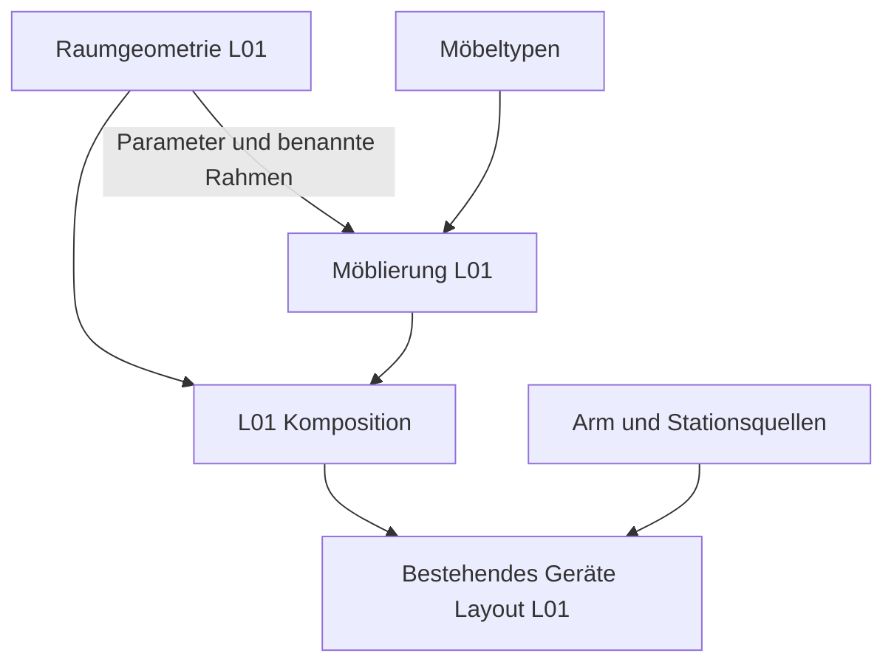

# Architektur der Arbeitsumgebungen und Ausstattung

Das Zielmodell trennt Arbeitsumgebung, Möbeltypen, Möblierung und
Geräteausstattung. Jede Konstruktion besitzt eine führende Quelle. Ein Standort
referenziert diese Quelle und beschreibt seine Instanzen mit Parametern,
Transformationen und benannten Bezugssystemen. CAD-Dateien bleiben Ableitungen.

## Vier Beschreibungsebenen

| Ebene | Verantwortung | Abgrenzung |
|---|---|---|
| Arbeitsumgebung | Geschosse, Labore, Flure, Raumkonturen, Wände, Stützen, Fenster, Öffnungen und feste Gebäudeanschlüsse | Keine Möbel- oder Geräteinstanzen |
| Möbeltypen | Wiederverwendbare parametrische Möbel und Zubehörtypen mit lokalen Montage- und Aufstellrahmen | Keine Standorte oder L01-Koordinaten |
| Möblierung | Konkrete Möbelinstanzen mit Typreferenz, Abmessungsbindungen und Aufstellung in einem Raum oder Flur | Keine kopierten Möbelrezepte |
| Geräteausstattung | Geräteinstanzen mit Referenz auf vorhandene Quellen, Zustand und Aufstellung auf Möbeln oder direkt im Raum | Keine zweite Arm-, Stations- oder Gerätebeschreibung |

Räume und Flure sollen später eine gemeinsame Umgebung bilden. Gemeinsam
verwendete Türen und Öffnungen werden dabei einmal beschrieben; die verbundenen
Bereiche referenzieren dieselbe Öffnungs-ID. Raumgeometrie und die Topologie der
Verbindungen sind getrennte Informationen. Die Mehrraum- und Flurtopologie ist
in diesem ersten Schritt noch nicht implementiert.

Ein optionales Anforderungsprofil kann später erwartete Möbel- und Gerätearten
benennen. Solche Anforderungen erzeugen noch keine tatsächlich aufgestellten
Gegenstände. Bewegliche Geräte behalten ihre Identität beim Raumwechsel;
Betriebspositionen werden später von der geplanten Aufstellung getrennt.

## Implementierter erster Schritt für L01

| Quelle | Inhalt |
|---|---|
| `model/lab-room-l01.shared.json` | Schlankes Kompositionsmanifest mit Revisionen der drei Quellen |
| `model/environments/l01.geometry.json` | Raumparameter, Fassade, Öffnungen, Verglasung und Betonstütze |
| `model/furniture/laboratory.catalog.json` | Sieben Möbel- und Zubehörtypen mit lokalen Maßverträgen |
| `model/furnishings/l01.furnishings.json` | L01-Möbelinstanzen, Parameterbindungen und konkrete Aufstellungen |
| `model/lab-layout-l01.shared.json` | Bestehende separate Geräteaufstellung; ihre Positionen bleiben erhalten |

Die Raumschale ist über `room_geometry_model` unabhängig von Möbeln auswertbar.
Sie enthält neun Körper. `furniture_model` instanziiert Möbel aus dem Katalog;
`lab_room_model` kombiniert die drei Quellen für die bisherigen CAD-Adapter.
Die vollständige Einrichtung behält 41 Körper, die bisherigen Körper- und
Operations-IDs, sechs starre Darstellungsgruppen und zwölf benannte Rahmen.

Die Typen umfassen Stauraumbank, offene angepasste Bank, Regalbrett, Stütze,
Schrank sowie seitliche und mittige passgenaue Abdeckungen. Unterschiedliche
Bänke und Schränke verwenden dieselben Rezepte. Die Abdeckungen sind Zubehör
der Einrichtung, dessen Zuschnitt an Raumkontur und Banklage gebunden ist;
sie beschreiben keine Heizungsanlage. Die bisherige Darstellungsgruppe
`BuildingServices` bleibt zur Identitätswahrung erhalten.

Möbelabmessungen und Raummesswerte besitzen getrennte Parametertabellen ohne
überlappende Namen. Ein Möbeltyp kennt nur lokale Abmessungen. Die Möblierung
bindet diese beispielsweise an `bench_height` oder eine freie Länge zwischen
Raumgrenzen. Verankerungen wie die Bankanpassung an die Stützenfront verwenden
den benannten Raumrahmen `L01.ConcreteSupport`.

Möbelposen bestehen derzeit aus drei Koordinaten in mm und einer festen Drehung
um die vertikale Achse in Grad. Gedrehte Quader werden als Polygonprismen
abgeleitet; Möbelrahmen drehen mit. Die eingepassten Abdeckungen verwenden
explizit die Raumkontur und bleiben im Raumbezugssystem. Allgemeine räumliche
Montagebeziehungen mit Neigung sind in diesem Schritt nicht implementiert.

## Ableitung und Revisionen

Der Einstieg bleibt `python scripts/build_lab_room.py`. FreeCAD und SolidCraft
verarbeiten dieselben ausgewerteten Primitive. Symbolische Maßabhängigkeiten
bleiben bis zu den Adaptern erhalten, damit native Parameteränderungen auch
Geometrie und Bezugssysteme gemeinsam verändern.

Das Kompositionsmanifest bindet jede Teilquelle mit SHA-256. Persistente
Änderungen an Raum, Katalog oder Möblierung erfordern eine bewusste Übernahme
in dieses Manifest; anschließend wird die Raumreferenz des Geräte-Layouts
aktualisiert. Der Build-Bericht führt die drei Quellen, deren Schemas und
Generatoren auf. Ein alter Bericht gilt nicht für die neue Kompositionsrevision.

Die Verträge sind in `room-composition.schema.json`, `room-geometry.schema.json`,
`furniture-catalog.schema.json` und `furnishings.schema.json` beschrieben.
Zusätzlich zu den Schemas prüfen die Generatoren Referenzen, Einheiten,
Wertebereiche, eindeutige IDs, Ausdruckszyklen und geometrische Bedingungen.

## Erhalt und Prüfgrenzen

`tests/fixtures/l01-before-layer-split.json` hält die ausgewerteten Primitive,
Konstruktionsfolgen, Rahmen und Gerätepositionen des vorherigen Stands für fünf
Parametervarianten fest. Die Regression prüft auch die bisherigen Übergabeziele.
Historische Testdaten sind keine zweite führende Raum- oder Möbelquelle.

Der native Vergleich prüft beide CAD-Kerne, gespeicherte Modelle und die
vorhandenen nativen Parameteränderungen. Das belegt geometrische Übereinstimmung,
keine Fertigungsfreigabe oder sichere Laboraufstellung. Die bisherigen
Durchgangsformeln beschreiben das nominale L01-Arrangement; frei versetzte Möbel
benötigen neue räumliche Freiraumprüfungen. Die heutigen Durchgänge und Geräte-
Betriebsbereiche sind weiterhin nicht sicherheitstechnisch qualifiziert.

## Synthetische minimale Testumgebungen

Neben einem realitätsbezogenen Labor ist ein ausdrücklich synthetisches
Umgebungsprofil vorgesehen: ein unbegrenzter Raum ohne beschriebene Wände,
Fenster, Türen oder lange Verkehrswege. Eine einzige Bank beziehungsweise
Referenzarbeitsfläche liefert Orientierung, Maßstab und Aufstellrahmen. Dieses
Profil gehört zur selben Vier-Ebenen-Architektur und benötigt keinen künstlich
riesigen Laborgrundriss.

Unbegrenztheit muss ein eigener, eindeutiger Modus sein. `null` bleibt einem
unbekannten Wert vorbehalten; sehr große Raumabmessungen und nicht endliche
Zahlen sind kein Ersatz für diesen Modus. Ein unbeschriebener Boden oder eine
fehlende Wand erzeugt keinen CAD-Körper. Ein Ausschnitt, Kameraraster oder
optional gezeichneter Boden dient nur der Darstellung und begrenzt die
Testumgebung nicht.

| Ebene | Kompakte Testumgebung |
|---|---|
| Arbeitsumgebung | Synthetischer unbegrenzter Raum mit eindeutigem Weltbezug; keine Gebäudevermessung oder Raumkontur |
| Möbeltypen | Referenz auf eine Bank oder Arbeitsfläche aus dem gemeinsamen Katalog |
| Möblierung | Eine Bankinstanz mit benanntem Arbeitsflächenrahmen |
| Geräteausstattung | Dicht angeordnete Instanzen der zu prüfenden Geräte; dieselben Gerätequellen wie im realen Layout |

Die Bank ist eine Referenz für die Anordnung, keine Voraussetzung für die
Kommunikation. Geräte sollen für kurze Übergaben in einem gemeinsamen
Arbeitsbereich angeordnet werden. Ein in der Realität bodengebundenes Gerät
kann daneben stehen oder durch einen ausdrücklich gekennzeichneten Mock
vertreten sein; seine Konstruktion wird dafür nicht in ein Tischgerät geändert.
Ungeprüfte mechanische Erreichbarkeit oder abstrahierte Transportübergaben
bleiben kenntlich.

### Kommunikation und Testlauf getrennt beschreiben

Ein Testprofil soll Geräte-IDs an Treiber oder Mocks binden und den Ablauf,
Zeitmodell, erwartete Rückmeldungen sowie Fehlerfälle festlegen. Es referenziert
die Umgebung und die bestehenden Protokollquellen; es besitzt keine eigene
Raum-, Möbel- oder Gerätekonstruktion. Dieselbe Geräteausstattung kann dadurch
mit lokalen Mocks, mit Netzwerkadaptern oder später mit Hardware geprüft werden.
Jede dieser Betriebsarten benötigt ihren eigenen ausgeführten Nachweis.

Für schnelle Tests sind insbesondere Befehlsreihenfolge, Besitzübergaben,
Bestätigungen, Zeitüberschreitungen, Fehlerantworten und Wiederanlauf relevant.
Lange Fahrwege entfallen in diesem Szenario. Simulierte Wartezeiten können in
einem expliziten Testzeitmodell vorgerückt werden; sie dürfen nicht durch
vorgegebene Erfolgsmeldungen ersetzt werden. Ein Ablauf soll auch bei fehlender
Bestätigung oder Kommunikationsausfall korrekt anhalten.

Ein geometrisch kurzer Weg allein prüft keine Kommunikation. Eine lokale
Mock-Schnittstelle ist kein Netzwerkserver; eine Animation ist kein Nachweis
von ROS-/SiLA-Interoperabilität, realer Latenz oder Hardwarefunktion. Die
bestehenden Programm- und Protokollgrenzen bleiben auch im synthetischen Raum
sichtbar. Die Testumgebung liefert keine Freigabe einer realen Laboraufstellung.

### README Interaktion als erster Referenzfall

Die im README gezeigte Entnahme aus CF01 mit Ablage im Rack ist der erste
vorgesehene Integrationsfall für dieses Profil. Raum und Referenzbank sollen
aus der minimalen Umgebung und Möblierung abgeleitet werden. Arm und CF01
referenzieren weiterhin `model/robot.json` beziehungsweise
`model/centrifuge-cf01.shared.json`; die Entnahme-, Greifer- und Rackbeziehungen
bleiben an ihre vorhandene Szenenquelle und das CF01-Protokoll gebunden.
Es entsteht keine zweite Beschreibung dieser Geräte oder des Ablaufs.

Bei dieser Überführung sind zunächst die heutige Bankoberfläche, Geräteposen,
Gelenkstellungen und Gefäßübergaben zu erhalten. Die Bankoberfläche liegt im
bisherigen Szenenbezug bei Z = 0; ein neuer Welt- oder Bankrahmen darf die
Darstellung nicht unbeabsichtigt verschieben. Anschließend kann dieselbe
Interaktion mit einer anderen Aufstellung, etwa in L01, verbunden werden.
Dort kommen die realen Wege und zusätzlichen räumlichen Randbedingungen hinzu.

Der aktuelle Stand ist noch die eigenständige Szene
`model/centrifuge-cf01.robot-pickup.shared.json` mit einem `bench_surface`-
Bauraum. Das unbegrenzte Umgebungsprofil, seine Komposition und eine gemeinsame
Testlaufkonfiguration sind hier als nächster Schritt beschrieben, noch nicht
als Generatorformat oder Laufzeit implementiert. Die gespeicherten README-
Medien behalten ihren dokumentierten historischen Quellstand, bis eine daraus
abgeleitete neue Fassung erzeugt und geprüft wurde.

## Nächste Schritte

Zuerst soll die README-Entnahmeszene aus dem synthetischen Profil mit einer
Referenzbank abgeleitet werden, bei erhaltenen Positionen und Abläufen.

Die Geräteausstattung soll später an benannte Möbel- oder Raumrahmen gebunden
werden: Geschoss → Raum → Möbel → Arbeitsfläche → Gerät. Dann folgt ein Gerät
beispielsweise einer verschobenen Bank. Das bestehende Geräte-Layout verwendet
weiterhin seine bisherigen Aufstellungsformeln; dieser erste Schritt verlagert
keine Geräte und führt noch keinen allgemeinen Montagegraphen ein.

Danach können weitere Raumgeometrien, Flure und gemeinsame Türverbindungen
folgen. Neue Räume und Aufstellungen sollen den Möbelkatalog wiederverwenden,
ohne Möbel oder Geräte erneut zu konstruieren.
