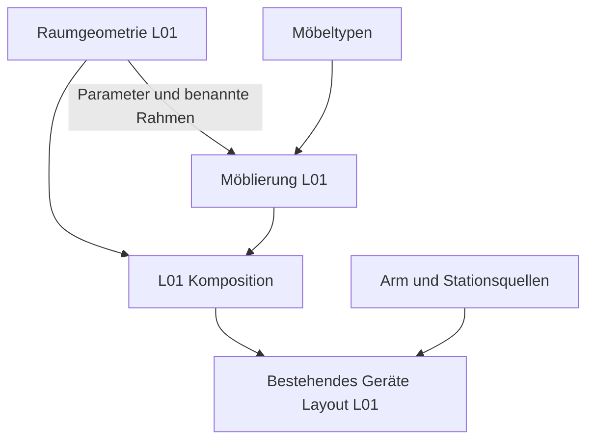

# Architektur der Arbeitsumgebungen und Ausstattung

Die [Modellgalerie](docs/models/README.md) führt mit Bildern durch diese Ebenen
und verknüpft jede Ansicht mit den gemeinsamen Quellen und der Fachdokumentation.

Das Zielmodell trennt Arbeitsumgebung, Möbeltypen, Möblierung und
Geräteausstattung. Jede Konstruktion besitzt eine führende Quelle. Ein Standort
referenziert diese Quelle und beschreibt seine Instanzen mit Parametern,
Transformationen und benannten Bezugssystemen. CAD-Dateien bleiben Ableitungen.

FreeCAD und SolidCraft erzeugen ihre Geometrie unabhängig aus diesen Quellen.
Der Vergleich beider Ergebnisse ist eine zusätzliche Prüfung. Insbesondere
erzeugt der eigenständige CF01-SolidCraft-Adapter native Konstruktionsfeatures
und gemeinsame Protokollstellungen ohne FreeCAD-Dateien als Eingabe. Erhaltene
Hersteller-Gehäuseteile können unter einer gemeinsamen semantischen Geräte-ID
mehrere starre CAD-Körper bilden; ihre Zuordnung wird im Build-Bericht geführt.

## Vier Beschreibungsebenen

| Ebene | Verantwortung | Abgrenzung |
|---|---|---|
| Arbeitsumgebung | Geschosse, Labore, Flure, Raumkonturen, Wände, Stützen, Fenster, Öffnungen und feste Gebäudeanschlüsse | Keine Möbel- oder Geräteinstanzen |
| Möbeltypen | Wiederverwendbare parametrische Möbel und Zubehörtypen mit lokalen Montage- und Aufstellrahmen | Keine Standorte oder L01-Koordinaten |
| Möblierung | Konkrete Möbelinstanzen mit Typreferenz, Abmessungsbindungen und Aufstellung in einem Raum oder Flur | Keine kopierten Möbelrezepte |
| Geräteausstattung | Geräteinstanzen mit Referenz auf vorhandene Quellen, Zustand und Aufstellung auf Möbeln oder direkt im Raum | Keine zweite Arm-, Stations- oder Gerätebeschreibung |

Räume und Flure sollen später eine gemeinsame Umgebung bilden. Gemeinsam
verwendete Türen und Öffnungen werden dabei einmal beschrieben; die verbundenen
Bereiche referenzieren dieselbe Öffnungs-ID. Raumgeometrie und die Topologie der
Verbindungen sind getrennte Informationen. Die Mehrraum- und Flurtopologie ist
in diesem ersten Schritt noch nicht implementiert.

Ein optionales Anforderungsprofil kann später erwartete Möbel- und Gerätearten
benennen. Solche Anforderungen erzeugen noch keine tatsächlich aufgestellten
Gegenstände. Bewegliche Geräte behalten ihre Identität beim Raumwechsel;
Betriebspositionen werden später von der geplanten Aufstellung getrennt.

## Implementierter erster Schritt für L01

| Quelle | Inhalt |
|---|---|
| `model/lab-room-l01.shared.json` | Schlankes Kompositionsmanifest mit Revisionen der drei Quellen |
| `model/environments/l01.geometry.json` | Raumparameter, Fassade, Öffnungen, Verglasung und Betonstütze |
| `model/furniture/laboratory.catalog.json` | Sieben Möbel- und Zubehörtypen mit lokalen Maßverträgen |
| `model/furnishings/l01.furnishings.json` | L01-Möbelinstanzen, Parameterbindungen und konkrete Aufstellungen |
| `model/lab-layout-l01.shared.json` | Bestehende separate Geräteaufstellung; ihre Positionen bleiben erhalten |

Die Raumschale ist über `room_geometry_model` unabhängig von Möbeln auswertbar.
Sie enthält neun Körper. `furniture_model` instanziiert Möbel aus dem Katalog;
`lab_room_model` kombiniert die drei Quellen für die bisherigen CAD-Adapter.
Die vollständige Einrichtung behält 41 Körper, die bisherigen Körper- und
Operations-IDs, sechs starre Darstellungsgruppen und zwölf benannte Rahmen.

Die Typen umfassen Stauraumbank, offene angepasste Bank, Regalbrett, Stütze,
Schrank sowie seitliche und mittige passgenaue Abdeckungen. Unterschiedliche
Bänke und Schränke verwenden dieselben Rezepte. Die Abdeckungen sind Zubehör
der Einrichtung, dessen Zuschnitt an Raumkontur und Banklage gebunden ist;
sie beschreiben keine Heizungsanlage. Die bisherige Darstellungsgruppe
`BuildingServices` bleibt zur Identitätswahrung erhalten.

Möbelabmessungen und Raummesswerte besitzen getrennte Parametertabellen ohne
überlappende Namen. Ein Möbeltyp kennt nur lokale Abmessungen. Die Möblierung
bindet diese beispielsweise an `bench_height` oder eine freie Länge zwischen
Raumgrenzen. Verankerungen wie die Bankanpassung an die Stützenfront verwenden
den benannten Raumrahmen `L01.ConcreteSupport`.

Möbelposen bestehen derzeit aus drei Koordinaten in mm und einer festen Drehung
um die vertikale Achse in Grad. Gedrehte Quader werden als Polygonprismen
abgeleitet; Möbelrahmen drehen mit. Die eingepassten Abdeckungen verwenden
explizit die Raumkontur und bleiben im Raumbezugssystem. Allgemeine räumliche
Montagebeziehungen mit Neigung sind in diesem Schritt nicht implementiert.

## Ableitung und Revisionen

Der Einstieg bleibt `python scripts/build_lab_room.py`. FreeCAD und SolidCraft
verarbeiten dieselben ausgewerteten Primitive. Symbolische Maßabhängigkeiten
bleiben bis zu den Adaptern erhalten, damit native Parameteränderungen auch
Geometrie und Bezugssysteme gemeinsam verändern.

Das Kompositionsmanifest bindet jede Teilquelle mit SHA-256. Persistente
Änderungen an Raum, Katalog oder Möblierung erfordern eine bewusste Übernahme
in dieses Manifest; anschließend wird die Raumreferenz des Geräte-Layouts
aktualisiert. Der Build-Bericht führt die drei Quellen, deren Schemas und
Generatoren auf. Ein alter Bericht gilt nicht für die neue Kompositionsrevision.

Die Verträge sind in `room-composition.schema.json`, `room-geometry.schema.json`,
`furniture-catalog.schema.json` und `furnishings.schema.json` beschrieben.
Zusätzlich zu den Schemas prüfen die Generatoren Referenzen, Einheiten,
Wertebereiche, eindeutige IDs, Ausdruckszyklen und geometrische Bedingungen.

## Erhalt und Prüfgrenzen

`tests/fixtures/l01-before-layer-split.json` hält die ausgewerteten Primitive,
Konstruktionsfolgen, Rahmen und Gerätepositionen des vorherigen Stands für fünf
Parametervarianten fest. Die Regression prüft auch die bisherigen Übergabeziele.
Historische Testdaten sind keine zweite führende Raum- oder Möbelquelle.

Der native Vergleich prüft beide CAD-Kerne, gespeicherte Modelle und die
vorhandenen nativen Parameteränderungen. Das belegt geometrische Übereinstimmung,
keine Fertigungsfreigabe oder sichere Laboraufstellung. Die bisherigen
Durchgangsformeln beschreiben das nominale L01-Arrangement; frei versetzte Möbel
benötigen neue räumliche Freiraumprüfungen. Die heutigen Durchgänge und Geräte-
Betriebsbereiche sind weiterhin nicht sicherheitstechnisch qualifiziert.

## Synthetische minimale Testumgebungen

Neben einem realitätsbezogenen Labor ist ein ausdrücklich synthetisches
Umgebungsprofil implementiert: ein unbegrenzter Raum ohne beschriebene Wände,
Fenster, Türen oder lange Verkehrswege. Eine einzige Bank beziehungsweise
Referenzarbeitsfläche liefert Orientierung, Maßstab und Aufstellrahmen. Dieses
Profil gehört zur selben Vier-Ebenen-Architektur und benötigt keinen künstlich
riesigen Laborgrundriss.

Unbegrenztheit muss ein eigener, eindeutiger Modus sein. `null` bleibt einem
unbekannten Wert vorbehalten; sehr große Raumabmessungen und nicht endliche
Zahlen sind kein Ersatz für diesen Modus. Ein unbeschriebener Boden oder eine
fehlende Wand erzeugt keinen CAD-Körper. Ein Ausschnitt, Kameraraster oder
optional gezeichneter Boden dient nur der Darstellung und begrenzt die
Testumgebung nicht.

| Ebene | Kompakte Testumgebung |
|---|---|
| Arbeitsumgebung | Synthetischer unbegrenzter Raum mit eindeutigem Weltbezug; keine Gebäudevermessung oder Raumkontur |
| Möbeltypen | Referenz auf eine Bank oder Arbeitsfläche über den gemeinsamen Möbelvertrag |
| Möblierung | Eine Bankinstanz mit benanntem Arbeitsflächenrahmen |
| Geräteausstattung | Dicht angeordnete Instanzen der zu prüfenden Geräte; dieselben Gerätequellen wie im realen Layout |

Die Bank ist eine Referenz für die Anordnung, keine Voraussetzung für die
Kommunikation. Geräte sollen für kurze Übergaben in einem gemeinsamen
Arbeitsbereich angeordnet werden. Ein in der Realität bodengebundenes Gerät
kann daneben stehen oder durch einen ausdrücklich gekennzeichneten Mock
vertreten sein; seine Konstruktion wird dafür nicht in ein Tischgerät geändert.
Ungeprüfte mechanische Erreichbarkeit oder abstrahierte Transportübergaben
bleiben kenntlich.

### Kommunikation und Testlauf getrennt beschreiben

`model/cf01-rack-batch.protocol.json` bindet die Umgebung und den vorhandenen
CF01-Befehlsvertrag an einen lokalen Mock-Testlauf. Die zwölf Proben haben stabile
IDs und eine explizite Zuordnung von Rack- zu Rotorplätzen. Die Rückgabe erfolgt
an den ursprünglichen Rackplatz, unabhängig von der gewählten Rotorplatzfolge.
Der Transporter ist ausschließlich die externe Vorbedingung „Rack bereitgestellt“.

`scripts/run_cf01_rack_batch.py` führt den vollständigen Ablauf mit den
vorhandenen CF01-Simulator- und Protokollklassen aus: beladen, starten, Lauf und
Abbremsen abwarten, entnehmen und zurückstellen. `--transport ros2` und
`--transport sila2` wählen die bereits vorhandenen lokalen Vertragsdecoder.
Es werden keine Netzwerkserver oder Hardware angesprochen. Roboterrückmeldungen
für Greifen, Freigeben und Absetzen sind ausdrücklich synthetische Eingaben;
der Chargenlauf führt weder Beladungs- noch Rückgabebahnen aus.
Der bestehende Bewegungsbaustein Rotorplatz 01 → Rackplatz 01 besitzt eine
eigene Zeitachse und wird vom Chargenrunner nicht aufgerufen.

Bei falscher Probenidentität, fehlender Bestätigung, Eigentümer-Timeout oder
unwuchtiger Testbeladung endet der Lauf ohne Erfolg. Bei einer unvollständigen
Übergabe bleiben die letzte vollständig bestätigte Buchführung und die
synthetische Ortsbeobachtung getrennt erhalten. `pending_handoff` nennt Probe,
Quelle, Ziel und eingegangene Quittungen. Während der Bearbeitung heißt die
Zuordnung `pending`; erst nach einem Fehler `unresolved`. Dies verhindert
eine behauptete eindeutige Zuordnung. Ein Greifereintrag in dieser Buchführung
ist bei ungeklärter Übergabe keine gesicherte Aussage über den physischen Ort. Der Erfolg
verlangt den abgeschlossenen Schleuderlauf, bestätigten Stillstand, einen leeren
Rotor und exakt dieselbe Rackreihenfolge wie am Anfang. Testmassen und
Qualifikationsgrenzen stehen nur im explizit fiktiven Testprofil; die reale
CF01-Quelle erhält dadurch keine Freigabe.

Für schnelle Tests sind insbesondere Befehlsreihenfolge, Besitzübergaben,
Bestätigungen, Zeitüberschreitungen, Fehlerantworten und Wiederanlauf relevant.
Lange Fahrwege entfallen in diesem Szenario. Simulierte Wartezeiten können in
einem expliziten Testzeitmodell vorgerückt werden; sie dürfen nicht durch
vorgegebene Erfolgsmeldungen ersetzt werden. Ein Ablauf soll auch bei fehlender
Bestätigung oder Kommunikationsausfall korrekt anhalten.

Ein geometrisch kurzer Weg allein prüft keine Kommunikation. Eine lokale
Mock-Schnittstelle ist kein Netzwerkserver; eine Animation ist kein Nachweis
von ROS-/SiLA-Interoperabilität, realer Latenz oder Hardwarefunktion. Die
bestehenden Programm- und Protokollgrenzen bleiben auch im synthetischen Raum
sichtbar. Die Testumgebung liefert keine Freigabe einer realen Laboraufstellung.

### README Interaktion als erster Referenzfall

Die im README gezeigte Entnahme aus CF01 mit Ablage im Rack ist der erste
implementierte Integrationsfall für dieses Profil. Raum und Referenzbank werden
aus der minimalen Umgebung und Möblierung abgeleitet. Arm und CF01
referenzieren weiterhin `model/robot.json` beziehungsweise
`model/centrifuge-cf01.shared.json`; die Entnahme-, Greifer- und Rackbeziehungen
bleiben an ihre vorhandene Szenenquelle und das CF01-Protokoll gebunden.
Es entsteht keine zweite Beschreibung dieser Geräte oder des Ablaufs.

Die Überführung erhält Bankoberfläche, Geräteposen,
Gelenkstellungen und Gefäßübergaben. Die Bankoberfläche liegt im
bisherigen Szenenbezug bei Z = 0; ein neuer Welt- oder Bankrahmen darf die
Darstellung nicht unbeabsichtigt verschieben. Anschließend kann dieselbe
Interaktion mit einer anderen Aufstellung, etwa in L01, verbunden werden.
Dort kommen die realen Wege und zusätzlichen räumlichen Randbedingungen hinzu.

Die Quelle `model/synthetic-cf01-workspace.shared.json` bindet die vier Ebenen:

| Quelle | Inhalt |
|---|---|
| `model/environments/synthetic-unbounded.json` | Unbegrenztheit ohne Raumschale oder Ersatzabmessungen |
| `model/furniture/reference-bench.catalog.json` | Referenzarbeitsfläche über das vorhandene Möbelrezept |
| `model/furnishings/cf01-reference-bench.json` | Eine Bankinstanz und ihr Arbeitsflächenrahmen |
| `model/equipment/cf01-workspace.json` | Referenzierte Geräte und lokale Posen am Bankrahmen |

Die Rackkonstruktion steht einmal in `model/guided-tube-rack.shared.json`.
Die Entnahmeszene referenziert die Umgebung; Bankgeometrie, Gerätepositionen und
Armvariante sind daraus abgeleitete Ansichten. Die bisherige Bankoberfläche,
Geräteposen und alle 241 Bewegungsschritte bleiben erhalten. Der ursprüngliche
60-s-Entnahmebaustein besitzt eine eigene Zeitachse; er wird vom Chargenrunner
nicht aufgerufen und ist nicht an dessen Schleuderlauf gekoppelt.

Die interaktive README-Demo zeigt diesen Bewegungsausschnitt und zusätzlich die
Aufzeichnung des vollständigen lokalen Chargenprotokolls mit Rack-, Rotor- und
Greiferinventar. Die Aufzeichnung ist kein im Browser laufender Geräteadapter.
Das kurze Video zeigt weiterhin den Entnahmebaustein; die physische Beladung
aller zwölf Rotorplätze wird damit nicht als geprüft dargestellt.

### Koordinatenverträge und spätere Migration

Im bestehenden `lab-layout/1` bezeichnet `host` eine unterstützende Fläche für
Aufstellungsprüfungen. `xyz` und `yaw_deg` beziehen sich auf das Labor-Weltsystem;
`host` transformiert diese Werte nicht. Im `equipment-layout/1` mit
`equipment_instance` benennt `host` dagegen den Elternrahmen; Position und
Drehung sind lokal zu diesem Rahmen. Die Schemas beschreiben beide Bedeutungen
an den jeweiligen Verträgen. Die L01- und CF01-Posen werden dadurch nicht geändert.

Eine spätere allgemeine Gerätebindung muss Unterstützungsfläche und
Koordinatenbezug in einem versionierten Vertrag ausdrücklich unterscheiden.
`host` darf dafür nicht global umgedeutet werden; bestehende Weltposen müssten
gezielt in lokale Posen überführt und geometrisch erneut geprüft werden.
Diese Migration und die gemeinsame CF01-/NanoDrop-Komposition sind separate
Aufgaben.

## Manuelle Aufgaben als eigene Ausführungsebene

Der [erste NanoDrop-Ablauf](docs/nanodrop-manual-workflow.md) ergänzt die räumlichen
Ebenen um einen lokalen, vollständig synthetischen Arbeitsablauf. Gerätetypen und
Fähigkeiten stehen in `model/nanodrop.catalog.json`; One und UltraC referenzieren
dasselbe Protokoll `model/nanodrop-manual.protocol.json` für Mikrovolumen-
Absorption. `model/nanodrop-manual.synthetic.json` bindet eine logische Geräte-
instanz, Rackinstanz und Proben an die vorhandenen Quellen für unbegrenzten Raum,
Referenzbank und Rack. Neue CAD-Geometrie oder Gerätepositionen entstehen nicht.
Der formale Profilvertrag steht in `model/nanodrop-manual.schema.json`.

Verantwortliche Person, physischer Gefäßort und reservierte Ressource sind
getrennte Informationen. Platzkennungen aus der gemeinsamen Rackquelle werden
zusammen mit der Rackinstanz verwendet. Entnahmen verbinden Originalprobe,
Quellgefäß, Aliquot, berichtetes Volumen und die Messungskennung. Eine gespeicherte
Messabsicht muss vor Wiederholung oder Wiederaufnahme ausdrücklich aufgelöst
werden. Unbekannte Restvolumina bleiben unbekannt; frühere Massenbestätigungen
sind nach Entnahmen überholt.

`scripts/manual_tasks.py` speichert Ereignisse, Zustandsansichten, exklusive
Ressourcen und unveränderte Importdateien transaktional in SQLite unter dem
ignorierten `exports/manual-workflows/`. Laufzeitdaten gehören nicht nach
`model/`. `scripts/manual_workflow.py` bündelt Profilbindung, Sitzung, Gewahrsam,
Gefäßreservierungen, Verbrauch, Wiederaufnahme und Importhülle. NanoDrop und Qubit
verwenden gerätespezifische Adapter auf diesem Kern; die gemeinsame CLI liegt in
`scripts/manual_workflow_cli.py`. Dateiimporte werden über eindeutige
laufbezogene Messungsnamen zugeordnet; fremde, fehlende oder doppelte Messungen
blockieren den Abschluss. Originalmeldungen und ausdrückliche Bewertungen bleiben
getrennt. Nach Neustart, widersprüchlicher Beobachtung oder Aufgabenfrist bleiben
Reservierungen bis zum bestätigten Abgleich bestehen. Rückgabe, Ergebnisfreigabe
und abschließende Arbeitsplatzfreigabe sind eigene Bedingungen.

Der Einstieg `python3 scripts/run_nanodrop_manual.py demo` erzeugt ausschließlich
synthetische Eingaben und eine synthetische CSV-Datei. Tests prüfen auch einen
harten Prozessabbruch mit anschließendem Neustart. Ein echter Geräteexport,
eine reale SOP, Scanner, Schutzfunktion, Hardware- oder Netzwerkkommunikation
sind nicht validiert. Netzwerkadapter und eine Fortsetzung in CF01 folgen
später; der bestehende CF01-Chargenrunner wird hierfür nicht erweitert.

### Synthetischer Qubit-4-Ablauf

Der [Qubit-4-Durchstich](docs/qubit-4-manual-workflow.md) verwendet einen eigenen
Gerätetypenkatalog und die führenden Quellen `model/qubit-4-manual.protocol.json`
sowie `model/qubit-4-manual.synthetic.json`. Der Profilvertrag steht in
`model/qubit-4-manual.schema.json`. Bestehende NanoDrop-Quellenpins, Rack- und
Raumdefinitionen bleiben erhalten. Ansatz- und Standardgefäße besitzen deklarierte
logische Plätze ohne erfundene Geometrie.

Eine Ansatzabsicht identifiziert das ausgewählte leere Gefäß vor dem Transfer.
Die Bestätigung erzeugt einen Transferdatensatz; nur dort wird die Originalprobe
einmalig belastet. Die spätere Messung verbraucht nicht noch einmal dieselbe
Probe. Alle Gefäße sind Teil des Wiederaufnahmeinventars. Nicht durchgeführte
Ansatzversuche benötigen bestätigte Entsorgung und neue IDs für einen erneuten
Versuch. Originalgefäße müssen an ihre ursprünglichen Plätze zurückkehren.

Die synthetische Prozesszeit ist im Lauf gebunden und schreitet ausschließlich
durch Ereignisse voran. Derselbe Zeitbezug prüft Inkubation, Kalibrierungsablauf
und Aufgabenfrist. Eine Kalibrierung pro Lauf wird nach bestätigten Standards
ausdrücklich freigegeben und an Gerät, Assayrevision, Chargen und Messungs-IDs
gebunden. Jede Probenmessabsicht friert diesen Bezug als `workflow_record` ein.
Eine außerhalb des Ablaufs erfolgte Gerätekalibrierung wäre nicht erkennbar.

Der finale Dateiimport verlangt sowohl Proben- als auch Standardmessungen.
Berichtete Ansatz- und Originalkonzentrationen bleiben getrennt. Eine berichtete
Originalkonzentration verlangt Proben- und Gesamtvolumen derselben Zeile passend
zum bestätigten Ansatz; sonst bleibt der Import in Quarantäne. Fehlt die
Originalkonzentration, wird sie mit dokumentierter Formel und Einheitenumrechnung
aus dem bestätigten Ansatz abgeleitet. Fehlende Gefäße, ungeklärte Absichten,
ungültige Messungen oder nicht bestätigte Entsorgung verhindern die Freigabe.
Ein neues Laufprofil deklariert eigene Anfangsmengen; ein laufübergreifendes
Volumenbuch und echte Kalibrierkurven sind nicht implementiert.

### Integrierter synthetischer Gesamtlauf

Der [gemeinsame Ablauf](docs/synthetic-lab-workflow.md) verbindet zwölf Originale
in der festen Folge CF01 → NanoDrop → Qubit 4. Führend ist das Manifest
`model/synthetic-lab-workflow.manifest.json`; die Komposition und ihr Schema
binden Aufstellung, Geräteprotokolle, Parameter, Uhrmodus und Platzrollen.
Die alten drei beziehungsweise zwölf Proben umfassenden Einzeldemos sind
unabhängige Fixtures, keine zusätzlich zu synchronisierenden Bestände.

Ein Rootzustand enthält Inventar, Buchungen, Massenbestätigungen, Reservierungen
und die ereignisgesteuerte Prozesszeit. Unter `stages[stage_id]` stehen getrennte
Gerätezustände mit Messungen, Importen, Bewertungen, Akteuren und Fristen.
`scripts/lab_workflow_stages.py` bindet die gemeinsamen Geräteoperationen über
ausdrückliche Ansichten an Root und Stufe. Alte Laufartprüfungen werden nicht
durch Umschreiben von Formaten umgangen. Die Restmenge ist eine Projektion aus
Anfangsmenge und eindeutig zugeordneten bestätigten Entnahmen. Unsichere
Durchführungen bleiben gesperrt; die geplante Entnahme ist keine Obergrenze.

Der Gesamtlauf verwendet die bestehende Rackinstanz `Rack` und lokale Plätze
wie `Slot01`. Historische geometrische IDs bleiben abgeleitete Referenzen.
Die gemeinsame Bankfläche wird über `SYN.Bench.Worktop` gebunden; der logische
Arbeitsbereich bleibt `SYN.NanoDrop.WorkArea`. Daraus entsteht kein zusätzlicher
Racktransport. NanoDrop und Qubit besitzen weiterhin logische Gerätebindungen
ohne neue CAD-Positionen. Der Root hält Rack, Gefäße und Arbeitsfläche über die
Gerätewechsel; Station, Arm und Messgeräte sind zusätzliche Stufenressourcen.
Ort, Akteursverantwortung und Ressourcenbesitz sind getrennte Informationen.

Neue synthetische Massenbestätigungen sind an Gefäß und Inhaltsrevision gebunden.
Entnahmeabsichten und Verbrauch entwerten sie; CF01 bekommt nur aktuelle Werte.
Qubit verarbeitet zwölf Proben seriell, sodass Halterplätze nach bestätigter
Entsorgung wiederverwendbar sind. Die Messkammer ist kein Vorbereitungsplatz.
NanoDrop-Blank und Qubit-Kalibrierung bleiben gerätespezifische Voraussetzungen;
der Kalibrierungsbezug ist weiterhin `workflow_record`.

Der CF01-Runner verwendet dieselbe Ausführung mit optionalen synchronen
Checkpoint- und Uhr-Callbacks. Absicht, rohe Antwort, Roboterbeobachtung und
vollständige Übergabe werden getrennt gespeichert. Wiederholte Heartbeatdetails
werden gezählt; der vollständige CF01-Bericht liegt einmal als Originalartefakt
vor. Rootzustände enthalten die letzte kompakte Ansicht, keine wiederholte
vollständige CF01-Trace. Bei Speicherfehlern wird nicht normal weitergearbeitet.
Der Journal-Präfixpfad vergleicht aktuellen Datenbank-Tail und Revision unter
derselben Schreibtransaktion; Öffnen, Bericht und Endabschluss prüfen die
gesamte Kette. Auch die Artefakte früherer Stufen werden beim Abschluss geprüft.

Nach Neustart innerhalb CF01 bleibt der Versuch gehalten; ein neuer Simulator
ist keine Wiederaufnahme. Die erste Fassung setzt aktive Mock-Jobs nicht fort.
Ein vollständiger Abbruchabgleich bestätigt alle Gefäße, Rotorplätze, Greifer,
Stillstand, Parkbremse, geparkten Heber und freien Arbeitsbereich ausdrücklich
als `synthetic_operator_confirmation`. Der alte Versuch wird mit seinen offenen
Quittungen stillgelegt, nicht nachträglich erfolgreich gemacht. An bestätigten
Stufengrenzen ist die manuelle Fortsetzung nach Abgleich möglich.

Die Runtime liegt im bisherigen gemeinsamen SQLite-Store unter `exports/`.
Unabhängige Gesamtläufe übernehmen Bestände nicht automatisch. Reagenzvorräte,
Netzwerkimport in diesen Gesamtlauf, Hardware, echte Exporte, neue Geometrie,
Roboterbahnen und
qualifizierte Schutzfunktionen sind damit nicht implementiert oder nachgewiesen.

Der [Plan zur laufübergreifenden Bestandsführung](docs/stock-continuation.md)
beschreibt den nächsten Ausbau: einmalige Einführung oder geprüfte Übernahme
eines abgeschlossenen Laufs, fortgeschriebene Restmengen und Inhaltsrevisionen
sowie ein atomarer Root-/Stock-Schreibpfad mit exklusiver persistenter Lease,
Kopfvergleich und Fencing. Diese Verträge und Befehle sind noch nicht implementiert.

## Lesende NanoDrop-UltraC-Netzwerkschnittstelle

Der [UltraC-Netzwerkadapter](docs/nanodrop-ultra-network.md) trennt den einmalig
beschriebenen Hersteller-Lesevertrag in
`model/nanodrop-ultra-network.protocol.json`, ein kataloggebundenes synthetisches
Gerätemodell und dessen HTTP-Adapter. Derselbe Client verwendet die fünf
ausgewählten GET-Routen am Modellserver oder an einer expliziten Geräte-URL.
Der lokale Netzwerkverkehr ist geprüft; ein Originalgerät ist noch nicht qualifiziert.
FreeCAD und SolidCraft sind keine Laufzeitabhängigkeiten dieses Geräteverhaltens.

Requestpfade und Parametertypen folgen M024 01/25. Nicht dokumentierte
Antwortformen, Filter- und Paging-Regeln bleiben ausdrücklich synthetische
Modellentscheidungen. Originalantworten werden unverändert mit Prüfsumme
archiviert. Ein Abruf erzeugt weder Verbrauch noch Ergebnisfreigabe und ist noch
nicht in den manuellen oder gemeinsamen Laborablauf eingebunden. Ein fachlicher
Decoder benötigt zunächst echte versionierte Geräteantworten und einen expliziten
Identitätsvertrag; die Ultra-API wird nicht auf NanoDrop One übertragen.

## Nächste Schritte

Die Geräteausstattung soll später an benannte Möbel- oder Raumrahmen gebunden
werden: Geschoss → Raum → Möbel → Arbeitsfläche → Gerät. Dann folgt ein Gerät
beispielsweise einer verschobenen Bank. Das bestehende Geräte-Layout verwendet
weiterhin seine bisherigen Aufstellungsformeln; dieser erste Schritt verlagert
keine Geräte und führt noch keinen allgemeinen Montagegraphen ein.

Danach können weitere Raumgeometrien, Flure und gemeinsame Türverbindungen
folgen. Neue Räume und Aufstellungen sollen den Möbelkatalog wiederverwenden,
ohne Möbel oder Geräte erneut zu konstruieren.

Der Referenzbanktyp liegt in einem eigenen Möbelkatalog, damit die unveränderte
L01-Komposition ihre bisherige Katalogrevision behält. Die gemeinsame
Möbelauswertung wird wiederverwendet.

Das weitergehende Zielmodell für manuelle Arbeitsschritte und Messgeräte steht
in [Manuelle Aufgaben und Messgeräte](docs/manual-tasks.md). Der synthetische
NanoDrop- und Qubit-Durchstich sowie der getrennte UltraC-Leseadapter sind oben
beschrieben; ihre Workflow-Netzwerkintegration und weitere Adapter bleiben
geplant. Messgerätetypen deklarieren Fähigkeiten im Katalog, Protokolle verlangen
Fähigkeiten statt Gerätetypen. Verantwortlichkeit und physischer Ort bleiben
getrennt; Aufgaben und Bestätigungen sind Laufzeitzustand außerhalb von `model/`.
Die bestehende CF01-Szene bleibt auf Arm, CF01 und Rack beschränkt;
Messgeräte verwenden eine eigene logische Bindung.
