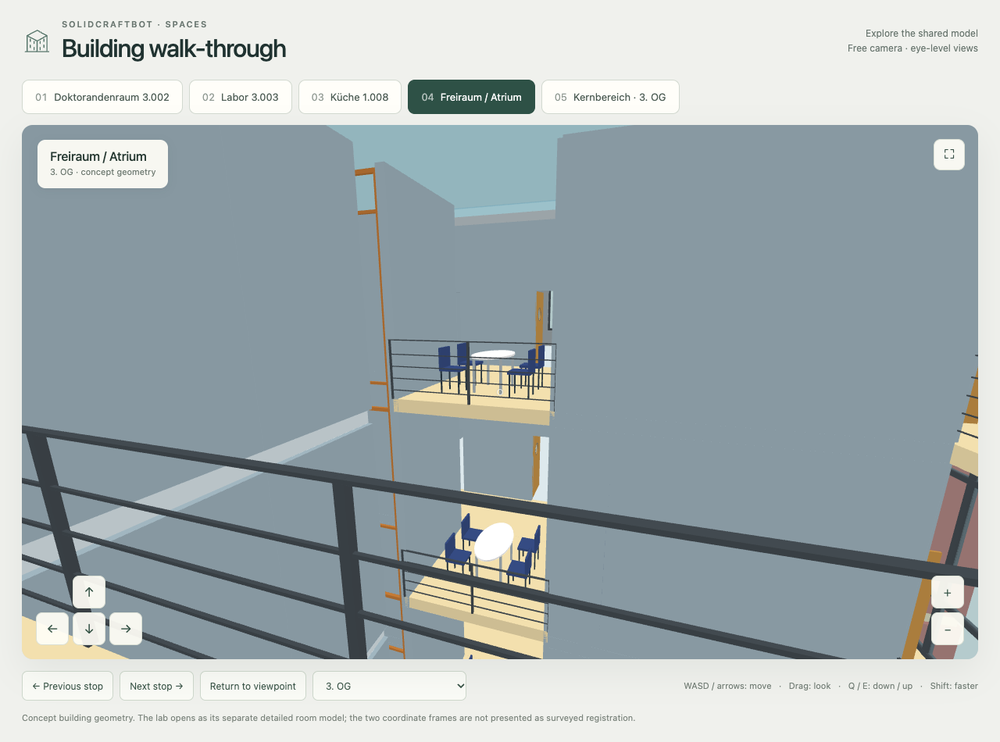

# SolidCraftBot

This is the English translation of the [German README](README.md), which is authoritative. Linked detailed documentation may be in German or English.

**Robotics that frees up time for research.**

For robotics to gain acceptance in a research laboratory, its purpose must be clear: this project is not about high throughput. Robots should take on work that people do not have to do themselves. This gives researchers time to think, write up results, improve methods and discuss their work with colleagues.

This project provides models for different robots. They look different because they have different capabilities. Together, they represent biological workflows in the model. Their way of working should be as human as possible: largely using the same tools, the same vessels and the same working environment that we use ourselves.

The robots should be **“self-aware”**: they should know their own state and capabilities, check the results of their actions and detect errors. If a sample is missing, a grasp fails or a handover remains unclear, they should notice and be able to request assistance. This feedback is as much a development goal as the movement itself.

We want to be able to **build, modify and repair our robots ourselves**. Otherwise, equipping our laboratory with many robots for different tasks would be difficult for us to afford. Building them ourselves allows us to adapt the technology to our research while making fewer, or at least different, compromises. Existing tools, 3D printers and the university workshop are important prerequisites.

Our goal is to model and test complete biological workflows on a computer first. We therefore describe not only the robots, but also the equipment, materials, procedures and shared working environment.

The model should stay as close as possible to the robot we build. We describe designs, procedures and verification limits in shared sources from which models, views and simulations are derived independently. This makes it clear what has been checked, what remains open and what must be demonstrated on the physical setup.

## Our laboratory robot

The six-axis laboratory arm is our first robot design. Different tools are intended to enable it to handle vessels, pipette and operate laboratory equipment. The arm design ends at a general-purpose tool flange; the pipetting function has yet to be developed.

The system also includes the [TR01 sample transporter](docs/sample-transport-tr01.md), which is intended to carry racks between workstations, and specialized stations such as the [CF01 centrifuge](docs/centrifuge-cf01.md). The [model gallery](docs/models/README.md#baugruppen) shows these different designs and their tasks.

**Status: CAD concept, no release for manufacture.** The budget target for the first limited arm prototype is EUR 3,000–5,000. Payload capacity, precision, dispensing performance and safety must be demonstrated on the physical setup.

### Robots in motion

https://github.com/user-attachments/assets/433efc9b-b910-42ef-aa4d-9ce2ba1704d3

The simulation shows the arm, centrifuge and rack working together: three samples are removed one after another and returned to their original rack positions. From the confirmed grasp to placement, each vessel follows one continuous path. The lid remains open throughout the three removals; the open-lid rotor indexing used here is a separate simulation.

Both arm cameras show their simulated images in sync with the sequence: the gripper camera looks at the fingers and vessel. The rear overview camera covers the working area and its access points with a horizontal field of view of about 120°—as a basis for future hazard detection. Occlusions remain visible; real optics and hazard detection have yet to be developed. The video shows around 100 seconds of model time at 1× playback speed.

Robots should work briskly and actually free up people's time. Carried samples require smooth movements with limited acceleration and jerk. The path shown has been checked in the model; real sensors, error responses and hardware operation have yet to be developed.

[Watch the video](docs/media/robot-demo-cameras-aligned.mp4) · [Download the interactive demo and open it locally](docs/media/robot-demo-cameras-aligned.html) · [Motion profile and limits of verification](docs/centrifuge-cf01.md#cf01-smooth-unloading) · [Model version and media provenance](docs/media/README.md)

Another example is [direct removal from H02 and placement in the rack](docs/h02-rack-transfer.md). Here, an arm of the same design grasps a vessel from its open holder and places it between already occupied rack positions. The complete path, including gripper opening and withdrawal, has been checked for both vessel variants in FreeCAD and SolidCraft.

## The shared working environment

A workflow needs more than equipment within reach: vessels must be ready, tools accessible and samples able to move between workstations. Our working environment model helps us examine these relationships on a computer and divide tasks between people and robots.

The [L01 laboratory room with furniture and equipment](docs/lab-layout-l01.md) describes a workplace in detail. The [building model](docs/building-stack.md) adds laboratories, corridors, offices and common areas. Places for thinking and writing, as well as the kitchen, are also part of this everyday research environment. The [model gallery](docs/models/README.md) guides you through rooms, furniture, equipment and their layouts. Some building dimensions are assumptions made for visualization; real transport routes must be checked separately.

The separate [BF01 building fleet](docs/building-fleet-demo.md) is in preparation: native measurements of the added lift sills show 8 mm gaps at all five active entrances. The new floor rule permits closed gaps up to 15 mm and only the source-derived sill height offset; these are synthetic owner assumptions without wheel qualification. Preparing the new routes alone takes 33.5 minutes, substantially exceeding the runtime target. Work has stopped at this task-defined condition; the complete 20-vehicle run, its full native audit and the fleet animation have not been approved.

### Interactive building walkthrough

[](https://smoe.github.io/DIYLabBot/)

[**Start the building walkthrough in your browser →**](https://smoe.github.io/DIYLabBot/)

You can explore the PhD students' office, laboratory, kitchen and atrium without installing CAD software. The first visit downloads about 37 MB; WebGL 2 is required. [Controls, model sources and limits of verification](docs/building-walkthrough.md).

## Running biological workflows together

The [workflow area](docs/workflows/README.md) brings together entry points and the [biological roadmap](docs/workflows/ROADMAP.md).

The steps connect robots, equipment and people. A sample retains its identity through withdrawals, measurements and transports; its handovers and consumed quantities are documented. Human work steps and courier trips are explicitly included. This allows a procedure to be automated gradually.

Examples of already executable **synthetic software workflows** include:

- [PS01 pipetting station](docs/pipetting-station-ps01.md) with separate arms for pipetting and labware handling, and freely combinable transfer, distribution and mixing steps. The first planning example combines two liquids along the two axes of a 96-well plate; quantities, tip consumption and well capacities are checked.
- [Centrifugation, NanoDrop and Qubit 4](docs/synthetic-lab-workflow.md) with a shared sample inventory and traceable withdrawals.
- [DNA extraction with NanoDrop, Qubit and TapeStation](docs/extraction-analytics.md), from the starting sample to the assessment of the resulting DNA product.
- [Asynchronous laboratory transport](docs/async-lab-transport.md) with confirmed handovers and explicit reconciliation of unclear outcomes.

These workflows use test data and simulated feedback. They allow process logic and failure cases to be investigated; real equipment operation and biological results require their own evidence. Automatically matching the intent of a biological experiment to suitable robots and equipment remains a [development goal](ARCHITECTURE.md#sila-fähigkeiten-und-gentle-ressourcenbindung).

## Contributing

Designs and workflows are defined in shared, machine-readable sources. FreeCAD and SolidCraft independently generate their models from these sources; ROS 2/RViz uses robot descriptions and prepared arm programs derived from them. This is intended to keep changes traceable across the design, motion checks and workflow model.

**Programming with ROS 2.** Robot descriptions (URDF), meshes and prepared motion programs are generated from the shared sources under `ros2_ws/`. The target is ROS 2 Jazzy with `ros2_control`, for example on Ubuntu 24.04; hardware integration currently uses mock hardware. The [GitHub CI](.github/workflows/ros2.yml) has built the Python package and run 13 package tests without skips, including active mock controllers, joint feedback and an acknowledged stationary `FollowJointTrajectory` hold goal. Moving programs and physical drives remain unverified. `python3 scripts/build_ros2_freecad.py` generates the ROS assets independently using FreeCAD; the full model build remains `python3 scripts/build_models.py --ros2`. The [data dry-run without ROS](docs/centrifuge-cf01.md#cf01-smooth-unloading) uses `PYTHONPATH=… python3 -m solidcraftbot_ros.demo --config … --scenario … --dry-run` (substitute paths and a scenario from the relevant build). An executable ROS tutorial will follow in the RoboStack/pixi phase; [ROS 2/RViz](docs/ros2.md) describes the entry point and CI verification limits.

**Equipment communication through SiLA 2.** For connecting laboratory equipment and workflow orchestrators, we use the open laboratory standard SiLA 2 as our guide. A separate [SiLA 2 interface over TLS/gRPC](docs/sila2-network.md) for the CF01 simulator is already implemented and locally verified. Connections to physical equipment and automatic capability and resource binding through GENtle remain development goals.

To get started:

- [Requirements](docs/requirements.md), [arm design](docs/design.md) and [mechanical development plan](ROADMAP.md#mechanischer-entwicklungsplan).
- [Architecture](ARCHITECTURE.md) and [shared model](docs/shared-model.md).
- [FreeCAD](docs/freecad.md), [ROS 2/RViz](docs/ros2.md) and [equipment communication using CF01/SiLA 2 as an example](docs/sila2-network.md).
- [Tutorial: SiLA 2 interface of the CF01 simulator](docs/tutorial-cf01-sila2.md#english-translation).

The local model build generates unversioned CAD, mesh and ROS files: the bounded reference build with `--ros2` occupies around 116 MB (decimal units; measured existing outputs, not peak storage demand; scope and source revision are recorded in the local [build report](exports/generated/storage-reference-2026-11-18/build-report.json)). The revision directories recorded there under `cad/generated/` and `exports/generated/`, as well as the generated mesh, URDF and configuration files under `ros2_ws/src/solidcraftbot_ros/`, are gitignored and can be rebuilt. Only these outputs may be deleted; do not delete `exports/` wholesale, because it also contains runtime data and original evidence. Additional build revisions require additional space.

```sh
python3 -m unittest discover -s tests -v
python3 scripts/tool_paths.py
python3 scripts/build_models.py --ros2
```

Source and kinematics tests run without CAD; checks of CAD/ROS outputs that have not yet been generated are skipped. FreeCAD and the SolidCraft CLI must be installed locally to build the models. [tool_paths.py](scripts/tool_paths.py) describes runtime options and environment variables.

Model sources, generators, runtime code, tests and documentation are versioned. Native CAD files and complete verification reports are generated locally; their current file paths are listed in the respective build reports. Selected images and demos remain in the repository as traceable snapshots of the model.
