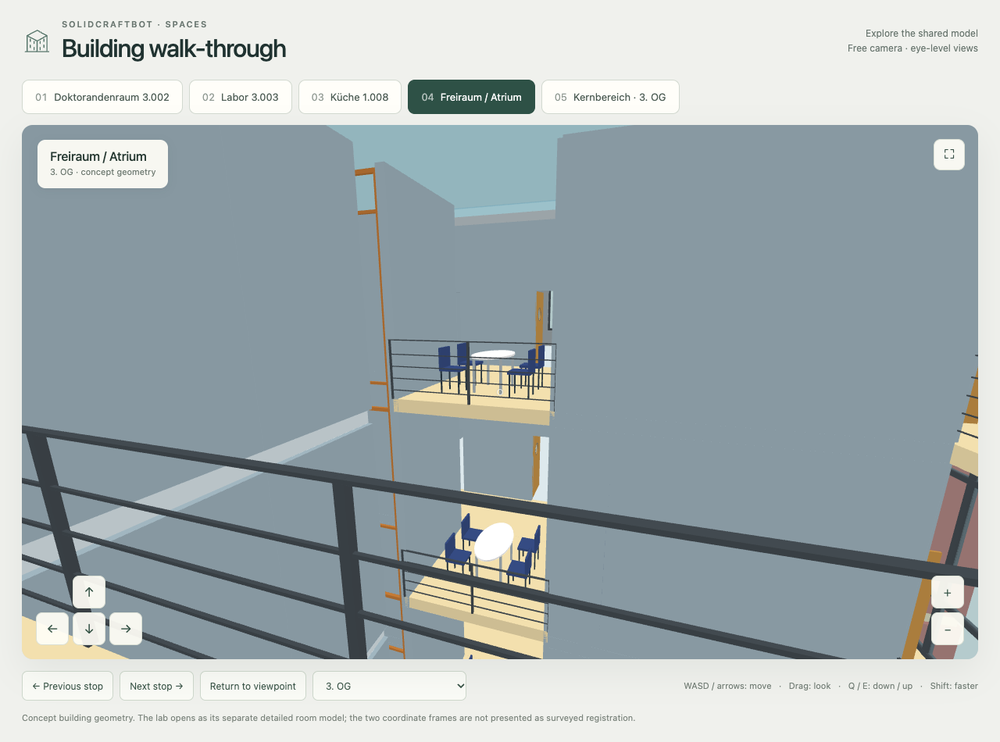

# SolidCraftBot

[English translation](README.en.md) · Die deutsche Fassung ist maßgeblich.

**Robotik, die Zeit für Forschung schafft.**

Damit Robotik im Forschungslabor Akzeptanz findet, muss ihr Zweck deutlich werden: Es geht hier nicht um Hochdurchsatz. Roboter sollen diejenigen Arbeiten übernehmen, die Menschen nicht selbst erledigen müssen. So können Forschende in derselben Zeit nachdenken, Ergebnisse aufschreiben, Verfahren verbessern und mit Kolleginnen und Kollegen diskutieren.

Dieses Projekt bietet Modelle für unterschiedliche Roboter. Sie sehen verschieden aus, weil sie verschiedene Dinge können. Ihr Zusammenspiel bildet biologische Workflows im Modell ab. Dabei soll ihre Arbeitsweise so menschlich wie möglich sein: weitgehend dieselben Werkzeuge, dieselben Gefäße und dieselbe Arbeitsumgebung, die wir auch selbst verwenden.

Die Roboter sollen dabei **„Self-Aware“** sein: ihren eigenen Zustand und ihre Fähigkeiten kennen, die Ergebnisse ihrer Handlungen überprüfen und Fehler erkennen können. Wenn eine Probe fehlt, ein Griff misslingt oder eine Übergabe unklar bleibt, sollen sie das bemerken und Unterstützung anfordern können. Diese Rückmeldung gehört zum Entwicklungsziel ebenso wie die Bewegung selbst.

Wir wollen unsere Roboter **selbst bauen, verändern und reparieren können**. Eine Ausstattung mit vielen Robotern für unterschiedliche Aufgaben wäre für uns sonst kaum finanzierbar. Eigenbau gibt uns die Möglichkeit, die Technik an unsere Forschung anzupassen und dabei weniger oder wenigstens andere Kompromisse einzugehen. Vorhandene Werkzeuge, 3D-Drucker und die Universitätswerkstatt sind dafür wichtige Voraussetzungen.

Unser Ziel ist, biologische Workflows zunächst vollständig am Rechner modellieren und erproben zu können. Deshalb beschreiben wir neben den Robotern auch die Geräte, Materialien, Abläufe und die gemeinsame Arbeitsumgebung.

Das Modell soll dem gebauten Roboter so nah wie möglich bleiben. Konstruktion, Abläufe und Prüfgrenzen beschreiben wir in gemeinsamen Quellen, aus denen Modelle, Ansichten und Simulationen unabhängig abgeleitet werden. So bleibt nachvollziehbar, was geprüft ist, was noch offen ist und was am realen Aufbau nachgewiesen werden muss.

## Unser Laborroboter

Der sechsachsige Laborarm ist unser erster Roboterentwurf. Unterschiedliche Werkzeuge sollen ihn für die Handhabung von Gefäßen, das Pipettieren und die Bedienung von Laborgeräten einsetzbar machen. Die Armkonstruktion endet an einem allgemeinen Werkzeugflansch; die Pipettierfunktion ist noch zu entwickeln.

Zum Zusammenspiel gehören auch der [Probentransporter TR01](docs/sample-transport-tr01.md), der Racks zwischen Arbeitsplätzen befördern soll, und spezialisierte Stationen wie die [Zentrifuge CF01](docs/centrifuge-cf01.md). Diese verschiedenen Konstruktionen und ihre Aufgaben zeigt die [Modellgalerie](docs/models/README.md#baugruppen).

**Stand: CAD-Konzept, keine Fertigungsfreigabe.** Für den ersten begrenzten Armprototyp liegt das Budgetziel bei 3.000–5.000 EUR. Tragfähigkeit, Präzision, Dosierleistung und Sicherheit müssen am realen Aufbau nachgewiesen werden.

### Roboter in Bewegung

https://github.com/user-attachments/assets/433efc9b-b910-42ef-aa4d-9ce2ba1704d3

Die Simulation zeigt das Zusammenspiel von Arm, Zentrifuge und Rack: Drei Proben werden nacheinander entnommen und in ihre ursprünglichen Rackplätze zurückgebracht. Vom bestätigten Griff bis zur Ablage bewegt sich jedes Gefäß auf einer durchgehenden Bahn. Der Deckel bleibt während der drei Entnahmen offen; die dabei verwendete offene Rotorindexierung ist eine gesonderte Simulation.

Beide Armkameras zeigen ihre simulierten Bilder synchron zum Ablauf: Die Greiferkamera blickt auf Finger und Gefäß. Die hintere Übersichtskamera erfasst mit etwa 120° horizontalem Bildwinkel die Arbeitszone und ihre Zugänge – als Grundlage für eine spätere Gefahrenerkennung. Verdeckungen bleiben sichtbar; reale Optik und Gefahrendetektion sind noch zu entwickeln. Das Video zeigt rund 100 Sekunden Modellzeit bei 1× Wiedergabe.

Roboter sollen zügig arbeiten und Menschen tatsächlich Zeit verschaffen. Getragene Proben benötigen dabei fließende Bewegungen mit begrenzter Beschleunigung und begrenztem Ruck. Die gezeigte Bahn ist im Modell geprüft; reale Sensorik, Fehlerreaktionen und Hardwarebetrieb bleiben zu entwickeln.

[Video ansehen](docs/media/robot-demo-cameras-aligned.mp4) · [Interaktive Demo herunterladen und lokal öffnen](docs/media/robot-demo-cameras-aligned.html) · [Bewegungsprofil und Prüfgrenzen](docs/centrifuge-cf01.md#cf01-smooth-unloading) · [Modellstand und Herkunft der Medien](docs/media/README.md)

Ein weiteres Beispiel ist die [direkte Entnahme aus H02 mit Ablage im Rack](docs/h02-rack-transfer.md). Hier greift ein Arm derselben Konstruktion ein Gefäß aus seinem offenen Halter und setzt es zwischen bereits belegten Rackplätzen ab. Der vollständige Weg einschließlich Greiferöffnung und Rückzug ist für beide Gefäßvarianten in FreeCAD und SolidCraft geprüft.

## Die gemeinsame Arbeitsumgebung

Ein Workflow braucht mehr als erreichbare Geräte: Gefäße müssen bereitstehen, Werkzeuge zugänglich sein und Proben zwischen Arbeitsplätzen wechseln können. Das Modell unserer Arbeitsumgebung hilft, diese Zusammenhänge schon am Rechner zu untersuchen und die Aufgaben zwischen Menschen und Robotern aufzuteilen.

Der [Laborraum L01 mit Möbeln und Geräten](docs/lab-layout-l01.md) beschreibt einen Arbeitsplatz im Detail. Das [Gebäudemodell](docs/building-stack.md) ergänzt Labore, Flure, Büros und Aufenthaltsbereiche. Auch Denk- und Schreibplätze und die Küche gehören zu diesem Forschungsalltag. Die [Modellgalerie](docs/models/README.md) führt durch Räume, Möbel, Geräte und ihre Aufstellungen. Gebäudeabmessungen sind teilweise Darstellungsannahmen; reale Transportwege müssen gesondert geprüft werden.

Die separate [Gebäudeflotte BF01](docs/building-fleet-demo.md) bietet eine aktive Browserfassung mit einer neuen, unabhängigen Patrouille pro geöffneter Seite: 20 leere Fahrzeuge verwenden dieselben Quellen, statischen Geometriedaten und Regler wie der lokale Simulationsdienst. Ein lokaler Dienst oder eine aufgezeichnete Fahrt ist für diese Fassung nicht erforderlich. Die 20 Atrium-Monitore zeigen tatsächlich empfangene synthetische Kameraposen; leere Abhol-/Abgabe-Testaufträge rekrutieren an zulässigen stationären Grenzen nach geschätzter Ankunftszeit. Die ergänzten Aufzugsschwellen haben an allen fünf aktiven Zugängen nativ gemessene 8-mm-Fugen. Die Bodenregel erlaubt bis 15 mm geschlossene Lücken und ausschließlich den aus der Quelle abgeleiteten Schwellenversatz; dies sind synthetische Eigentümerannahmen ohne Radqualifikation. Zielbuchten werden vor der Missionsvergabe gesichert; die Weiterfahrfreigabe prüft den nächsten höchstens 50-ms-Schritt samt vollständiger Anschlussbremskurve gegen denselben vorhandenen Scan. Die konkreten BF04- und BF09-Ruckregressionen halten 1.000 mm/s³ ein, ohne die Grenzwerte anzuheben. Die frühere Aufzeichnung über 1188,1 s und ihre Nachweise bleiben historische Prüfstände. Vollständige Zielabdeckung, native Gesamtbewegungsprüfung, unabhängiger Gesamtexport sowie reale Lasten, Geräteübergaben und Video-Netzwerklasttests bleiben offen.

### Interaktiver Gebäuderundgang

[](https://smoe.github.io/DIYLabBot/)

[**Gebäuderundgang im Browser starten →**](https://smoe.github.io/DIYLabBot/)

Doktorandenraum, Labor, Küche und Atrium lassen sich ohne CAD-Installation besichtigen. Der erste Aufruf lädt etwa 37 MB; WebGL 2 wird benötigt. [Bedienung, Modellquellen und Prüfgrenzen](docs/building-walkthrough.md).

## Biologische Workflows gemeinsam ausführen

Der [Workflow-Bereich](docs/workflows/README.md) bündelt die Einstiege und die
[biologische Roadmap](docs/workflows/ROADMAP.md).

Die Arbeitsschritte verbinden Roboter, Geräte und Menschen. Eine Probe behält ihre Identität über Entnahmen, Messungen und Transporte hinweg; ihre Übergaben und verbrauchten Mengen werden dokumentiert. Menschliche Arbeitsschritte und Botengänge gehören ausdrücklich dazu. So lässt sich ein Ablauf schrittweise automatisieren.

Bereits ausführbare **synthetische Softwareabläufe** zeigen beispielsweise:

- [Pipettierstation PS01](docs/pipetting-station-ps01.md) mit getrennten Armen für Pipettieren und Labware-Handhabung sowie frei kombinierbaren Transfers, Verteilungen und Mischschritten. Das erste Planungsbeispiel kombiniert zwei Flüssigkeiten entlang der beiden Achsen einer 96-Well-Platte; Mengen, Spitzenverbrauch und Well-Kapazitäten werden geprüft.
- [Zentrifugieren, NanoDrop und Qubit 4](docs/synthetic-lab-workflow.md) mit gemeinsamem Probenbestand und nachvollziehbaren Entnahmen.
- [DNA-Extraktion mit NanoDrop, Qubit und TapeStation](docs/extraction-analytics.md) von der Ausgangsprobe bis zur Bewertung des erhaltenen DNA-Produkts.
- [Asynchronen Labortransport](docs/async-lab-transport.md) mit bestätigten Übergaben und ausdrücklichem Abgleich bei unklaren Ergebnissen.

Diese Abläufe verwenden Testdaten und simulierte Rückmeldungen. Sie erlauben, Prozesslogik und Fehlerfälle zu untersuchen; reale Gerätebedienung und biologische Ergebnisse benötigen eigene Nachweise. Die automatische Zuordnung einer biologischen Versuchsabsicht zu geeigneten Robotern und Geräten bleibt ein [Entwicklungsziel](ARCHITECTURE.md#sila-fähigkeiten-und-gentle-ressourcenbindung).

## Mitentwickeln

Konstruktion und Abläufe stehen in gemeinsamen, maschinenlesbaren Quellen. FreeCAD und SolidCraft erzeugen daraus unabhängig ihre Modelle; ROS 2/RViz nutzt daraus abgeleitete Roboterbeschreibungen und vorbereitete Armprogramme. Änderungen sollen so in Konstruktion, Bewegungsprüfung und Ablaufmodell nachvollziehbar bleiben.

**Programmieren mit ROS 2.** Roboterbeschreibungen (URDF), Meshes und vorbereitete Bewegungsprogramme werden aus den gemeinsamen Quellen unter `ros2_ws/` erzeugt. Ziel ist ROS 2 Jazzy mit `ros2_control`, etwa auf Ubuntu 24.04; die Hardwareanbindung verwendet bislang Mock-Hardware. Die [GitHub-CI](.github/workflows/ros2.yml) hat das Python-Paket gebaut und 13 Pakettests ohne Skips ausgeführt, einschließlich aktiver Mock-Controller, Gelenkrückmeldungen und eines bestätigten stationären `FollowJointTrajectory`-Halteziels. Bewegte Programme und reale Antriebe bleiben ungeprüft. `python3 scripts/build_ros2_freecad.py` erzeugt die ROS-Dateien unabhängig mit FreeCAD; der vollständige Modellbuild bleibt `python3 scripts/build_models.py --ros2`. Der [Daten-Dry-run ohne ROS](docs/centrifuge-cf01.md#cf01-smooth-unloading) verwendet `PYTHONPATH=… python3 -m solidcraftbot_ros.demo --config … --scenario … --dry-run` (Pfade und Szenario aus dem jeweiligen Build einsetzen). Ein ausführbares ROS-Tutorial folgt erst in der RoboStack/pixi-Phase; Einstieg und CI-Prüfgrenzen beschreibt [ROS 2/RViz](docs/ros2.md).

**Gerätekommunikation über SiLA 2.** Für die Anbindung an Laborgeräte und Workflow-Orchestratoren orientieren wir uns am offenen Laborstandard SiLA 2. Für den CF01-Simulator ist bereits eine getrennte [SiLA-2-Schnittstelle über TLS/gRPC](docs/sila2-network.md) implementiert und lokal geprüft. Reale Geräteanbindungen und die automatische Zuordnung von Fähigkeiten und Ressourcen über GENtle bleiben Entwicklungsziele.

Für den Einstieg:

- [Anforderungen](docs/requirements.md), [Armentwurf](docs/design.md) und [mechanischer Entwicklungsplan](ROADMAP.md#mechanischer-entwicklungsplan).
- [Architektur](ARCHITECTURE.md) und [gemeinsames Modell](docs/shared-model.md).
- [FreeCAD](docs/freecad.md), [ROS 2/RViz](docs/ros2.md) und [Gerätekommunikation am Beispiel CF01/SiLA 2](docs/sila2-network.md).
- [Tutorial: SiLA-2-Schnittstelle des CF01-Simulators](docs/tutorial-cf01-sila2.md).

Der lokale Modellaufbau erzeugt nicht versionierte CAD-, Mesh- und ROS-Dateien: Der abgegrenzte Referenzbuild mit `--ros2` belegt rund 116 MB (Dezimalmaß; bestehende Ausgaben gemessen, kein Speicherhöchstbedarf; Messumfang und Quellstand im lokalen [Build-Bericht](exports/generated/storage-reference-2026-11-18/build-report.json)). Die darin erfassten Revisionsverzeichnisse unter `cad/generated/` und `exports/generated/` sowie die erzeugten Mesh-, URDF- und Konfigurationsdateien unter `ros2_ws/src/solidcraftbot_ros/` sind gitignored und per Build neu erzeugbar; nur diese Ausgaben können gelöscht werden, nicht pauschal `exports/` mit seinen Laufzeitdaten und Originalbelegen, und weitere Buildrevisionen benötigen zusätzlichen Platz.

```sh
python3 -m unittest discover -s tests -v
python3 scripts/tool_paths.py
python3 scripts/build_models.py --ros2
```

Quell- und Kinematiktests laufen ohne CAD; Prüfungen noch nicht erzeugter CAD-/ROS-Ausgaben werden übersprungen. Für den Modellaufbau müssen FreeCAD und SolidCraft CLI lokal installiert sein. Optionen und Umgebungsvariablen für die Laufzeiten beschreibt [tool_paths.py](scripts/tool_paths.py).

Versioniert werden Modellquellen, Generatoren, Laufzeitcode, Tests und Dokumentation. Native CAD-Dateien und vollständige Prüfberichte entstehen lokal; die aktuellen Dateipfade stehen in den jeweiligen Build-Berichten. Ausgewählte Bilder und Demos bleiben als nachvollziehbare Modellstände im Repository.
