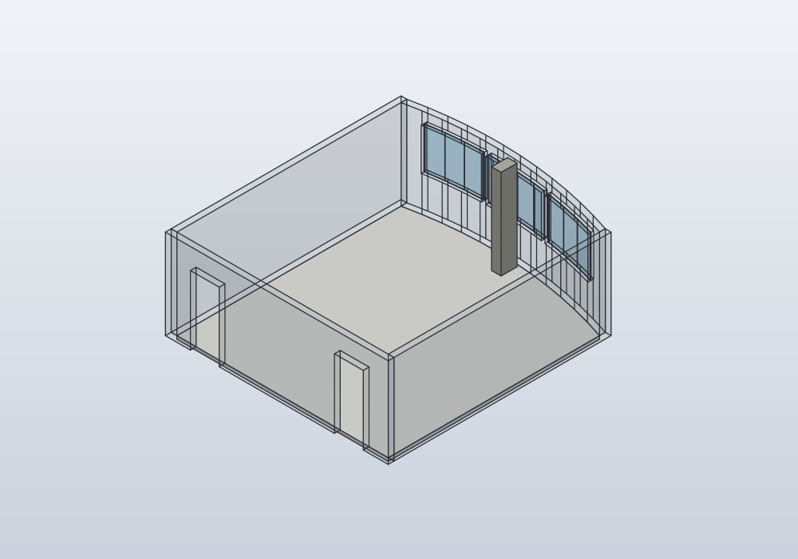
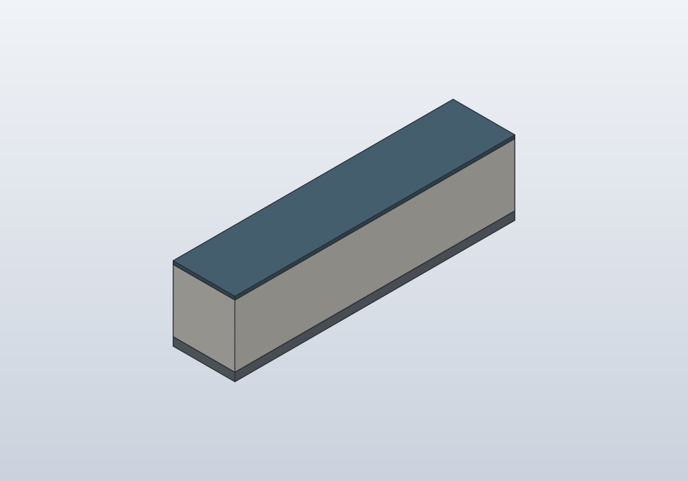
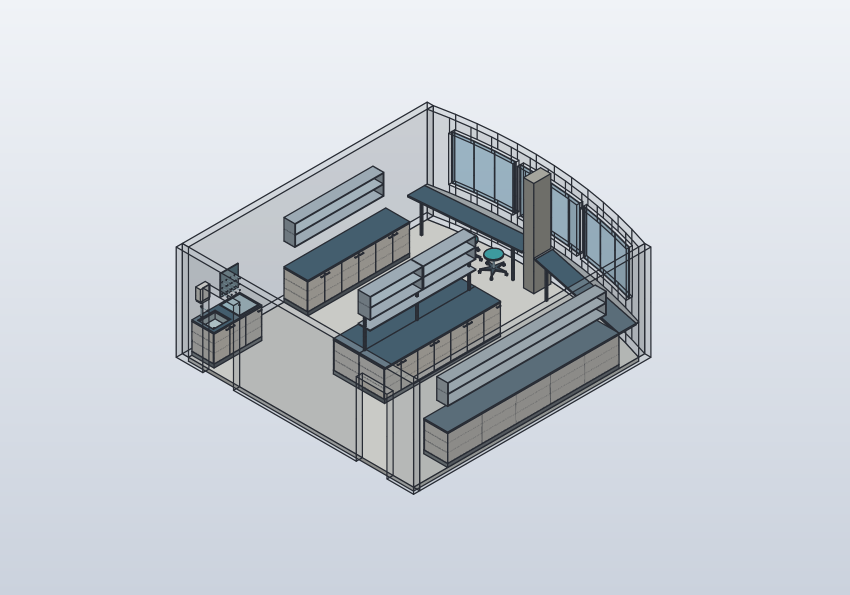
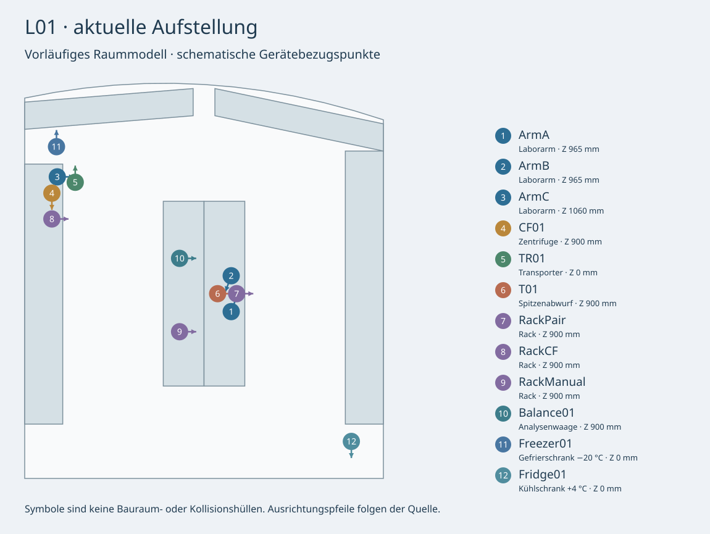
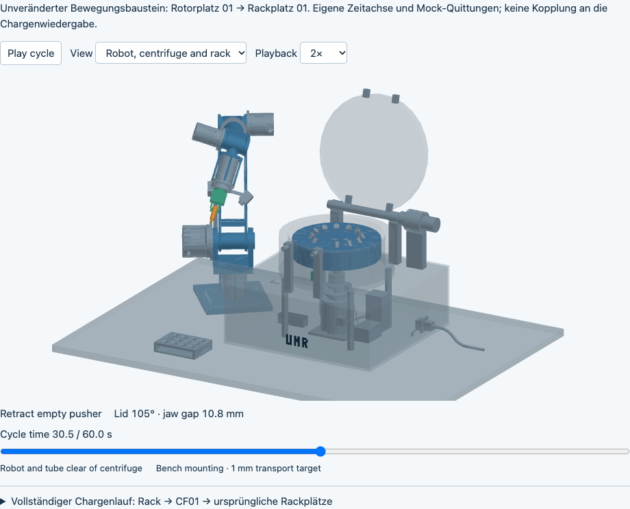

# SolidCraftBot

Ein sechsachsiger Laborroboter für ein universitäres Labor, entwickelt aus einer
CAD-unabhängigen, maschinenlesbaren Konstruktionsbeschreibung. FreeCAD, SolidCraft
und ROS 2/RViz sind daraus abgeleitete Darstellungen.

**Stand: CAD-Konzept A01, keine Fertigungsfreigabe.** Der erste Prototyp soll mit
3D-Druckern und der Universitätswerkstatt entstehen; Budgetziel: 3.000–5.000 EUR.
Tragfähigkeit, Steifigkeit, Präzision, Dosierleistung und Sicherheit sind noch
nicht nachgewiesen. Die austauschbare Pipettenaufnahme ist zunächst außerhalb
des CAD-Umfangs; die Armquelle endet an einem allgemeinen Flansch.

## Modelle entdecken

[**Zur Modellgalerie →**](docs/models/README.md) · Baugruppen, Varianten und Abläufe mit Bildern und Quellenlinks.

| 1 · Arbeitsumgebung | 2 · Möbeltypen | 3 · Möblierung | 4 · Geräteausstattung |
|---|---|---|---|
| <a href="docs/models/README.md#umgebungen"></a> | <a href="docs/models/README.md#moebeltypen"></a> | <a href="docs/models/README.md#moeblierung"></a> | <a href="docs/models/README.md#ausstattung"></a> |

Die Galerie verbindet die vier Ebenen mit den einzelnen Konstruktionen und der
synthetischen Testumgebung. CAD-Ansichten und schematische Pläne sind benannt.

## Roboter in Bewegung

[](docs/media/robot-demo.mp4)

[Kurzes Video ansehen](docs/media/robot-demo.mp4) ·
[Interaktive Demo herunterladen](docs/media/robot-demo.html) ·
[Modellstand und Herkunft](docs/media/README.md)

Die Szene wird aus einer synthetischen, unbegrenzten Umgebung mit einer
Referenzbank abgeleitet. Die Bewegungsansicht und das Video zeigen den bisherigen
60-s-Bewegungsbaustein Rotorplatz 01 → Rackplatz 01, im Video beschleunigt.
Er besitzt eine eigene Zeitachse und ist nicht mit der Chargenwiedergabe gekoppelt.
Die HTML-Datei lokal öffnen: Wiedergabe, Zeitschieber und drei Ansichten
funktionieren ohne CAD-Installation oder Netzwerk.

Zusätzlich enthält die HTML-Demo das aufgezeichnete **Chargenprotokoll für zwölf
Proben**: Ein Transporter hat das Rack bereitgestellt; es wird in CF01 geladen,
zentrifugiert und in ursprünglicher Reihenfolge zurück ins Rack entladen. Der
Transporter ist nicht dargestellt. Sämtliche Roboterübergaben und Rückmeldungen
sind lokale Mocks ohne ausgeführte Bahn; Testzeit wird beim Warten auf bestätigte
Befehlsabschlüsse einschließlich Spin und Bremsen fortgeschrieben.
Neu erzeugte HTML-Demos starten auf Deutsch und lassen sich über
**Sprache / Language** auf Englisch umschalten. Die ausgewählten Medien oben
bleiben der historische Build ohne Sprachumschaltung. Aktuelle Bedienung,
Berichtsfelder und Prüfgrenzen stehen in der
[Baugruppendokumentation](docs/centrifuge-cf01-robot-pickup.md).
Die bisherige Entnahmebewegung bleibt als eigener Baustein erhalten. Der vollständige
Lauf ist auch reproduzierbar ausführbar:

```sh
python3 scripts/run_cf01_rack_batch.py
python3 scripts/run_cf01_rack_batch.py --transport sila2
```

Die Transportauswahl prüft lokale ROS-/SiLA-Vertragsdecoder, keine Netzwerkserver.
Massen, Laufzeiten und Qualifikationswerte sind ausdrücklich fiktive Testdaten.
Eine native Ladebahn und Hardwarebetrieb sind damit nicht nachgewiesen.

## Quellen und lokale Ausgaben

Aktive Textquellen verwenden LF im Repository und auf allen Rechnern beim
Auschecken; `.gitattributes` schaltet lokale CRLF-Konvertierung ausdrücklich ab.
Herstelleroriginale, Historie, Test-Fixtures und die historischen README-Medien
bleiben bytegenau erhalten. Die einmalige Umstellung steht im
[Migrationsbericht](docs/line-ending-migration.json). Dessen Prüfsummen gehören
zum damaligen Migrationsstand; spätere fachliche Änderungen erzeugen neue
Quellstände. Alte Build-Prüfsummen und Bilder bleiben historische Nachweise.


Versioniert werden Konstruktionsabsicht, Generatoren, Dokumentation, Tests und
Laufzeitcode. Eigene FreeCAD-/SolidCraft-Dateien, STEP-/Mesh-Exporte,
Build-Berichte und Arbeitsrenderings werden lokal erzeugt und ignoriert.
Die kleine, bewusst ausgewählte README-Demo unter `docs/media/` ist die Ausnahme.

| Inhalt | Maßgeblicher Ort |
|---|---|
| Arm, Parameter, Gelenke, Protokolle und Schnittstellen | `model/` |
| Gemeinsame Ableitung und CAD-/ROS-Adapter | `scripts/` |
| Unveränderte Herstellerdaten und registrierte, prüfsummengebundene Bibliothek | `cad/vendor/` |
| ROS-Laufzeitcode, Launch-Dateien und Paketvorlagen | `ros2_ws/src/solidcraftbot_ros/` |
| Kleine, festgehaltene Geometriereferenzen für Regressionen | `tests/fixtures/` |
| Lokale Modelle | `cad/generated/` und Baugruppenordner unter `cad/` |
| Lokale Prüfberichte und Exporte | `exports/` und Baugruppenordner unter `cad/` |
| Lokale Renderings | `renders/` |
| Generierte ROS-Beschreibungen, Konfiguration und Netze | `ros2_ws/src/solidcraftbot_ros/{urdf,config,meshes}/` |

Die Herstellerbibliothek bleibt vorerst vollständig als Build-Eingabe erhalten:
`model/robot.json` und die Adapter referenzieren ihre registrierten Teilgeometrien
über SHA-256. Sie ist keine zweite führende Quelle für unsere Armkonstruktion.
Native CAD-Änderungen müssen in gemeinsame Quelle oder Generator zurückgeführt
und anschließend neu abgeleitet werden.

## Erzeugen und prüfen

```sh
python3 -m unittest discover -s tests -v
python3 scripts/tool_paths.py          # zeigt die gefundenen CAD-Laufzeiten
python3 scripts/build_models.py --ros2
```

Die beiden CF01-SolidCraft-Prüfstellungen lassen sich unabhängig von FreeCAD
direkt aus den gemeinsamen Quellen erzeugen:

```sh
python3 scripts/export_centrifuge_robot_pickup_solidcraft.py
```

Der [native CF01-Adapter](docs/centrifuge-cf01-robot-pickup.md#independent-solidcraft-build-and-importer-workaround)
umgeht den dokumentierten STEP-Importfehler. Die historische Medien-Provenienz
bleibt als damaliger Prüfstand erhalten.

Python, FreeCAD mit importierbarem `FreeCAD`/`Part` und SolidCraft CLI müssen lokal
vorhanden sein. Alle Generatoren finden die Laufzeiten über
[`scripts/tool_paths.py`](scripts/tool_paths.py), in dieser Reihenfolge:
`--freecad-python`/`--solidcraft-cli`, dann die Umgebungsvariablen
`SOLIDCRAFTBOT_FREECAD_PYTHON`/`SOLIDCRAFTBOT_SOLIDCRAFT_CLI`, dann
`solidcraft-cli` im `PATH`, zuletzt die üblichen Installationsorte unter macOS
(`/Applications/FreeCAD.app`, `/Applications/SolidCraft.app`) und Windows
(neueste `FreeCAD */bin/python.exe` unter `%LOCALAPPDATA%\Programs` bzw.
`%ProgramFiles%`). Unter Linux ist für FreeCAD die Umgebungsvariable oder die
Option nötig. Fehlt eine Laufzeit, bricht der Aufruf vor dem Build mit einem
Hinweis ab. Die komplette CAD-Kette wurde nach dem Mac-Checkout noch nicht neu
ausgeführt.

Auf einem frischen Checkout laufen die Quell- und Kinematiktests ohne CAD.
Tests gespeicherter CAD-/ROS-Ausgaben melden **skipped**, bis die betreffenden
lokalen Builds existieren. Ein bestandener Quelltest ersetzt keine native
Geometrieprüfung. Nach dem Build enthält `exports/generated/build-report.json`
die aktuellen Armdateien, Prüfergebnisse und Grenzen; die Stationsgeneratoren
schreiben ihre jeweiligen `cad/<baugruppe>/shared-build-report.json`.
Dateipfade in älteren Fachdokumenten bezeichnen lokale Build-Ausgaben und sind
keine herunterladbaren GitHub-Artefakte mehr.

## Baugruppen und Entwicklung

- [Architektur: Arbeitsumgebung, Möbeltypen, Möblierung und Geräteausstattung](ARCHITECTURE.md)

- [Gemeinsames Modell und Entwicklungsschleife](docs/shared-model.md)
- [Anforderungen](docs/requirements.md), [Entwurf](docs/design.md), [Entwicklungsplan](docs/development-plan.md)
- [FreeCAD](docs/freecad.md), [ROS 2/RViz und Prüfgrenzen](docs/ros2.md)
- [Servo-Integration](docs/servo-integration.md), [Herstellerdaten](cad/vendor/myactuator/README.md)
- [Mobile Armbasis MB01](docs/mobile-base-mb01.md), [Probentransport TR01](docs/sample-transport-tr01.md)
- [Deckelstation C01](docs/tube-station-c01.md), [Spitzenabwurf T01](docs/tip-collector-t01.md)
- [Zentrifuge CF01](docs/centrifuge-cf01.md), [Roboterentnahme](docs/centrifuge-cf01-robot-pickup.md)
- [Gefäßträger H01](docs/tube-carrier-h01.md), [Rahmen H02](docs/tube-frame-h02.md), [Drehantrieb H03](docs/tube-cam-h03.md)
- [Laborraum](docs/lab-room-l01.md), [Aufstellung](docs/lab-layout-l01.md), [Transfersequenz](docs/lab-transfer-l01.md)
- [Manuelle Aufgaben und Messgeräte](docs/manual-tasks.md), [NanoDrop](docs/nanodrop-manual-workflow.md) und [Qubit 4](docs/qubit-4-manual-workflow.md) (synthetische Abläufe)
- [NanoDrop- und Qubit-Anschauungsmodelle](docs/instrument-concepts.md) mit schwenkbaren Hebeln beziehungsweise Deckeln in beiden CADs
- [NanoDrop UltraC über HTTP](docs/nanodrop-ultra-network.md): gemeinsamer Leseclient und synthetisches Netzwerkmodell; Originalgerät noch nicht qualifiziert
- [Gemeinsamer synthetischer Ablauf CF01 → NanoDrop → Qubit 4](docs/synthetic-lab-workflow.md) mit einem Probenbestand und durchgängiger Verbrauchsbuchung

## Repository beziehen

```sh
git clone git@github.com:smoe/DIYLabBot.git
cd DIYLabBot
```

Die Git-Historie wurde am 6. November 2026 bereinigt: Der ursprüngliche einzelne
Import-Commit wurde durch den Quellstand ohne erzeugte Projektmodelle ersetzt.
Primärdateien, Hersteller-Build-Eingaben und die ausgewählten README-Medien
bleiben erhalten. Ein normaler vollständiger Klon benötigt deshalb keinen
Download der früheren CAD-/Exporthistorie mehr.

Vorhandene Klone besitzen noch die alte Historie. Am einfachsten neu klonen;
eigene Änderungen vorher sichern und gezielt übernehmen. Alte Branches nicht
zurück in `main` zusammenführen, da sie die entfernten Binärdateien wieder in
die erreichbare Historie bringen würden. Lokale Build-Ausgaben bleiben lokal.
