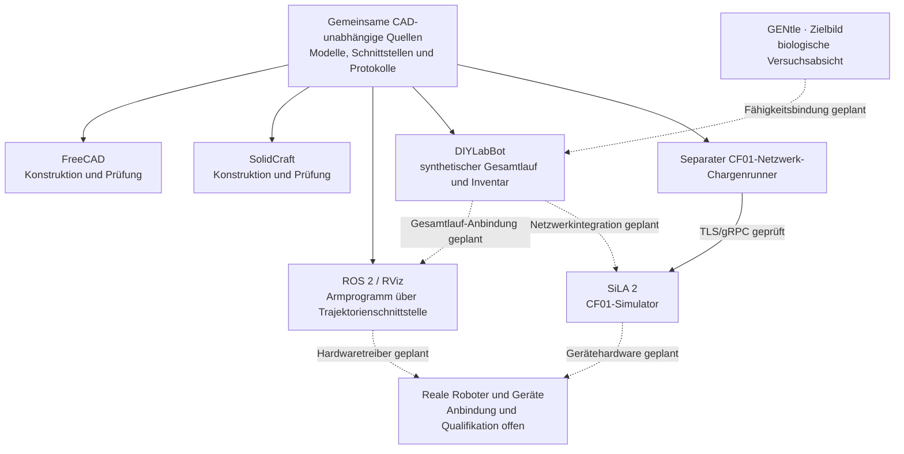

# SolidCraftBot

Ein sechsachsiger Laborroboter für ein universitäres Labor, entwickelt aus einer
CAD-unabhängigen, maschinenlesbaren Konstruktionsbeschreibung. FreeCAD, SolidCraft
und ROS 2/RViz sind daraus abgeleitete Darstellungen.

**Stand: CAD-Konzept A01, keine Fertigungsfreigabe.** Der erste Prototyp soll mit
3D-Druckern und der Universitätswerkstatt entstehen; Budgetziel: 3.000–5.000 EUR.
Tragfähigkeit, Steifigkeit, Präzision, Dosierleistung und Sicherheit sind noch
nicht nachgewiesen. Die austauschbare Pipettenaufnahme ist zunächst außerhalb
des CAD-Umfangs; die Armquelle endet an einem allgemeinen Flansch.

## Modelle entdecken

[**Zur Modellgalerie →**](docs/models/README.md) · Baugruppen, Varianten und Abläufe mit Bildern und Quellenlinks.

| 1 · Arbeitsumgebung | 2 · Möbeltypen | 3 · Möblierung | 4 · Geräteausstattung |
|---|---|---|---|
| <a href="docs/models/README.md#umgebungen"></a> | <a href="docs/models/README.md#moebeltypen"></a> | <a href="docs/models/README.md#moeblierung"></a> | <a href="docs/models/README.md#ausstattung"></a> |

Die Galerie verbindet die vier Ebenen mit den einzelnen Konstruktionen und der
synthetischen Testumgebung. CAD-Ansichten und schematische Pläne sind benannt.

## Roboter in Bewegung

https://github.com/user-attachments/assets/919b9436-0b45-4b2e-9ed1-2584da67b06f

[Kurzes Video ansehen](docs/media/robot-demo-continuous-cfr.mp4) ·
[Interaktive Demo herunterladen](docs/media/robot-demo-continuous-cfr.html) ·
[Bewegungsprofil und Prüfgrenzen](docs/cf01-smooth-unloading.md) ·
[Modellstand und Herkunft](docs/media/README.md) ·
[Einbettungsnachweis](docs/media/robot-demo-continuous-cfr.embed.json)

Die Szene wird aus einer synthetischen, unbegrenzten Umgebung mit einer
Referenzbank abgeleitet. Sie zeigt **drei aufeinanderfolgende Entnahmen** nach
einem Zwölferlauf: Sample01–03 gelangen in ihre ursprünglichen Rackplätze,
neun Gefäße bleiben im Rotor. Eine Detailansicht zeigt den vorhandenen
16-mm-Hub entlang der Gefäßachse, bevor der Greifer zugreift.

Vom bestätigten Griff bis zur Rackablage fährt das getragene Gefäß ohne
Zwischenhalt: axiale Entnahme, gerundeter Transit und vertikale Ablage gehören
zu einer gemeinsamen glatten Bahn. Der Deckel bleibt zwischen den drei
Entnahmen offen und schließt erst nach der letzten Freigabe und dem
Heberrückzug. Eine ausdrücklich aktivierte Simulatorerweiterung erlaubt dafür
die langsame Rotorindexierung bei offenem, gehaltenem Deckel; der bestehende
Stationsvertrag bleibt unverändert.

Auch leere Fahrten und Raumsondierung sollen fließen: Ein Wegpunkt ist kein
Haltepunkt. Warten ist nur mit einer benannten Bedingung vorgesehen, etwa auf
den Heber, das Greifen oder die bestätigte Ablage. Eine zusätzliche Pause zur
Vorführung des angehobenen Gefäßes entfällt. Das Video wird aus gleichmäßig
verteilten Modellzeiten mit festen 20 Bildern pro Sekunde erzeugt.

Geschwindigkeit, Beschleunigung und Ruck bleiben durch dieselben vorläufigen
Grenzen beschränkt; Position, Geschwindigkeit und Beschleunigung sind stetig.
Das Programm enthält 3.876 Armknoten und dauert 99,674 s: rund 13,2 % weniger
Modellzeit als die ältere Fassung mit Deckelzyklen je Probe.
Vom ersten Griff bis zur bestätigten Rackabstützung sind es 11,611 s,
gegenüber 11,731 s in der älteren Fassung mit Zwischenhalten. Ein beschleunigter Videoclip ändert die
Programmzeit nicht. Die erste durchgehende Fassung dauerte insgesamt 80,759 s;
die jetzt ebenfalls verrundeten leeren Fahrten benötigen bei denselben
Gelenkgrenzen mehr Modellzeit. Die beladene Fahrt bleibt unverändert; globale
Zeitoptimalität ist nicht nachgewiesen.
Biologische Belastbarkeit, Flüssigkeitsbewegung und reale
Antriebsgrenzen sind noch nicht bestimmt;
die vorläufigen Grenzwerte sind keine Freigabe für biologische Proben.

Die HTML-Datei lokal öffnen: Wiedergabe, Zeitschieber, automatische Hubansicht
und Deutsch/Englisch funktionieren ohne CAD-Installation oder Netzwerk.
Die Bewegungsansicht besitzt eine eigene Zeitachse. Sie ruft weder den
Chargenrunner noch Geräte oder Hardware auf. Der vollständige lokale
**Rack → CF01 → Rack-Lauf für zwölf Proben** bleibt separat ausführbar.
Ein Transporter hat das Rack bereitgestellt; seine Fahrt und die native
Ladebahn sind nicht dargestellt. Bisherige Medien bleiben als historische
Fassungen mit eigener Provenienz erhalten.

Die offene Indexierung ist ausschließlich eine zusätzliche Simulation. Sie
ist weder ein neuer ROS-/SiLA-Befehl noch eine Ausführung des bisherigen
Chargenrunners oder des gemeinsamen Laborworkflows. Eine sensorabhängige
Abbruch- und Rückführstrategie des Armprogramms ist noch nicht implementiert.

```sh
python3 scripts/run_cf01_rack_batch.py
python3 scripts/run_cf01_rack_batch.py --transport sila2
```

Die Transportauswahl prüft lokale ROS-/SiLA-Vertragsdecoder, keine Netzwerkserver.
Massen, Laufzeiten und Qualifikationswerte sind ausdrücklich fiktive Testdaten.
Eine native Ladebahn und Hardwarebetrieb sind damit nicht nachgewiesen.

Für echte TLS/gRPC-Kommunikation mit dem CF01-Simulator gibt es zusätzlich den
[SiLA-2-Netzwerkeinstieg](docs/sila2-network.md). Er verwendet denselben
Chargenrunner, einen separaten v2-Vertrag und ein dauerhaftes Übergabejournal.
Die Anleitung führt durch Anmeldung, Serverstart und Netzwerk-Chargenlauf auf
Deutsch und Englisch; historische Medien bleiben unverändert.



FreeCAD und SolidCraft erzeugen ihre Modelle unabhängig aus denselben Quellen.
**Die gezeigte Armbewegung ist bereits für die ROS-Trajektorienschnittstelle
programmiert.** Der
[Exporter](scripts/export_cf01_unload_ros2.py) übernimmt dieselben
Gelenkpositionen, Geschwindigkeiten und Beschleunigungen für die quintische
Interpolation des vorhandenen `FollowJointTrajectory`-Clients.
Exportiert wird der Armkanal; Greifer und CF01 benötigen eigene Steuerkanäle.
Vor Ausführung müssen Roboterbeschreibung, 280/250-mm-Armvariante, Aufstellung
und Werkzeugbezug übereinstimmen; der Client prüft diese Geometriebindung nicht.
ROS-Laufzeit und Hardwareausführung sind ungeprüft; reale Kollisions-, Sensor-,
Qualitäts- und Schutzrückmeldungen bleiben einzubinden. Beim separaten
CF01-Chargenrunner ist dagegen TLS/gRPC zum Simulator geprüft. Gestrichelte
Verbindungen sind geplant; der gemeinsame CF01–NanoDrop–Qubit-Ablauf arbeitet
bislang lokal und synthetisch. Export und Datenprüfung ohne ROS-Installation:

```sh
python3 scripts/export_cf01_unload_ros2.py
PYTHONPATH=ros2_ws/src/solidcraftbot_ros python3 -m solidcraftbot_ros.demo \
  --config exports/generated/cf01-unload-ros2/scenarios.json \
  --scenario cf01_unload_three_samples --dry-run
```

Biologische Versuche sollen im Zielbild in GENtle oder einem anderen
Versuchsplaner gepflegt werden: wissenschaftliche Absicht, Proben- und
Materialsemantik, benötigte Fähigkeiten, Randbedingungen und Freigabe.
DIYLabBot führt die operative Umsetzung mit Gefäßidentitäten, Orten, Verbrauch
und Reservierungen. Ein anderer Roboter erhält eine passende Modellbeschreibung
und operative Anbindung; die biologische Absicht soll über benötigte Fähigkeiten
wiederverwendbar bleiben. Diese automatische Fähigkeits- und Ressourcenbindung
ist noch nicht implementiert; Einzelheiten stehen in
[ARCHITECTURE.md](ARCHITECTURE.md#sila-fähigkeiten-und-gentle-ressourcenbindung).

## Quellen und lokale Ausgaben

Aktive Textquellen verwenden LF im Repository und auf allen Rechnern beim
Auschecken; `.gitattributes` schaltet lokale CRLF-Konvertierung ausdrücklich ab.
Herstelleroriginale, Historie, Test-Fixtures und die historischen README-Medien
bleiben bytegenau erhalten. Die einmalige Umstellung steht im
[Migrationsbericht](docs/line-ending-migration.json). Dessen Prüfsummen gehören
zum damaligen Migrationsstand; spätere fachliche Änderungen erzeugen neue
Quellstände. Alte Build-Prüfsummen und Bilder bleiben historische Nachweise.


Versioniert werden Konstruktionsabsicht, Generatoren, Dokumentation, Tests und
Laufzeitcode. Eigene FreeCAD-/SolidCraft-Dateien, STEP-/Mesh-Exporte,
Build-Berichte und Arbeitsrenderings werden lokal erzeugt und ignoriert.
Die kleine, bewusst ausgewählte README-Demo unter `docs/media/` ist die Ausnahme.

| Inhalt | Maßgeblicher Ort |
|---|---|
| Arm, Parameter, Gelenke, Protokolle und Schnittstellen | `model/` |
| Gemeinsame Ableitung und CAD-/ROS-Adapter | `scripts/` |
| Unveränderte Herstellerdaten und registrierte, prüfsummengebundene Bibliothek | `cad/vendor/` |
| ROS-Laufzeitcode, Launch-Dateien und Paketvorlagen | `ros2_ws/src/solidcraftbot_ros/` |
| Kleine, festgehaltene Geometriereferenzen für Regressionen | `tests/fixtures/` |
| Lokale Modelle | `cad/generated/` und Baugruppenordner unter `cad/` |
| Lokale Prüfberichte und Exporte | `exports/` und Baugruppenordner unter `cad/` |
| Lokale Renderings | `renders/` |
| Generierte ROS-Beschreibungen, Konfiguration und Netze | `ros2_ws/src/solidcraftbot_ros/{urdf,config,meshes}/` |

Die Herstellerbibliothek bleibt vorerst vollständig als Build-Eingabe erhalten:
`model/robot.json` und die Adapter referenzieren ihre registrierten Teilgeometrien
über SHA-256. Sie ist keine zweite führende Quelle für unsere Armkonstruktion.
Native CAD-Änderungen müssen in gemeinsame Quelle oder Generator zurückgeführt
und anschließend neu abgeleitet werden.

## Erzeugen und prüfen

```sh
python3 -m unittest discover -s tests -v
python3 scripts/tool_paths.py          # zeigt die gefundenen CAD-Laufzeiten
python3 scripts/build_models.py --ros2
```

Die beiden CF01-SolidCraft-Prüfstellungen lassen sich unabhängig von FreeCAD
direkt aus den gemeinsamen Quellen erzeugen:

```sh
python3 scripts/export_centrifuge_robot_pickup_solidcraft.py
```

Der [native CF01-Adapter](docs/centrifuge-cf01-robot-pickup.md#independent-solidcraft-build-and-importer-workaround)
umgeht den dokumentierten STEP-Importfehler. Die historische Medien-Provenienz
bleibt als damaliger Prüfstand erhalten.

Python, FreeCAD mit importierbarem `FreeCAD`/`Part` und SolidCraft CLI müssen lokal
vorhanden sein. Alle Generatoren finden die Laufzeiten über
[`scripts/tool_paths.py`](scripts/tool_paths.py), in dieser Reihenfolge:
`--freecad-python`/`--solidcraft-cli`, dann die Umgebungsvariablen
`SOLIDCRAFTBOT_FREECAD_PYTHON`/`SOLIDCRAFTBOT_SOLIDCRAFT_CLI`, dann
`solidcraft-cli` im `PATH`, zuletzt die üblichen Installationsorte unter macOS
(`/Applications/FreeCAD.app`, `/Applications/SolidCraft.app`) und Windows
(neueste `FreeCAD */bin/python.exe` unter `%LOCALAPPDATA%\Programs` bzw.
`%ProgramFiles%`). Unter Linux ist für FreeCAD die Umgebungsvariable oder die
Option nötig. Fehlt eine Laufzeit, bricht der Aufruf vor dem Build mit einem
Hinweis ab. Die komplette CAD-Kette wurde nach dem Mac-Checkout noch nicht neu
ausgeführt.

Auf einem frischen Checkout laufen die Quell- und Kinematiktests ohne CAD.
Tests gespeicherter CAD-/ROS-Ausgaben melden **skipped**, bis die betreffenden
lokalen Builds existieren. Ein bestandener Quelltest ersetzt keine native
Geometrieprüfung. Nach dem Build enthält `exports/generated/build-report.json`
die aktuellen Armdateien, Prüfergebnisse und Grenzen; die Stationsgeneratoren
schreiben ihre jeweiligen `cad/<baugruppe>/shared-build-report.json`.
Dateipfade in älteren Fachdokumenten bezeichnen lokale Build-Ausgaben und sind
keine herunterladbaren GitHub-Artefakte mehr.

## Baugruppen und Entwicklung

- [Architektur: Arbeitsumgebung, Möbeltypen, Möblierung und Geräteausstattung](ARCHITECTURE.md)

- [Gemeinsames Modell und Entwicklungsschleife](docs/shared-model.md)
- [Anforderungen](docs/requirements.md), [Entwurf](docs/design.md), [Entwicklungsplan](docs/development-plan.md)
- [FreeCAD](docs/freecad.md), [ROS 2/RViz und Prüfgrenzen](docs/ros2.md)
- [Servo-Integration](docs/servo-integration.md), [Herstellerdaten](cad/vendor/myactuator/README.md)
- [Mobile Armbasis MB01](docs/mobile-base-mb01.md), [Probentransport TR01](docs/sample-transport-tr01.md)
- [Deckelstation C01](docs/tube-station-c01.md), [Spitzenabwurf T01](docs/tip-collector-t01.md)
- [Zentrifuge CF01](docs/centrifuge-cf01.md), [Roboterentnahme](docs/centrifuge-cf01-robot-pickup.md)
- [Gefäßträger H01](docs/tube-carrier-h01.md), [Rahmen H02](docs/tube-frame-h02.md), [Drehantrieb H03](docs/tube-cam-h03.md)
- [Laborraum](docs/lab-room-l01.md), [Aufstellung](docs/lab-layout-l01.md), [Transfersequenz](docs/lab-transfer-l01.md)
- [Manuelle Aufgaben und Messgeräte](docs/manual-tasks.md), [NanoDrop](docs/nanodrop-manual-workflow.md) und [Qubit 4](docs/qubit-4-manual-workflow.md) (synthetische Abläufe)
- [RNA-/DNA-Extraktionsvorbereitung](docs/extraction-automation.md): getrennte Zellpellet-Aliquots, manuelle Qiagen-Spin-Säulen-Kits und prüfbare Material-/Prozesspläne; noch keine Extraktionsausführung
- [Kitstation K01](docs/extraction-kit-station.md): zwei Kit-Ensembles im parametrischen Behälter-/Einsatzentwurf für das Regal, mit nativen Ansichten und ausdrücklich offenen Artikelmaßen und Lagerfreigaben
- [NanoDrop- und Qubit-Anschauungsmodelle](docs/instrument-concepts.md) mit schwenkbaren Hebeln beziehungsweise Deckeln in beiden CADs
- [Wiederverwendbares Laborglas](docs/lab-glassware.md): hohle Becher, durchgängige Trichter und Flaschen mit separaten Verschlüssen für FreeCAD und SolidCraft
- [Laborgeräte](docs/lab-equipment.md): Analysenwaage, Kaltlagerung, Wasserbad und Abzug mit beweglichen Deckeln, Türen und Frontschieber für FreeCAD und SolidCraft
- [NanoDrop UltraC über HTTP](docs/nanodrop-ultra-network.md): gemeinsamer Leseclient und synthetisches Netzwerkmodell; Originalgerät noch nicht qualifiziert
- [Gemeinsamer synthetischer Ablauf CF01 → NanoDrop → Qubit 4](docs/synthetic-lab-workflow.md) mit einem Probenbestand und durchgängiger Verbrauchsbuchung
- [DNA nacheinander mit NanoDrop und Qubit HS messen](docs/dna-quantification.md): synthetische Ablaufvorbereitung mit Vor- oder nachträglicher Verdünnung um Faktor 10/20 und Rückgabe ins ursprüngliche Rack auf dem Tisch
- [DNA über SiLA 2 und vorbereitete ROS-Aufträge](docs/dna-sila2-network.md): eigener Root-Netzwerkadapter und lokaler Mock-Worker; kein ROS-Laufzeit- oder Bewegungsnachweis

## Repository beziehen

```sh
git clone git@github.com:smoe/DIYLabBot.git
cd DIYLabBot
```

Die Git-Historie wurde am 6. November 2026 bereinigt: Der ursprüngliche einzelne
Import-Commit wurde durch den Quellstand ohne erzeugte Projektmodelle ersetzt.
Primärdateien, Hersteller-Build-Eingaben und die ausgewählten README-Medien
bleiben erhalten. Ein normaler vollständiger Klon benötigt deshalb keinen
Download der früheren CAD-/Exporthistorie mehr.

Vorhandene Klone besitzen noch die alte Historie. Am einfachsten neu klonen;
eigene Änderungen vorher sichern und gezielt übernehmen. Alte Branches nicht
zurück in `main` zusammenführen, da sie die entfernten Binärdateien wieder in
die erreichbare Historie bringen würden. Lokale Build-Ausgaben bleiben lokal.
