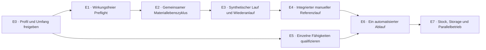

# Roadmap: Laborabläufe und CUT&RUN

**Stand 11. November 2026. E0 ist mit einem Referenzprofilentwurf begonnen;
alle CUT&RUN-Abnahmen stehen noch aus. E1–E7 sind geplant.** Diese Datei führt Reihenfolge,
Abhängigkeiten und Übergaben. Die verbindlichen Architekturgrenzen stehen im
[CUT&RUN-Ablaufvertrag](ARCHITECTURE.md#cutrun). Sie ist keine zusätzliche
Arbeits-SOP, Gerätefreigabe oder vollständige mechanische Entwicklungsplanung.

## Bestehende Pläne weiterverwenden

| Führende Detailplanung | Zuständigkeit |
|---|---|
| [Architektur](ARCHITECTURE.md#cutrun) | Quellen-/Profilbindung, Rollen, Reaktionszustand, Fähigkeiten und Systemgrenzen |
| [Arm-Entwicklungsplan](docs/development-plan.md) | Arm, Optik, Werkzeuge und mechanische Qualifikation; der erste Wasser-Präzisionsversuch bleibt bestehen |
| [Extraktionsvorbereitung](docs/extraction-automation.md) | Bereits vorbereitete RNA-/DNA-Ketten und deren Bedarf am gemeinsamen Materiallebenszyklus |
| [Stock-Plan](docs/stock-continuation.md) | Dauerhafte Bestandsköpfe, atomare Buchungen und Schutz vor veralteten Schreibern; Reagenzvorräte bisher ausgeschlossen |
| [Storage-Plan](docs/automated-storage-plan.md) | K01-Bereitstellung, Regal-/Übergabekonzept und spätere Transportqualifikation; S01 bleibt ein synthetischer Fixture-Nachweis |

Diese Detailpläne werden referenziert, nicht hier kopiert. Direkte Bereitstellung
und serielle Bearbeitung eines Laufs sind der Ausgangspunkt. Automatisiertes
Storage und mehrere gleichzeitig aktive Arme sind keine Voraussetzung für den
ersten CUT&RUN-Durchstich. Die vorhandenen Quellen, Journale und synthetischen
Geräteabläufe beweisen noch keine CUT&RUN-Fähigkeit.

## Abhängigkeiten und Etappen

Die Etappen sind Freigabebedingungen, keine Termine oder Budgetzusagen.
E5 kann nach E0 mit geeigneten Ersatzmedien parallel beginnen. Ein unabhängig
dokumentierter menschlicher Laborversuch darf vorher stattfinden; er wird
dadurch noch kein nachgewiesener integrierter DIYLabBot-Referenzlauf nach E4.
Vor der ersten realen Aktivierung in E4 müssen Eignung und Bereitschaft des
manuellen Stoppwegs belegt sein. E5 qualifiziert zusätzlich die automatisierte
Ausführung. E6 → E7 betrifft die Freigabe zur CUT&RUN-Integration gemeinsamer
Bestände und Transporte; unabhängige Stock-/S01-Entwicklung kann parallel fortfahren.

| Etappe | Zu lieferndes Ergebnis | Abnahme vor der nächsten Freigabe | Status |
|---|---|---|---|
| **E0 · Profil/Umfang** | Genau ein erstes Referenzprofil mit Quelle, Revision, Verfahrenszweig, lokal geprüftem Quellenbeleg, Probenart, Kontrollen und Zuständigkeit auswählen. Erste Ausbaustufe endet bei gereinigter CUT&RUN-DNA; spätere Erweiterungen separat beschließen. | SOP fachlich freigegeben; Reagenz-/Kitidentitäten, Eingangsmenge, Reinigung, Gerätebedarf, Pausen und zulässige Abweichungen eindeutig. Quellenwidersprüche und fehlende Parameter aufgelöst, keine Misch-SOP. | Begonnen: [publikationsbezogener Melanom-/H3K4me3-Entwurf](docs/cutrun-reference-profile.md); konkrete SOP-Bindung offen |
| **E1 · Preflight** | CUT&RUN nach dem Extraktionsmuster als gebundene operative Planung vorbereiten: Rollen, Fraktionen, Mengenarten, Kontrollzweige, Parameter und benötigte Fähigkeiten. Noch keine Wirkungen oder Bilanzbuchungen. | Unvollständige oder widersprüchliche Profile, fehlende Stoppwege, falsche Gefäß-/Fähigkeitsbindungen und unpassende QC werden erkannt. Ein formal vollständiger Plan bleibt ohne implementierte Laufzeit ausdrücklich nicht ausführungsbereit. | Offen, noch nicht geprüft |
| **E2 · Gemeinsamer Lebenszyklus** | Eine versionierte Erweiterung für Extraktion **und** CUT&RUN: Umwandlungen, 1:n-Abstammung, behaltene Produkte/Nebenfraktionen, Enddispositionen, typisierte Mengen, Produktaliquots sowie laufexklusive Reagenzzuteilung und Istverbrauch. | Keine erzwungene Originalrückgabe oder Produktentsorgung; keine doppelte Belastung durch Produkt-QC oder doppelte Aliquotzuteilung. Ereignis und Projektion atomar, Wiederholungen idempotent, Unbekanntes nicht Null. Historische Läufe bleiben unverändert lesbar. | Offen, noch nicht geprüft |
| **E3 · Synthetischer Lauf** | Gemeinsame Ablaufhülle und Journal mit ausdrücklich synthetischen Personen-/Gerätebeobachtungen erweitern. Profilabhängige Stufenfolge, Aktivierungs-/Stoppzustand und Wiederaufnahme abbilden. | Negative Fälle unten bestehen. Wiederaufnahme kann Zustand und Inventar klären, wiederholt aber keine unklare Aktivierung oder Entnahme. Synthetische Prozesszeit wird als solche ausgewiesen. | Offen, noch nicht geprüft |
| **E4 · Manueller Referenzlauf** | Menschen führen die freigegebene SOP mit vorhandenen qualifizierten Geräten aus; tatsächliche Handlungen, Zeiten und Originalartefakte werden dem integrierten Lauf zugeordnet. | Herkunft, Fraktionsübergaben, Stoppevidenz, Reagenzverbrauch, QC-Entnahmen und Produktübergabe sind vollständig nachvollziehbar. Biologische Bewertung durch zuständige Person nach vorher festgelegten Kriterien; synthetische Bestätigung zählt nicht als reale Durchführung. | Offen, noch nicht geprüft |
| **E5 · Einzelne Fähigkeiten** | Pipettieren, Magnettrennung, Resuspension/Mischung, Probentemperierung und gegebenenfalls Zentrifugation/Analytik am konkreten Gefäß und Medium qualifizieren; Personenaufgaben weiter zulassen. | Vorab festgelegte Fehler-, Verlust-, Verschleppungs-, Temperatur- und Zeitgrenzen experimentell erfüllt. Stoppweg einschließlich Ausfallverhalten erprobt. Native Geometrie- und Bewegungsnachweise ergänzen die Messungen. | Offen, noch nicht geprüft |
| **E6 · Ein automatisierter Ablauf** | Einen seriellen Ablauf desselben Profils mit eindeutig gebundenen Fähigkeiten gegen E4 vergleichen. Automatisierte und verbleibende Personenaufgaben ausweisen; noch keine frei optimierte Mehrarm-/Mehrchargenplanung. | Vorab definierte technische und biologische Vergleichskriterien erfüllt; Fristen und Probentemperatur nachgewiesen. Vollautomation nur beanspruchen, wenn alle betreffenden Schritte qualifiziert sind. | Offen, noch nicht geprüft |
| **E7 · Bestände und Ausbau** | Laufübergreifenden Stock um die benötigten Reagenz-/Produktrollen erweitern; anschließend Storage- und Mehrarmplanung aus den verlinkten Plänen integrieren. Library-Präparation und Direktligation bleiben eigene Erweiterungsaufträge. | Bestandskopf/Lease/Fencing und Eltern-Kind-Reservierungen verhindern Doppelbelegung und Doppelverbrauch. Danach Chargen-/Armtakt, Rückhaltung, Lagerbedingungen und Wiederanlauf über alle beteiligten Ressourcen nachgewiesen. | Offen, noch nicht geprüft |

E2 arbeitet zunächst mit nachweislich für einen Lauf ausgegebenen Reagenzaliquots.
Es entsteht keine zweite globale Vorratsliste. Erst E7 darf gemeinsame Vorräte
über mehrere Läufe fortschreiben; dafür muss der bisherige Ausschluss von
Reagenzien im Stock-Vertrag ausdrücklich erweitert werden. Ein Neustart, neues
Profil oder Rückstellen ins Regal darf keine Mengen beziehungsweise Haltbarkeit
zurücksetzen. Reservierungen und Abgleich gelten weiterhin innerhalb eines Laufs.

## Erforderliche negative Nachweise für E3

Diese Fälle sind geplante Prüfungen, keine bereits ausgeführten Tests:

- Abbruch vor Aktivierung sowie nach möglicher Zugabe ohne Quittung; Ca-haltige
  Zugabe wird nicht automatisch wiederholt. Nach Kontaktverlust wird die Probe
  als möglicherweise aktiv behandelt.
- Unbestätigte Stoppzugabe, fehlendes Mischen, leeres Stoppreagenz und blockierter
  Stoppzugang; kein Software-Halt wird als gestoppte Chemie ausgegeben.
- Zeitüberschreitung, unbekannte Uhrzuordnung nach Neustart, Temperaturabweichung
  und eine Charge, deren Stopptermine der verfügbare Dosiertakt nicht erfüllen kann.
- Vertauschter Kontroll-/Input-Zweig oder falsche Fraktion; ein aufbewahrtes
  Nebenprodukt beziehungsweise Produkt darf nicht automatisch als Abfall enden.
- Doppelte Entnahme, unbekannte tatsächliche Menge, falsches Gefäß/Produkt und
  Produkt-QC, die das Original ein zweites Mal belasten würde; ebenso die Zuteilung
  desselben Reagenzaliquots an zwei Läufe oder dessen erneute Einführung als frisch.
- Speicherfehler vor Wirkung, Parallelzugriff und veraltete Zustandskopie; keine
  zweite führende Bilanz, unbelegte Freigabe oder Neuinitialisierung des Bestands.
- Rohdatei mit unpassender Reaktions-/Versuchskennung, unzulässige QC-Methode
  oder Signal unter Nachweisgrenze; weder Dateireihenfolge noch Nullsetzung
  ersetzt Identität beziehungsweise Mengenwissen.

Eine chemisch nicht mehr rettbare Reaktion kann fachlich beendet werden, ohne
Materialien ungeprüft zu entsorgen. Quarantäne, dokumentierte Abweichung und
bestätigte Enddisposition bleiben getrennte Schritte. Der reale manuelle
Stoppweg muss vor der ersten E4-Aktivierung bereit und geeignet sein;
E3 beweist weder diesen realen Nachweis noch einen Hardware-Watchdog.

## Entscheidungen vor E0-Freigabe

Der Eigentümer hat Melanomzelllinien, H3K4me3 als technischen Einstieg und
[PMID 41594604](https://pubmed.ncbi.nlm.nih.gov/41594604/) als methodischen und
wissenschaftlichen Bezug festgelegt. Ausstattung ist laut Eigentümer im
gezeichneten Labor/direkten Umfeld vorhanden; Verantwortung liegt bei ihm,
Sicherheitsbeauftragtem und Chefin. Die aktuelle Arbeit bleibt in silico.
Der [Referenzentwurf](docs/cutrun-reference-profile.md) führt SK-Mel-29 als
ersten Modellkandidaten und die späteren TP73-Cofaktorziele mit Evidenzbezug.

Für die endgültige Bindung bleiben offen:

- Konkrete Laborlinie und der publizierte Labor-/SOP-Stand einschließlich
  Quellenbeleg, Artikeln, Zellzustand und Mengen. Der aktuelle CST-Stand 09/2026
  ist nicht als damaliger Originalstand belegt.
- Gewählter Verfahrenszweig, Reinigung, QC, Pausen und zulässige Abweichungen;
  keine stillschweigende Ersetzung durch eine andere Variante.
- Vor realer Ausführung konkrete Geräte-/Ortsbindungen und lokale Freigaben.
  Die bestätigte Verfügbarkeit ersetzt diese Nachweise nicht, blockiert aber
  keine gekennzeichneten synthetischen Modellfälle.
- Abnahmekriterien und zulässige Abweichungen je Profil. Roh-DNA-QC,
  Library-QC und externe Auswertung bleiben nach [Architektur](ARCHITECTURE.md#cutrun)
  getrennt; ein optionaler späterer Library-Auftrag benötigt eine eigene Freigabe.

Mehrarmzahl, Chargengröße, benötigte Zusatzausstattung und Kosten folgen aus
dieser Auswahl und den Nachweisen. Die zwölf CF01-Plätze, das bisherige
Armprototypbudget und die modellierten Möbel liefern dafür keine Freigabe.
