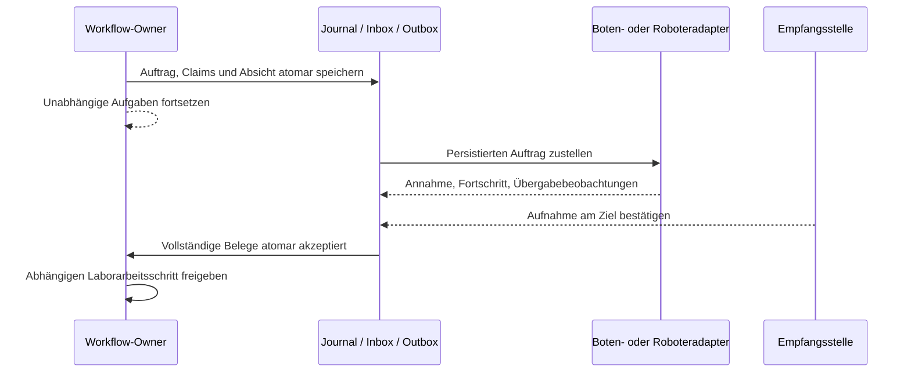

# Asynchroner Transport zwischen Laboren: T0/T1 und Ausbauplan

**Status: T0 und T1 sind für den synthetischen A/B-Fall implementiert.**
Boten- und Robotermock verwenden denselben fachlichen Vertrag. Beide führen
modellhaft einen **Beam-Transport mit null Fahrzeit** aus; es werden weder reale
Boten beauftragt noch Roboter bewegt. Identitäten, Claims und die vier getrennten
Rollenquittungen werden dabei weiterhin vollständig geprüft.

Die Referenzimplementierung führt einen frischen synthetischen Owner im
vorhandenen Journal. T2, die Anbindung an einen bestehenden biologischen
Workflow-Owner, bleibt offen. Der nachfolgende Gesamtplan enthält zusätzlich
spätere Netzwerk-/Robotik- und Stockschritte. Gebäude und Wege bleiben optionaler
räumlicher Kontext; vorhandene aktive Läufe und Bestände werden nicht migriert.

## Ziel und erste Ausbaustufe

Ein Workflow beauftragt den Transport einer identifizierten Einheit von einem
bestätigten Abgabeort zu einem reservierten Empfangsort. Unabhängige Aufgaben
können weiterlaufen; der empfangende Arbeitsschritt wartet auf den bestätigten
Transportabschluss.

**V1: ein autoritativer Store, ein übergeordneter Workflow-Owner, je Auftrag
genau ein geschlossenes Rack mit eingefrorenem Inhaltsmanifest.** Mehrere
unabhängige Aufträge dürfen offen sein. Bote und Robotermock unterscheiden sich
durch Ausführungsadapter und Evidenz, nicht durch Identitäts- oder Abschlussregeln.

Der Transport ist ein Kindauftrag seines Owners, kein neuer Materiallauf mit
kopiertem Inventar. Gefäßentnahme, Aliquotierung, Umverpackung, Mengenverbrauch,
Ownerwechsel, mehrere schreibende Labor-Stores und reale Roboterfahrten sind
nicht Teil dieser ersten synthetischen Stufe.

## Vorhandene Grundlagen und tatsächliche Grenzen

Lesender Ausgangsstand ist `0b8749a`; die untersuchten DNA-/Journal-Dateien
blieben beim folgenden HEAD `c5c72dc` bytegleich.

| Grundlage | Wiederverwenden | Fehlender Ausbau |
|---|---|---|
| [Journal](../scripts/manual_tasks.py), `create`/`append` | Ereignis, Artefakt, Ressourcen und Revisions-CAS in einer SQLite-Transaktion | Job-Unterzuteilungen, persistente Inbox/Outbox und deren atomare Fortschreibung |
| [Material-Ledger](../scripts/material_ledger.py), [Materialworkflow](../scripts/material_workflow.py) | Identitäten, Inhaltsrevisionen, Abstammung und eine führende Mengenbilanz | Rackplatzierung und kanonische laborübergreifende Übergabeplätze |
| [DNA-Auftragsport](../scripts/dna_quantification_port.py) | `intended → dispatched → claimed → observed`; Absicht vor Workeraufruf; Claim und Beobachtung getrennt | Ein offener Goal; B0 bewegt ein Gefäß zwischen Rackplatz und Agent mit Rückgabe zum Heimatplatz, kein Gesamtrack |
| [DNA-Netzwerklaufzeit](../scripts/dna_sila2_runtime.py), [Kontrollkontext](../scripts/dna_quantification_control.py) | Request-Fingerabdruck, Principalbindung und Quittung mit der ersten Root-Wirkung | Globaler Mutex über längere Befehlsausführung; keine allgemeine dauerhafte Jobqueue |
| [Bestandsfortsetzungsplan](stock-continuation.md) | Vorgesehene Stockkopf-/Owner-, CAS- und Fencing-Regeln | Laufübergreifender Bestand und atomare Ownerübernahme bleiben geplant |

Vor T0/T1 gab es keine allgemeine dauerhafte Transportqueue. T1 speichert
Inbox, Outbox und Jobmap nun vollständig im Owner-Zustand desselben Journals,
ohne eine neue Datenbank oder Queue-Tabelle. Eine eigenständige `EffectOutbox`-
Klasse oder ein Netzwerk-SPI wird damit nicht eingeführt. Der bisherige
DNA-Workeraufruf bleibt synchron; ein freier SiLA-Eventloop belegt allein
keine parallele dauerhafte Auftragsbearbeitung.
Die DNA-Ressourcenprojektion hält Agenten aus historischen Goals bis zum
Laufende. Für gemeinsam genutzte Boten braucht es eine andere Zuteilung.

Die parallel vorbereiteten TR01-/Storage-Demos sind zusätzliche synthetische
Referenzen im Arbeitsverzeichnis. Sie definieren diesen Vertrag nicht.
Weltbezogene Fixture-IDs ersetzen keine gemeinsame physische Ressourcenidentität.

## Eigentümer und Identitäten

| Rolle | Verantwortung |
|---|---|
| Workflow-Owner | Journal, Inventar, Mengen, Ressourcen und fachliche Abschlussentscheidung |
| Transportauftrag | Referenziert den Bestand und beschreibt genau eine beauftragte Strecke |
| Ausführender Agent | Bote oder Roboter mit begrenzter Ausführungsbefugnis, ohne Ledgerzugriff |
| Abgebende/empfangende Stelle | Bestätigt die konkrete Übergabe am registrierten Ort |
| Principal | Authentifizierter Nachrichteneinreicher; getrennt von Person, Agent und physischem Gewahrsam |

Fachliche Bindungen des Gesamtvertrags. Die konkret unterstützten T0/T1-Felder
stehen verbindlich in [Protokoll](../model/async-lab-transport.protocol.json) und
[Schema](../model/async-lab-transport.schema.json); darüber hinausgehende
Transportbedingungen bleiben Ausbauziele:

- Autorität/Store, Owner-Root, Transport-ID, Vertragsrevision/-digest,
  Request-ID und Fingerabdruck.
- Dispatchversuch, eindeutige Abhol-/Ablieferungs-Übergabe-IDs,
  Root-Sitzung und monoton steigende Zuweisungsepoche.
- Rackinstanz, Manifestrevision/-digest, Gefäß-IDs, Material-/Probenbezüge
  und Inhaltsrevisionen.
- Standort, Labor/Umgebung, Übergabeort, Halterinstanz und lokaler Platz;
  Quellenrevision des Endpunktvertrags.
- Agent, erforderliche Fähigkeiten, Ressourcenbelege, Ausführungs-/Evidenzklasse
  und explizite Transport-/Annahmebedingungen mit Einheiten.

Material, Probe und physisches Gefäß bleiben verschieden. Aliquots können
dieselbe Herkunft besitzen, benötigen aber eigene Gefäßidentitäten.
Transport erzeugt keine Probe und verändert keine Menge, Inhaltsrevision oder
Verbrauchsbuchung. Auch `null` bleibt unbekannt; ein Transportbeleg erneuert
keine Massenmessung oder deren Frische.

Beim Gesamtrack bleiben **Rackinstanz + lokaler Rackplatz** und ursprüngliche
Heimatplätze erhalten. Geändert werden Platzierung und Gewahrsam des Racks.
Der Ort seiner Gefäße wird aus dieser Hierarchie abgeleitet. Die Rackplatzierung
gehört zur Owner-Inventarprojektion; das unveränderliche Jobmanifest ist ein
Auftragssnapshot und keine zweite beschreibbare Orts-/Mengenliste.

Ein falsches Rack am richtigen Ort, ein fehlendes Gefäß oder eine unerwartete
Inhaltsrevision sperrt die Übergabe. Raumnummer, CAD-Koordinate, URL oder
gleichnamiger `Slot01` genügen nicht als Ressourcenidentität. Endpunkte
referenzieren vorhandene Umgebungs-/Halterdefinitionen; deren Geometrie wird
nicht kopiert. Gebäudenachbarschaft belegt keine Passierbarkeit.

## Reservierungen und Unterzuteilungen

Vor Abholung werden Payload und enthaltene Gefäße/Materialien gesichert,
Quellbelegung geprüft, ein geeigneter Zielplatz reserviert und Agentenkapazität
zugeteilt. Der Erwerb erfolgt atomar vollständig oder gar nicht.
Vorhandene `vessel:`-/`material:`-/`rack:`-Bezüge werden weiterverwendet;
für Übergabeplätze kommen kanonische Ressourcen-IDs hinzu.

Alle beteiligten Writer müssen dieselbe Ressourcenauflösung verwenden.
Verschiedene `world_id` dürfen für dasselbe physische Objekt keine unabhängige
Exklusivität vortäuschen. Unangepasste Legacy-Runner dürfen diese Ressourcen
nicht über andere Aliase belegen.

**T0/T1 führt Job-Unterclaims:** Das Journal schützt Ressourcen heute
zwischen Roots, erlaubt aber denselben Owner mehrfach. Zwei Kindaufträge
desselben Roots brauchen daher exklusive Unterzuteilungen für Rack, enthaltene
Gefäße/Materialien, Plätze und Agentenkapazität.

Auch Handhabungs-, Entnahme- und Umwandlungsoperationen desselben Owners müssen
diese Unterclaims prüfen. Root-Eigentum allein erlaubt keine Inhaltsänderung
an einem für Transport gebundenen Gefäß. Nur tatsächlich unabhängige Aufgaben
dürfen währenddessen weiterlaufen.

| Ressource | Vorgesehene Haltedauer |
|---|---|
| Rack und Inhalt | Owner behält die Bestandsbindung; Job-Unterclaim bis bestätigter Ablieferung oder geklärter Rückführung |
| Quellplatz | V1 hält ihn konservativ für Rückführung bis zum geklärten Auftragsende; tatsächliche Belegung wird getrennt fortgeschrieben |
| Zielplatz | Vor Pickup reserviert; nach Annahme belegt und atomar dem empfangenden Owner-Schritt zugeordnet |
| Agentenkapazität | Auftragsbezogen; nach bestätigter Abgabe und erforderlicher Adapterfreigabe wieder verfügbar |
| Arbeits-/Anfahrbereich | Für die jeweilige Übergabe sichern; nicht pauschal ganze Labore über die Transportdauer blockieren |

Ein gelöschter temporärer Claim macht einen belegten Zielplatz nicht frei.
Ein Kindauftragsabschluss darf keine Root-Holds anderer Schritte entfernen.
Belegung, Ressourcenbesitz und Agentenzuteilung bleiben unterscheidbar.

`material_allocations` dokumentiert dauerhaft die Einführung ausgegebener
Aliquots, nicht wechselnden Gewahrsam. Dieser Index wird weder für Boten
umgeschrieben noch bei Ablieferung gelöscht. Zugeordnete Aliquots werden nicht
in einem neuen Transportroot nochmals eingeführt.

## Fachliche Phasen und Übergabebelege

Phase und Kontrollzustand werden getrennt geführt:

| Phase | Voraussetzung |
|---|---|
| `requested` | Auftrag mit Owner-/Bestandsbezug dauerhaft angenommen |
| `reserved` | Manifest aktuell, Ressourcen vollständig zugeteilt, Endpunkte vorbereitet |
| `pickup_pending` | Autorisierte Abhol-/Transportabsicht vor dem ersten Effekt gespeichert |
| `in_custody` | Abgabestelle bestätigt tatsächliche Abgabe und Agent bestätigt Übernahme |
| `delivery_pending` | Zugehörige Ablieferung vorbereitet; Ankunft allein ändert keinen Gewahrsam |
| `completed` | Agent bestätigt Abgabe, Empfangsstelle bestätigt Aufnahme; Ort, Claims und Jobaudit atomar fortgeschrieben |

`arrived` und Workerfortschritt sind Meldungen, keine Ersatzquittungen.
`held`, `cancel_requested` und `reconcile_required` verhindern neue
Folgeeffekte, ohne letzte bestätigte Phase oder Herkunft zu überschreiben.

Jede Übergabe besitzt zwei getrennte Rollenquittungen:

1. **Abholung:** Abgabestelle hat das erwartete Rack tatsächlich freigegeben;
   der zugewiesene Agent hat es tatsächlich übernommen.
2. **Ablieferung:** Agent hat das Rack tatsächlich abgegeben;
   Empfangsstelle hat Identität und unterstützte Aufnahme am richtigen Ziel bestätigt.

Belege binden Übergabe, Versuch, Manifest, Endpunkte, zugewiesenen Agenten,
Epoche, Beobachtungs-ID und Originalevidenz. Vorabbereitschaft ist keine
nachträgliche Abgabebeobachtung. Erst das passende vollständige Paar ändert
den kanonischen Gewahrsam. Einseitige oder widersprüchliche Angaben machen den
tatsächlichen Zustand ausdrücklich ungewiss: „zuletzt bestätigt an der Quelle“
bedeutet dann nicht „sicher noch dort“.

Dieselbe berechtigte Person darf mehrere Rollen ausführen; beide Rollenereignisse
bleiben explizit. Daraus werden keine zwei unabhängigen Beobachter. Der Bote
darf über den bisherigen globalen `claim` nicht zum Verantwortlichen sämtlicher
Gefäße eines Materialworkflows werden.

## Asynchron und ohne künstliche Transporthalte



Übergabe-IDs, Endpunktfreigaben, Ressourcen und begrenzte Ausführungsbefugnis
werden vor Ausführung gespeichert. Rootphasen sind Buchführungsprojektionen,
keine Roboterhalte nach jedem Netzwerkpaket.

Für Roboter bleibt die Vorgabe fließender Bewegung maßgeblich. Eine begrenzte
beladene Bahn wird vor dem Griff autorisiert und durch die erforderlichen
lokalen Geräte-/Sensorbedingungen abgesichert. Zwischen Griff und Ablage
entsteht kein zusätzlicher Halt nur für einen Netzwerk-Roundtrip.
Übergabebeobachtungen können während dieser Ausführung asynchron eintreffen.
Neue Folgeaufträge bleiben bis zu den nötigen Rootbestätigungen gesperrt.

Beide Seitenquittungen oder sogar eine Ablieferungsmeldung können vor einer
verspäteten Abholmeldung eintreffen. Die Inbox erhält diese Belege dauerhaft,
wendet sie aber erst in gültiger kausaler Reihenfolge an. Nur vorher
autorisierte Übergabe-/Versuchs-IDs sind dafür zulässig. Empfangsreihenfolge
und fremde Zeitstempel beweisen keinen physischen Ablauf.

Das lokale Verhalten bei Verbindungsverlust muss jeder reale Adapter vorher
festlegen und qualifizieren. Server-Leaseablauf stoppt keine Person und keinen
laufenden Roboter. Der synthetische Vertrag belegt weder einen sicheren Stopp
noch eine unterbrechungsfreie Hardwarefahrt.

## Nachrichten, Rechte und atomare Speicherung

Geplantes schmales Adapter-SPI: Auftrag einreichen, Status abfragen, Ereignisse
ab Cursor lesen, Abbruch anfordern. Adapter erhalten den versionierten Umschlag,
aber keine Journal-, Inventar- oder SQL-Verbindung. Domänenübergänge bleiben
beim Owner.

**Nachricht empfangen**, **Auftrag dauerhaft angenommen** und **fachlich
abgeschlossen** bleiben verschiedene Antworten. Das DNA-Muster aus
Request-Fingerabdruck, Principal und persistierter Quittung wird wiederverwendet:

- Identischer Request mit gleichen normalisierten Argumenten und Principal
  liefert die gespeicherte Antwort ohne zweiten Effekt.
- Andere Argumente/Principal unter derselben Kennung sind ein Konflikt.
  Auch eine neue Request-ID darf dieselbe Übergabe nicht doppelt buchen.
- Versuche, Übergaben und Beobachtungen besitzen eigene Kennungen.
  Ein alter Beleg erfüllt keinen neuen Versuch.
- Wiederholbare Zustellung benötigt dauerhafte Deduplikation beim Empfänger.
  Ein leerer Worker-Cache nach Neustart erlaubt keine Wiederholung unklarer Effekte.

Eine **gemeinsame Transaktionsprimitive** muss Rootereignis, Jobprojektion,
Unterclaims, Inbox-Deduplikation, Outbox und Antwortbeleg speichern.
Mehrere unabhängig committende `Journal.append`-/Queue-Aufrufe reichen nicht.

Rootrevision, aktuelle Sitzung, Auftragsepoche, Manifest/Inhaltsrevisionen und
Berechtigungen werden unter demselben Schreiblock geprüft. Ereignis, Projektion,
Evidenz und Ressourcenänderungen committen gemeinsam. Jeder Fehler rollt alles
zurück; fehlgeschlagener Intent verhindert Dispatch. Empfang wird erst nach
dauerhafter Speicherung bestätigt. Indizes/Caches bleiben prüfbare Projektionen.

Quittungen binden den autorisierten Versuch und die Übergabe, nicht einen über
die gesamte Transportdauer unveränderten Rootkopf. Ändert ein unabhängiger Job
den Root, liest der Empfänger nach einem CAS-Konflikt neu und prüft dieselbe
Quittung gegen den aktuellen Zustand. Er ersetzt dabei keine alte Sitzung oder
Epoche durch eine neue und dispatcht keinen Effekt erneut.

Der Dispatcher speichert die Übergabe an den Adapter vor dem Aufruf.
Er hält **weder SQL-Transaktion noch globalen Mutex über die Transportdauer**.
Ein Prozessabbruch an dieser Grenze verlangt bei unklarem Effekt Abgleich.
Inbox/Outbox und Fencing liefern keine physische Exactly-once-Garantie.

Principal, Person, Agent und beobachtende Rolle stammen aus vertrauenswürdigem
Kontext; Payloadfelder verleihen keine Rechte. Scan, Personenbestätigung,
Sensorbeobachtung, Workerclaim und synthetische Eingabe bleiben verschiedene
Evidenzklassen. Ein Scan allein beweist weder Rackinhalt noch sicheren Griff
oder biologische Qualität.

## Fristen, Neustart und Abbruch

| Fall | Verbindliches Verhalten |
|---|---|
| Frist, Logout, fehlender Heartbeat oder Lockablauf | Markieren und eskalieren; keine automatische Gefäß-, Platz- oder Agentenfreigabe |
| Neuer Worker / neue Sitzung | Neue Fencing-Epoche; alte Nachrichten autorisieren keinen neuen Effekt |
| Alter oder widersprüchlicher Beleg | Als Audit-/Konfliktbeleg erhalten; nicht auf neuen Versuch anwenden oder als physisch bedeutungslos wegwerfen |
| Noch nie dispatchter Auftrag | Abbruch nach atomarem Zurückziehen unbeanspruchter Outbox und belegtem Nichtvollzug |
| Dispatch beansprucht oder Ausgang unklar | Nichtvollzug nicht annehmen; Claims halten und ausdrücklich abgleichen |
| Abbruch nach Abholung | Agent bleibt Verwahrer; autorisierte Rückführung oder reservierter alternativer Empfangsort nötig |
| Agentenwechsel unterwegs | Eigene bestätigte Übergabe und neue Befugnis nötig; kein spontaner Wechsel in V1 |
| Empfängerannahme fehlt | Kein normaler Abschluss, keine Freigabe des abhängigen Arbeitsschritts |

Fencing verhindert veraltete Softwareautorisierung, holt aber keinen
physischen Befehl zurück. Eine neue Epoche erlaubt deshalb keinen zweiten
Transport, solange die frühere Ausführung ungeklärt ist.

Der Abgleich benennt `performed`, `not_performed` oder `unknown` mit aktuellen
Belegen. Er erfindet keine historischen Seitenquittungen. Ein Wiederauffindeort
kann eine kontrollierte Rückführung/Abbruchdisposition begründen, beweist aber
keine frühere lückenlose Übergabekette. Ausnahmen brauchen eigene Ereignisse
und eine ausdrückliche Ownerentscheidung.

Fristen und Aufbewahrungsbedingungen laufen während Warten und Kontaktverlust
weiter. Biologische Temperatur-/Zeitgrenzen werden nicht geschätzt; fehlende
verpflichtende Bedingungen blockieren die Freigabe. Das synthetische Beispiel
ist keine biologische, mechanische, Greif-, Navigations- oder Sicherheitsqualifikation.

## Grenze zu mehreren Owners und Stores

V1 erreicht mehrere Labore, **während derselbe Owner seinen Bestand führt**.
Der nächste Laborarbeitsschritt bleibt im selben Root. Jobabschluss prüft die
Übergaben, aktuellen Bestand, offene Effekte und Ressourcenübergabe. Rootabschluss
prüft zusätzlich sämtliche Laborstufen, Transportjobs, Buchungen und Artefakte.

Übernahme durch einen unabhängigen Material-/DNA-Root benötigt zuerst den
[Stock-/Fortsetzungsvertrag](stock-continuation.md): gemeinsamer Bestandskopf,
dauerhafte Gefäßzuordnung, autorisierte Ownerübernahme und atomarer Schreibpfad.
Auftragskopien oder exportierte Berichte ersetzen dies nicht.

Mehrere Netzwerkclients können später dieselbe Autorität verwenden. Getrennte
Labor-Serververzeichnisse besitzen heute getrennte Stores und koordinieren weder
Reservierungen noch Mengen. Eine DB-Kopie ist kein koordiniertes Inventar;
gespeicherte IDs allein verhindern keinen absichtlich geklonten schreibenden
Store. Föderation und verteiltes Fencing sind eigene spätere Ausbaustufen.

## Umsetzungsetappen

| Etappe | Ergebnis | Abnahme |
|---|---|---|
| T0 · Domänenvertrag, synthetisch implementiert | Versionierte Auftrags-/Quittungsschemata, Rollen, Invarianten, reiner Zustandsautomat | Beide Quittungspaare, ungeordnete Nachrichten, Identitäts-/Versionskonflikte ohne Gerätezugriff |
| T1 · Dauerhafte Ausführung, synthetisch implementiert | Opt-in Owner-Komposition mit Jobmap, atomarer Inbox/Outbox, Claims, Fencing; Boten- und Robotermock | Neustart-/Konkurrenztests; gleicher fachlicher Endzustand beider Adapter |
| T2 · Workflowanbindung | Vorhandener Owner wartet auf Transportabschluss; unabhängige Aufgaben laufen weiter | Zwei disjunkte Jobs offen; gleicher Payload/Zielplatz niemals doppelt zugeteilt |
| T3 · Mensch und Netzwerk | Berechtigte Botenoberfläche, optionaler Netzwerkadapter über dieselben Domänenoperationen | Rollen, Reconnect und persistente Deduplikation separat geprüft |
| T4 · Reale Robotik | Bewegungs-/Sensoradapter mit passender Ausführungsbefugnis | Fließende Bahn, reale Griff-/Ablagebelege und lokales Ausfallverhalten separat geprüft |
| Gesonderter Stock-Ausbau | Übergänge zwischen unabhängigen Owners, später mögliche Föderation | Keine zweite Einführung oder Mengenrücksetzung; eine Reservierungs-/Bestandsautorität |

T0/T1 stellt einen kleinen Transportkern, einen Ownerport und einen expliziten
Dispatcher mit zwei Adaptern bereit; die verbindlichen Quellen stehen unten.
Identitäts-, Journal- und Ledgerregeln bleiben in den gemeinsamen Komponenten,
statt pro Adapter eine eigene Bilanz/Zustandsmaschine einzuführen.

Neue Laufzeitkompositionen werden explizit versioniert und zuerst mit frischen
synthetischen Fixtures eingeführt. Aktive Roots, B0-Quellen und bestehende FDLs
werden nicht still migriert. SiLA-LockController v1, der separate v2-Draft-/GENtle-
Plan, ROS-B0 und reale Robotiknachweise bleiben getrennt. Der Plan definiert
kein normatives SiLA-Feature und installiert keine ROS-Umgebung.

Neue Berichte müssen Transportmodus, Übergabeevidenz, Netzwerkprüfung,
Bewegungsausführung, Hardware und Ownerwechsel getrennt ausweisen. Der vorhandene
DNA-Loopback-Nachweis belegt keine Ausführung dieses neuen Transportvertrags.

## Erster Testfall und Abnahmen

Zwei synthetische Labore A/B mit je zwei benannten Übergabeplätzen. Ein geschlossenes
Rack wird A → B durch den Botenmock und B → A durch den Robotermock beauftragt.
Gefäß-, Proben-/Material- und Rackplatzbezüge sowie Mengen bleiben erhalten.
Ein zweites disjunktes Rack und andere Rootaufgaben prüfen echte Nichtblockierung.
Daraus werden keine realen Wege, Zeiten oder Beschleunigungsgrenzen abgeleitet.

Verpflichtende Tests:

1. Beide Seitenquittungsreihenfolgen und Ablieferung vor verspäteter Abholmeldung:
   dauerhafte Speicherung und kausal zulässige Anwendung bleiben getrennt.
2. Fehlende Seite, falsches Rack, falscher Halter bei gleichem Platznamen,
   unvollständiges Manifest und geänderte Inhaltsrevision blockieren.
3. Gleicher Request ohne Doppeleffekt; geänderte Argumente/Principal und zweite
   Request-ID für dieselbe Übergabe erzeugen keine doppelte Buchung.
4. Zwei DB-Verbindungen konkurrieren um Rack, Inhalt, Zielplatz oder Agentenplatz;
   auch zwei Kindaufträge oder eine Materialoperation desselben Owners können
   Exklusivität nicht umgehen. Eine unabhängige Rootänderung zwischen Dispatch
   und Quittung erlaubt nach erneutem CAS die weiterhin gültige Quittung.
5. Schreibfehler rollen Root, Claims, Job, Inbox/Outbox und Antwort vollständig
   zurück; nach fehlgeschlagenem Intent wird kein Adapter aufgerufen.
6. Harter Abbruch vor/nach Dispatch und zwischen Quittungen: Claims bleiben
   erhalten; Neustart wiederholt keinen unklaren Effekt.
7. Alte Sitzung/Epoche, verspätete Quittung, widersprüchlicher Ortsbeleg:
   keine neue Autorisierung; Konflikt und physische Ungewissheit bleiben sichtbar.
8. Abbruch vor/nach Pickup, belegter Rückkehrplatz und erfolglose Rückführung:
   kein automatisches Zurücksetzen auf den Quellort.
9. Jobabschluss entfernt keine fremden Root-Holds; belegter Empfangsplatz und
   Payload bleiben für den richtigen Folgeschritt gebunden.
10. Kein Material-Neueintrag, Debit oder Mengenreset, einschließlich `null`;
    permanente Aliquotzuordnungen unverändert.
11. Bote/Robotermock ergeben denselben fachlichen Endzustand mit getrennten
    Evidenzklassen. Annahme, Claim, Ankunft oder Scan allein reichen nicht.
12. Ein vorab autorisierter synthetischer Roboterlauf erhält keine zusätzlichen
    Netzwerkwartepunkte zwischen Griff und Ablage; fehlende Belege verhindern
    trotzdem die vorzeitige Freigabe des nächsten Laborprozesses.

Die T0/T1-Prüfungen der Referenzimplementierung stehen im folgenden Abschnitt.
Die gesamte Liste beschreibt auch spätere T2–T4-Abnahmen; sie behauptet keine
vorhandene Netzwerkanbindung, reale Botenoberfläche, Robotik oder Ownerübernahme.

## T0/T1: ausführbare Referenzimplementierung

| Quelle | Aufgabe |
|---|---|
| [Protokoll](../model/async-lab-transport.protocol.json) | Führende Phasen-/Rollenliste, synthetischer Beam-Modus und Prüfgrenzen |
| [A/B-Fixture](../model/async-lab-transport.synthetic.json) | Zwei Racks, je zwei Gefäße, zwei Labore mit je zwei Plätzen, Boten-/Roboteragenten; bekannte 40-µl- und unbekannte Mengen |
| [Schema](../model/async-lab-transport.schema.json) | Versionierte Definition sowie Umschlag-/Quittungsformen |
| [Domänenkern](../scripts/async_transport_domain.py) | Reine Transitionen, Manifest, Rollen, kausale Inbox, Job-Unterclaims und Audit |
| [Owner-Laufzeit](../scripts/async_transport.py) | Journal-CAS, Request-Idempotenz, Quellenpins, persistenter Dispatch, Wiederanlauf und Berichte |
| [Beam-Mocks](../scripts/async_transport_adapters.py) | Gemeinsame Implementierung mit zwei Agentenarten; Claim plus vier getrennte synthetische Nachrichten |
| [CLI](../scripts/run_async_transport.py) | Explizite Fixtureinitialisierung, Demo, Status/Bericht und JSONL-Sitzung |

```sh
python3 scripts/run_async_transport.py --store exports/async-ab/workflows.sqlite3 demo
python3 scripts/run_async_transport.py --store exports/async-ab/workflows.sqlite3 status SYN.AsyncTransport.AB.Run
python3 scripts/run_async_transport.py --store exports/async-ab/workflows.sqlite3 report SYN.AsyncTransport.AB.Run --out exports/async-ab/report.json
```

Die Demo führt drei Aufträge aus: Rack 1 von A nach B per Botenmock, Rack 2 von
A nach B per Robotermock und Rack 1 zurück nach A per Robotermock. Die ersten
beiden Aufträge sind vor jeder Beobachtungsannahme bereits dispatcht. Beim
Robotermock treffen die Ablieferungsbelege zuerst ein. Der Owner verarbeitet
sie erst nach den passenden Abholbelegen. Der Transport verändert weder die
Gefäß-/Materialprojektion noch Rackplätze, Mengen oder Inhaltsrevisionen.

Eine erneute Demo darf denselben Root oder dieselbe bereits angenommene Fixture
im selben Store nicht zurücksetzen. Der eigene Demo-Store ist eine unabhängige
synthetische Testwelt, kein Weg zur Fortsetzung eines realen Bestands. Ohne
`--store` wird der bestehende gemeinsame Standard-Store verwendet.

`create` speichert zuerst ausschließlich eine unveränderliche Deklaration,
einen unbestätigten Root und leere Ressourcen-/Inventarprojektionen. Erst
`admit` nimmt das synthetische Inventar und alle Basisholds atomar an. Das
umgeht keine permanente Material-/Gefäßzuordnung eines bestehenden Owners.
Basisholds für Fixture, Racks, Inhalt und belegte Plätze bleiben im Owner
bestehen, auch wenn die drei Jobs abgeschlossen sind. Die Agentenzuteilung
wird dagegen nach geklärtem Jobabschluss frei. `passed` bezeichnet die
synthetische Transportprüfung, keinen abgeschlossenen biologischen Gesamtlauf.

Die Python-API trennt `dispatch(...)` und `ingest(batch)`: Dispatch speichert
vor dem Adapteraufruf; der Rückgabebatch hat zunächst keine Inventarwirkung.
Die CLI/API pumpt diese Nachrichten ausdrücklich. Ein autonomer Hintergrund-
Worker, echtes Messaging und ein authentifizierter Netzwerkdienst gehören
nicht zu T1. Die Fixture-Principals sind synthetische Rollenkontexte, keine
Logins oder bestätigten Personenidentitäten.

Eine neue schreibende Sitzung benötigt ausdrücklich `session --resume`:

```sh
python3 scripts/run_async_transport.py --store exports/async-ab/workflows.sqlite3 session SYN.AsyncTransport.AB.Run --resume --actions exports/async-ab/actions.jsonl
```

JSONL-Zeilen enthalten exakt `operation`, `principal`, `request_id` und `args`.
Eine reine `status`-/`report`-Abfrage übernimmt keine Sitzung. Resume ersetzt die
Sitzung, erhöht die Epoche und hält offene Jobs. Bereits dispatchte Arbeit wird
keinem neuen Mock automatisch erneut gegeben. Ein Quellenwechsel sperrt
Fortsetzungen; es gibt keine stille Formatmigration.

Die Mocks erzeugen alle Belege explizit als synthetische Endpunkt-, Boten- oder
Roboterattestation. Ihr Cache gilt nur für die jeweilige Instanz; stabile
Request-/Beobachtungskennungen und der Owner verhindern Doppeleffekte. Die
Beobachtungsbatches werden kanonisch serialisiert als Journalartefakte erhalten.
Ein Workerclaim allein ändert keinen Ort. Abweichende oder alte Belege bleiben
als Konflikt sichtbar und sperren den Fortschritt. Eine kontrollierte
Abbruchdisposition ohne vollständige historische Kette wird als
`cancelled_reconciled` ausgewiesen, niemals als normal abgeschlossener Transport.

Ein später Widerspruch zu einem bereits terminalen Job sperrt auch neue oder
bereits dispatchte Folgeaufträge desselben Racks. Historische Erfolgsereignisse
werden erhalten; der aktuelle Bericht weist den Konflikt aus und meldet keinen
Erfolg. **T1 besitzt noch keine Freigabe-API für solche terminalen Konflikte.**
Das betroffene Rack bleibt gesperrt, statt einen geklärten Ort zu behaupten.

Prüfgrenzen bleiben ausdrücklich: **kein Netzwerk, keine ROS-Ausführung, keine
Bahn, keine Hardware, keine reale Authentifizierung, kein realer Scan, keine
biologische oder Sicherheitsqualifikation, keine bestehende Workflowanbindung
T2 und kein laufübergreifender Stock**. Null Fahrzeit ist eine erfundene
Ausführungsannahme. Frist-/Ausfallmeldungen können einen Job halten; ein
Wallclock-Watchdog, Sensorstopp oder reale Temperaturüberwachung wird nicht
behauptet. Vorhandene SiLA-/CAD-Nachweise bleiben davon getrennt.

Gezielte Prüfungen:

```sh
python3 -m unittest discover -s tests -p 'test_async_transport*.py' -v
```

Prüfstand 12.11.2026: **72 Transporttests bestanden, keine übersprungen.**
Der frische CLI-Demolauf schloss drei Jobs mit 29 Journalereignissen ab;
bekannte und unbekannte Mengen blieben unverändert, ohne Verbrauchsbuchung.
Quellenpins blieben während der Prüfung stabil.
Die Commitprüfung wiederholte die 72 Transporttests zusammen mit 44 Journal-
und Materialallokationstests aus einem sauberen Checkout: alle 116 bestanden,
keine übersprungen. Der Testaufbau legt seinen ignorierten Laufzeitordner selbst
an und benötigt keine vorherige Demoausführung.
Zusätzlich bestanden 299 gezielte Regressionstests für Journal, Material-Ledger
und Lebenszyklus, den bisherigen Gesamtlauf sowie DNA-, NanoDrop- und Qubit-
Abläufe, ebenfalls ohne übersprungene Tests. Dies ist kein neuer CAD-, Netzwerk-
oder Hardwareprüfnachweis.

Die Tests prüfen Rollen-/Manifestbindung, sämtliche Rollenreihenfolgen,
unveränderte Mengen einschließlich `null`, Nebenläufigkeit mit zwei SQLite-
Verbindungen, harte Prozessunterbrechung, Fehler nach SQL-Schreibschritten,
Requestwiederholung und Abgleich. Sie prüfen auch Abbruch zwischen gespeichertem
Dispatch und Adapteraufruf, späte Konflikte bei Folgejobs sowie die strikten
JSON-Typgrenzen für Epochen und Ausführungsflags.
