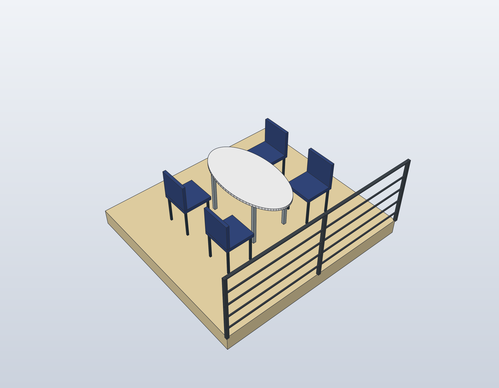
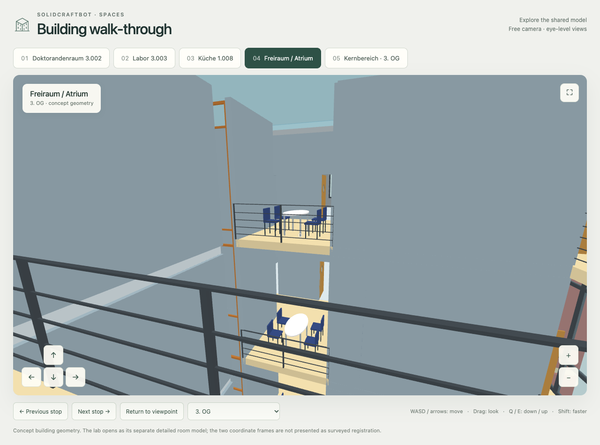

# Sitzgruppe im Kernbereich am Atrium

Die Sitzgruppe steht im **Kernbereich**, dem unnummerierten Bereich `NorthCore`
gegenüber dem Doktorandenraum **3.002** auf der anderen Seite des Atriums.
Der Eigentümer hat diese Lage als **C** im abgeleiteten Orientierungsplan
bestätigt. Im **1., 2. und 3. OG** stehen dort jeweils ein weißer elliptischer
Tisch und vier Stühle: insgesamt drei Sitzgruppen.

Die frühere westliche Zuordnung zu `R3_012` und `CoreGap` war falsch. Diese
Bereiche gehören zur Toilettenseite; ihre ursprünglichen Flächen, Grenzen und
Türöffnungen bleiben wie im Plan erhalten. Die Küche 1.008 bleibt auf der
Küchenseite des Gebäudes; ihre gesonderte Raum- und Fensterkorrektur ist in der
[Möblierungsdokumentation](building-furnishings.md) beschrieben.
Die Rohzeichnung F03 wird durch die Korrektur nicht verändert.





Die schräge Bereichsansicht stammt aus dem aktuellen unabhängigen
SolidCraft-Bereichsmodell; umgebende Wände sind dort für die Sicht ausgeblendet.
Der Atriumblick stammt aus dem vollständigen FreeCAD-Modell im Browser.
Die Ansichten und die [Bildprovenienz](media/atrium-seating.provenance.json)
sind an den korrigierten Stand gebunden. Der
[Rundgang](building-walkthrough.md) verwendet den Blickpunkt
„Kernbereich · 3. OG“.

## Planbezug und gemeinsame Quelle

Die Gebäudevariante `AtriumAccess` bindet ausschließlich die vorhandene Fläche
`NorthCore`. `W063` bildet den offenen Zugang vom Flur `C3_021`; `W065` bildet
die offene Atriumkante mit dem gemeinsamen Geländerrezept. Die Wände `W062`
zum Aufzug und `W079` zum inneren Treppenhaus bleiben erhalten. Die Bodenfläche
wird innerhalb der vorhandenen Kernbereichskontur ergänzt; sie ragt nicht als
neue Plattform in den Luftraum.

Die unbestimmte Klassifikation der ursprünglichen F03-Vorlage bleibt dort
unverändert. Erst die geschossgebundene Gebäudekomposition bezeichnet
`NorthCore` als offenen Kernbereich. Sie vergibt keine neue Raumnummer.
`R3_011`, `R3_012` und `CoreGap` werden dafür nicht umgewidmet; die ursprüngliche
Tür `D3_012` wird nicht deaktiviert.

`atrium_seating` in `model/furnishings/building-social.json` führt genau eine
Möblierungsvorlage mit den drei Geschossbindungen. Ihr Anker `AtriumAccess`
referenziert die Planvariante. `scripts/atrium_seating.py` berechnet die Lage aus
der Quellfläche sowie den gegenüberliegenden Flur- und Geländerkanten.
Die Vorlage kopiert weder Raumkonturen noch Weltkoordinaten.

## Weißer elliptischer Tisch

Der gemeinsame Möbelkatalog führt den Typ `oval_table` mit dem Rezept
`elliptical_table`. Die Tischplatte ist weiß (`#ffffff`) und besitzt eine
elliptische Kontur. Das Rezept berechnet daraus ein Polygonprofil mit höchstens
**0,5 mm** deklarierter Bogen-/Sehnenabweichung und extrudiert dieses mit der
vorhandenen portablen Operation `polygon_prism`. Beide CAD-Adapter erhalten
dieselben Profilpunkte. Es wird keine neue analytische Ellipsenoperation im
CAD-Vertrag behauptet.

Die Ausgangsmaße sind **1.500 × 800 mm**, Höhe **745 mm**. Bei diesen Werten
besteht das Profil aus 88 Punkten; die konservative Abweichungsgrenze beträgt
rund **0,478 mm**. Vier Beine werden aus demselben parametrischen Rezept
abgeleitet und müssen vollständig innerhalb des tatsächlich erzeugten Profils
liegen. Die nominalen Maße, Beinstationen und Höhen bleiben Darstellungsannahmen.

Vier vorhandene `dining_chair`-Instanzen stehen zu zweit an jeder Längsseite.
Ihre Körpermaße stammen aus dem Katalog. Die Möbel werden nicht verkleinert,
um eine nicht passende Fläche nutzbar erscheinen zu lassen; eine zu große
Konfiguration wird abgewiesen.

## Prüfstand und Grenzen

Die Quellprüfung prüft die offene rechteckige Kernbereichsfläche, vollständige
Möbelgrößen, Bodenkontakt und konservative Körperbegrenzungen zwischen
verschiedenen Möbeln sowie gegen Wand- und Geländerlinien. Ein Regressionstest
verlangt, dass Flächen, Grenzen und Türen der Toilettenseite auf allen drei
Obergeschossen mit der kanonischen Zeichnung übereinstimmen.

Der aktuelle FreeCAD-Gesamtstand `building-stack-ecc15e1b9dd9` besteht mit
1.944 geschlossenen Körpern, 452 gezielten Geometrieprüfungen und 15
Höhenprüfungen. Eine unabhängig aus den gemeinsamen Operationen erzeugte
SolidCraft-Bereichsprüfung enthält 306 geschlossene Körper für Kernbereich,
Toilettenabgrenzung und Küche; ihre 18 nativen Prüfzeugen bestehen. Alle 87
Sitzgruppenkörper, drei weißen Tischplatten, zwölf Stühle und 15
Möbel-Bodenkontakte sind darin bestätigt. Ein neuer vollständiger
SolidCraft-Gebäudeaufbau oder STEP-Gesamtvergleich wird nicht behauptet.
Der aktuelle Browserexport besteht die tatsächliche Chrome-Prüfung aller
fünf Blickpunkte, Bewegungs- und Mobilbedienung. Quellen, native Artefakte,
Bilder und Prüfumfang sind in der Bildprovenienz gebunden.
Die früheren Stände `5406a30fc113` und `6dbc248fae3b` beziehen sich auf die
zurückgenommene Platzierung auf der Toilettenseite. Ihre damaligen
Geometrieprüfungen und Außenflächen-Äquivalenznachweise sind historische
Nachweise dieser falschen Aufstellung; sie qualifizieren die neue Lage im
Kernbereich nicht.

```sh
python3 -m unittest discover -s tests -p 'test_atrium_seating.py' -v
python3 -m unittest discover -s tests -p 'test_elliptical_table.py' -v
python3 -m unittest discover -s tests -p 'test_building_plan_variants.py' -v
```

Die Prüfungen betreffen statische Darstellkörper. Vermessene Möbelabstände,
Stuhlbewegungen, reale Wege, Ergonomie, Tragfähigkeit und normgerechte
Absturzsicherung sind damit nicht qualifiziert. EG und Keller erhalten durch
diese Vorlage keine zusätzlichen Sitzgruppen.
