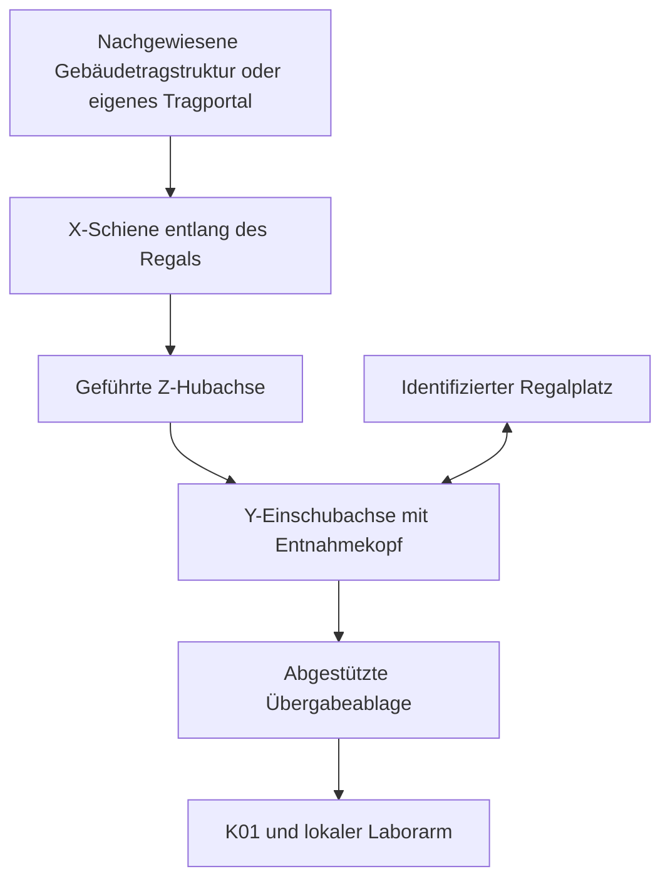

# Automatisierter Storage: Ausbauplan ab K01

**Status: geplant, nicht implementiert.** Ausgangspunkt ist Commit
`f7b6bbc301c4c3675f4f41fcf2af80c1edd19d7b` mit modellierten Griffen an K01-Trägern
und Deckeln. Dieser Plan wurde auf Eigentümerwunsch ohne Claude ausgearbeitet.
Er ist keine Auswahl oder Freigabe einer realen Lager- oder Deckenanlage.

Der erste begrenzte [synthetische Testfall S01](synthetic-storage-s01.md)
ergänzt inzwischen einen Regalplatz, einen referenzierten K01-Träger und
eine feste Übergabeablage. Statische CAD-Fälle und ein eigener Fixture-Mock
sind von der weiterhin geplanten gemeinsamen Bestandsintegration und realen
Transportausführung zu unterscheiden. Die folgenden Ausbauschritte bleiben
ein Plan; S01 ersetzt insbesondere nicht das reale Aufmaß.

## Version 1: beide Kits direkt an der Station

RNA- und DNA-Kit bleiben unmittelbar an K01 bereitgestellt. Einräumen,
Regalzugriff und Deckenroboter sind keine Voraussetzung der ersten Version.
Die bisherigen Kitpositionen und die Extraktionsvorbereitung bleiben erhalten.
Die neun Materialhüllen je Kit sind weiterhin eine Typübersicht mit
`planned_unobserved`, keine beobachtete Bestückung oder Packungsstückzahl.

Der [K01-Entwurf](extraction-kit-station.md) besitzt einen Frontgriff für den
ganzen Träger und einen Dachgriff ausschließlich für die abnehmbare Haube.
Gemeinsame Parameter erzeugen Geometrie und Greif-/Anfahrbezüge. Statische
CAD-Freiräume belegen keine Traglast, reale Greifbarkeit oder Transportbahn.

## Mechanische Zielrichtung

Als erste eigene Konzeptvariante schlage ich einen an einer nachgewiesenen
Tragstruktur befestigten Wagen entlang der Regalfront vor. Drei geführte
Translationen übernehmen die zunächst gleich orientierten Träger:

| Achse | Aufgabe |
|---|---|
| X | Entlang der Regalfront zum gewünschten Fach fahren |
| Z | Höhe des Fachs oder der Übergabeablage einstellen |
| Y | In das Fach greifen und den Träger herausziehen beziehungsweise einschieben |

Das Schaubild beschreibt eine zu untersuchende Kinematik, keine Installation.
Eine abgehängte Raumdecke wird nicht als tragfähig angenommen. Gebäudelastpfad,
Befestigung, Führung, Hubhaltesystem, Lastaufnahme und Rückhaltung müssen
gemeinsam ausgelegt werden. Eine frei am Seil pendelnde Last ist nicht die
vorausgesetzte Positioniermechanik.

Eine Linearachse mit Deckenmontage ist ein existierendes Prinzip, etwa bei
der [KUKA KL 100](https://www.kuka.com/en-us/products/robotics-systems/robot-periphery/linear-units/kl-100).
Festo beschreibt [kartesische X-/Y-/Z-Portale, Dokumentstand 2024/01](https://www.festo.com/media/pim/292/D15000100173292.pdf);
das Dokument nennt horizontale Montage und ist kein Nachweis einer beliebigen
Überkopfmontage. Beide Quellen dienen nur als Prinzipbelege. Sie begründen
keine Produktauswahl oder Übertragung von Leistungs- und Sicherheitseigenschaften
auf DIYLabBot. Der Vorschlag mit drei Translationen ist unsere eigene
Entwurfsbewertung für die beschränkte erste Aufgabe.

Ein sechsachsiger Entnahmekopf wird erst nötig, wenn die aufgenommenen
Orientierungs- und Zugangsanforderungen das rechtfertigen. Dann ist die vorhandene
Armquelle zu referenzieren; ihre Überkopfverwendung braucht eine eigene
Auslegung. Die sechs Drehachsen der Laborarme bleiben unverändert. Die
Lagerkinematik erhält einen eigenen passenden Modellvertrag. Zwei gegenüberliegende
Regalseiten, Kopfrotation und Raumwechsel bleiben spätere Varianten.
Der vorhandene [Bodentransporter TR01](sample-transport-tr01.md) behält seine
Aufgabe zwischen Armstationen beziehungsweise Laboren.

## Ganze Träger entnehmen, abgestützt übergeben

Zunächst wird ein geschlossenes Kit als Ganzes transportiert. Der Deckel
bleibt bis K01 aufgesetzt. Sein Griff wird beim Ein- und Auslagern nicht
zur Aufnahme des ganzen Kits verwendet.

Der Frontgriff erzeugt durch den dahinterliegenden Schwerpunkt ein Kippmoment.
Vor einer mechanischen Festlegung sind deshalb eine formschlüssige Aufnahme,
eine zusätzliche Unterstützung unter dem Träger und eine Sicherung gegen
Verkippen zu vergleichen. Auch Artikel, Einsatz und Deckel brauchen eine
geeignete Rückhaltung. Der vorhandene Griff allein löst diese Aufgaben nicht.
Die Fachhülle muss den vollständigen geschlossenen Träger einschließlich
Dachgriff, Greifer, Unterstützung und Anfahrraum aufnehmen.

Ein definierter, abgestützter Übergabeplatz verbindet Storage und lokale
Laborrobotik: Träger absetzen, Unterstützung und Identität bestätigen,
Greiferfreigabe bestätigen, dann lokalen Zugriff erlauben. Eine freie
Arm-zu-Arm-Übergabe wird zunächst nicht benötigt. Der Entnahmekopf soll keine
einzelnen offenen Probengefäße durch den Raum reichen. Für spätere Probenaufgaben
werden identifizierte geschlossene Racks oder Kassetten mit eigenen Einsätzen
und Bedingungen vorgesehen.

## Vier räumliche Ebenen und eine gemeinsame Identitätsführung

Die [Zielarchitektur](../ARCHITECTURE.md#vier-beschreibungsebenen) bleibt maßgeblich:

| Ebene | Künftiger Storage-Anteil |
|---|---|
| Arbeitsumgebung | Vermessene Gebäude- und Traganschlussbezüge, freie Zugangsbereiche |
| Möbeltypen | Ein wiederverwendbarer Regaltyp mit lokalen Fächern und Aufstellrahmen |
| Möblierung | Konkrete Regalinstanzen und deren Aufstellung |
| Geräteausstattung | Referenzierte Schienenanlage, Entnahmekopf und Übergabeplatz |

K01-Träger und spätere Probenkassetten referenzieren ihre führenden Quellen.
Fachrahmen, Greifrahmen und Zielorte werden daraus abgeleitet; eine Regalinstanz
enthält keine kopierten Container- oder Roboterkörper. Allgemeine Montagegraphen,
Regalplatzverträge und Storage-Adapter sind noch zu implementieren. Es werden
hier keine neuen verfügbaren Schemafelder behauptet und keine L01-Instanzen
umgestellt.

Artikeltyp, tatsächlicher Artikel, Kitträger, Inhalt, physischer Ort und
Verantwortung sind getrennte Identitäten. Im späteren Bestand ist etwa ein
bestimmtes Gefäß weiterhin demselben Platz seines identifizierten Racks
zugeordnet, während das Rack seinen Lagerort wechselt. Die ursprünglichen
Proben- und Platzidentitäten bleiben erhalten. Ein Transport erzeugt weder
neue Gefäße noch Verbrauch und setzt keine Restmenge zurück.

Dafür ist eine versionierte Erweiterung des gemeinsamen Inventars erforderlich:
Träger mit bestätigter Zusammensetzung, Eltern-Kind-Zuordnung und Inhaltsrevision;
typisierte Orte für Regalplatz, Aufnahme und Übergabeplatz; bestätigter Gewahrsam
und ausdrücklich ungeklärte Zustände. Enthaltene Objekte und ihre Reservierungen
müssen beim Transport des Elternträgers mitgeprüft werden. Einen Regalplatz nicht
still als vorhandenen Rackplatz ausgeben. Die heutigen K01-Symbole werden
nicht automatisch in reale Artikel und Mengen umgewandelt.

Die [laufübergreifende Bestandsführung](stock-continuation.md) ist ebenfalls
noch ein Plan und schließt Reagenzvorräte zunächst aus. Vor Storage-Laufzeitbetrieb
müssen der gemeinsame dauerhafte Bestand und die erforderlichen Reagenz-/
Trägerbezüge umgesetzt werden. Keine separate Regal-Datenbank als zweite Bilanz
anlegen. Stock-/Rootereignis, Ortswechsel, Reservierungen und Bestandskopf sind
atomar zu speichern; erwartete Version, persistente Lease und Fencing-Epoche
schützen vor parallelen beziehungsweise veralteten Schreibern.

## Transportauftrag und Wiederanlauf

Der erste Auftrag ist seriell: ein Träger, ein Quellenfach, ein freier Zielplatz,
ein Entnahmekopf. Fahrbereich und beteiligte Ressourcen bleiben reserviert,
bis der tatsächliche Ausgang geklärt ist.

1. Quellen-/Zielidentität, Trägerzusammensetzung, Umgebung, Rückhaltung und
   Ausführungsberechtigung prüfen; Absicht vor einer Wirkung dauerhaft speichern.
2. Träger identifizieren, Aufnahme ausführen und tatsächliche Übernahme bestätigen.
3. Vom bestätigten Griff zur Ablage fließend fahren. Entnahme-, Freiraum- und
   Transitmarken erzwingen keinen Halt. Geschwindigkeits-, Beschleunigungs- und
   Ruckgrenzen gelten für Achsen, Werkzeug und vollständige Last samt Orientierung.
4. Abgestützte Ablage, Freigabe und beobachteten Zielort getrennt bestätigen;
   erst danach Auftrag und Reservierungen ordnungsgemäß abschließen.

Physische Unterstützung und logischer Gewahrsam sind getrennt zu erfassen.
Eine Übergabe darf zeitweise zwei Stützen besitzen, aber keinen widersprüchlichen
Bestandsort oder zwei unabhängige Besitzer erzeugen. Fehlende Quittung,
Prozessabbruch oder Neustart lässt eine Durchführung ungeklärt. Keine automatische
Wiederholung und keine angenommene Rückkehr ins Regal. Leaseablauf ist keine
Freigabe einer schwebenden Last; ein Datenbanktoken stoppt keinen bereits
abgesandten Motorbefehl.

Notwendige Halte dienen Griff, Ablage, Beobachtung oder einer konkret benannten
Schutz-/Synchronisationsbedingung. Die vorhandene gemeinsame PVA-/FK-Mathematik
wird wiederverwendet; ausgeführte Kurve und Export benötigen neue Nachweise
zwischen den Knoten. Ein statisches Greifbild ersetzt diese Prüfung nicht.

ROS wäre die Bewegungs-/Rückmeldegrenze; ein späterer SiLA-Dienst bietet
Transportfähigkeiten und beobachtete Zustände an. Wissenschaftliche Absicht,
Materialanforderungen und Zeitpunkt der Bereitstellung liegen beim Workflowplaner
wie GENtle. Diese Bindung ist wie bisher Zielarchitektur. Ein SiLA-Lock beweist
weder eine erfolgreiche Übergabe noch mechanische Sicherheit.

## Kitvorrat und Probenlagerung unterscheiden

Für Originalkomponenten gelten die in der [Stationsdokumentation](extraction-kit-station.md#lagerung-und-arbeitsvorbereitung-unterscheiden)
belegten Herstellerbedingungen und das konkrete Etikett. Öffnung, Ansatz,
Charge und Verwendbarkeit erhalten eigene Bezüge. Ein geschlossener Container
verlängert keine Haltbarkeit. Unbekannter oder verletzter Lagerzustand darf
nicht allein durch Rückstellen auf einen Platz zur Freigabe werden.

Zellpellets, RNA-/DNA-Produkte und Arbeitslösungen bekommen eigene Lagerzwecke,
Umgebungsbedingungen, Fristen und Qualitätsentscheidungen. Raumtemperatur der
Kitkomponenten ist keine Freigabe für diese Materialien. Kühlschrank-, Gefrier-
oder Türzugriff, Expositionszeiten und Kondensat sind eine eigene spätere
Ausbaustufe. Die bisherigen synthetischen Mess- und Extraktionsverträge werden
dadurch nicht still erweitert.

## Schritte und Abnahmekriterien

| Schritt | Ergebnis und notwendiger Nachweis |
|---|---|
| 0 · Jetzt | Beide Kits direkt an K01; Griffentwurf mit nativen Bildern und Prüfgrenzen in `f7b6bbc` |
| 1 · Aufmaß und Lastfälle | Reale Artikel-/Trägerabmessungen, Stückzahlen, Massen, Schwerpunkt, Greiferbedarf, Fachmaße und Gebäudelastpfad erfassen; offene Werte bleiben `null` |
| 2 · Ein Fach, eine Ablage | Gemeinsame Quellen und formale Verträge für Regal, Trägeraufnahme und Übergabe entwickeln; beide CADs unabhängig aufbauen und vollständige Hüllen prüfen |
| 3 · Synthetischer Auftrag | Gemeinsamen Inventar-/Stockvertrag ergänzen; Entnahme, Übergabe und Rückgabe zunächst mit ausdrücklich synthetischen Beobachtungen testen |
| 4 · Lokaler Prüfstand | Aufnahme, Abstützung, Retention, Halten bei Energieverlust und Wiederanlauf zuerst mit geeigneter Ersatzlast prüfen; Kriterien vor Versuch festlegen |
| 5 · Eine automatisierte Strecke | Nachgewiesene Tragstruktur und Achsen verwenden; eine fließende Fach–Ablage–Fach-Bahn inklusive voller Last, Greifer, Nachbarn und Export neu prüfen |
| 6 · Ausbau | Weitere Fächer, Planung mehrerer Aufträge und gegebenenfalls Proben-/Kühllagerung getrennt ergänzen und qualifizieren |

Für Schritt 3 sind mindestens doppelte Entnahme desselben Trägers, belegtes
Ziel, falsche Identität, reserviertes enthaltenes Gefäß, veraltete Lease,
Speicherfehler vor Wirkung sowie Neustart nach Wirkung ohne Quittung als
negative Tests vorzusehen. Kein Fall darf doppelte Orte, erneuten Verbrauch
oder unbelegte Freigabe hinterlassen. Beobachtete Beladung und Ortsbestätigung
bleiben von synthetischer Eingabe unterscheidbar.

Nutzlast, Bauhöhe, Hub, Reichweite, Genauigkeit, biologische Bewegungsgrenzen,
Reinigung, Lebensdauer, Schutzkonzept und Kosten sind noch nicht festgelegt.
Das bisherige Budget des begrenzten Armprototyps ist keine Kalkulation der
Deckenanlage. Der nächste Umsetzungsschritt ist das Aufmaß mit einem realen
K01-Träger und einer definierten Übergabeaufnahme; Version 1 kann währenddessen
ohne Storage-Anlage weiterentwickelt werden.
