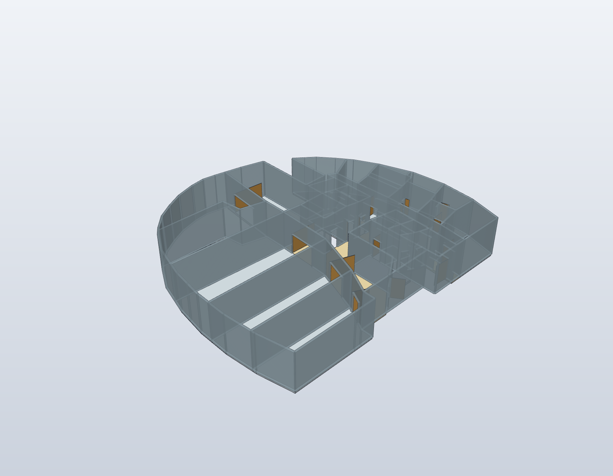

# Keller im Gebäudemodell

Der Keller besitzt eine eigene relative Nachzeichnung aus dem privat
bereitgestellten Plan HIS 5540. Die gemeinsame Gebäudequelle referenziert
`model/basement-kg.shared.json`; FreeCAD und SolidCraft erzeugen ihre Geometrie
unabhängig aus derselben Quelle. Das Foto wird nicht veröffentlicht.

Die Nachzeichnung enthält die Technik-, Lager- und Nebenräume 0.001–0.020
einschließlich der Unterteilungen A/B/C. „Kompressoren“ bleibt ein gesonderter
Bereich mit offener Raumzuordnung. Der Aufzug ist von 0.010 „FMR Aufzug“
getrennt. Die Raumabschrift steht in [den Bestandsnotizen](floorplan-kg-og1-notes.md).

Die Kontur ist im gemeinsamen Gebäudebezug um 180° orientiert. Ihre relative
Einpassung ist eine manuelle Konzeptregistrierung. Eckpunkte der vertikalen
Kerne referenzieren die vorhandene F03-Quelle; Wandgrenzen werden einmal
beschrieben und von benachbarten Flächen gemeinsam verwendet. Der registrierte
Treppenkern ist ein Teilbereich von 0.018. Seine genaue Abgrenzung und die
tatsächliche Treppenform sind im Foto nicht nachgewiesen.



In der Gebäudekomposition passt die [gemeinsame Hüllenregistrierung](building-alignment.md)
die äußere Darstellungsgeometrie an die Obergeschosse an. Aufzug und innere
Treppe bleiben im gemeinsamen Bezug fest; die hier beschriebene Originalquelle
und ihre relative Nachzeichnung bleiben unverändert.

## Höhen und Erschließung

EG bleibt bei Z = 0. Der Keller liegt vorläufig einen angenommenen
Geschossabstand darunter: bei den Standardparametern −4.250 mm, mit
4.000 mm lichter Höhe und 250 mm Platte. Diese Werte sind Darstellungsannahmen,
keine bestätigten Kellermaße. Parameteränderungen berechnen Lage, Schacht
und Treppenverbindung gemeinsam neu; die Höhen der Obergeschosse bleiben erhalten.

Die interne Konzepttreppe verbindet KG mit EG und weiter bis zum 3. OG.
Die separate äußere Metalltreppe beginnt weiterhin im EG und endet am Dach.
Der Aufzug führt bis KG; dort wird ausschließlich die innere Türseite
geöffnet dargestellt. Die äußere Kellerseite bleibt geschlossen.
Die einzelne beispielhafte Kabine bleibt im EG. Ein Aufzugsbetrieb wird nicht
simuliert. Der Keller erhält keine aus den Obergeschossen übernommene
Atriumöffnung und keinen blauen Austauschmarker.

## Aufbau und Grenzen

```sh
python3 scripts/build_building_stack.py --backend both
python3 -m unittest discover -s tests -p 'test_basement_kg.py' -v
```

Aktuelle CAD-Pfade und Prüfungen werden im lokalen
`cad/building-stack/shared-build-report.json` ausgewiesen. Die erzeugte
Ansicht `basement` blendet die anderen Geschosse aus; `ground` bleibt das EG.

Fassadenvorsprünge, Rettungsleitern, genaue Türlagen und Türanschläge,
Installationen und technische Geräte sind vereinfacht oder ausgelassen.
Raummaße, Kellerhöhe und Registrierung sind nicht vermessen. Die statische
Darstellung belegt keine reale Begehbarkeit, Kopffreiheit, Tragfähigkeit,
Transportbahn oder Sicherheitsfreigabe.

Die ergänzten Küchenangaben betreffen ausschließlich 1.008 im ersten OG.
Eine Küchenmöblierung oder Nutzungsänderung ist kein Bestandteil der
Kellerintegration.

## Historischer Keller-Prüfstand ohne Fotoergänzungen

Revision `building-stack-b3571c36214a`: beide nativen CAD-Fassungen bestehen
mit 803 geschlossenen Körpern, je 249 Geometrieproben und neun Höhenprüfungen.
Alle 803 zusätzlichen STEP-Vergleiche ergeben 0 Volumendifferenz.
Die sechs Build-Ansichten und die aktualisierte Laborhervorhebung wurden
visuell geprüft. Eine FreeCAD-GUI-Prüfung wurde nicht durchgeführt.

Die damalige gezielte Suite im gemischten Arbeitsverzeichnis führte 131 Tests aus: 128 bestanden, drei optionale
Schema-Prüfungen wegen fehlender Zusatzbibliothek übersprungen. Galerieprüfung:
47 Bilder, 3.985.290 Bytes, unter dem unveränderten 4-MB-Budget. Das ist keine
vollständige Repository-Suite. Quellen-, Artefakt- und Bildbindungen stehen
in [der Gebäudeprovenienz](media/building-stack.provenance.json).

Der aktuelle [Fotoausbau](building-exterior.md) stellt das Gelände auf EG-Höhe dar
und ordnet den Keller darunter ein. Aktuelle Prüfzahlen stehen in der
Gebäudeprovenienz; die obigen Werte dokumentieren den vorherigen Kellerstand.
