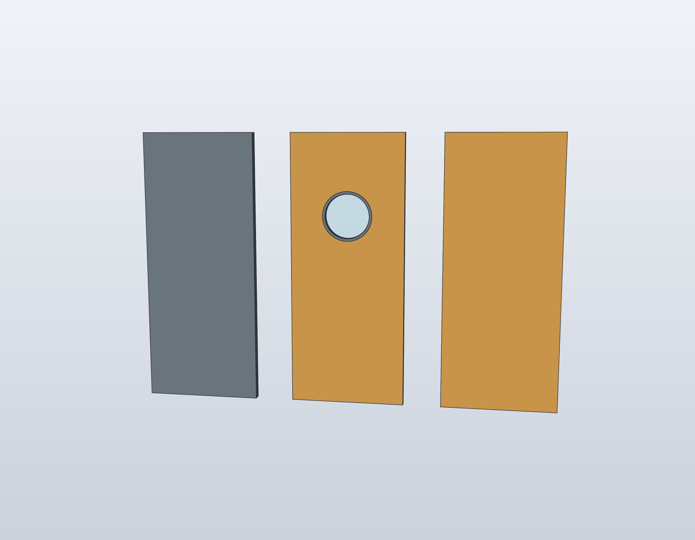
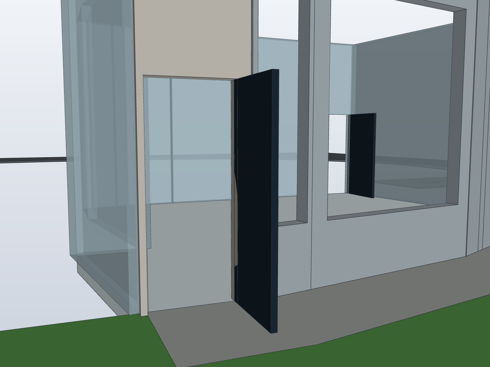
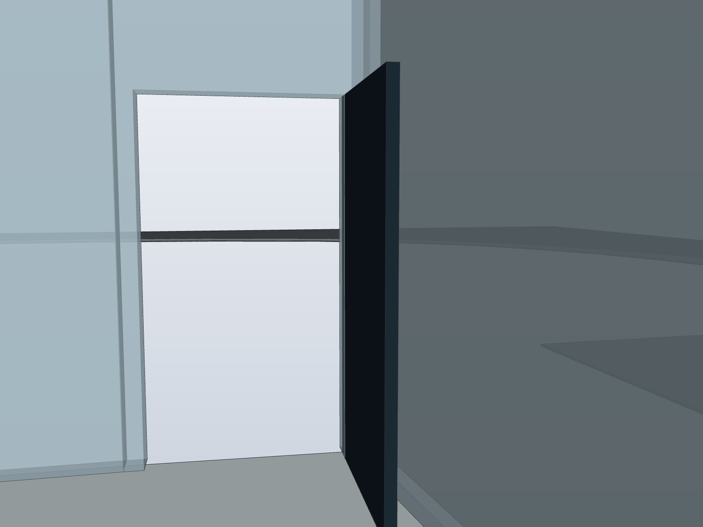

# Raumtüren mit und ohne rundes Guckfenster

Zwei wiederverwendbare Geometrietypen beschreiben die Türblätter:
`plain` ohne Fenster und `round_window` mit rundem Guckfenster. Das Material
wird unabhängig davon ausgewählt. Die ausdrücklich bestätigte linke
Verbindungstür von Doktorandenraum 3.002 erhält ein durchgehend transparentes
Glasblatt mit dem Geometrietyp `plain`; es benötigt keinen runden Ausschnitt.
Die übrigen oberirdischen Türblätter behalten den
vorhandenen Holzfarbton, die Kellertüren erhalten das vom Eigentümer bestätigte
schwere Stahlprofil. Die Kellerdarstellung verwendet zunächst die fensterlose
Variante; Fenster im Keller wurden nicht bestätigt.



## Zuordnung im Gebäude

Die Eigentümervorgabe vom 13. November 2026 verwendet die größeren Räume an
der oberen und unteren **Zeichnungsseite** für die Fenstertüren. Die wenigen
Ausnahmen in EG und 3. OG werden ausdrücklich ignoriert. Daraus wird keine
geografische Nordrichtung und keine neue verlässliche Labornutzung abgeleitet.

- Explizit bestätigte Labore und Doktoranden-Schreibräume bekommen die
  Fenstervariante. Die drei Doktorandenbüros 1.002, 2.002 und 3.002 sowie Labor
  3.003 sind ausdrücklich gebunden.
- Küche 1.008 und Büro 3.009 sind explizite Ausnahmen. Beschriftungen mit
  „Sekretariat“ oder „Küche“ schließen die Fenstervariante ebenfalls aus.
  Eine bekannte Ausnahme hat an einer gemeinsam referenzierten Tür Vorrang.
- Die geometrische Regel betrachtet die größeren Raumflächen außerhalb des
  Y-Bands des referenzierten Atriums. Die Mindestfläche von 45 % der
  referenzierten Doktorandenbürofläche ist eine sichtbare Auswahlannahme.
  Kleine seitliche und unbestimmte Flächen erhalten standardmäßig keine Fenster.
- Keller-Türblätter bekommen unabhängig von der Raumbezeichnung das Stahlprofil.
  Unbekannte Massen werden als `null` geführt.
- `opening_overrides` bindet bestätigte Ausnahmen an genau ein Geschoss und
  eine bestehende Öffnungs-ID. Die OG3-Öffnung `D3_002_001` erhält `plain` und
  `glass`. Dieser ausdrückliche Bezug hat Vorrang vor den automatischen
  Raum-/Beschriftungsregeln. Andere Geschosse behalten ihre Auswahl.

Die linke Öffnung grenzt in der geometrischen F03-Vorlage an `R3_001` und
verbindet nach der Eigentümerbestätigung vom 14. November 2026
Doktorandenraum 3.002 mit Labor 3.001. Das separat dargestellte detaillierte
L01-Modell bleibt Labor 3.003 zugeordnet. Die Korrektur
der Öffnungslage liegt in der Gebäudekomposition; die Türtypenquelle verändert
keine Grundrisswände oder Raumnummern.

Die abgeleitete Zuordnung je Öffnung, ihre benachbarten Bereichs-IDs, Auswahlgrund,
Material, Dicke und Fensterkörper stehen im Build-Bericht unter
`exterior.door_bindings`. Die Grundrisse und Öffnungs-IDs bleiben führende
Referenzen. An der in der Küchenprojektion ausgelassenen Trennwand entsteht
kein freistehendes Türblatt; die entsprechende Wand und Tür anderer Geschosse
bleiben erhalten.

## Logistikraum im Erdgeschoss

Die Eigentümerkorrektur vom 15. November 2026 bezeichnet `R0_013` als
Logistikraum für Post und Abfall. Für `D0_013_Exterior` und `D0_013` gelten
öffnungsspezifische Stahlprofile mit dunkelblauem, fast schwarzem Farbton
(`#172530`, angenähert, kein bestätigter RAL-Wert).

Die Außentür ist beim Blick von außen rechts angeschlagen und öffnet ins Freie.
Die Atriumtür ist beim Weitergehen von außen, aus dem Logistikraum gesehen,
ebenfalls rechts angeschlagen und öffnet in den Logistikraum. Beide
Öffnungsrichtungen folgen damit dem beschriebenen Weg vom Atrium nach außen.
Der Generator bestimmt Anschlag und Öffnungsseite aus den angrenzenden
Raumpolygonen; die Richtung des gespeicherten Wandsegments ändert sie nicht.
Die dargestellten 90 Grad sind eine illustrative Stellung. Der Eigentümer
bestätigt für beide Türen geschlossene Blätter ohne Sichtfenster. Beschläge und Schutzklassen werden daraus nicht abgeleitet.





Die Detailbilder zeigen einen auf die Raumwände, Boden, Türblätter und
Umgebungsflächen begrenzten nativen Ausschnitt. Weitere Fassadendetails
sind ausgeblendet. Die [Bildprovenienz](media/logistics-doors.provenance.json)
bindet die Ansichten an die gemeinsame Quelle und den nativen Vergleich.

## Gemeinsame Konstruktion

`model/doors/room-doors.catalog.json` führt beide Geometrietypen und die
Materialprofile für Holz, Stahl und Glas. `model/building-doors.shared.json` bindet diesen Katalog per
Prüfsumme und beschreibt die Auswahlregeln. Die Gebäudekomposition referenziert
diese Quelle unter `exterior.doors`. Die Schemas stehen in
`model/room-door-catalog.schema.json` und `model/building-doors.schema.json`.

`scripts/building_doors.py` erzeugt dieselben portablen Operationen für beide
CADs. Die Fensteröffnung wird durch das gesamte Türblatt geschnitten. Scheibe
und die beiden äußeren Ringe sind eigene geschlossene Körper; ihr Rahmen wird
aus derselben Fenstergröße abgeleitet. Die Fensterachse folgt der tatsächlichen
Türblattausrichtung, auch an schrägen Wänden. Bestehende Blatt-IDs bleiben erhalten.
Ein Glasblatt verwendet dieselbe portable Profiloperation wie ein fensterloses
Blatt und trägt die im Katalog deklarierte Transparenz. Es bekommt weder einen
zusätzlichen runden Ausschnitt noch eine zweite Scheibe. Unbekannte Geschosse,
Öffnungen, Typen und Materialien sowie doppelte Ausnahmen werden abgelehnt.

```sh
python3 scripts/build_building_stack.py --backend both
python3 -m unittest discover -s tests -p 'test_building_doors.py' -v
python3 -m unittest discover -s tests -p 'test_building_exterior.py' -v
```

## Darstellungsannahmen und Prüfgrenzen

Fensterdurchmesser 350 mm, Fenstermitte 1500 mm über der Türunterkante,
Scheibenstärke 8 mm, äußere Stahltürblattstärke 60 mm und Glasblattstärke
12 mm sind ungemessene
Darstellungswerte. Die Holzstärke und Holzfarbe stammen weiterhin aus der
bestehenden gemeinsamen Quelle. Bei zu kleinen Türblättern verweigert der
Generator die Fenstervariante, statt sie still zu verkleinern.

Die 60 mm beschreiben die angenommene äußere Türblattstärke. Blechaufbau,
Versteifungen, Beschläge, Dichtungen, Glasbefestigung und tatsächliche Masse
sind offen. Die Bestätigung
„schwere Stahltür“ belegt keine Brand-, Strahlen-, Druck- oder Einbruchschutzklasse.
Die offenen Stellungen bleiben illustrative statische Prüfstellungen;
Türschwenkwege und reale Begehbarkeit sind nicht qualifiziert.
Der Glasfarbton und die Deckkraft von 0,3 sind Darstellungsannahmen, keine
optischen Messwerte. Glasart, Beschläge, Rahmen, Schutzklasse und tatsächliche
Masse bleiben offen; das transparente Blatt beschreibt keine geprüfte Glastür.

Die drei historischen einzeln abgeleiteten Beispiele `room-doors-3d9675a976d8-r4` umfassen
beide Geometrietypen und die Stahl-Materialvariante. Alle sechs nativen Körper,
ihre Wiederöffnung und der STEP-Differenzvergleich bestehen. Ein separater
Prüfzylinder bestätigt die freie Fensteröffnung im Holzblatt sowie die Scheibe
im Ausschnitt; die beiden fensterlosen Blätter bleiben an dieser Stelle massiv.
Die [Bildprovenienz](media/room-door-models.provenance.json) bindet diese Prüfung
an Quellen und Dateien. Sie ersetzt den separaten Nachweis des Gesamtgebäudes nicht.

## Nachweis im vollständigen Gebäude

`building-stack-a08626f68c13` enthält 1.811 gültige geschlossene Körper in
beiden CADs. 451 Geometrieproben und 14 Höhenprüfungen je Backend sowie
alle exakten STEP-Vergleiche bestehen mit 0 Volumendifferenz. Die separate
native Türprüfung umfasst alle 141 Blätter: 66 mit rundem Fenster, 53
fensterlose Holzblätter und 22 fensterlose Stahlblätter. Sie prüft für jedes
Fenster den materialfreien Ausschnitt, die Scheibe im Ausschnitt und das
fehlende Volumenüberlappen zwischen Scheibe und Blatt. Der lokale Bericht
`room-doors-native-qa.json` ist an die gemeinsame Quelle und native Datei gebunden.
Diese bisherigen Nachweise schließen das neue Glasprofil nicht ein.

Der frühere FreeCAD-Gebäudestand `6dbc248fae3b` enthält das neue Glasprofil;
die frühere rechte Öffnung in 3.002 wird durch einen positiven Materialzeugen
in der erhaltenen Wand geprüft. Der historische unabhängige SolidCraft-Stand
`5406a30fc113` bestätigt die geschlossenen Türkörper und dieselben
Öffnungs-/Schließprüfungen. Der getrennte Quellenvergleich belegt, dass die
spätere Außenflächenänderung weder Türkörper noch diese Prüfverträge verändert.
Die aktuelle Raumansicht und die getrennten Revisionsbindungen stehen in der
[Möblierungsdokumentation](building-furnishings.md).
