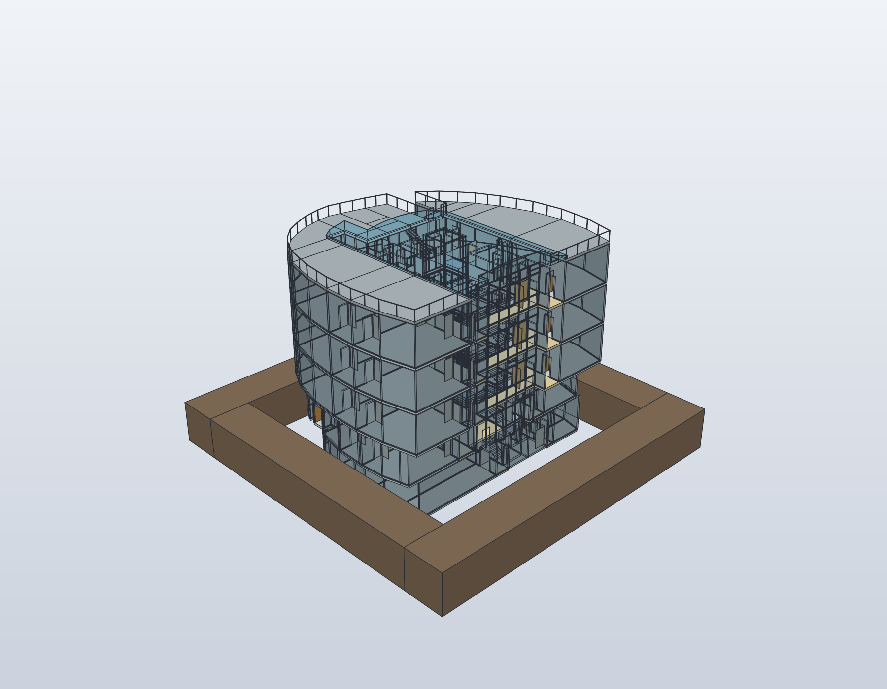
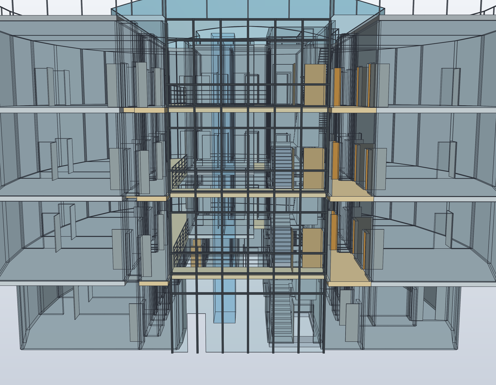

# Glasfront, Türfarbe, offene Geländer und Gelände

Die beiden privat bereitgestellten Fotos zeigen die Glasfront des Foyers von
außen und innen. Der Eigentümer bestätigt den warmen gelblichen Holzton der
Seminarraumtüren als Farbe der Raumtüren im Gebäude. Die Innenaufnahme zeigt
schlanke Metallpfosten, einen Handlauf und sehr offene horizontale Geländerstäbe.
Die Fotos werden nicht ins Repository übernommen.

Die gemeinsame Quelle `model/building-stack.shared.json` führt diese Absicht
unter `exterior`. `scripts/building_exterior.py` übersetzt sie in dieselben
portablen Quader- und Profiloperationen für FreeCAD und SolidCraft:

- Eine mehrgeschossige transparente Glasfront mit dunklen Pfosten und Riegeln
  ersetzt die Fassaden-Platzhalterwand `W108` in der Gebäudekomposition.
  Die EG-Eingangsöffnung bleibt über `EW074` / `D0_018` referenziert.
- Der vorläufige Holzfarbton `#C99448` gilt für die dargestellten Raumtürblätter
  aller fünf Ebenen. Sie stehen illustrativ offen. Die sichtbare Glasfront ist
  davon getrennt; der vorhandene Aufzug wird nicht in eine Holztür umgedeutet.
- An den Atrium-/Flurkanten `W068` und `W106` ersetzen offene Metallgeländer
  die bisher ungeklärten Begrenzungen in den drei Obergeschossen. Pro Kante
  werden Pfosten, Handlauf und vier schlanke horizontale Stäbe gemeinsam erzeugt.
  Riegel und Geländerteile bleiben einzelne editierbare Körper; die Darstellung
  benötigt keine vollständige boolesche Verschweißung ihres Profilrasters.
- Ein brauner, rechteckiger Erdreich-Schnittkasten endet auf EG-Höhe ±0.
  Der Keller liegt darunter. Die Öffnung um die Gebäudehülle dient der
  Einsehbarkeit, nicht der Darstellung einer vermessenen Baugrube.

Die Quellgrundrisse F03, EG und KG bleiben unverändert. Sämtliche Ersetzungen
sind ausdrücklich auf die Gebäude-Komposition begrenzt; Wände und Öffnungen
werden nicht in eine zweite Planquelle kopiert. Die Raumtüren erhalten eigene
Prüfzeugen gegen die bestehenden Öffnungen. Die Geländehöhe und die Fassadenhöhe
werden in den nativen Fassungen gegen die Geschossbezüge geprüft.

## Ansichten und Aufbau





```sh
python3 scripts/build_building_stack.py --backend both
python3 scripts/render_building_exterior.py --output-dir renders/building-front-review
python3 -m unittest discover -s tests -p 'test_building_exterior.py' -v
```

Aktuelle native Dateien werden über `cad/building-stack/shared-build-report.json`
aufgelöst. Die separate Frontansicht ändert ausschließlich Sichtbarkeit und Kamera;
das native Modell wird dabei nicht gespeichert. Die Quellen-, Bild- und
Prüfzuordnung steht in [der Gebäudeprovenienz](media/building-stack.provenance.json).

## Grenzen der Fotoableitung

Fassadenlage, sechs gleichmäßig angesetzte Glasfelder, Unterteilungen, Glas- und
Profilstärken, Türblattstärken und Geländermaße sind ungemessene Darstellungsannahmen.
Die Bildbeleuchtung erlaubt keine exakte Material- oder Farbmessung. Auch die
vertikale Fassadenregistrierung und die Verbindung zum anders nachgezeichneten
EG sind konzeptionell; eine metrische Foto-/Planregistrierung fehlt.

Das Erdreich ist ein grafischer Höhenbezug auf der angenommenen EG-Höhe, kein
Geländeaufmaß. Kellerhöhe und Geschossabstand bleiben Annahmen. Konstruktive
Kontakte zwischen Glas und Profilen sowie zwischen Türblättern und Laibungen
werden nicht als globale Kollisionsfreiheit ausgegeben. Türanschläge und
Offenstellungen sind keine bestätigten Betriebszustände. Tragwerk, Glasaufbau,
Absturzsicherung, Begehbarkeit, Brandschutz und Hardware sind nicht qualifiziert.
Die Fotos belegen die sichtbare Gestaltung, keine dieser Funktionen.

## Geprüfte Veröffentlichung

Revision `building-stack-efe22ae793b6-r2` wurde unabhängig in FreeCAD und
SolidCraft erzeugt: 1.048 geschlossene Körper, je 390 Geometrieproben und
14 Höhenprüfungen bestehen. Alle 1.048 zusätzlichen STEP-Vergleiche ergeben
0 Volumendifferenz. Raumtürblätter werden gegen die bestehenden Öffnungen
geprüft; Gelände und Glasfront gegen EG- und Dachhöhe. Die sichtbare Türfarbe
wurde zusätzlich an einem einzeln gerenderten Türblatt kontrolliert.
Eine FreeCAD-GUI-Prüfung und eine globale Kollisionsprüfung wurden nicht durchgeführt.

Die gezielte Veröffentlichungssuite umfasst 137 Tests: 134 bestanden, drei
optionale Schema-Prüfungen wegen fehlender `jsonschema`-Bibliothek übersprungen.
Dies ist keine vollständige Repository-Suite. Originalfotos bleiben privat.
