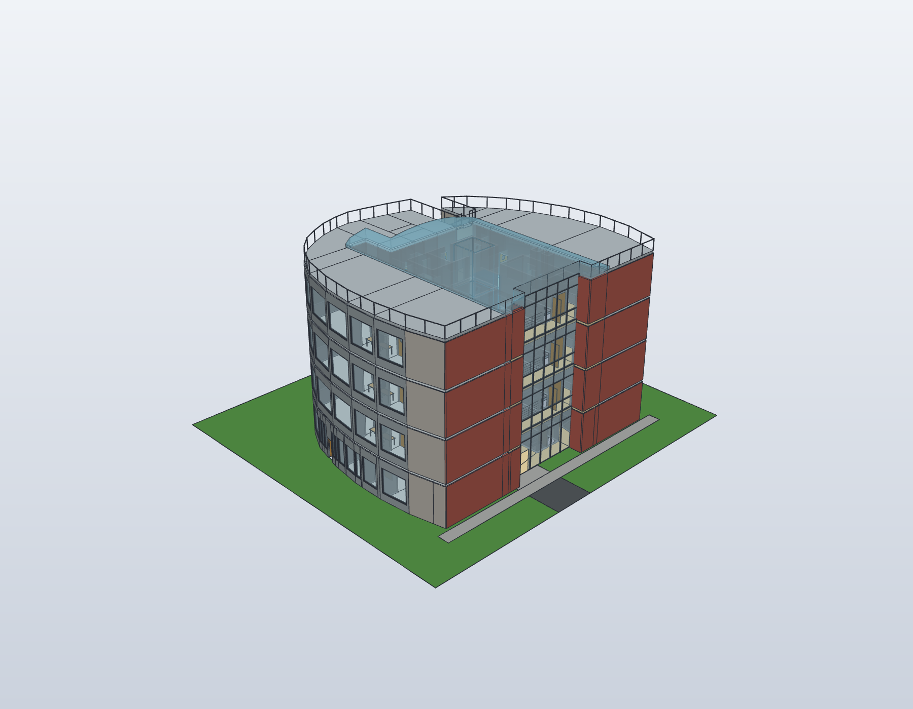
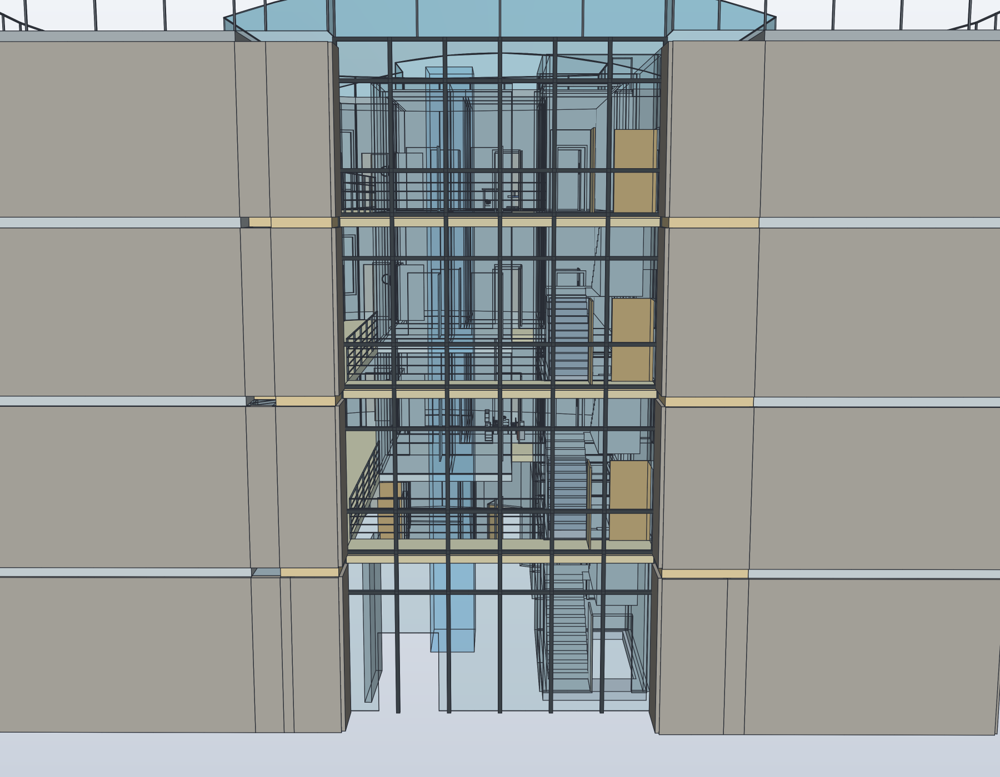
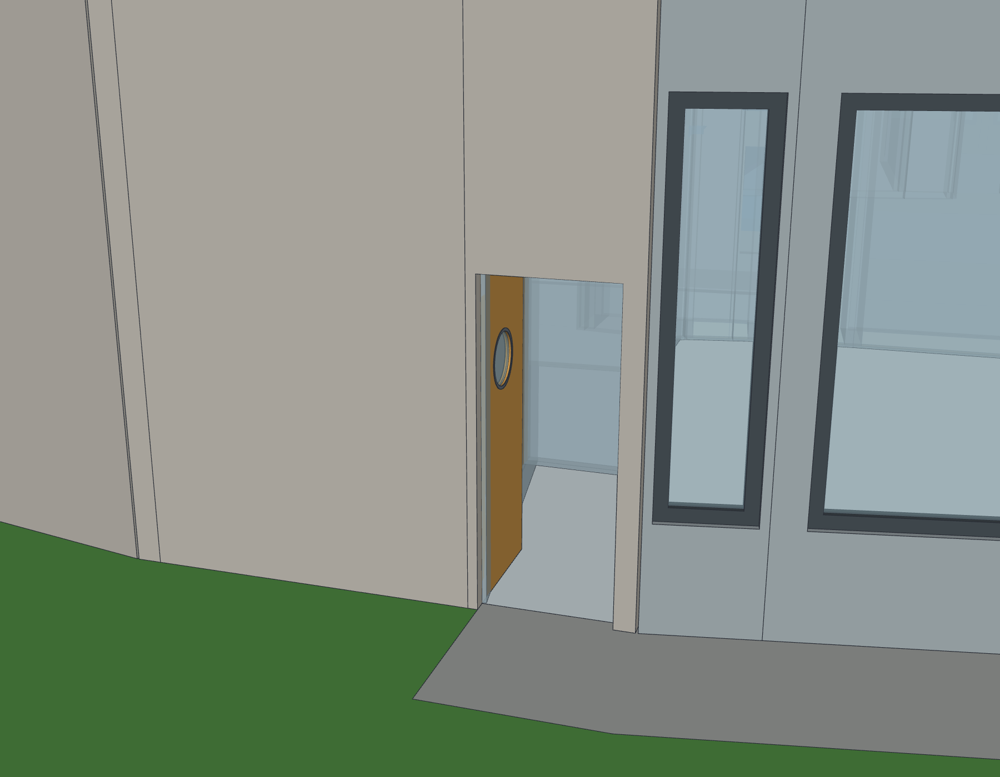

# Glasfront, Türfarbe, offene Geländer und Gelände

Die privat bereitgestellten Foyer- und Seitenfotos zeigen die Glasfront des Foyers von
außen und innen. Der Eigentümer bestätigt den warmen gelblichen Holzton der
Seminarraumtüren als Farbe der Raumtüren im Gebäude. Die Innenaufnahme zeigt
schlanke Metallpfosten, einen Handlauf und sehr offene horizontale Geländerstäbe.
Die Fotos werden nicht ins Repository übernommen.

Die gemeinsame Quelle `model/building-stack.shared.json` führt diese Absicht
unter `exterior`. `scripts/building_exterior.py` übersetzt sie in dieselben
portablen Quader- und Profiloperationen für FreeCAD und SolidCraft:

- Eine mehrgeschossige transparente Glasfront mit dunklen Pfosten und Riegeln
  ersetzt die Fassaden-Platzhalterwand `W108` in der Gebäudekomposition.
  Die EG-Eingangsöffnung bleibt über `EW074` / `D0_018` referenziert.
- Der vorläufige Holzfarbton `#C99448` gilt für die oberirdischen Raumtürblätter.
  Die [Türtypenquelle](building-doors.md) ergänzt die runden Guckfenster und
  das schwere Stahlprofil für den Keller. Sie stehen illustrativ offen. Die sichtbare Glasfront ist
  davon getrennt; der vorhandene Aufzug wird nicht in eine Holztür umgedeutet.
- An den Atrium-/Flurkanten `W068` und `W106` ersetzen offene Metallgeländer
  die bisher ungeklärten Begrenzungen in den drei Obergeschossen. Die
  [Kernbereichsvariante](atrium-seating.md) ergänzt die Kante `W065`
  mit demselben Rezept. Insgesamt entstehen drei Geländergruppen je
  Obergeschoss. Pro Kante
  werden Pfosten, Handlauf und vier schlanke horizontale Stäbe gemeinsam erzeugt.
  Riegel und Geländerteile bleiben einzelne editierbare Körper; die Darstellung
  benötigt keine vollständige boolesche Verschweißung ihres Profilrasters.
  Die zuvor an `W066` und `W064` angenommene Sitznischenöffnung ist
  zurückgenommen; die Toilettenseite behält ihre ursprünglichen Grenzen.
- Die Eingangsflanken und übrigen geschlossenen Außenwände sind undurchsichtiger
  Beton. Die Eingangsflanken erhalten oberhalb des Geländes den fotoangenäherten
  roten Anstrich `#B65E52`; die übrigen Betonflächen bleiben grau. Seitlich werden nur die ausdrücklich referenzierten Fassadenabschnitte
  mit Fensterbändern belegt. Geschlossene Endfelder, vertikale Zwischenstücke,
  Brüstungen und Stürze unterbrechen die Verglasung; die Brüstungsbereiche der
  Fensterseiten erhalten eine deckende graue Verkleidung.
- Die erweiterte Küche 1.008 erhält ihren äußeren Fensterbezug an `W005`.
  `exterior.side_window_walls_by_level` ergänzt diese Wand ausdrücklich nur
  für `OG1`; das vorhandene Seitenfensterrezept liefert die angenommenen
  Abmessungen und Bauteile. Die Fensterlage führt keine Vermessung oder neue
  Größenbestätigung ein. Die anderen Geschosse behalten ihre bisherigen
  Fensterzuordnungen; insbesondere wird Büro 3.009 dadurch nicht umgebaut.
- Rasen wird grün (`#559447`) als lediglich 20 Darstellungs-mm dünne Schicht
  auf EG-Höhe ±0 markiert. Die Gebäudegrundfläche wird ausgespart. Ein massiver
  brauner Erdblock entfällt. Der Keller liegt weiterhin unter dieser Ebene.
- Direkt vor der Glasfront liegt ein durchgehender Bereich aus grauen
  Gehwegplatten, davor die Straße über die gesamte Eingangsseite. Links folgen
  die Platten der Fassadenkontur bis zum weiter hinten liegenden Seiteneingang
  `D0_013_Exterior`. Die übrigen Außenflächen bleiben Rasen. Alle Flächen sind
  dünne Darstellungsflächen; Breiten und Grenzen sind nicht vermessen.

Die Quellgrundrisse F03, EG und KG bleiben unverändert. Sämtliche Ersetzungen
sind ausdrücklich auf die Gebäude-Komposition begrenzt; Wände und Öffnungen
werden nicht in eine zweite Planquelle kopiert. Die Raumtüren erhalten eigene
Prüfzeugen gegen die bestehenden Öffnungen. Die Geländehöhe und die Fassadenhöhe
werden in den nativen Fassungen gegen die Geschossbezüge geprüft.

## Außenflächen aus der Luftbildansicht

Die [Google-Maps-Luftbildansicht von Schillingallee 69](https://www.google.com/maps/search/?api=1&query=Schillingallee%2069%2C%2018057%20Rostock)
wurde am 14.11.2026 visuell geprüft. Das Gebäude ist über den Abgleich der
Institutsadresse und der charakteristischen gekrümmten Bauform zugeordnet.
Links liegt eine breite befestigte Hof-/Zufahrtsfläche; die bisherige grüne
Pufferfläche hinter dem schmalen Gehweg war eine unbelegte Modellannahme.
Der helle Fußgängerstreifen bleibt davon getrennt. Die tatsächlich begrünten
Bereiche auf der anderen Seite bleiben grün.

Die gemeinsame Quelle führt die linke befestigte Fläche ausdrücklich. Ihre
Abgrenzung innerhalb des kleinen Darstellungsausschnitts wird über
`left_hardstanding_end_fraction` angenähert. Das ist eine qualitative manuelle
Kartenauswertung, keine automatische Flächenextraktion oder georeferenzierte
Vermessung. Einzelne Plattenmaße, verdeckte Kanten und das Aufnahmedatum des
Luftbildes sind nicht bekannt. Google-Bildmaterial wird nicht ins Repository
übernommen. Die [Institutsadresse](https://www.iegt-rostock.de/kontakt/) bestätigt
Schillingallee 69 als Standort.

## Ansichten und Aufbau







```sh
python3 scripts/build_building_stack.py --backend both
python3 scripts/render_building_exterior.py --output-dir renders/building-front-review
python3 -m unittest discover -s tests -p 'test_building_exterior.py' -v
```

Aktuelle native Dateien werden über `cad/building-stack/shared-build-report.json`
aufgelöst. Die separate Frontansicht ändert ausschließlich Sichtbarkeit und Kamera;
das native Modell wird dabei nicht gespeichert. Die Quellen-, Bild- und
Prüfzuordnung steht in [der Gebäudeprovenienz](media/building-stack.provenance.json).

## Grenzen der Fotoableitung

Fassadenlage, sechs gleichmäßig angesetzte Glasfelder, Unterteilungen, Glas- und
Profilstärken, Türblattstärken und Geländermaße sind ungemessene Darstellungsannahmen.
Die Bildbeleuchtung erlaubt keine exakte Material- oder Farbmessung. Auch die
vertikale Fassadenregistrierung und die Verbindung zum anders nachgezeichneten
EG sind konzeptionell; eine metrische Foto-/Planregistrierung fehlt.

Die dünne Rasenmarkierung und die Verkehrsflächen sind grafische Bezüge auf
der angenommenen EG-Höhe, kein Geländeaufmaß. Kellerhöhe und Geschossabstand bleiben Annahmen. Konstruktive
Kontakte zwischen Glas und Profilen sowie zwischen Türblättern und Laibungen
werden nicht als globale Kollisionsfreiheit ausgegeben. Türanschläge und
Offenstellungen sind keine bestätigten Betriebszustände. Tragwerk, Glasaufbau,
Absturzsicherung, Begehbarkeit, Brandschutz und Hardware sind nicht qualifiziert.
Die Fotos belegen die sichtbare Gestaltung, keine dieser Funktionen.

## Historischer Prüfstand vor Hüllen- und Außenanlagenkorrektur

Revision `building-stack-efe22ae793b6-r2` wurde unabhängig in FreeCAD und
SolidCraft erzeugt: 1.048 geschlossene Körper, je 390 Geometrieproben und
14 Höhenprüfungen bestehen. Alle 1.048 zusätzlichen STEP-Vergleiche ergeben
0 Volumendifferenz. Raumtürblätter werden gegen die bestehenden Öffnungen
geprüft; Gelände und Glasfront gegen EG- und Dachhöhe. Die sichtbare Türfarbe
wurde zusätzlich an einem einzeln gerenderten Türblatt kontrolliert.
Eine FreeCAD-GUI-Prüfung und eine globale Kollisionsprüfung wurden nicht durchgeführt.

Die gezielte Veröffentlichungssuite umfasst 137 Tests: 134 bestanden, drei
optionale Schema-Prüfungen wegen fehlender `jsonschema`-Bibliothek übersprungen.
Dies ist keine vollständige Repository-Suite. Originalfotos bleiben privat.

Die Seitenkorrektur verwendet begrenzte Glasfelder zwischen opaken Bauteilen.
Die gemeinsame `exterior`-Quelle hält Fensterpfade, Höhenanteile, Materialfarben
und die dünne Außenflächenschicht einmalig fest. Beide CAD-Adapter verwenden
dieselben daraus abgeleiteten Profile, Wandöffnungen und Geländeoperationen.
Die ursprünglichen Raumgrundrisse und festen Treppen-/Aufzugskerne bleiben erhalten.

## Prüfstand der Seiten- und Außenflächenkorrektur vor den Raumtüren

`building-stack-2d80f268decf`: 1614 geschlossene Körper, je 451 Geometrieproben und 14 Höhenprüfungen
in FreeCAD und SolidCraft. Alle zusätzlichen exakten STEP-Vergleiche bestehen.
Die Seitenfenster besitzen eigene native Leerraum-Prüfzeugen in den tatsächlichen
Wandkörpern. Die Außenflächen werden auf EG-Höhe und dünne Schicht geprüft.
Der STEP-Abgleich speichert unveränderliche Schwerpunkt-/Volumenwerte zwischen;
Zuordnungsregel, Reihenfolge bei Gleichstand und alle exakten booleschen
Differenzprüfungen mit derselben Toleranz bleiben unverändert. Der lokale
Prüfbericht bindet diesen Prüfadapter zusätzlich über seine Prüfsumme.

Die gezielte Veröffentlichungssuite umfasst jetzt 157 Tests: 153 bestanden,
vier optionale JSON-Schema-Prüfungen wegen fehlender `jsonschema`-Bibliothek
übersprungen. Quellen, Bilddateien und die Galerieprüfung sind aktuell gebunden.

## Integrierter Raumtürenstand

`building-stack-a08626f68c13` ergänzt dieselbe Fassade um die
[Raumtürvarianten](building-doors.md), Küche und Büros. Beide CADs bestehen
mit 1.811 geschlossenen Körpern, je 451 Geometrieproben und 14 Höhenprüfungen.
Alle exakten STEP-Vergleiche ergeben 0 Volumendifferenz.
