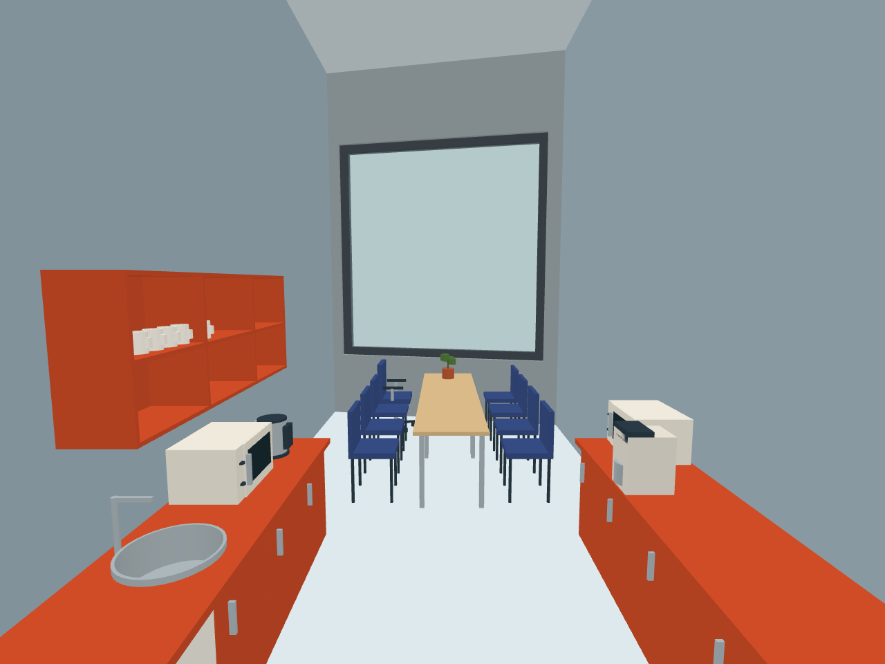
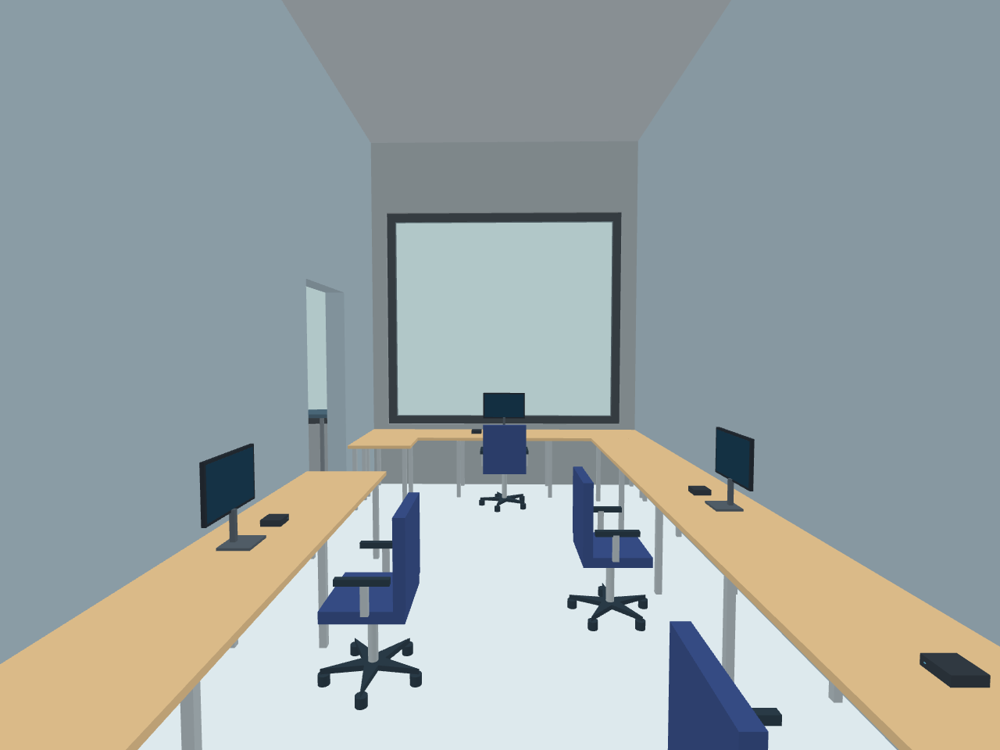
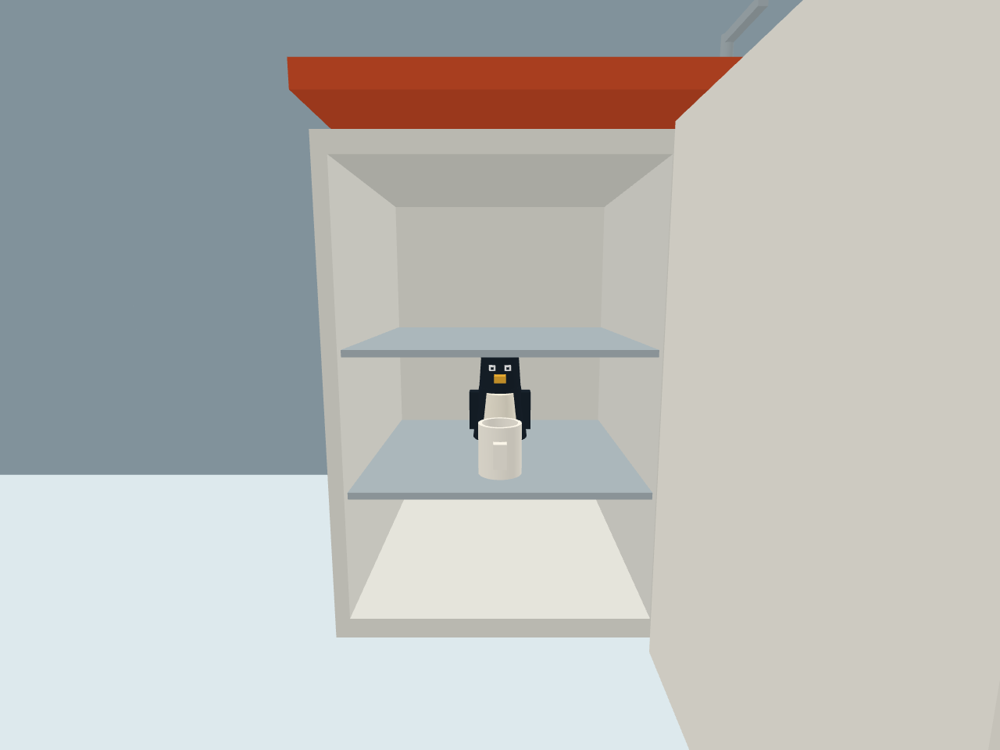

# Küche und Büros im Gebäudemodell

Die Küche **1.008** folgt zwei privaten Innenfotos: orange-rote Küchenzeilen
auf beiden Seiten, runde Edelstahlspüle nahe der Tür, Mikrowelle und Wasserkocher,
Kaffeemaschine und kleiner Tischbackofen gegenüber, Tassenregal sowie eine helle
Tischgruppe mit acht blauen Stühlen. Nach der ausdrücklichen Vorgabe vom
13. November 2026 stehen je vier Stühle gleichmäßig an den beiden Längsseiten;
die Stirnseiten bleiben frei. Diese Modellvorgabe hat Vorrang vor der
Fotointerpretation. Pflanzen ergänzen die Darstellung.
Die Fotos selbst werden nicht veröffentlicht.

Die Korrektur des 1. OG fasst die Vorlagenflächen `R3_008A`, `R3_008B` und
`R3_009` zur Küche **1.008** zusammen. Die im bisherigen Modell abgetrennte
hintere Bürofläche gehört hier zum offenen Küchenraum; die Trennwände `W027`
und `W017` werden deshalb nur in dieser OG1-Möblierung ausgelassen. Daraus
wird kein zusätzliches Büro mit einer erfundenen Nummer im 1. OG abgeleitet.
Das Büro **3.009** und die entsprechenden Wände der oberen Geschosse bleiben
in ihren eigenen Geschossbindungen erhalten.

Die Tische stehen am äußeren Fensterbezug `R3_009` / `W005`. Der
`window_anchor` der Küchenaufstellung bindet die Tischinstanzen `TableA` und
`TableB` an diese Quellwand. Nach der einheitlichen Darstellungseinpassung wird
die gesamte Küchenanordnung gemeinsam zum Fenster ausgerichtet; die relative
Anordnung von Zeilen, Stühlen, Geräten und Kühlschrankinhalt bleibt erhalten.
Der nominale Abstand der nächsten Tischplattenkante zur inneren Wandfläche
beträgt **100 mm**, einmal mit der `presentation_scale` skaliert.
Die Aufstellung soll den Bereich an der Raumtür für den Schrankzugang frei
halten. Reale Zugänglichkeit und vollständige Türschwenkbereiche benötigen
einen eigenen Nachweis.



Das aktuelle Küchenbild stammt aus dem geprüften Browserrundgang des
integrierten FreeCAD-Modells. Es zeigt den offenen Raum mit der Tischgruppe
am Außenfenster; ältere Ansichten dokumentieren die vorherige Raumabtrennung
und Darstellungseinpassung.

Die Doktorandenbüros **1.002 und 2.002** enthalten je vier angenommene
Schreibtische mit Bürostühlen; **3.009** einen Arbeitsplatz. Für **3.002** ist
eine durchgehende U-Arbeitsfläche bestätigt: bündig an beiden Längswänden und
an der schrägen Fensterwand, mit freier linker Glastür zum Labor **3.001**.
Die vier bisherigen `Desk`-IDs bezeichnen jetzt Arbeitsplattenmodule: einen
durchgehenden rechten Lauf, zwei durch die linke Tür getrennte Abschnitte und
das Fensterstück. Das Fensterstück besitzt beide Ecken; die Seiten schließen
ohne Spalt oder überlagerte Platten daran an. Vier Stühle sowie Maße, Höhen,
Stützenabstände und der Abstand zu den Türpfosten bleiben ausdrückliche
Darstellungsannahmen. Die Tischanordnung in 1.002 und 2.002 bleibt unverändert.

Alle 13 Büroarbeitsplätze erhalten je einen Bildschirm mit Standfuß und einen
kleinen Mini-PC. Der gemeinsame Typ `office_computer` beschreibt die Teile
einmalig; jede Instanz referenziert über `worktop_anchor` ihre Tischplatte und
zwei relative Positionsanteile. Höhe, Ausrichtung und Raumskalierung werden
aus der tatsächlich erzeugten Platte abgeleitet. Die Auswertung weist Geräte
zurück, die über deren Rand ragen. In 3.002 liegen zwei Sets auf dem langen
linken Lauf sowie je eines rechts und am Fenster; das kurze Stück hinter der
Glastür bleibt frei. Gerätemaße und Ausstattung sind Darstellungsannahmen.
Die aktuellen Bürobilder zeigen die eingerichteten Arbeitsplätze.

Der Erste-Hilfe-Kasten ist als eigener portabler Möbeltyp beschrieben. Seine Platzierung
referenziert die Flurtür `D3_002N` und deren Innenseite im Raum `R3_002`;
„rechts“ bedeutet beim Eintreten in den Raum. Der Abstand folgt dem rechten
Türpfosten und der Innenfläche der Quellwand, nicht einer geschätzten globalen
Koordinate. Die Fassade am gegenüberliegenden schmalen Raumende ist der
Fensterbezug der lokalen Tischanordnung. Fenstermaße und zusätzliche
Bestandsdetails werden dadurch nicht erfunden.

Die Plattenlängen folgen den inneren Wandflächen und den tatsächlichen
Türintervallen des wirksamen OG3-Grundrisses. Der frühere rechte Durchgang ist
dort geschlossen. Ein nomineller Pfostenabstand von 60 mm ist eine
Darstellungsannahme und wird einmal mit der Raumdarstellung skaliert.
Türöffnungen und die dargestellten offenen Türblätter müssen frei bleiben;
ein vollständiger Türschwenkbereich oder eine reale Bewegungsfreigabe ist
damit nicht geprüft.



Die aktuelle Ansicht stammt aus dem geprüften Browserrundgang: native
FreeCAD-BReps wurden tesselliert und im Browser dargestellt. Sie zeigt den
Blick vom Eingang zur Fensterwand. Der Bildnachweis verbindet die
FreeCAD-Datei, den HTML-Export und die geprüfte Kamerastellung.
Das [Büro 1.002](media/furnishings-gallery/building-stack-c031b24585f3/office-1-002.png)
zeigt die angenommene Vierergruppe mit Monitoren und Mini-PCs.

## Ein kleiner Gast im Kühlschrank

Im lokalen Rundgang lässt sich auch die Mikrowelle per Mausklick oder
Leertaste öffnen und schließen. Türrahmen, Fenster und Griff bilden die
bewegliche Gruppe; das ausgehöhlte Gehäuse und die Bedienknöpfe bleiben fest.
Die gemeinsame Gerätevorlage liefert auch dem Tischbackofen eine getrennte
statische Tür; interaktiv gebunden ist hier ausschließlich die Mikrowelle.
Die Scharnierlage und der Öffnungswinkel von 90° sind Darstellungsannahmen.
Die CAD-Referenz bleibt geschlossen; eine reale Schwenkfreiheit ist nicht geprüft.

Ein Pinguin mit Teetasse sitzt im ergänzten Unterbaukühlschrank. Kühlschrankhülle,
Innenraum, Fachböden, Tür und Griff sind getrennt modelliert. Für die aktuelle
Detailansicht wurde die Kühlschranktür im Browser geöffnet.
Welche der auf den Fotos sichtbaren Unterbaueinheiten tatsächlich der
Kühlschrank ist, bleibt unbestätigt. Der frühere SolidCraft-Ausschnitt mit
ausgeblendeter Tür bleibt als historische Detailansicht erhalten.



## Bildnachweise der Möbelgalerie

Die [aktuelle Bildprovenienz](media/building-furnishings-current.provenance.json)
bindet die vier Bilder an die geprüfte FreeCAD-Komposition, ihren
Rundgangexport und die neu erfassten Chromium-Ansichten. Der Bildtest prüft
Bildbytes, Quellpins und Kamerabindungen. Die statischen Browserbilder
dokumentieren Darstellungsgeometrie. Aufmaß, reale Aufstellung, Ergonomie,
Bewegung und Türschwenkfreiheit erfordern eigene Nachweise.

Die [historische Bildprovenienz](media/building-furnishings.provenance.json)
führt die früheren Fassungen und deren Prüfstände. Die ursprünglichen Bilder
bleiben als [Küche 1.008](media/kitchen-1-008.png),
[Büro 1.002](media/office-1-002.png), [Büro 3.002](media/office-3-002.png)
und [Kühlschrankdetail](media/kitchen-fridge-easter-egg.png) zugänglich.

Für eine Aktualisierung einen geprüften Rundgang unter
`exports/furnishings-walkthrough` ableiten, die Bildaufnahmen prüfen und
anschließend die sichtgeprüften Bilder binden.

```sh
python3 scripts/build_furnishings_gallery.py fixtures exports/furnishings-walkthrough exports/furnishings-gallery-viewpoints.json
node scripts/capture_building_furnishings_gallery.cjs exports/furnishings-walkthrough/index.html exports/furnishings-gallery-capture exports/furnishings-gallery-viewpoints.json
python3 scripts/build_furnishings_gallery.py record exports/furnishings-walkthrough exports/furnishings-gallery-capture --reviewed
```

## Gemeinsame Quellen und Aufbau

- `model/furniture/social.catalog.json`: wiederverwendbare Möbel- und Geräteteile
  aus portablen Operationen; die Nasszeile leitet sich von derselben Küchenzeile ab.
- `model/furnishings/building-social.json`: Instanzen, lokale Aufstellung und
  ausdrückliche Bindung an Geschoss und Raum.
- `model/building-furnishings.schema.json` und
  `model/social-furniture-catalog.schema.json`: die zugehörigen Datenverträge.
- `scripts/building_furnishings.py`: gemeinsame Auswertung für beide CADs.
- `scripts/wall_worktops.py`: parametrisierte Tischteile und wandgebundene
  Plattenumrisse; keine CAD- oder Gebäudestapel-Abhängigkeit.
- `model/building-stack.shared.json`: prüfsummengebundene Gebäudekomposition.

```sh
python3 scripts/build_building_stack.py --backend freecad --no-render
python3 scripts/build_building_stack.py --backend solidcraft --no-render
python3 -m unittest discover -s tests -p 'test_building_furnishings.py' -v
python3 -m unittest discover -s tests -p 'test_wall_worktops.py' -v
```

Der Build-Bericht unter `cad/building-stack/shared-build-report.json` ordnet
Quellen, native Dateien, Prüfungen und Ansichten der jeweiligen Revision zu.
Die Ansichten heißen `Kitchen1008`, `Kitchen1008_EasterEgg`, `PhD1002`,
`PhD2002`, `PhD3002` und `Office3009`.

## Grenzen der Einpassung

Das 1. OG verwendet weiterhin die relative F03-Schablone des 3. OG. Die Küche
1.008 nutzt den gemeinsamen Projektionsbereich `R3_008A` / `R3_008B` /
`R3_009`; die beiden inneren Trennwände `W027` und `W017` entfallen nur für
diese OG1-Aufstellung. Die Fensterzuordnung an `W005` wird ebenfalls nur in
OG1 ergänzt. F03 selbst sowie Raum 3.009 und seine Wände in OG3 bleiben
erhalten. Die bestätigte Nutzungszuordnung ersetzt kein metrisches Aufmaß
oder einen vollständig nachgezeichneten eigenen OG1-Grundriss.

Die bisherige freie Einrichtung wird einheitlich in die verfügbare
Darstellfläche skaliert. Wandgebundene Platten umgehen deren Zentrierabstände:
Rücken und Längen entstehen aus den Wandinnenflächen, Tiefe, Höhe und
Stützenmaße werden einmal mit derselben `presentation_scale` ausgewertet.
Diese wird pro Raum berichtet und ist keine metrische Registrierung.
Die lokalen Möbelmaße sind illustrative Millimeterwerte.
Native geschlossene Körper und der CAD-Vergleich qualifizieren weder reale
Aufstellung, Türschwenkbereiche, Begehbarkeit noch Ergonomie oder Anschlüsse.
Die Möbel führen keine Geräte-, Transport- oder Laborabläufe aus.

Der Katalog führt für `desk` einen gemeinsamen parametrischen Vertrag mit
mm-Einheiten, gültigen Bereichen und Annahmebasis. Ohne Überschreibungen
entstehen exakt die bisherigen fünf Tischteile einschließlich ihrer IDs.
`parameter_overrides_mm` darf unabhängige Maße ändern; bei `wall_span` ist die
Länge aus dem Raum abgeleitet. Der Anker referenziert Bereich, Wand und bei
geteilten Läufen die Öffnungs-ID, ohne Wandkoordinaten zu kopieren.
`full`, `before_opening` und `after_opening` beziehen sich auf die Richtung
der Quellwand. Ein einziger `corner_owner` übernimmt die beiden Stoßecken.
Nur konvexe Raumkonturen und gemeinsame Plattenhöhe/-dicke werden unterstützt;
ungültige oder leere Abschnitte werden zurückgewiesen. Beide CADs erhalten
dieselben daraus abgeleiteten Polygonprismen und Stützen.

## Statische Möbelprüfung

Beim vorherigen vollständigen Möblierungsstand `building-stack-48617bac704a`
wurden 383 native Möbel- und Dekorationskörper als gültige geschlossene Körper
geprüft. Die exakte Prüfung der zwischen verschiedenen Einrichtungsgegenständen
verbleibenden Kandidaten findet keine Volumenüberschneidungen; auch die
Aussparungen für Spüle und Kühlschrank sind berücksichtigt. Im nativen Gebäude
sind alle 214.097 Möbel-/Wandpaare bereits durch ihre Begrenzungsquader getrennt.
Kontakte zwischen Teilen desselben Gegenstands sind dabei zulässig.

Der vorherige Vier-Tisch-Stand für 3.002 wurde unabhängig in FreeCAD
(`building-stack-fb3ab20a37e4`) und SolidCraft
(`building-stack-fb3ab20a37e4-r2`) aufgebaut: jeweils 1.816 gültige geschlossene
Körper, darunter 394 Möbelkörper. Ein neuer STEP-Quervergleich wurde dabei
nicht ausgeführt. In beiden nativen Fassungen sind alle 924 Paare aus den
77 Möbelkörpern des Raums und den zwölf Körpern seiner drei Türblätter samt
Fenstereinsätzen bereits durch ihre Begrenzungsquader getrennt.

Die damalige integrierte FreeCAD-Fassung `building-stack-ecc15e1b9dd9`
besteht mit 1.944 geschlossenen Körpern, 452 Geometrieproben und
15 Höhenprüfungen.
Zusätzliche Prüfungen der tatsächlichen nativen Flächen bestätigen den
vollständigen Wandkontakt aller vier Plattenrücken und den vollständigen
Kontakt beider Eckstöße. Dabei entstehen keine Volumenüberschneidungen.
Die 97 Möbelkörper des Raums sind von allen fünf Tür- und Detailkörpern
getrennt; auch die 291 Paare mit Längs- und Fensterwänden sowie 4.128 Paare
verschiedener Möbel enthalten keine unbeabsichtigten Volumenschnitte. Der Nachweis gilt für die
dargestellten statischen Stellungen und enthält keinen neuen STEP-Quervergleich.

Der SolidCraft-Nachweis bewahrt den geprüften historischen 5406-Stand.
Die damals gebundenen Quell- und Kommandogleichheitsprüfungen beschreiben den
anschließenden 6dbc-Stand, dessen Sitzgruppe noch falsch auf der Toilettenseite
lag. Ein gespeichertes kombiniertes 6dbc-SolidCraft-Modell wurde dabei nicht
erzeugt. Diese historischen Nachweise qualifizieren weder die jetzt verlegte
Sitzgruppe im Kernbereich noch die erweiterte Küchenaufstellung am Fenster.

Die aktuellen nativen Küchenprüfungen bestätigen die ausgelassenen
OG1-Trennwände und die Fensterbindung: Der kleinste Abstand einer Tischplatte
zur inneren Fensterwandfläche beträgt im Darstellungsmodell 76,081081 mm.
Alle 1.184 Möbel-/Wandpaare sind ohne Volumenschnitt. Sowohl das tatsächliche
modellierte Eingangstürblatt als auch eine konservative volle Kreisfläche
um dessen Scharnier sind von allen 148 Küchenmöbelkörpern getrennt. Das
belegt Modellgeometrie, keinen gemessenen realen Türschwenkweg oder sicheren
Zugang.

Der neue SolidCraft-Ausschnitt enthält 306 geschlossene Körper und besteht
18 Geometrieproben; seine Quellenpins entsprechen derselben aktuellen
Gebäudekomposition. Er deckt Küche, Kernbereich und den benannten Kontext ab.
Ein vollständiges aktuelles SolidCraft-Gebäudemodell oder ein neuer
STEP-Quervergleich wurde dafür nicht erzeugt. Die beiden Raumansichten sind
über das aktuelle FreeCAD-Modell, den HTML-Export und eine erneut geprüfte
Fünf-Blickpunkte-Browsersitzung gebunden. Nur das Bild von Büro 1.002 bleibt
erhalten: Für dessen 72 Körper sind die Operationen und Darstellungen mit
der historischen Quelle und ihrem ursprünglichen Generator exakt gleich.

Die [historische Bildprovenienz](media/building-furnishings.provenance.json)
bindet die damaligen Ansichten an ihre Quellen, nativen Revisionen und
Prüfberichte.

## Gleichmäßige Stuhlverteilung · 13. November 2026

Die Eigentümervorgabe ersetzt die Fotointerpretation: je vier Stühle an beiden
Längsseiten der zusammengeschobenen Tische, keine Stühle an den Stirnseiten.
Die Sitzmitten liegen mit gleichem Abstand und gleichen Randabständen einander
gegenüber; alle Stühle zeigen zum Tisch. Der bisherige Drehstuhl steht nun
seitlich. Ein weiterer Stuhl ergänzt die gerade Gesamtzahl von acht Sitzen.

Die damalige Küchenprojektion `kitchen-seating-883a5a7d56dd` enthält
148 gültige geschlossene Körper in FreeCAD und SolidCraft. Der STEP-Vergleich
ergibt 0 Volumendifferenz; verschiedene Einrichtungsgegenstände überschneiden
sich nicht. Verwendet wird der zuletzt geprüfte Darstellungsrahmen der
Möblierung. Die parallel geänderte Gebäudeausrichtung wird damit nicht neu
qualifiziert: Ein Vollaufbau traf auf kreuzende Grenzen `EW091/EW163`.
Die damals unveränderten Büro- und Kühlschrankbilder behielten ihren
bisherigen nativen Modellnachweis; die betroffenen Geometrie- und
Darstellungsbefehle waren gegenüber der damaligen gemeinsamen Quelle exakt
gleich. Diese Aussage über den historischen Stand bindet die neue
Fensteraufstellung der Küche nicht automatisch.

## Vorheriger integrierter Gebäudestand mit Raumtüren

`building-stack-a08626f68c13` enthält die damals unveränderten Möblierungsquellen
zusammen mit der korrigierten Gebäuderegistrierung und den neuen Raumtüren.
Der oben beschriebene `EW091/EW163`-Fehler gehört zum historischen Zwischenstand.
Der damalige vollständige Aufbau bestand in beiden CADs mit 1.811 geschlossenen
Körpern, 451 Geometrieproben und 14 Höhenprüfungen je Backend sowie
0 Volumendifferenz in allen STEP-Vergleichen. Küche, Büros und Kühlschrank-Easter-Egg
wurden aus diesem Gesamtmodell abgebildet. Die Stuhlverteilung bleibt vier zu vier.
