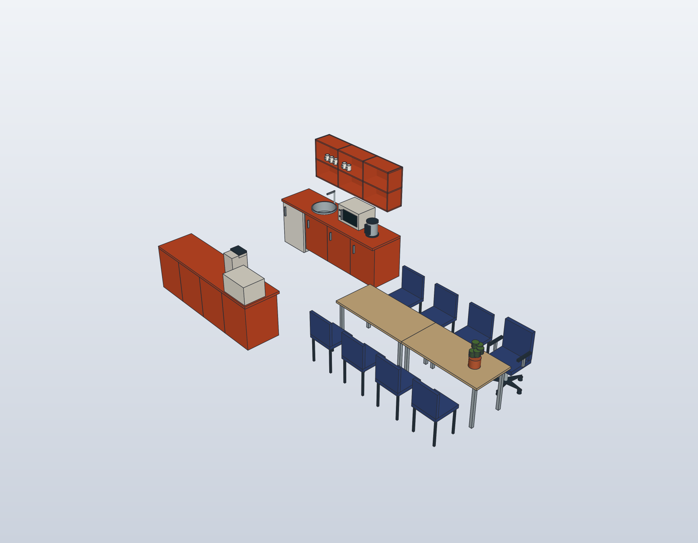
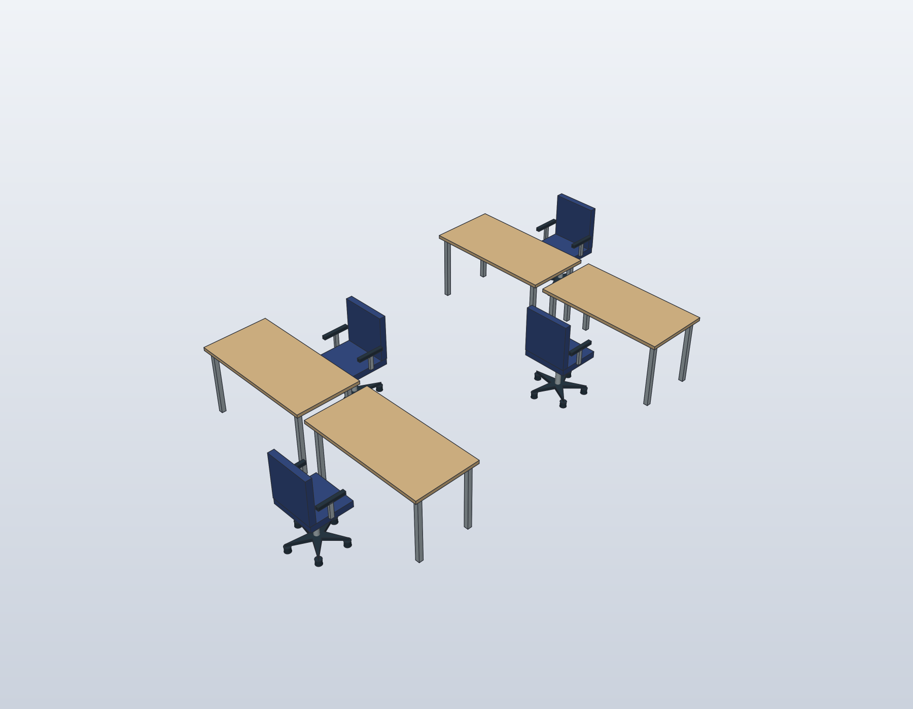
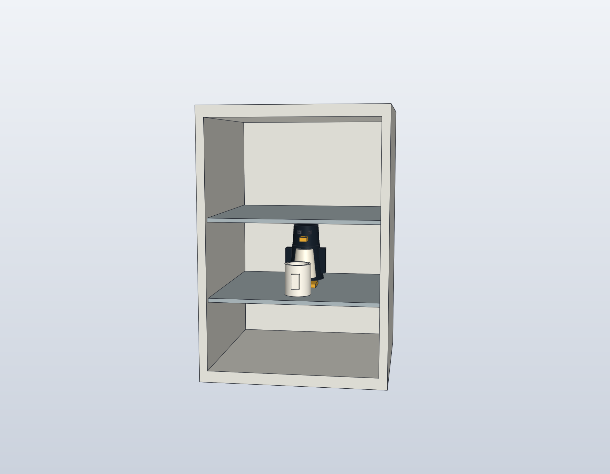

# Küche und Büros im Gebäudemodell

Die Küche **1.008** folgt zwei privaten Innenfotos: orange-rote Küchenzeilen
auf beiden Seiten, runde Edelstahlspüle nahe der Tür, Mikrowelle und Wasserkocher,
Kaffeemaschine und kleiner Tischbackofen gegenüber, Tassenregal sowie eine helle
Tischgruppe mit acht blauen Stühlen. Nach der ausdrücklichen Vorgabe vom
13. November 2026 stehen je vier Stühle gleichmäßig an den beiden Längsseiten;
die Stirnseiten bleiben frei. Diese Modellvorgabe hat Vorrang vor der
Fotointerpretation. Pflanzen ergänzen die Darstellung.
Die Fotos selbst werden nicht veröffentlicht.



Die Doktorandenbüros **1.002, 2.002 und 3.002** enthalten zunächst je vier
Schreibtische mit Bürostühlen; **3.009** einen Arbeitsplatz. Die Raumzuordnungen
sind bestätigt. Arbeitsplatzanzahlen, Maße, Farben außerhalb der Küchenreferenz
und Positionen sind Darstellungsannahmen, keine Bestandsaufnahme.



## Ein kleiner Gast im Kühlschrank

Ein Pinguin mit Teetasse sitzt im ergänzten Unterbaukühlschrank. Kühlschrankhülle,
Innenraum, Fachböden, Tür und Griff sind getrennt modelliert. Die Detailansicht
blendet Tür und Griff aus; sie ist keine Simulation einer Türbewegung.
Welche der auf den Fotos sichtbaren Unterbaueinheiten tatsächlich der
Kühlschrank ist, bleibt unbestätigt.



## Gemeinsame Quellen und Aufbau

- `model/furniture/social.catalog.json`: wiederverwendbare Möbel- und Geräteteile
  aus portablen Operationen; die Nasszeile leitet sich von derselben Küchenzeile ab.
- `model/furnishings/building-social.json`: Instanzen, lokale Aufstellung und
  ausdrückliche Bindung an Geschoss und Raum.
- `model/building-furnishings.schema.json` und
  `model/social-furniture-catalog.schema.json`: die zugehörigen Datenverträge.
- `scripts/building_furnishings.py`: gemeinsame Auswertung für beide CADs.
- `model/building-stack.shared.json`: prüfsummengebundene Gebäudekomposition.

```sh
python3 scripts/build_building_stack.py --backend both
python3 -m unittest discover -s tests -p 'test_building_furnishings.py' -v
```

Der Build-Bericht unter `cad/building-stack/shared-build-report.json` ordnet
Quellen, native Dateien, Prüfungen und Ansichten der jeweiligen Revision zu.
Die Ansichten heißen `Kitchen1008`, `Kitchen1008_EasterEgg`, `PhD1002`,
`PhD2002`, `PhD3002` und `Office3009`.

## Grenzen der Einpassung

Das 1. OG verwendet noch die relative F03-Schablone des 3. OG. Die Küche ist
vorläufig dem gemeinsamen Projektionsbereich von `R3_008A` und `R3_008B`
zugeordnet. Nur die innere Trennwand dieses OG1-Bereichs wird in der möblierten
Darstellung ausgelassen. F03 selbst und die entsprechende Wand in OG2/OG3
bleiben erhalten. Diese Zuordnung ersetzt keinen bestätigten OG1-Grundriss.

Die lokale Einrichtung wird einheitlich in die verfügbare Darstellfläche
skaliert. Die `presentation_scale` wird pro Raum berichtet; sie ist keine
metrische Registrierung. Die lokalen Möbelmaße sind illustrative Millimeterwerte.
Native geschlossene Körper und der CAD-Vergleich qualifizieren weder reale
Aufstellung, Türschwenkbereiche, Begehbarkeit noch Ergonomie oder Anschlüsse.
Die Möbel führen keine Geräte-, Transport- oder Laborabläufe aus.

## Statische Möbelprüfung

Beim vorherigen vollständigen Möblierungsstand `building-stack-48617bac704a`
wurden 383 native Möbel- und Dekorationskörper als gültige geschlossene Körper
geprüft. Die exakte Prüfung der zwischen verschiedenen Einrichtungsgegenständen
verbleibenden Kandidaten findet keine Volumenüberschneidungen; auch die
Aussparungen für Spüle und Kühlschrank sind berücksichtigt. Im nativen Gebäude
sind alle 214.097 Möbel-/Wandpaare bereits durch ihre Begrenzungsquader getrennt.
Kontakte zwischen Teilen desselben Gegenstands sind dabei zulässig.

Die [Bildprovenienz](media/building-furnishings.provenance.json) bindet die
Ansichten an Quellen, native Revision und lokale Prüfberichte. Diese statischen
Nachweise ersetzen keine reale Aufstellung oder Bewegungs-/Türschwenkprüfung.

## Gleichmäßige Stuhlverteilung · 13. November 2026

Die Eigentümervorgabe ersetzt die Fotointerpretation: je vier Stühle an beiden
Längsseiten der zusammengeschobenen Tische, keine Stühle an den Stirnseiten.
Die Sitzmitten liegen mit gleichem Abstand und gleichen Randabständen einander
gegenüber; alle Stühle zeigen zum Tisch. Der bisherige Drehstuhl steht nun
seitlich. Ein weiterer Stuhl ergänzt die gerade Gesamtzahl von acht Sitzen.

Die aktualisierte Küchenprojektion `kitchen-seating-883a5a7d56dd` enthält
148 gültige geschlossene Körper in FreeCAD und SolidCraft. Der STEP-Vergleich
ergibt 0 Volumendifferenz; verschiedene Einrichtungsgegenstände überschneiden
sich nicht. Verwendet wird der zuletzt geprüfte Darstellungsrahmen der
Möblierung. Die parallel geänderte Gebäudeausrichtung wird damit nicht neu
qualifiziert: Ein Vollaufbau traf auf kreuzende Grenzen `EW091/EW163`.
Die unveränderten Büro- und Kühlschrankbilder behalten ihren bisherigen
nativen Modellnachweis; die betroffenen Geometrie- und Darstellungsbefehle
sind gegenüber der neuen gemeinsamen Quelle exakt gleich.
