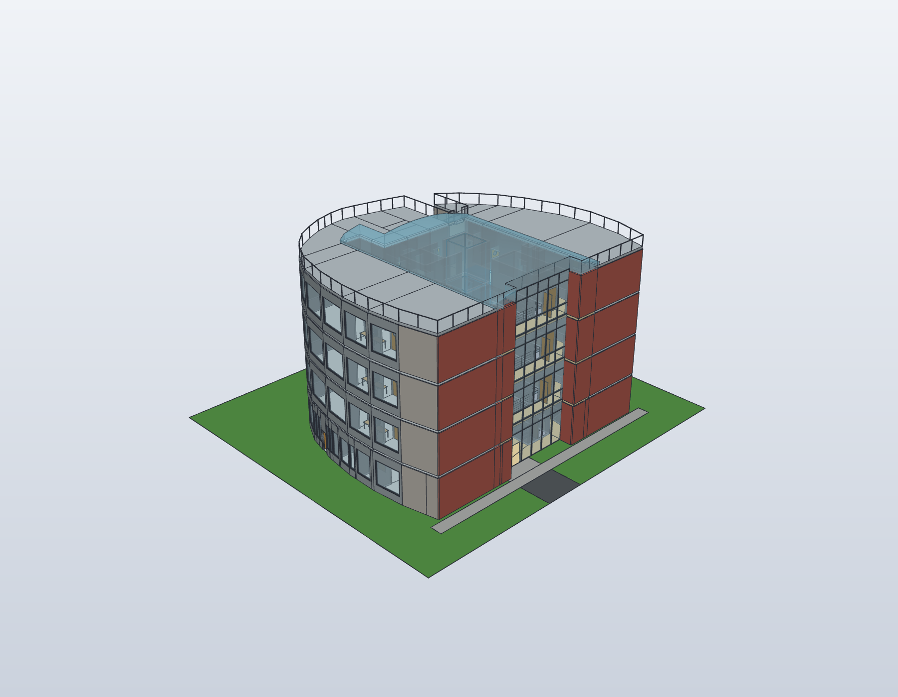
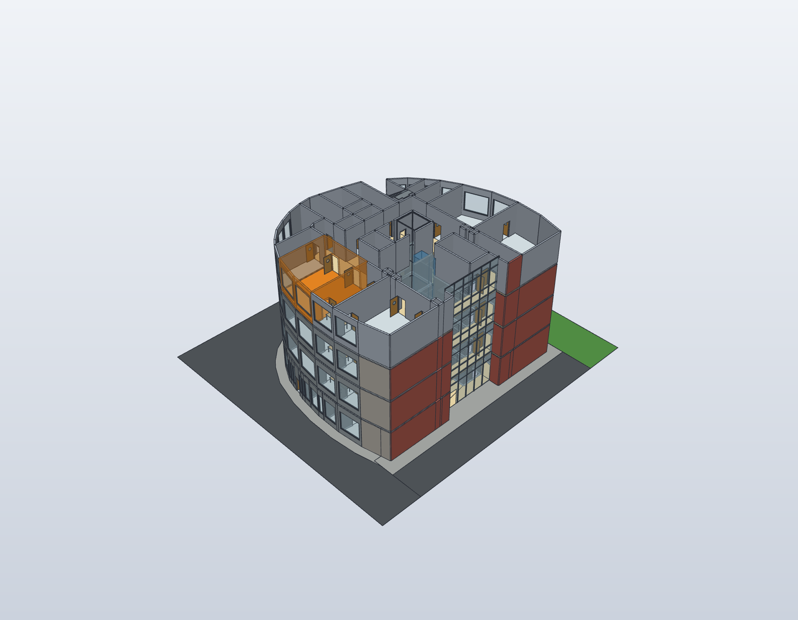
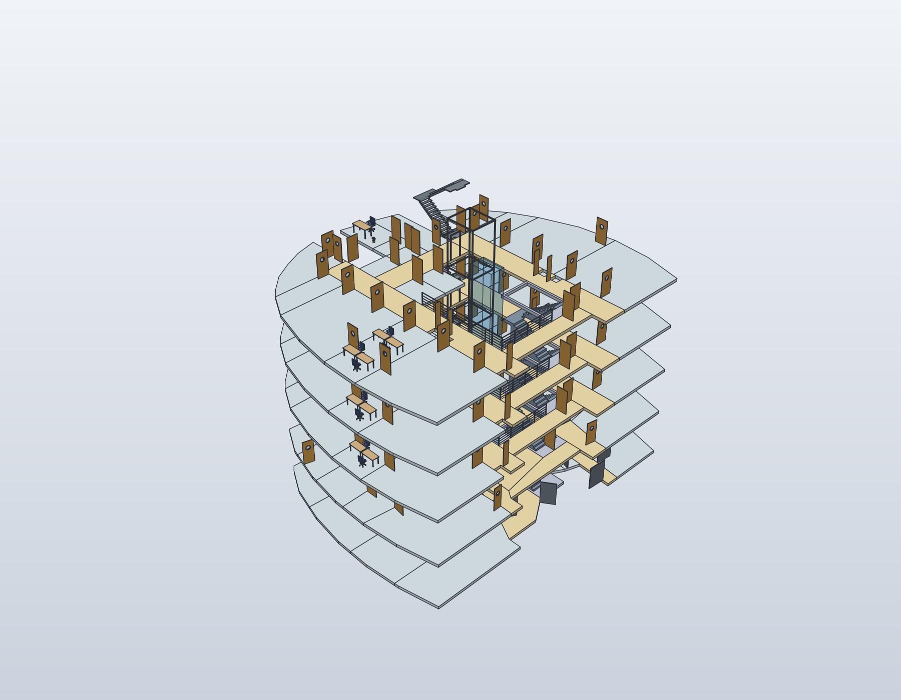
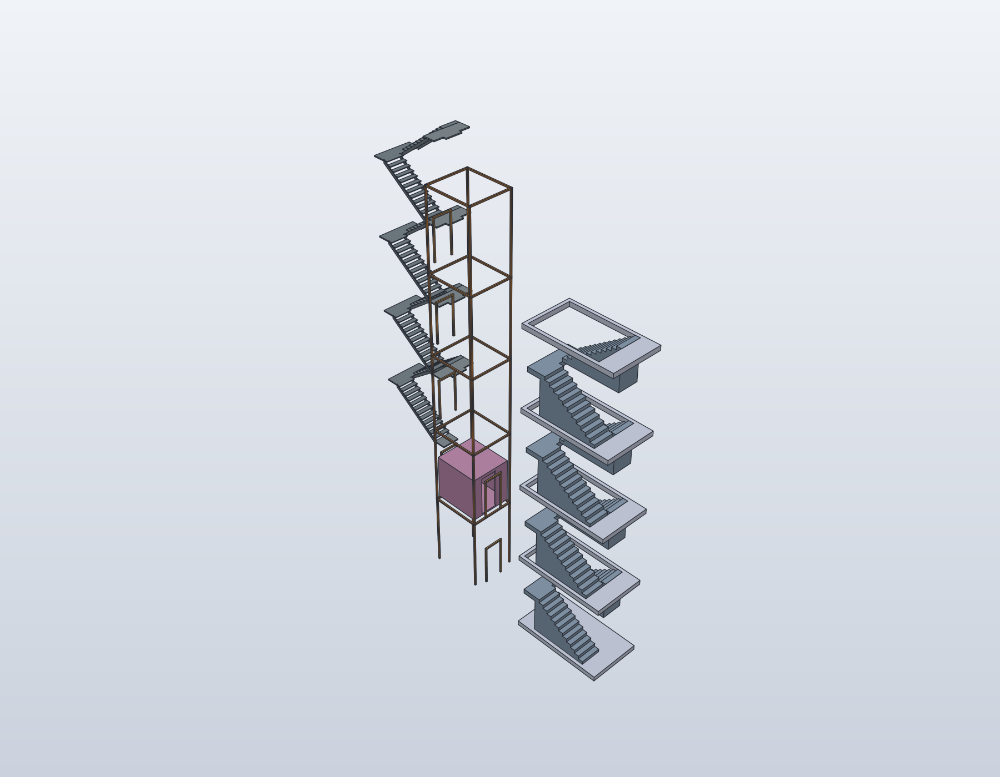
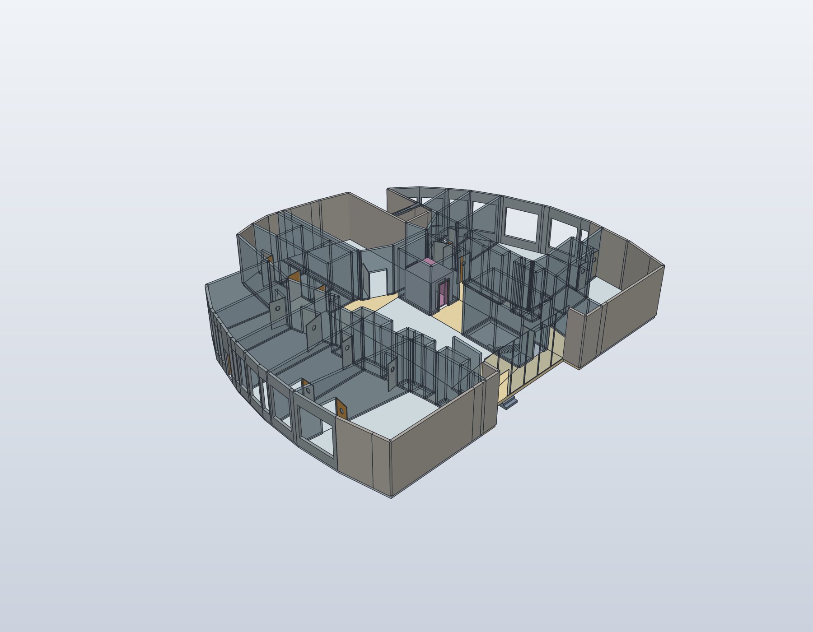
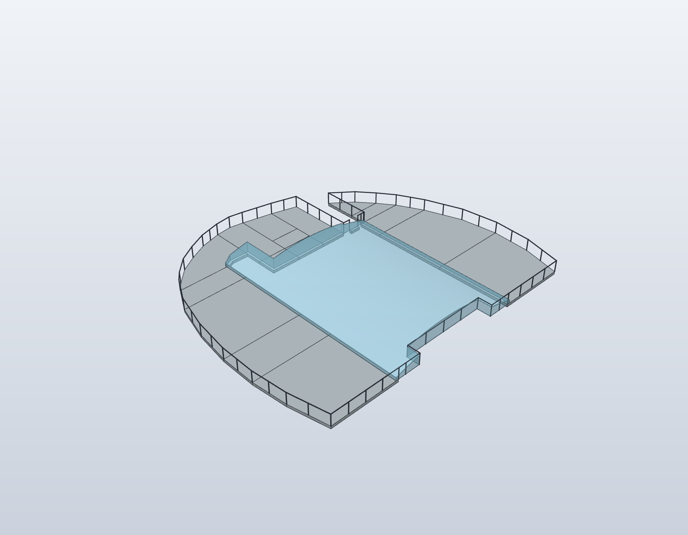
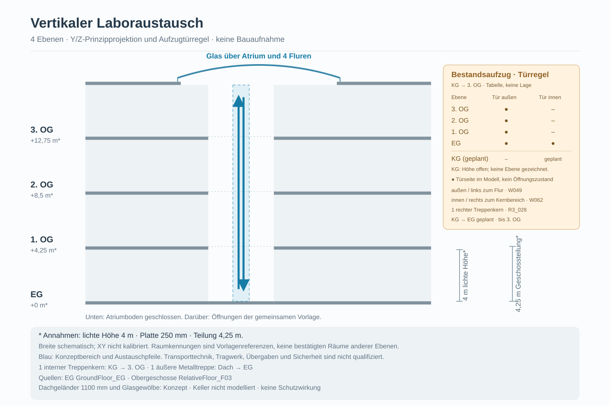
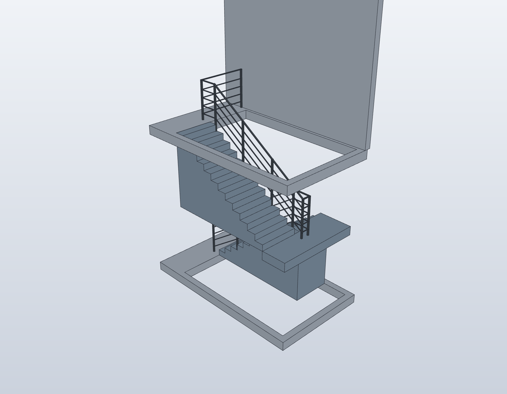

# Gebäude · Keller, EG, drei Obergeschosse und Dach

Die [blaue Küche in 3.008](kitchen-3008.md) steht im ersten Raum vom Flur aus.
Die beiden Raumtüren öffnen in Richtung Fenster. Die Kabinenfotos vom
18. November 2026 korrigieren außerdem den Aufzug: KG und EG öffnen nur die
Seite ohne Bedienpanel, die Obergeschosse die gegenüberliegende Seite.

In Raum **3.007** steht das [Forschungsmikroskop MI01](microscope-mi01.md)
auf einer aus dem bestehenden Möbelkatalog abgeleiteten Bank. Gerät und
Aufstellung besitzen getrennte Quellen; der Rundgang hat dafür einen eigenen
Blickpunkt. Das Trägerstativ ist noch unbekannt. Die gemeinsame Definition
liefert weiterhin das generische Darstellungsmodell für die native
Gebäudefassung; sie belegt keine Hersteller-Geometrietreue.

Die [geschossübergreifende Hüllenregistrierung](building-alignment.md) bringt
KG und EG vollständig auf die Außenkontur der Obergeschosse. Aufzug und inneres
Treppenhaus bleiben dabei im gemeinsamen vertikalen Bezug fest.

Der [Keller](basement-kg.md) verwendet eine eigene registrierte Raumquelle und
wird unter dem EG mit vorläufig angenommenem Geschossabstand ergänzt.
Der [fotoabgeleitete Ausbau](building-exterior.md) ergänzt Glasfront, opake Betonflanken, unterbrochene seitliche Fensterbänder, warme
Holztürfarbe, offene Metallgeländer und die dünne grüne Gelände-Markierung für die Gesamtansicht.

Das Modell unterscheidet **ein inneres Treppenhaus**, **einen alleinstehenden
Aufzug** und **eine außenliegende Metall-Fluchttreppe**. Das Erdgeschoss besitzt
jetzt eine eigene abgeleitete Geometrie mit Seminarraum, Foyer und anders
angeordneten Toiletten. Nur die drei Obergeschosse verwenden dieselbe F03-Vorlage.
Der Luftraum und alle vier umlaufenden Flure werden gemeinsam vom gewölbten
Glasdach überdeckt. Die Gewölbeachse ist gegenüber dem ersten Entwurf um 90°
gedreht und verläuft entlang der gemeinsamen X-Achse.

Die Fotos bleiben privat. Veröffentlicht werden ausschließlich die freigegebenen
Vektorableitungen und daraus erzeugte Modellansichten. Horizontale Maße,
Glaswölbung, Dachdetails und technische Bauteile bleiben Konzeptannahmen.

## Hüllenstand vor der Seiten- und Außenflächenkorrektur

`building-stack-4b47ee12d5a4-r2`: 1.477 geschlossene Körper. 388 Geometrieproben und 14 Höhenprüfungen je Backend.
Alle 1.477 zusätzlichen STEP-Vergleiche bestehen.
KG und EG besitzen dieselbe Außenkontur wie OG1–OG3; Aufzug und inneres
Treppenhaus bleiben unverändert im gemeinsamen XY-Bezug. Details und
Prüfgrenzen stehen in [der Hüllenregistrierung](building-alignment.md).

## Fassaden- und Außenflächenstand vor der Türintegration

`building-stack-2d80f268decf`: opake Betonflanken, begrenzte seitliche Fensterbänder,
dünne grüne Rasenmarkierung sowie grauer Bürgersteig und Zufahrt. Die
Geschosshülle und festen Kerne bleiben unverändert registriert. Beide CADs
bestehen 451 Geometrieproben und 14 Höhenprüfungen; alle 1614 STEP-Vergleiche bestehen.
Details stehen in [der Fotoableitung](building-exterior.md).

## Prüfstand mit Raumtüren vor der Raum- und Atriumkorrektur

`building-stack-a08626f68c13` integriert Küche 1.008, die drei
Doktorandenbüros, Büro 3.009 und die [gemeinsamen Türmodelle](building-doors.md).
66 Raumtüren besitzen runde Guckfenster, 53 oberirdische Raumtüren bleiben
fensterlos und 22 Keller-Raumtüren verwenden das fensterlose Stahlprofil.
Die Küchenstühle bleiben gleichmäßig mit je vier Sitzen an beiden Längsseiten.

FreeCAD und SolidCraft enthalten 1.811 geschlossene Körper. Je 451
Geometrieproben und 14 Höhenprüfungen sowie alle 1.811 exakten STEP-Vergleiche
bestehen; die maximale STEP-Volumendifferenz beträgt 0.
Die zusätzliche native Türprüfung bestätigt alle 141 Raumtürblätter und die
freien Ausschnitte mit separat eingesetzten Scheiben. Maße und Materialaufbau
bleiben Darstellungsannahmen; reale Türbewegungen sind nicht geprüft.

## Raum- und Atriumkorrektur

Die zusammengefasste Fläche **3.006A/B**, im 3. OG das bestätigte Sekretariat,
erhält im 1.–3. OG wieder einen Geschossboden. Ihre bisherige Kennzeichnung als unbestimmter Bereich hatte
die Bodenerzeugung unterdrückt. Die Gebäudevariante `SuiteFloors` übernimmt
die vorhandene Kontur und Plattendicke; die innere A/B-Aufteilung bleibt
ungeklärt. Im 3. OG ergänzt das vorhandene Seitenfensterrezept ein Außenfenster
am fernen Fassadenende (`W001`). Das Fenster ist vom Eigentümer bestätigt;
seine genaue Lage und Größe bleiben Darstellungsannahmen. Die ursprüngliche
F03-Nachzeichnung bleibt unverändert.

Die aktuelle Quellkorrektur stellt die Toilettenseite `R3_011` / `R3_012` /
`CoreGap` einschließlich ihrer Grenzen und Türöffnungen wie gezeichnet wieder
her. Die Sitzgruppen gehören in den **Kernbereich** (`NorthCore`), den
unnummerierten Bereich gegenüber von 3.002 auf der anderen Seite des Atriums.
Im 1.–3. OG stehen dort jeweils ein weißer elliptischer Tisch und vier Stühle.
Der Zugang liegt an `W063` zum Flur `C3_021`, das Geländer an `W065`.
Die linke Glastür zu 3.001 und die U-Arbeitsfläche in 3.002 bleiben Bestandteil
der zuvor bestätigten Raumkorrektur.

In der Küche 1.008 entfällt die hintere Büroabtrennung: Die OG1-Aufstellung
fasst `R3_008A`, `R3_008B` und `R3_009` zusammen und lässt die inneren Wände
`W027` und `W017` aus. Tische und gesamte Küchenanordnung werden gemeinsam
am äußeren Fensterbezug `W005` ausgerichtet, damit der Bereich an der Raumtür
für den Schrankzugang frei bleibt. Die Fensterzuordnung wird nur in OG1
ergänzt; Büro 3.009 und die oberen Geschossgrenzen bleiben erhalten.

Die früheren Stände `building-stack-6dbc248fae3b` und
`building-stack-5406a30fc113-r2` enthalten noch die falsche Sitzgruppenlage auf
der Toilettenseite. Ihre nativen Prüfungen und die damalige Außenflächen-
Äquivalenz beziehen sich auf diese zurückgenommene Darstellung. Sie belegen
die neue Kernbereichs- und Küchenaufstellung nicht. Der neue FreeCAD-Gesamtstand
`building-stack-ecc15e1b9dd9` besteht mit 1.944 geschlossenen Körpern,
452 Geometrieprüfungen und 15 Höhenprüfungen. Die neue unabhängige
SolidCraft-Bereichsprüfung für Kernbereich, Toilettenabgrenzung und Küche
bestätigt 306 geschlossene Körper und 18 native Prüfzeugen. Sie ist kein
vollständiger SolidCraft-Gebäudeaufbau oder STEP-Gesamtvergleich. Der neue
Browserexport besteht die tatsächliche Chrome-Prüfung aller fünf Blickpunkte
und Bedienelemente. Die
[Bildprovenienz des Kernbereichs](media/atrium-seating.provenance.json) bindet
die neuen Nachweise getrennt nach ihrem tatsächlichen Umfang.

## Labor 3.003 als Gebäudeinstanz

Die optionale Referenz
[`model/furnishings/building-laboratories.json`](../model/furnishings/building-laboratories.json)
bindet die bestehende L01-Definition an `OG3` / `R3_003` und dessen Eingangswand
`W036`. `scripts/building_laboratories.py` berechnet die vier unabhängigen
Raumparameter aus den Innenflächen der F03-Wände. Die Gebäudetransformation
folgt der inneren Eingangsecke, der Wandrichtung und der vorhandenen
Geschosshöhe. Die Quelle enthält weder Maßkopien noch eigene Geräteposen.

Die Möbel werden mit Maßstab 1 aus denselben Rezepten neu ausgewertet; die
Darstellungsskalierung der Büromöbel wird nicht auf sie angewendet. Boden,
Wände und Glas bleiben ausschließlich bei der Gebäudehülle. Die 183
verbleibenden Möbel-/Strukturkörper gehören zur neuen nativen Gebäudefassung.
Die aus L01 übernommene Betonstütze ist ausdrücklich nicht im F03-Plan belegt.
Die maximale lokale Y-Differenz der quadratischen Fassadennäherung zur Polylinie wird
je Segment einschließlich der inneren Extremstellen berechnet und im
`laboratories`-Interface ausgewiesen. Sie ist keine Aufmaßgenauigkeit.
Der nur rund 904 mm breite Fensterdurchgang bleibt eine offene praktische
Eigentümerentscheidung; `placement_qualified` bleibt `false`.

Das Interface enthält außerdem hergeleitete Parameter, Welttransformationen,
Möbelrahmen und Gelenke, benannte Arbeitsflächen und Rackplätze. Der
Öffnungsgraph verbindet 3.002 über `D3_002N` und den Flur mit `D3_003A/B` und
3.003; diese Topologie bleibt getrennt von Geometrie und Materiallaufzeit.
T2/T3-Endpunkte, Transporterfahrten und eine Materialübergabe sind nicht
implementiert. Für spätere Roboterbahnen gilt weiterhin die gemeinsame
Vorgabe fließender Bewegungen.

Der Browser übernimmt zusätzlich alle 17 Gerätegruppen aus dem geprüften
Standalone-L01-Layout mit ihren gebundenen Posen und starren Transformationen.
Native Geräte im Gebäude-CAD fehlen in dieser Stufe ausdrücklich. Es gibt nur
eine Gebäudeszene; der isolierte Laborblick filtert dieselben Weltkörper.
Standalone-L01 bleibt für Ablauftests aus derselben Definition erzeugbar.
Typweite Browserartikulationen geben den vorhandenen Schranktürgelenken und
Hockerliften Bedienung, ohne ihre Definition je Instanz zu kopieren.

**Integrierter `master`-Stand vom 16. November 2026:**
`building-stack-0dfc62c4a318` besteht mit 2.362 geschlossenen FreeCAD-Körpern,
509 Geometrieprüfungen und 16 Höhenprüfungen. Büro-PCs, Küchengeräte und die
neueren Treppengeländer sind enthalten. Das aktualisierte Standalone-L01
`lab-layout-l01-953a32f28782` mit den aktuellen Armkameras besteht beide CADs
mit 884 Körpern und den bisherigen Zugangs-/Kollisionsprüfungen.
Der gemeinsame Browserexport `building-walkthrough-177026299fe0` besteht die
vollständige Chrome-Prüfung mit 3.045 Körpergruppen: Laborzugang vom Büro,
Möbelbedienung und Aufzugfahrt ebenso wie die erhaltenen Büro-/Küchengeräte.

**Ursprünglicher Prüfstand in `1bf1d77`:** Der native FreeCAD-Gebäudestand
`building-stack-2b9b9a5b1e10-r2` besteht mit 2.121 geschlossenen Körpern,
452 Geometrieprüfungen und 16 Höhenprüfungen. Standalone-L01 wurde unabhängig
in beiden CADs neu aufgebaut: fünf Raumvarianten und die vollständige
878-Körper-Aufstellung bestehen. Der Browserexport `building-walkthrough-d0fca19566f3`
bindet diese Berichte und enthält alle 17 Geräte sowie drei funktionale
Arm-Unterbauten. Die tatsächliche Chrome-Prüfung besteht den Büro–Flur–Labor-Weg,
Schranktür und Hockerlift sowie Aufzugruf, Einstieg, Fahrt OG3–EG–OG3 und
die geschossabhängigen Ausstiege. Ein neuer
vollständiger SolidCraft-Gebäudeaufbau ist ausdrücklich ausgelassen.
Historische Berichte und folgende Bilder bleiben ihren eigenen Revisionen
zugeordnet und belegen diese neue Laborbindung oder Aufzugfahrt nicht.

## Ansichten für den Antrag

Die folgenden Gesamtbilder bleiben Momentaufnahmen ihrer in der Provenienz
gebundenen Revisionen. Die korrigierten Arbeitsplätze und Atrium-Sitzgruppen
zeigen die aktuellen [Möbelbilder](building-furnishings.md),
[Sitznischenbilder](atrium-seating.md) und der [Browserrundgang](building-walkthrough.md).



**Gesamtansicht:** Keller, EG und drei Obergeschosse, um 90° gedrehtes Glasgewölbe
über Atrium und allen vier Fluren sowie Dachumrandung. Die ursprünglichen F03- und L01-Quellen bleiben unverändert.



**Labor 3.003 im Gebäudekontext:** Orange markiert den referenzierten Raum
`R3_003` auf Ebene `OG3`, einschließlich seines Bodens und der fünf Grenzwände.
Das Dach ist für diese Ansicht ausgeblendet, die Wände des obersten Geschosses
sind transparenter. Es werden ausschließlich Darstellungseigenschaften des
geprüften nativen Modells geändert; die CAD-Datei bleibt bytegleich.
Diese historische Ansicht zeigt die frühere semantische Zuordnung ohne
L01-Einrichtung. Die neue explizite Laborbindung ist oben beschrieben; das
Bild und seine Provenienz bleiben erhalten. Eine vermessene Registrierung
bleibt auch mit der neuen Bindung offen.



**Luftraumansicht:** Wände und verdeckende Dachflächen sind für dieses Bild
ausgeblendet. Blau bleibt die Idee des späteren automatisierten Austauschs;
sie ist getrennt vom Gebäudeaufzug. Das Atrium besitzt oben einen Glasabschluss,
keinen offenen Himmel. Eine freie Transportbahn wird damit nicht nachgewiesen.



**Erschließung:** Das innere Treppenhaus liegt rechts. Der Aufzug enthält genau
eine beispielhaft im EG stehende Kabine und keine angelagerte Treppe. Links liegt
die separate Metalltreppe, durch Flur und seitlichen Versatz vom Aufzug getrennt.
Die übrige Umgebung ist nur für diese Detailansicht ausgeblendet.



**Erdgeschoss:** Eigene Raumaufteilung statt einer weiteren Obergeschosskopie.
Die neue [EG-Vektorableitung](ground-floor-eg.md) zeigt Raumbezeichnungen,
Seminarraum, Foyer, WC-Anordnung und den Ausgang der Außentreppe neben 22.



**Dach:** Die Glaswölbung erstreckt sich über die referenzierten Flure
`C3_018`, `C3_019`, `C3_020`, `C3_021` und den eingeschlossenen Atrium-/Kernbereich.
Die Grundfläche folgt deren Konturen statt einem vergrößerten Rechteck über
benachbarten Räumen. Die Flurböden bleiben unverändert; die Dachöffnung wird
auf die Glasabdeckung erweitert. Die Gewölbeachse liegt nun in X-Richtung,
das gekrümmte Querprofil in Y/Z. Die Ränder reichen über die neue Öffnung
auf das äußere, undurchsichtige Dach. Das bildet die
beschriebene Absicht des Regenablaufs ab. Tragwerk, Dichtung und hydraulische
Entwässerung sind nicht berechnet. Die Umrandung ist eine schematische Darstellung
der vom Eigentümer genannten Schutzkonstruktion für die Wartung der Klimaanlagen;
Schutzwirkung und reale Maße sind ungeprüft. Klimageräte werden nicht erfunden.



[Prinzipschema als SVG](models/images/building-stack.svg) ·
[hochauflösende PNG-Fassung](media/building-stack-section.png).
Das Schema ist eine Erläuterung der Quellen, kein vermessener Gebäudeschnitt.
Die horizontale Prinzipdarstellung verwendet das Querprofil des gedrehten
Gewölbes; die vierseitige Abdeckung ergibt sich aus der Dachgrundfläche.
Alle nativen PNG-Ansichten oben sind ebenfalls für die Antragsunterlagen abrufbar.

## Drei voneinander getrennte vertikale Systeme

| System | Bestätigte Reichweite | Aktuelle Darstellung |
|---|---|---|
| Inneres Treppenhaus, F03-Bereich 3.028 / EG-Bereich 20 | Keller bis 3. OG | KG–3. OG mit verbundenen Konzeptläufen und Podesten; Kellerhöhe angenommen |
| Gebäudeaufzug | Keller bis 3. OG | Statische EG-Kabinenreferenz im CAD, durchgehender Schachtrahmen; im Browser eine bewegte Kabine mit Ruf, Einstieg, Geschosswahl und erlaubtem Ausstieg |
| Äußere Metall-Fluchttreppe, F03-Bereich 3.017 | Dach bis Boden | Eigenständige Metallkonstruktion mit Podesten und Anschluss am Dach; EG-Ende neben Zugang 22 |

Die Außentreppe ist **kein zweites inneres Treppenhaus** und keine Baugruppe des
Aufzugs. Ihre Lage wird aus der referenzierten Fläche und dem EG-Ausgang
abgeleitet. Laufrichtung, Stufenaufteilung, Metallquerschnitte und Anschlussdetails
sind vorläufige Darstellungsannahmen. Sie sind keine nachgewiesene reale Flucht-
oder Wartungsroute. Eine Kelleranbindung der Außentreppe wird nicht angelegt.

### Gemeinsames Geländer für Atrium und inneres Treppenhaus

Die inneren Treppenläufe vom Keller bis zum 3. OG erhalten an ihren freien
Kanten dasselbe offene Metallgeländer wie das Atrium: Pfosten, Handlauf und
vier Querstreben. `circulation.stairs.guard_profile_ref` verweist mit
`#/exterior` auf die bereits vorhandenen Atriumparameter; im Treppenrezept
werden weder Maße noch Farbe nochmals definiert. `scripts/building_guards.py`
erzeugt die gemeinsamen Bauteile für beide Aufstellungen.

Die Streben folgen den geneigten Läufen. Die kurzen Geländer auf Zwischen-
und Geschosspodesten schließen das Treppenauge. Im obersten 3. OG wird der
Abschluss über den dort ungenutzten Aufwärtslauf bis zur Seitenwand geführt.
`circulation.stairs.instances[].top_guard_wall` referenziert dafür `W081`;
Wandinnenfläche und bündiger Endpfosten werden aus Wandlage, Wandstärke und
dem gemeinsamen Profil abgeleitet. Der ankommende Treppenlauf sowie die
Zugänge und Wendebereiche bleiben frei. Untere Geschosse behalten ihre
bisherigen Geländer. Gemeinsame Eckpfosten werden einmal erzeugt.
Die geneigte Führung folgt den Stufenvorderkanten; die Pfostenfüße werden aus
den vorhandenen Stufen- und Podestkörpern abgeleitet. Querschnitte bleiben
normal zur geneigten Strebe erhalten, und Pfostenabstände werden entlang
der tatsächlichen dreidimensionalen Verbindung begrenzt.
Stufen, Podeste, Aufzug und äußere Metalltreppe werden dadurch nicht neu
konstruiert. Die bestehenden Körper-IDs bleiben erhalten.

Höhe, Querschnitte, Abstände und Anschlussüberdeckung sind weiterhin
Darstellungsannahmen. Geometrische Prüfungen der neuen Bauteile und ihrer
deklarierten Freiräume ersetzen keine Prüfung realer Absturzsicherung,
Treppennormen, Kopffreiheit, Tragfähigkeit oder Fluchtwege.



Die [Bildprovenienz](media/stairwell-railing.provenance.json) bindet diese
Detailansicht an die gemeinsame Quelle und die native Teilprüfung: 161 neue
Geländerteile sowie vier bestehende Treppenverbindungen und fünf Geschossböden
und die Anschlusswand im 3. OG wurden unabhängig in FreeCAD und SolidCraft
erzeugt. 171 STEP-Vergleiche,
41 Auflagerproben und 16 abgegrenzte Laufbereichsproben bestehen die Prüfungen.
Der Endpfosten schließt bündig an die Wand an; die Geländerteile dringen nicht
in sie ein. Die Querstreben schneiden kein Stufen- oder Bodenmaterial. Eine vollständige
native Gebäudeprüfung wurde damit nicht erneuert; ältere Gesamtbilder und
deren Provenienz behalten ihren historischen Stand.
Der reguläre Gebäudebuild übernimmt dieselben Auflager- und Freiraumproben
für beide CAD-Ziele und weist fehlende oder unvollständige Geländerbelege ab.

## Aufzugtürseiten

Der Eigentümer bestätigt im Bezug des ersten Geschossplans **außen links zum
Flur 3.020** (`W049`, `C3_020`) und **innen rechts zum Gebäudekern** (`W062`,
`NorthCore`). Im EG grenzen dieselben Türseiten an dessen eigene Flurflächen.
„Außen“ bezeichnet hier
eine Aufzugseite, keinen Gebäudeausgang.

| Stopp | Türseiten | Geometrie |
|---|---|---|
| EG | Nur innen, gegenüber dem Bedienpanel | Modellierte Öffnung und Rahmen |
| 1.–3. OG | Nur außen | Innere Seiten bleiben geschlossen |
| KG | Nur innen | Eigene Raumquelle; Höhe vorläufig angenommen |

Die einmalig referenzierte Öffnung `DLift` liefert die synthetische Lage/Breite
für die Aufzugdarstellung. Die tatsächlichen Zielwände werden geschnitten;
Rahmen stehen nicht vor ungebrochenen Wandkörpern. Im Browser begrenzt
dieselbe aktive Portliste die Ausstiegsseiten. Die bewegte EG-Kabine besitzt
weiter ihre beiden Öffnungen; die inneren Schachtwände der Obergeschosse
bleiben dennoch geschlossen. Kabinen- und aktive Schachttüren besitzen
verschiebbare Blätter. Die Edelstahloptik, zwei Handlaufhöhen, dunkler Boden
und horizontale Tastenreihe folgen den Kabinenfotos; Maße bleiben angenommen.
Panel und Telefon bleiben an den zuvor bestätigten nordwestlichen bzw.
nordöstlichen Positionen. Das dargestellte Anzeigenfeld hat keine eigene
Live-Geschossanzeige; der Browser zeigt den Fahrzustand im Bedienmenü.

Die Browserfahrt verschiebt genau eine Kabine und die absolut daran gebundene
Kamera. Die übrige freie Navigation ist an Bord gesperrt. Halte und Höhen
kommen aus dem bestehenden Aufzuginterface; die Fahrtzeit folgt einer
ausdrücklich synthetischen Geschwindigkeitsannahme. Bedienung und Grenzen
stehen im [Rundgang](building-walkthrough.md#aufzug-benutzen).
`lift_operation_implemented` bleibt `false`: Die Darstellung ist kein realer
Aufzugsbetrieb oder Nachweis einer Schutzfunktion.
`NorthCore` bleibt in der Obergeschossvorlage in seiner übrigen Nutzung unbestimmt.

## Quellen und gemeinsame Bezugssysteme

Die führende Komposition
[model/building-stack.shared.json](../model/building-stack.shared.json) bindet:

- [F03](../model/floor-f03.shared.json) für OG1–3 und die gemeinsamen Kernbezüge;
- [die eigene Keller-Ableitung](../model/basement-kg.shared.json) für KG;
- [die eigene EG-Ableitung](../model/ground-floor-eg.shared.json) für EG;
- die bestehenden, ungemessenen L01-Parameter als horizontale Darstellungsproportion;
- getrennte Rezepte für Aufzug, innere Treppe, äußere Metalltreppe und Dach;
- optional die gepinnte Laborreferenz mit L01-Raum-/Möbeldefinition und Geräteaufstellung.

Die EG-Abbildung ist gegenüber F03 um 180° orientiert. Ihre Literalvektoren sind
bereits im gemeinsamen Darstellungsrahmen abgelegt. Gemeinsame Kernpunkte werden
als echte F03-Vertexreferenzen ausgewertet. Die manuelle Einpassung ist keine
starre photogrammetrische Registrierung, kein Aufmaß und keine metrische
Kalibrierung. Der Loader dreht die Koordinaten nicht ein zweites Mal.
Einrichtungen und Geräte des bestehenden L01 werden nicht in das EG übertragen.

Keller, EG und OG verwenden ihre jeweiligen Raumquellen.
Wände, Öffnungen und Flächen bleiben je Quelle einmal beschrieben. Eigene
Geschosspräfixe erzeugen die Instanzen; Varianten berechnen die abgeleiteten
Höhen und Anschlüsse gemeinsam neu. Die EG-Raumbezeichnungen stammen aus dem
neuen Plan; Obergeschosskennungen bleiben Vorlagenbezüge.

## Höhen und Dachannahmen

| Größe | Ansatz | Status |
|---|---|---|
| Lichte Geschosshöhe | 4.000 mm | Eigentümerannahme |
| Geschoss-/Dachplatte | 250 mm | Vorläufige Darstellungsannahme |
| Geschossabstand | 4.250 mm | Aus lichter Höhe und Platte abgeleitet |
| Bodenoberseiten KG–3. OG | −4.250 / 0 / 4.250 / 8.500 / 12.750 mm | Abgeleitete Darstellungshöhen; Kellerhöhe offen |
| Dachoberseite | 17.000 mm | Oberste lichte Höhe plus Dachplatte; kein fünftes Geschoss |
| Glaswölbung, Überstand, Umrandung | Parameter unter `roof` | Illustrativ, nicht vermessen oder statisch ausgelegt |

Eine Geschossreferenz liegt auf der Bodenoberseite; die Platte liegt darunter.
Die neue Dachplatte liegt oberhalb der obersten lichten Höhe. Sie verkürzt diese
nicht. Die hohle Glaswölbung besitzt eine echte kreisförmige Zylinderschale,
keinen vollen Zylinder im Luftraum. Nur die umlaufenden Anschlusswände werden
aus derselben Kreisgeometrie numerisch angenähert. Auflösung und maximale
Sehnenabweichung werden im Dachvertrag ausgewiesen; die Randwände überlappen
die Schale konstruktiv. Daraus folgt kein Dichtheits- oder Anschlussnachweis. Ihre Grundfläche, Randabschlüsse und überstehenden Ränder werden
aus den gemeinsamen Flächenreferenzen abgeleitet. Alle vier Flur-IDs müssen
in der Glasabdeckung enthalten sein; eine opake Flurvollplatte direkt unter
dem Glas würde diese Lichtöffnung wieder verschließen. Nur das ausdrücklich
begrenzte Zugangspodest am Anschluss der äußeren Dachtreppe bleibt als lokale
Ausnahme erhalten; es wird getrennt von einer Flurvollplatte geprüft. Die Kellerhöhe verwendet ausdrücklich vorläufig denselben Darstellungsansatz;
ein Kelleraufmaß bleibt offen.

Im EG wird keine zusätzliche Atrium-Füllplatte über den wirklichen Raumflächen
angelegt. Foyer- und Flurböden aus der EG-Quelle decken die Projektion des oberen
Luftraums gemeinsam ab. Obere Treppenöffnungen und erhaltene Zugangspodeste
werden mit den tatsächlichen Etagenböden ausgewertet. An der Außentreppe werden
frühere schematische Vollplatten durch leichte Metallpodeste ersetzt; geteilte
Fassaden bleiben Gebäudewände.

## Aufbau und Nachweise

```sh
python3 scripts/build_building_stack.py --backend both
python3 scripts/render_ground_floor.py --out exports/ground-floor-eg.svg
python3 scripts/render_building_stack_section.py --out exports/building-stack-section.svg
python3 scripts/render_building_stack_highlight.py --level OG3 --area R3_003
```

FreeCAD und SolidCraft konstruieren unabhängig aus denselben Quellen. Einzeln
sind `--backend freecad` und `--backend solidcraft` verwendbar. STEP dient nur
zum zusätzlichen Vergleich. Native Dateien, vollständige Berichte und
Arbeitsrenderings bleiben lokal unter `cad/`, `exports/` und `renders/`;
ausgewählte Dokumentationsbilder sind versioniert.

Historischer Foto-Prüfstand vor der Hüllenregistrierung `building-stack-efe22ae793b6-r2`: 1.048 gültige
geschlossene Körper, 390 Geometrieproben und 14 Höhenprüfungen je Backend.
Alle 1.048 zusätzlichen STEP-Vergleiche ergeben 0 Volumendifferenz.
Die [Fotoableitung](building-exterior.md) dokumentiert Glasfront, Türfarbe,
offene Geländer und den Gelände-Höhenbezug.


Separater lokaler Möblierungsstand `building-stack-48617bac704a`: Beide CADs erzeugen
1.185 geschlossene Darstellkörper einschließlich Küche und Büros. 248 gezielte
Geometrieproben, neun Höhenprüfungen und alle 1.185 STEP-Differenzprüfungen
bestehen. Die zusätzlichen [Möbelprüfungen und Einpassungsgrenzen](building-furnishings.md)
sind separat beschrieben.


Vorheriger Keller-Prüfstand vor den Fotoergänzungen `building-stack-b3571c36214a`: beide CADs erzeugen
803 geschlossene Darstellkörper. FreeCAD bestätigt 249 gezielte Geometrieproben
und neun Höhenprüfungen; alle 803 zusätzlichen STEP-Differenzprüfungen bestehen.
Die Kelleransicht und ihre Grenzen stehen in [der Kellerdokumentation](basement-kg.md).

Historischer Prüfstand vor der Kellerintegration: Die Revision
`building-stack-aecf951be669` wurde mit beiden CADs unabhängig aufgebaut:
670 gültige geschlossene Darstellkörper und 221 gezielte Prüfgruppen je Backend.
Alle 670 zusätzlichen STEP-Differenzvergleiche ergeben
0 in kubischen Darstellungs-mm. Fünf native SolidCraft-Ansichten und beide
Vektorgrafiken wurden visuell geprüft; eine FreeCAD-GUI-Prüfung wurde nicht durchgeführt.

Der damalige isolierte Veröffentlichungsstand wurde einschließlich F03, EG, Gebäude,
Laborhervorhebung und Galerie geprüft: **125 Tests bestanden, ohne Skips**.
Die Galerieprüfung bestätigt 45 Bilder mit 3.993.813 Bytes unter dem unveränderten
4-MB-Budget. Das ist die gezielte Prüfung dieses Commitumfangs, keine Ausführung
der vollständigen Repository-Suite. Ein früherer erweiterter Test im gemischten
Arbeitsverzeichnis meldete einen veralteten TR01-Galerie-Pin; dieses historische
Ergebnis bleibt in der Provenienz erhalten. Der Veröffentlichungsstand wurde
aus `master` plus den zugehörigen Gebäudeänderungen getrennt zusammengesetzt.

Die [Provenienz](media/building-stack.provenance.json) bindet Quellen, Generatoren,
Artefakte, Ansichten und tatsächlich ausgeführte Prüfungen. Die Prüfungen betreffen
statische Darstellkörper, benannte Öffnungen, geschlossene Aufzugseiten,
Treppen-/Podestanschlüsse, die EG-Bodenvereinigung und die Dachgeometrie.
Wandknoten und starre Montageanschlüsse dürfen sich konstruktiv überlappen;
eine globale Kollisionsfreiheit wird nicht behauptet.

Die Daten liefern keine reale Begehbarkeit, Kopffreiheit, Aufzugssteuerung,
Tragfähigkeit, Absturzsicherung, Entwässerungsleistung, Brandschutz- oder
Fluchtwegfreigabe. Netzwerk, ROS-/SiLA-Anbindung, Sensorik und Hardwareausführung
sind für dieses Gebäudekonzept nicht implementiert. Spätere Robotertransporte
unterliegen weiterhin der Vorgabe fließender Bewegung ohne unnötige Zwischenhalte.

## Küche und Denkbereiche

Die [Küche 1.008 und die Büros 1.002, 2.002, 3.002 sowie 3.009](building-furnishings.md)
werden aus einer eigenen referenzierten Möblierung ergänzt. Die Küchenfarben
und Anordnung folgen zwei Innenfotos; Maße, Arbeitsplatzanzahlen und die
Einpassung in die OG-Schablone bleiben ausdrücklich angenommene Darstellwerte.
Die ergänzte Eigentümervorgabe ordnet den hinteren Vorlagenbereich `R3_009`
im 1. OG der offenen Küche zu. Die innere Büroabtrennung entfällt dort; die
Tischgruppe steht am äußeren Fenster, während die Eingangsseite für den
Schrankzugang frei bleiben soll.
Ein separater Blick in den Kühlschrank zeigt das kleine Easter Egg.

Der [lokale Browserrundgang](building-walkthrough.md) öffnet den Doktorandenraum
3.002, die Küche, den Atriumblick und den Kernbereich direkt. Das detaillierte
Labor 3.003 öffnet als eigene Szene, solange seine Registrierung in den
Gebäudebezug offen ist.

Die aktuellen Gebäudevarianten lassen die zugrunde liegenden Raumzeichnungen
unverändert: In 3.002 liegt die Glastür zu Labor 3.001 links, die frühere rechte
Verbindung zu 3.003 bleibt geschlossen. Die Arbeitsplatten bilden ein
wandbündiges U mit freier Türöffnung. Der [Kernbereich](atrium-seating.md)
`NorthCore` erhält im 1.–3. OG je einen weißen elliptischen Tisch und vier
Stühle. Seine Bodenfläche folgt der vorhandenen Kontur außerhalb des Luftraums;
das Geländer an `W065` verwendet das gemeinsame Rezept. Die ursprünglichen
Toilettenflächen, ihre Grenzen und Türen bleiben erhalten. EG, Keller und die
Aufzug-/Treppenhauswände `W062` und `W079` bleiben von der Sitzgruppenvariante
unberührt. Die oben gezeigten Gesamtbilder
dokumentieren ihre jeweils in der Provenienz gebundenen früheren Revisionen.
