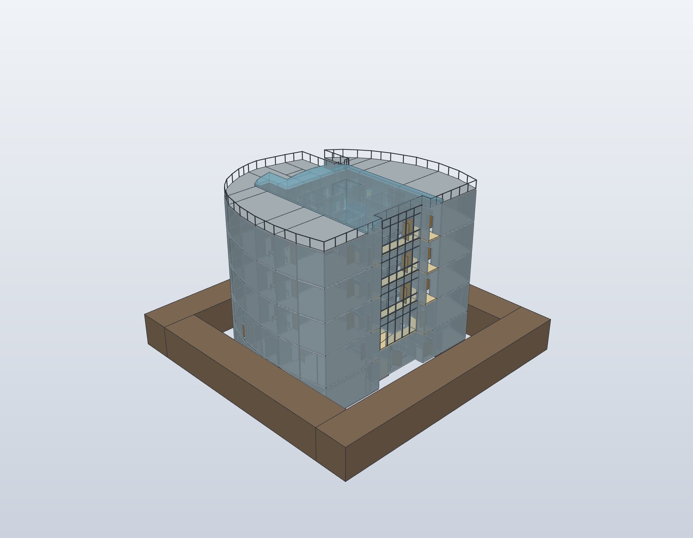
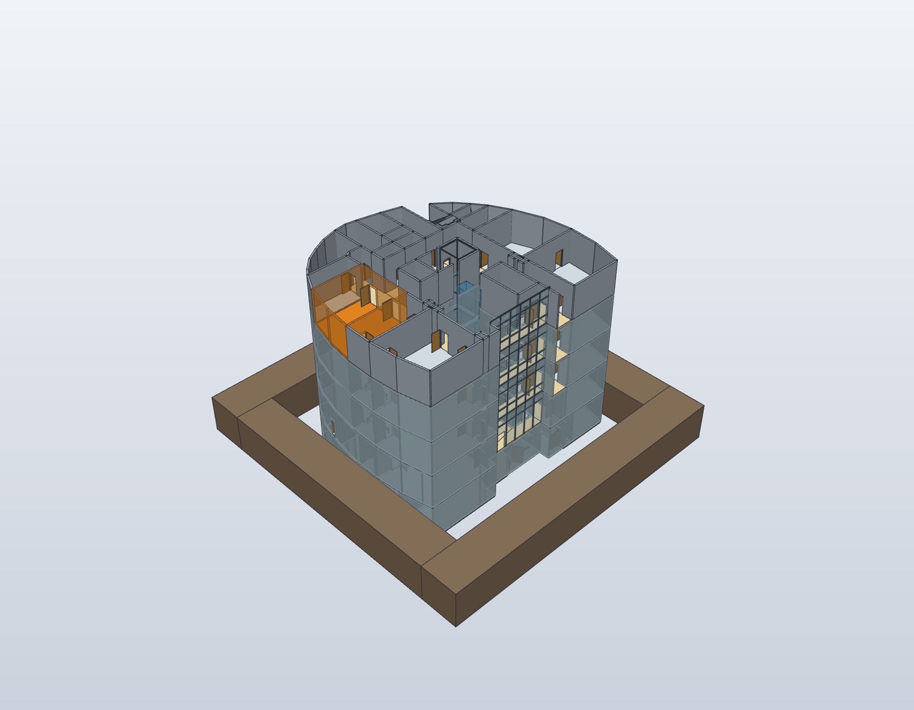
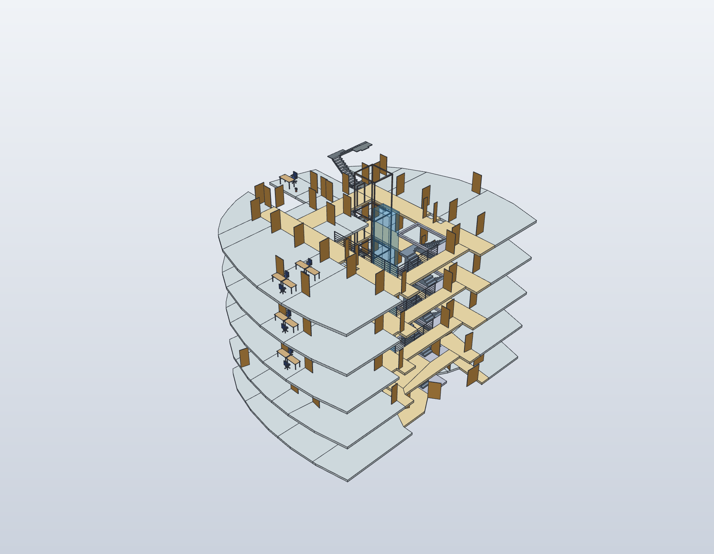
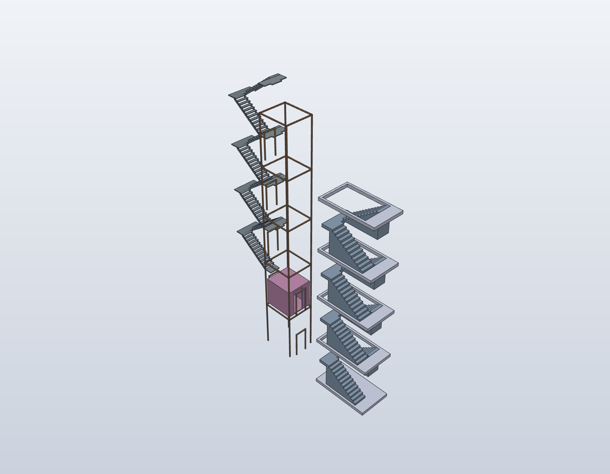
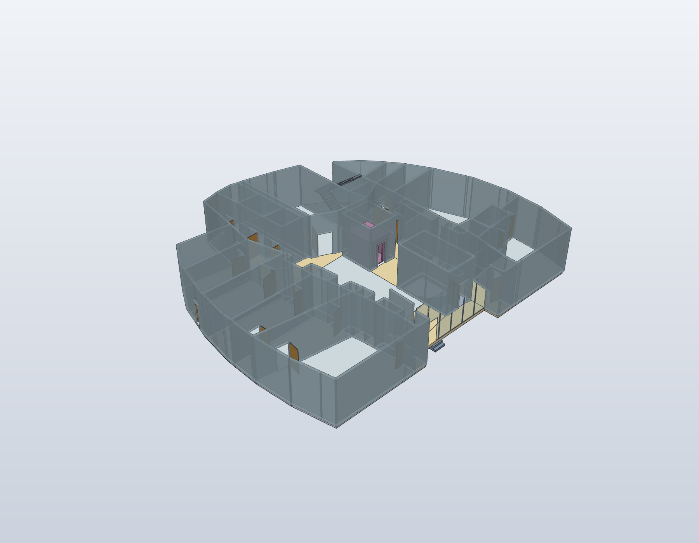
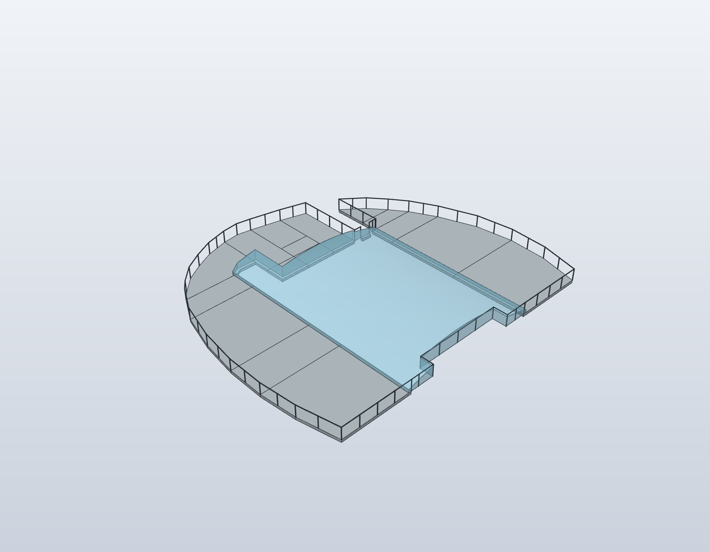
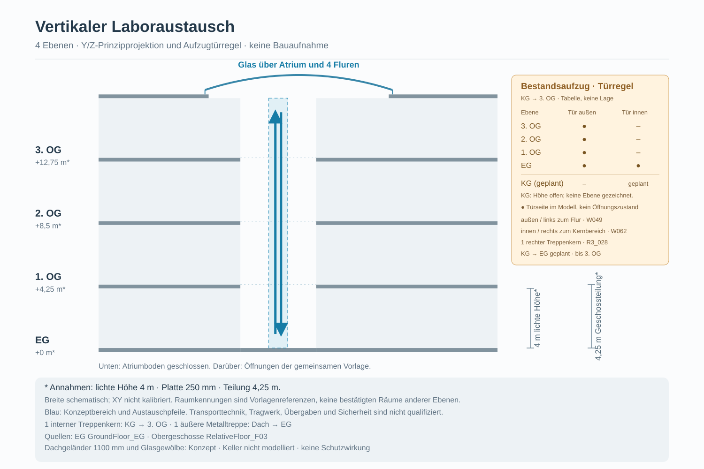

# Gebäude · Keller, EG, drei Obergeschosse und Dach

Die [geschossübergreifende Hüllenregistrierung](building-alignment.md) bringt
KG und EG vollständig auf die Außenkontur der Obergeschosse. Aufzug und inneres
Treppenhaus bleiben dabei im gemeinsamen vertikalen Bezug fest.

Der [Keller](basement-kg.md) verwendet eine eigene registrierte Raumquelle und
wird unter dem EG mit vorläufig angenommenem Geschossabstand ergänzt.
Der [fotoabgeleitete Ausbau](building-exterior.md) ergänzt Glasfront, warme
Holztürfarbe, offene Metallgeländer und den Gelände-Höhenbezug für die Gesamtansicht.

Das Modell unterscheidet **ein inneres Treppenhaus**, **einen alleinstehenden
Aufzug** und **eine außenliegende Metall-Fluchttreppe**. Das Erdgeschoss besitzt
jetzt eine eigene abgeleitete Geometrie mit Seminarraum, Foyer und anders
angeordneten Toiletten. Nur die drei Obergeschosse verwenden dieselbe F03-Vorlage.
Der Luftraum und alle vier umlaufenden Flure werden gemeinsam vom gewölbten
Glasdach überdeckt. Die Gewölbeachse ist gegenüber dem ersten Entwurf um 90°
gedreht und verläuft entlang der gemeinsamen X-Achse.

Die Fotos bleiben privat. Veröffentlicht werden ausschließlich die freigegebenen
Vektorableitungen und daraus erzeugte Modellansichten. Horizontale Maße,
Glaswölbung, Dachdetails und technische Bauteile bleiben Konzeptannahmen.

## Aktueller Hüllenstand

`building-stack-4b47ee12d5a4-r2`: 1.477 geschlossene Körper. 388 Geometrieproben und 14 Höhenprüfungen je Backend.
Alle 1.477 zusätzlichen STEP-Vergleiche bestehen.
KG und EG besitzen dieselbe Außenkontur wie OG1–OG3; Aufzug und inneres
Treppenhaus bleiben unverändert im gemeinsamen XY-Bezug. Details und
Prüfgrenzen stehen in [der Hüllenregistrierung](building-alignment.md).

## Ansichten für den Antrag



**Gesamtansicht:** Keller, EG und drei Obergeschosse, um 90° gedrehtes Glasgewölbe
über Atrium und allen vier Fluren sowie Dachumrandung. Die ursprünglichen F03- und L01-Quellen bleiben unverändert.



**Labor 3.003 im Gebäudekontext:** Orange markiert den referenzierten Raum
`R3_003` auf Ebene `OG3`, einschließlich seines Bodens und der fünf Grenzwände.
Das Dach ist für diese Ansicht ausgeblendet, die Wände des obersten Geschosses
sind transparenter. Es werden ausschließlich Darstellungseigenschaften des
geprüften nativen Modells geändert; die CAD-Datei bleibt bytegleich.
L01 ist diesem Raum semantisch zugeordnet. Die bisherige L01-Einrichtung wird
hier nicht maßstäblich eingesetzt; eine vermessene Registrierung bleibt offen.



**Luftraumansicht:** Wände und verdeckende Dachflächen sind für dieses Bild
ausgeblendet. Blau bleibt die Idee des späteren automatisierten Austauschs;
sie ist getrennt vom Gebäudeaufzug. Das Atrium besitzt oben einen Glasabschluss,
keinen offenen Himmel. Eine freie Transportbahn wird damit nicht nachgewiesen.



**Erschließung:** Das innere Treppenhaus liegt rechts. Der Aufzug enthält genau
eine beispielhaft im EG stehende Kabine und keine angelagerte Treppe. Links liegt
die separate Metalltreppe, durch Flur und seitlichen Versatz vom Aufzug getrennt.
Die übrige Umgebung ist nur für diese Detailansicht ausgeblendet.



**Erdgeschoss:** Eigene Raumaufteilung statt einer weiteren Obergeschosskopie.
Die neue [EG-Vektorableitung](ground-floor-eg.md) zeigt Raumbezeichnungen,
Seminarraum, Foyer, WC-Anordnung und den Ausgang der Außentreppe neben 22.



**Dach:** Die Glaswölbung erstreckt sich über die referenzierten Flure
`C3_018`, `C3_019`, `C3_020`, `C3_021` und den eingeschlossenen Atrium-/Kernbereich.
Die Grundfläche folgt deren Konturen statt einem vergrößerten Rechteck über
benachbarten Räumen. Die Flurböden bleiben unverändert; die Dachöffnung wird
auf die Glasabdeckung erweitert. Die Gewölbeachse liegt nun in X-Richtung,
das gekrümmte Querprofil in Y/Z. Die Ränder reichen über die neue Öffnung
auf das äußere, undurchsichtige Dach. Das bildet die
beschriebene Absicht des Regenablaufs ab. Tragwerk, Dichtung und hydraulische
Entwässerung sind nicht berechnet. Die Umrandung ist eine schematische Darstellung
der vom Eigentümer genannten Schutzkonstruktion für die Wartung der Klimaanlagen;
Schutzwirkung und reale Maße sind ungeprüft. Klimageräte werden nicht erfunden.



[Prinzipschema als SVG](models/images/building-stack.svg) ·
[hochauflösende PNG-Fassung](media/building-stack-section.png).
Das Schema ist eine Erläuterung der Quellen, kein vermessener Gebäudeschnitt.
Die horizontale Prinzipdarstellung verwendet das Querprofil des gedrehten
Gewölbes; die vierseitige Abdeckung ergibt sich aus der Dachgrundfläche.
Alle nativen PNG-Ansichten oben sind ebenfalls für die Antragsunterlagen abrufbar.

## Drei voneinander getrennte vertikale Systeme

| System | Bestätigte Reichweite | Aktuelle Darstellung |
|---|---|---|
| Inneres Treppenhaus, F03-Bereich 3.028 / EG-Bereich 20 | Keller bis 3. OG | KG–3. OG mit verbundenen Konzeptläufen und Podesten; Kellerhöhe angenommen |
| Gebäudeaufzug | Keller bis 3. OG | Eine stationäre EG-Kabine, durchgehender Schachtrahmen und vorgesehene Türseiten; Kellerstopp mit angenommener Höhenlage |
| Äußere Metall-Fluchttreppe, F03-Bereich 3.017 | Dach bis Boden | Eigenständige Metallkonstruktion mit Podesten und Anschluss am Dach; EG-Ende neben Zugang 22 |

Die Außentreppe ist **kein zweites inneres Treppenhaus** und keine Baugruppe des
Aufzugs. Ihre Lage wird aus der referenzierten Fläche und dem EG-Ausgang
abgeleitet. Laufrichtung, Stufenaufteilung, Metallquerschnitte und Anschlussdetails
sind vorläufige Darstellungsannahmen. Sie sind keine nachgewiesene reale Flucht-
oder Wartungsroute. Eine Kelleranbindung der Außentreppe wird nicht angelegt.

## Aufzugtürseiten

Der Eigentümer bestätigt im Bezug des ersten Geschossplans **außen links zum
Flur 3.020** (`W049`, `C3_020`) und **innen rechts zum Gebäudekern** (`W062`,
`NorthCore`). Im EG grenzen dieselben Türseiten an dessen eigene Flurflächen.
„Außen“ bezeichnet hier
eine Aufzugseite, keinen Gebäudeausgang.

| Stopp | Türseiten | Geometrie |
|---|---|---|
| EG | Außen und innen | Modellierte Öffnungen und Rahmen |
| 1.–3. OG | Nur außen | Innere Seiten bleiben geschlossen |
| KG | Nur innen | Eigene Raumquelle; Höhe vorläufig angenommen |

Die einmalig referenzierte Öffnung `DLift` liefert die synthetische Lage/Breite
für die Aufzugdarstellung. Die tatsächlichen Zielwände werden geschnitten;
Rahmen stehen nicht vor ungebrochenen Wandkörpern. Die Anzeige beschreibt
vorgesehene Türseiten, keinen ausgeführten Öffnungszustand oder Aufzugsbetrieb.
`NorthCore` bleibt in der Obergeschossvorlage in seiner übrigen Nutzung unbestimmt.

## Quellen und gemeinsame Bezugssysteme

Die führende Komposition
[model/building-stack.shared.json](../model/building-stack.shared.json) bindet:

- [F03](../model/floor-f03.shared.json) für OG1–3 und die gemeinsamen Kernbezüge;
- [die eigene Keller-Ableitung](../model/basement-kg.shared.json) für KG;
- [die eigene EG-Ableitung](../model/ground-floor-eg.shared.json) für EG;
- die bestehenden, ungemessenen L01-Parameter als horizontale Darstellungsproportion;
- getrennte Rezepte für Aufzug, innere Treppe, äußere Metalltreppe und Dach.

Die EG-Abbildung ist gegenüber F03 um 180° orientiert. Ihre Literalvektoren sind
bereits im gemeinsamen Darstellungsrahmen abgelegt. Gemeinsame Kernpunkte werden
als echte F03-Vertexreferenzen ausgewertet. Die manuelle Einpassung ist keine
starre photogrammetrische Registrierung, kein Aufmaß und keine metrische
Kalibrierung. Der Loader dreht die Koordinaten nicht ein zweites Mal.
Einrichtungen und Geräte des bestehenden L01 werden nicht in das EG übertragen.

Keller, EG und OG verwenden ihre jeweiligen Raumquellen.
Wände, Öffnungen und Flächen bleiben je Quelle einmal beschrieben. Eigene
Geschosspräfixe erzeugen die Instanzen; Varianten berechnen die abgeleiteten
Höhen und Anschlüsse gemeinsam neu. Die EG-Raumbezeichnungen stammen aus dem
neuen Plan; Obergeschosskennungen bleiben Vorlagenbezüge.

## Höhen und Dachannahmen

| Größe | Ansatz | Status |
|---|---|---|
| Lichte Geschosshöhe | 4.000 mm | Eigentümerannahme |
| Geschoss-/Dachplatte | 250 mm | Vorläufige Darstellungsannahme |
| Geschossabstand | 4.250 mm | Aus lichter Höhe und Platte abgeleitet |
| Bodenoberseiten KG–3. OG | −4.250 / 0 / 4.250 / 8.500 / 12.750 mm | Abgeleitete Darstellungshöhen; Kellerhöhe offen |
| Dachoberseite | 17.000 mm | Oberste lichte Höhe plus Dachplatte; kein fünftes Geschoss |
| Glaswölbung, Überstand, Umrandung | Parameter unter `roof` | Illustrativ, nicht vermessen oder statisch ausgelegt |

Eine Geschossreferenz liegt auf der Bodenoberseite; die Platte liegt darunter.
Die neue Dachplatte liegt oberhalb der obersten lichten Höhe. Sie verkürzt diese
nicht. Die hohle Glaswölbung besitzt eine echte kreisförmige Zylinderschale,
keinen vollen Zylinder im Luftraum. Nur die umlaufenden Anschlusswände werden
aus derselben Kreisgeometrie numerisch angenähert. Auflösung und maximale
Sehnenabweichung werden im Dachvertrag ausgewiesen; die Randwände überlappen
die Schale konstruktiv. Daraus folgt kein Dichtheits- oder Anschlussnachweis. Ihre Grundfläche, Randabschlüsse und überstehenden Ränder werden
aus den gemeinsamen Flächenreferenzen abgeleitet. Alle vier Flur-IDs müssen
in der Glasabdeckung enthalten sein; eine opake Flurvollplatte direkt unter
dem Glas würde diese Lichtöffnung wieder verschließen. Nur das ausdrücklich
begrenzte Zugangspodest am Anschluss der äußeren Dachtreppe bleibt als lokale
Ausnahme erhalten; es wird getrennt von einer Flurvollplatte geprüft. Die Kellerhöhe verwendet ausdrücklich vorläufig denselben Darstellungsansatz;
ein Kelleraufmaß bleibt offen.

Im EG wird keine zusätzliche Atrium-Füllplatte über den wirklichen Raumflächen
angelegt. Foyer- und Flurböden aus der EG-Quelle decken die Projektion des oberen
Luftraums gemeinsam ab. Obere Treppenöffnungen und erhaltene Zugangspodeste
werden mit den tatsächlichen Etagenböden ausgewertet. An der Außentreppe werden
frühere schematische Vollplatten durch leichte Metallpodeste ersetzt; geteilte
Fassaden bleiben Gebäudewände.

## Aufbau und Nachweise

```sh
python3 scripts/build_building_stack.py --backend both
python3 scripts/render_ground_floor.py --out exports/ground-floor-eg.svg
python3 scripts/render_building_stack_section.py --out exports/building-stack-section.svg
python3 scripts/render_building_stack_highlight.py --level OG3 --area R3_003
```

FreeCAD und SolidCraft konstruieren unabhängig aus denselben Quellen. Einzeln
sind `--backend freecad` und `--backend solidcraft` verwendbar. STEP dient nur
zum zusätzlichen Vergleich. Native Dateien, vollständige Berichte und
Arbeitsrenderings bleiben lokal unter `cad/`, `exports/` und `renders/`;
ausgewählte Dokumentationsbilder sind versioniert.

Historischer Foto-Prüfstand vor der Hüllenregistrierung `building-stack-efe22ae793b6-r2`: 1.048 gültige
geschlossene Körper, 390 Geometrieproben und 14 Höhenprüfungen je Backend.
Alle 1.048 zusätzlichen STEP-Vergleiche ergeben 0 Volumendifferenz.
Die [Fotoableitung](building-exterior.md) dokumentiert Glasfront, Türfarbe,
offene Geländer und den Gelände-Höhenbezug.


Separater lokaler Möblierungsstand `building-stack-48617bac704a`: Beide CADs erzeugen
1.185 geschlossene Darstellkörper einschließlich Küche und Büros. 248 gezielte
Geometrieproben, neun Höhenprüfungen und alle 1.185 STEP-Differenzprüfungen
bestehen. Die zusätzlichen [Möbelprüfungen und Einpassungsgrenzen](building-furnishings.md)
sind separat beschrieben.


Vorheriger Keller-Prüfstand vor den Fotoergänzungen `building-stack-b3571c36214a`: beide CADs erzeugen
803 geschlossene Darstellkörper. FreeCAD bestätigt 249 gezielte Geometrieproben
und neun Höhenprüfungen; alle 803 zusätzlichen STEP-Differenzprüfungen bestehen.
Die Kelleransicht und ihre Grenzen stehen in [der Kellerdokumentation](basement-kg.md).

Historischer Prüfstand vor der Kellerintegration: Die Revision
`building-stack-aecf951be669` wurde mit beiden CADs unabhängig aufgebaut:
670 gültige geschlossene Darstellkörper und 221 gezielte Prüfgruppen je Backend.
Alle 670 zusätzlichen STEP-Differenzvergleiche ergeben
0 in kubischen Darstellungs-mm. Fünf native SolidCraft-Ansichten und beide
Vektorgrafiken wurden visuell geprüft; eine FreeCAD-GUI-Prüfung wurde nicht durchgeführt.

Der damalige isolierte Veröffentlichungsstand wurde einschließlich F03, EG, Gebäude,
Laborhervorhebung und Galerie geprüft: **125 Tests bestanden, ohne Skips**.
Die Galerieprüfung bestätigt 45 Bilder mit 3.993.813 Bytes unter dem unveränderten
4-MB-Budget. Das ist die gezielte Prüfung dieses Commitumfangs, keine Ausführung
der vollständigen Repository-Suite. Ein früherer erweiterter Test im gemischten
Arbeitsverzeichnis meldete einen veralteten TR01-Galerie-Pin; dieses historische
Ergebnis bleibt in der Provenienz erhalten. Der Veröffentlichungsstand wurde
aus `master` plus den zugehörigen Gebäudeänderungen getrennt zusammengesetzt.

Die [Provenienz](media/building-stack.provenance.json) bindet Quellen, Generatoren,
Artefakte, Ansichten und tatsächlich ausgeführte Prüfungen. Die Prüfungen betreffen
statische Darstellkörper, benannte Öffnungen, geschlossene Aufzugseiten,
Treppen-/Podestanschlüsse, die EG-Bodenvereinigung und die Dachgeometrie.
Wandknoten und starre Montageanschlüsse dürfen sich konstruktiv überlappen;
eine globale Kollisionsfreiheit wird nicht behauptet.

Die Daten liefern keine reale Begehbarkeit, Kopffreiheit, Aufzugssteuerung,
Tragfähigkeit, Absturzsicherung, Entwässerungsleistung, Brandschutz- oder
Fluchtwegfreigabe. Netzwerk, ROS-/SiLA-Anbindung, Sensorik und Hardwareausführung
sind für dieses Gebäudekonzept nicht implementiert. Spätere Robotertransporte
unterliegen weiterhin der Vorgabe fließender Bewegung ohne unnötige Zwischenhalte.

## Küche und Denkbereiche

Die [Küche 1.008 und die Büros 1.002, 2.002, 3.002 sowie 3.009](building-furnishings.md)
werden aus einer eigenen referenzierten Möblierung ergänzt. Die Küchenfarben
und Anordnung folgen zwei Innenfotos; Maße, Arbeitsplatzanzahlen und die
Einpassung in die OG-Schablone bleiben ausdrücklich angenommene Darstellwerte.
Ein separater Blick in den Kühlschrank zeigt das kleine Easter Egg.
