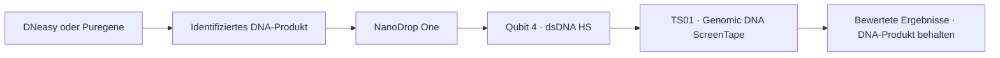

# Synthetische Extraktion mit NanoDrop, Qubit 4 und TapeStation

Die neue, ausdrücklich gewählte Komposition verbindet die vorhandene
[DNeasy-69504-Extraktion](dneasy-extraction.md) beziehungsweise
[Puregene-Zellextraktion](puregene-extraction.md) mit NanoDrop und Qubit 4.
Die vorhandene TapeStation-QC bleibt Teil desselben Laufs.

Die separate [SiLA-Bindung](extraction-analytics-sila2.md) ergänzt nun die
Workflowsteuerung über den vorhandenen DNA-Dienst. Die folgende lokale
Komposition und ihre Geräte-/SOP-Grenzen bleiben eigenständig; eine SiLA-
Transportquittung ist keine Instrumentmessung oder physische Übergabe.



Das Diagramm beschreibt die Reihenfolge. Alle Entnahmen stammen aus demselben
DNA-Produkt; ein Messansatz wird nicht zur Quelle für das nächste Gerät.
Ein gemeinsamer Material-Root besitzt Inventar, Verbrauch, Ressourcen und
Originalartefakte. Es wird kein neuer DNA-Anfangsbestand aus dem Eluatvolumen
angelegt. Die bisherigen Standalone-Läufe bleiben eigene Laufarten.

## Einstieg

```sh
python3 scripts/run_extraction_analytics.py --help
python3 scripts/run_extraction_analytics.py --store exports/extraction-qc-dneasy/workflows.sqlite3 demo --run-id SYN.ExtractionQC.DNeasy01
python3 scripts/run_extraction_analytics.py --store exports/extraction-qc-puregene/workflows.sqlite3 demo --profile model/extraction-analytics.puregene.json --run-id SYN.ExtractionQC.Puregene01
```

Die Vorgabe wählt DNeasy. `--profile model/extraction-analytics.dneasy.json`
wählt denselben Quellenvertrag ausdrücklich. Für unabhängige Demo-Wiederholungen
einen frischen synthetischen Store verwenden; eine neue Laufkennung setzt
keine vorhandenen Materialien oder ausgegebenen Reagenzaliquots zurück.

`create` legt einen unbestätigten Lauf an. Nur `demo` erfindet positive
Beobachtungen, Mengen und Rohdateien. `status` und `report` lesen ohne
Sitzungsübernahme; `resume` verlangt ausdrücklichen Wirkungs- und Inventarabgleich.
`act` verwendet dieselbe JSON-/Artefakthülle wie die vorhandenen Extraktionsrunner.
Ein Lauf wird nach einer Unterbrechung nicht durch einen neuen Demoaufruf
fortgesetzt.

Die Demo kann bei `extracted`, `nanodrop_intent`, `nanodrop`, `qubit_intent`,
`qubit` oder `tapestation_loaded` pausieren; die bisherigen benannten
Extraktionsphasen und `before_confirm:PHASE_ID` bleiben ebenfalls möglich.
`qubit_intent` hält bei der ersten Standardmessabsicht, ohne sie als erfolgt
zu bestätigen.

## Quellen und gemeinsame Regeln

| Quelle | Verantwortung |
|---|---|
| `model/extraction-analytics.protocol.json` | Reihenfolge und Grenzen der Integration |
| `model/extraction-analytics.dneasy.json`, `.puregene.json` | Referenzierte Extraktions- und Messverträge, ausgegebene Qubit-Reagenzaliquots |
| `model/extraction-analytics.schema.json` | Formaler Kompositionsvertrag |
| `scripts/extraction_analytics_sources.py` | Quellenpins und einmalige Bindung an Probe, Produkt, Gefäß und ursprünglichen Platz |
| `scripts/extraction_analytics_workflow.py` | Opt-in-Laufart im vorhandenen Extraktions-/Material-Root |
| `scripts/extraction_analytics_stages.py` | Kontextansichten auf vorhandene NanoDrop-/Qubit-Operationen und den kanonischen Material-Ledger |
| `scripts/extraction_analytics_demo.py` | Ausdrücklich synthetische Eingaben; wiederverwendete Geräte- und TapeStation-Demohilfen |

Chemieschritte, Herstellerparameter und Fraktionsrollen werden aus den
bestehenden Extraktionsquellen referenziert. Die bestehenden NanoDrop- und
Qubit-Operationen führen Blank, Ansatz, Inkubation, Kalibrierungszuordnung,
Messung, Import und Bewertung aus. Der ältere DNA-Quantifizierungskoordinator
und dessen Gefäßvolumenbilanz werden nicht als zweite Bilanz eingebettet.

NanoDrop One und der vorhandene 200-µl-dsDNA-HS-Zielvertrag für Qubit 4 werden
aus der [DNA-Quantifizierung](dna-quantification.md) wiederverwendet. Die
eigenständigen manuellen Fixtures werden nicht umgeschrieben. Eine allgemeine
Verdünnungs- oder Wiederholungsplanung ist in dieser ersten Komposition
nicht enthalten.

## Identität, Buchungen und Messgültigkeit

Die biologische Probenkennung bleibt erhalten. Produktmaterial und physisches
Produktgefäß behalten ihre eigenen Identitäten; die Messkontexte referenzieren
sie zusammen mit der Inhaltsrevision und dem ursprünglichen Rackplatz.
Ein Kontext speichert Geräte- und Belegmetadaten, keine neue Anfangs- oder
Restmenge. Entnahmen benötigen eine persistierte Absicht vor ihrer Bestätigung.

NanoDrop bucht die bestätigte Entnahme einmal. Qubit führt beide Standards,
das ausgegebene synthetische Working Solution und den Probenansatz als echte
Materialeffekte im selben Ledger. Das Working Solution wird als bereits
vorbereiteter synthetischer Reagenzansatz deklariert; seine Herstellung wird
nicht als durchgeführt angenommen. Jeder Standardansatz hat eigene Eltern
und erhält keinen DNA-Probenelternbezug. Ansatzgefäße besitzen laufgebundene
Kennungen und bleiben bis zur ausdrücklich bestätigten Entsorgung inventarisiert.
Die Qubit-Kammer ist kein Ablageplatz.

Qubit-Messung, Import, Bewertung und Entsorgung entnehmen kein weiteres
DNA-Volumen. Dasselbe gilt für TapeStation-Import und -Bewertung. In der
Standard-Testwelt verbleiben nach 1,5 µl NanoDrop, 2 µl Qubit und 1 µl
TapeStation **195,5 µl DNeasy-Eluat** beziehungsweise **95,5 µl Puregene-Produkt**.
Diese Zahlen sind Fixturebilanzen, keine Ertragsprognosen oder Laborparameter.
Abweichende Istmengen bleiben als solche gebucht; unbekannte Mengen werden
nicht geschätzt.

Originaldateien und Messungs-/Ansatz-/Kalibrierungszuordnung bleiben erhalten.
NanoDrop und Qubit berichten unterschiedliche Messprinzipien; ihre Werte
werden nicht gleichgesetzt. Ein bereits assaykorrigierter Qubit-Wert wird
nicht nochmals verdünnungskorrigiert. Kalibrierungsbindung stammt aus dem
Workflow und ist keine vom Gerät gelesene Kalibrierungs-ID.

TapeStation folgt nach beiden Quantifizierungen, damit deren Entnahmen die
bereits eingefrorene TapeStation-Produktrevision nicht nachträglich verändern.
Die bestehenden Lane-, Material-, Gefäß- und Revisionsprüfungen bleiben erhalten.
DIN, Fragmentgröße und Konzentration sind getrennte Größen. Ein historischer
Messbeleg ist keine Behauptung über eine spätere unveränderte Inhaltsrevision.

## Wiederanlauf, Abschluss und Prüfgrenzen

Offene Geräte- und Materialabsichten werden gemeinsam gespeichert. Nach
Neustart, abweichender Beobachtung oder Fristablauf werden weder Entnahme noch
Rückgabe, Kalibrierung oder Freigabe angenommen. Unbekannte Wirkungen behalten
ihre Reservierungen. Der ausdrückliche Geräteabgleich ersetzt nicht den
vollständigen Inventarabgleich des Roots. Ein lokaler Geräteabschluss gibt
keine Root-Ressourcen frei.

`start_device` beginnt den nächsten vorgesehenen Gerätekontext ausdrücklich.
Die Python-Ansicht `flow.device("nanodrop")` beziehungsweise `flow.device("qubit")`
verwendet die bestehenden Gerätebefehle. Für CLI-Einzelaktionen führt
`device_action` die Felder `device`, `operation` und `arguments`; Importe laufen
über den Root-Befehl `import_results` mit zusätzlichem `device`. Ohne `device`
bleibt dieser Befehl der bestehende TapeStation-Import.
Der Root-Befehl `resolve_device` verlangt nach Wiederaufnahme das Gerät,
`pending_resolution` (passende Absicht und ausdrücklichen Ausgang oder `null`),
`device_valid` und einen Grund. Danach folgt der vollständige `reconcile`.
`device_valid` ist eine synthetische Blank-/Kalibrierungsbeobachtung und ersetzt
keine Gerätebeobachtung; eine abgelaufene Qubit-Kalibrierung wird damit nicht
neu berechnet oder freigegeben.

Der Gesamtabschluss verlangt bewertete NanoDrop- und Qubit-Ergebnisse,
bestätigte Rückgabe des Produktgefäßes, geklärte Messansätze und den bestehenden
TapeStation-Abschluss einschließlich beider Dispositionen. Das Produkt bleibt
erhalten. Nach angelegtem TapeStation-Auftrag gilt weiterhin dessen eigener
Stillstands-/Rücknahmebeleg vor Abbruchfreigabe. Alte Journale werden nicht
migriert; geänderte Quellenpins sperren aktive Fortsetzungen.

```sh
python3 -m unittest discover -s tests -p 'test_extraction_analytics*.py' -v
```

Die gezielte Prüfung umfasst 31 Integrationsfälle (12 Quellen-/Schema-,
15 Ablauf- und vier CLI-/Abnahmefälle) sowie 91 bestehende DNeasy-, Puregene-
und TapeStation-Regressionsfälle, jeweils ohne übersprungene Tests. Quellen
und Tests blieben während der abschließenden Läufe bytegleich. Dies ist keine
vollständige Repository- oder CAD-Suite.

Die Komposition ist vollständig synthetisch. Reale Extraktion, Pelletretention,
Hydratation, Flüssigkeitshandhabung, Working-Solution-Herstellung, lokale SOPs,
native Geräteexporte, Geräte-/Netzwerk-/Roboterbetrieb, biologische Leistung
und Sicherheit bleiben unqualifiziert. Die NanoDrop-UltraC-Netzwerkanbindung
und SiLA-Dienste werden hier nicht angesprochen. Die vorhandenen TapeStation-
Bereichsgrenzen erlauben keinen präzisen Nachweis beliebig großer DNA.
Es entsteht keine Roboterbahn; die Vorgabe fließender Bewegungen gilt für
spätere Bewegungsadapter weiter.
