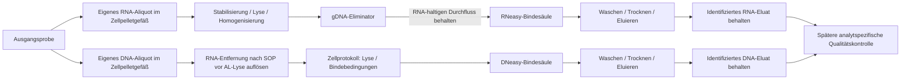

# RNA- und DNA-Extraktion für die Automatisierung vorbereiten

**Stand: maschinenlesbare Vorbereitung für Säugerzellpellets aus getrennten
Aliquots.** Kitmaterialien, Prozessrollen, Identitäten und offene Anforderungen
sind beschrieben und prüfbar. Eine Extraktion, Verbrauchsbuchung oder
Gerätesteuerung führt diese Vorbereitung noch nicht aus.

## Auswahl und Materialerhalt

| Produkt | Verwendung im Entwurf | Unterscheidung |
|---|---|---|
| QIAGEN RNeasy Protect Cell Mini, **74624** | RNA aus dem eigenen Zellpellet-Aliquot | RNAprotect Cell und RNeasy Plus Mini; gDNA-Eliminator und RNA-Bindesäule sind verschiedene Säulen |
| QIAGEN DNeasy Blood & Tissue, **69504** | DNA aus einem zweiten Zellpellet-Aliquot | Manuelles Mini-Spin-Säulen-Kit; das eigenständige QIAcube-Kit 69516 wird nicht vorausgesetzt |

Die Zellvariante folgt dem gewählten Ausgangsmaterial. Die Protect-Familie
enthält auch andere probenabhängige Varianten; das Gewebebündel 74124 wird
hier nicht still mit der Zellvariante gleichgesetzt. Referenz:
[QIAGEN Protect-Produktfamilie](https://www.qiagen.com/mz/products/discovery-and-translational-research/sample-collection-stabilization/rna/rneasy-protect-kits),
[RNAprotect Cell Reagent Handbook, HB-0483-003, März 2021](https://www.qiagen.com/en-us/resources/download/kithandbook/hb-0483-003-hb-rna-protect-cell-0321-ww-1124208).

Ziel ist, die jeweils manuell verwendeten Säulen, Puffer und Gefäße zu
behalten. QIAGEN beschreibt die Automation der gewählten Verfahren auf QIAcube;
das ist ein Machbarkeitsbeleg für die Spin-Säulen-Technik. Geräteabhängige
Rotoradapter, Filterspitzen und zusätzliche Gefäße bleiben auszuwählen.
Die FAQ nennt dafür protokollabhängige Zusatzartikel; daraus wird kein
vollständiger Einkaufskorb für unseren Roboter abgeleitet.
[DNeasy-Handbuch, HB-2061-004, Juni 2023](https://www.qiagen.com/en-us/resources/download/kithandbookandprotocol/hb-2061-004-hb-dny-blood-tissue-0623-ww),
[QIAGEN FAQ 1402](https://www.qiagen.com/us/resources/faq/1402).

Die Materialrollen stehen einmal im Katalog. Auch mögliche Zusätze wie
Zellresuspensionsmedium, ein Reduktionszusatz oder eine gewählte RNase-Behandlung
sind dort als SOP-abhängig ausgewiesen. Eine Planrolle ist noch keine konkrete
Artikel-, Chargen-, Mengen- oder Verbrauchszuordnung. Komponenten gleichen
Herstellers sind nicht automatisch zwischen beiden Verfahren austauschbar.

## Führende Quellen und Einstieg

| Datei | Verantwortung |
|---|---|
| `model/extraction-automation.catalog.json` | Kitidentität, Materialrollen und Herstellerreferenzen |
| `model/extraction-automation.protocol.json` | Gemeinsame abstrakte Operationen, Einheiten und zwei referenzierende Ablaufketten |
| `model/extraction-automation.preparation.json` | Synthetisches Probenpaar, getrennte Aliquots, geplante Gefäße/Plätze und noch offene SOP-/Parameter-/Providerbindungen |
| `model/extraction-automation.schema.json` | Formale Verträge; Quellenreferenzen verwenden das vorhandene Assembly-Referenzschema |
| `scripts/extraction_preparation.py` | Unverändernde Prüfung und Ableitung eines Vorbereitungsplans |

```sh
python3 scripts/prepare_extraction_automation.py
python3 scripts/prepare_extraction_automation.py --out exports/extraction-preparation/plan.json
python3 scripts/prepare_extraction_automation.py --require-complete
```

Der letzte Aufruf meldet die offenen Eingaben durch Exitcode 2. Ein gültiger
Entwurf mit offenen Eingaben ist beim normalen Aufruf zulässig. Auch ein
vollständig ausgefüllter Plan besitzt immer `execution_ready: false` und den
Blocker `extraction_execution_unimplemented`. Er ersetzt keine Extraktionslaufzeit.

Herstellerreferenzen enthalten URL, konsultierte Revision und Zugriffsdatum.
Die Hersteller-PDFs sind damit nicht lokal bytegeprüft oder als unsere SOP
qualifiziert. Eine ausgewählte lokale, maschinenlesbare SOP wird separat durch
ID, Revision und SHA-256-gebundene Modell-JSON referenziert; ID und Revision
müssen mit dieser Quelle übereinstimmen.

## Zwei Produkte mit gemeinsamer Herkunft



Die beiden Eingangsmaterialien sind getrennte Aliquots desselben Ursprungs.
Ein Gefäß wird nicht zweimal als Eingang verbraucht. Beide Produkte erhalten
eigene Material- und Eluatgefäß-IDs sowie Ursprungs- und Elternaliquotbezüge.
Das ist eine geplante Abstammung; die tatsächliche Aliquotierung und ihre
Mengen müssen vor einer Durchführung nachgewiesen werden.

Säulen und Gefäße sind eigene Prozessgegenstände. Für RNA ist das Auffanggefäß
des gDNA-Schritts ausdrücklich vom späteren Säulen-Sammelgefäß getrennt.
**Der Durchfluss der gDNA-Eliminator-Säule enthält die weiterzuverarbeitende
RNA.** Bei der Bindung und den Wäschen bleibt dagegen die Säulenfraktion
erhalten; das Eluat wird anschließend als Produkt aufgefangen. Der Compiler
prüft diese unterschiedlichen Fraktionsrollen. Eine allgemeine Regel
„Durchfluss entsorgen“ wäre hier falsch.

Das Eingangsgefäß bezeichnet zunächst auch den Ort der Lysatvorbereitung.
Notwendige zusätzliche Gefäße oder Wechsel ergeben sich aus der gewählten SOP
und dem Halterkonzept. Das Profil ist keine vollständige Materialbilanz oder
behauptete Passungsprüfung. Rückbehaltene Produkte, Prozessabfall und
verbliebene Ausgangsmaterialien müssen später getrennt abgeglichen werden.

## Noch einzutragende Prozess- und Geräteangaben

- Zellart, Erhaltungs-/Stabilisierungszustand, Zellzahl beziehungsweise
  begründete andere Eingangsmengen und passende SOP-Revision. Die Angaben im
  Beispiel sind offen; unbekannte Mengen werden nicht zu Nullmengen.
- Die aus dieser SOP übernommenen Volumina, Zeiten, Temperaturen,
  Zentrifugalkräfte und Wiederholungen. Die Einheiten stammen einmal aus dem
  Protokoll. Zentrifugalkraft wird in `x_g` geführt; ein RPM-Wert ist kein Ersatz.
- Tatsächliche Reagenzvorbereitung, optionale Behandlungen, Artikel,
  Chargen, Verfallsdaten und SOP-gerechte Abfallströme. Das DNA-Zellprotokoll
  erhält nicht automatisch die Gewebevorbehandlung mit ATL. Eine gewählte
  RNase-Behandlung gehört dort vor die AL-Lyse.
- Greifen von Säulen im Sammelgefäß, Deckelbetätigung, Gefäßwechsel,
  Flüssigkeitszugang, Mischung/Homogenisierung, Temperierung und qualifizierte
  Zentrifugation. Ein Providername im Profil beschreibt nur eine beabsichtigte
  Zuordnung.

Die CF01 hat weiterhin offene Rotor-, Gefäß-, Antriebs- und Sicherheitsgrenzen.
Ihre Zielwerte oder ein erfolgreicher Simulatorlauf belegen keine Eignung für
die Säulen-Gefäß-Kombination und den geforderten Zentrifugationsschritt.
Die Auswahl einer geeigneten Zentrifuge einschließlich Rotor und Adaptern ist
ein eigener Nachweis; es werden keine Startbefehle erzeugt.

Die Parameterfelder beschreiben zunächst die abstrakten Phasenanforderungen.
Sie sind keine vollständige Rezeptparameterliste: Mehrere Pufferzugaben,
unterschiedliche Waschvolumina, zusätzliche Sammelgefäße und bedingte
Vorbehandlungen sind für eine spätere Ausführung in die einzeln bestätigbaren
Schritte der ausgewählten SOP aufzulösen. `planning_complete` bezeichnet nur
die Vollständigkeit dieser Vorbereitungsfelder.

RNA-Vorbehandlung und zulässige Wartefenster erhalten bei der späteren Planung
Vorrang. DNA-Inkubation kann nach bestätigten Ressourcenfreigaben parallel
laufen. Chemische Prozesszeiten bleiben echte Wartebedingungen. Transportbahnen
sollen der projektweiten Vorgabe fließender Bewegung entsprechen; dazu enthält
dieser Plan noch keine Roboterkinematik oder Dosierqualifikation.

## Anschluss an den vorhandenen Workflow

Die Vorbereitung referenziert den vorhandenen Lebenszyklus, das Journal und den
Ledger als Integrationsziele. Sie legt keine zweite Ereignis- oder Bestandsführung
an und verändert den bestehenden CF01–NanoDrop–Qubit-Lauf nicht.

Vor einer ausführbaren Extraktion sind folgende gezielte Erweiterungen nötig:

1. Ein manueller Extraktionsvertrag mit bestätigtem Vorbehandlungsende,
   Entnahme-/Transferabsichten, wiederaufnehmbaren Checkpoints und
   Abbruchabgleich. Danach können dieselben Schritte schrittweise an
   qualifizierte Adapter gebunden werden.
2. Der gemeinsame Bestand muss Materialumwandlungen, Massen-/Zellzahl- und
   Reagenzverbräuche sowie **aufzubewahrende Produkte** abbilden. Die heutige
   Hülle verlangt die Rückgabe aller Originale und Entsorgung abgeleiteter
   Gefäße; die heutige µL-Originalentnahmebilanz reicht hierfür nicht aus.
3. RNA-/DNA-Eluate werden über ihre Material-, Gefäß- und Platzidentitäten
   weitergegeben. Die bestehenden NanoDrop-/Qubit-Testprofile verwenden
   DNA-Methoden beziehungsweise einen konkreten synthetischen Assay. Eine
   passende RNA-Methode, Blank-/Assaywahl und fachliche Freigabe sind erst
   einzubinden. Eine erfolgreiche Qualitätsmessung ist kein automatischer
   Extraktionsertrags- oder Integritätsnachweis.

## Prüfung und Grenzen

```sh
python3 -m unittest discover -s tests -p 'test_extraction_*.py' -v
```

Geprüft werden Quellenbindungen, die Pflichtphasen und Fraktionsrollen,
Aliquot-/Produktabstammung, eindeutige Prozessgegenstände und Rackplätze,
Einheiten, numerische Eingabeformen und die wirkungsfreie Planableitung. Die formalen
Schemaprüfungen benötigen die optionale Entwicklungsabhängigkeit `jsonschema`.
Synthetische IDs und geplante Zuordnungen sind keine Scans oder Beobachtungen.
Ausbeute, Reinheit, RNA-Integrität, Kontaminationsschutz, Pipettierleistung,
Hardware, CAD-Passung und reale SOP-Ausführung sind nicht geprüft.
