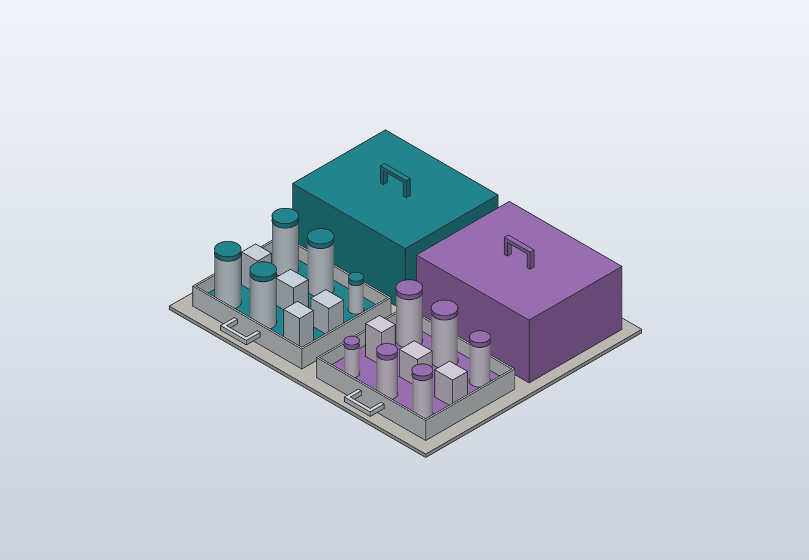
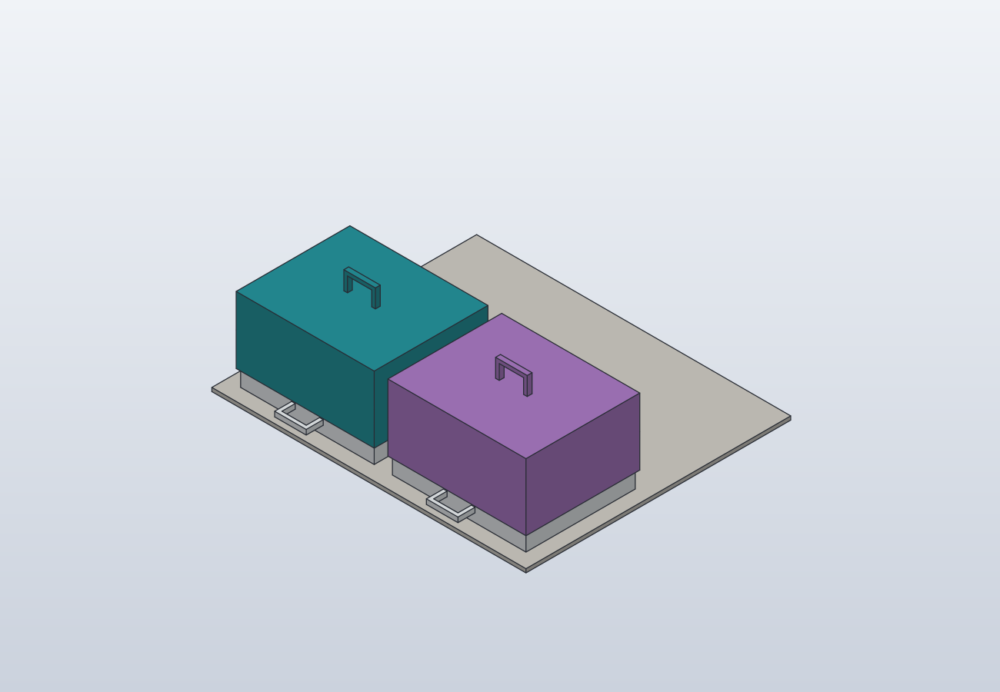
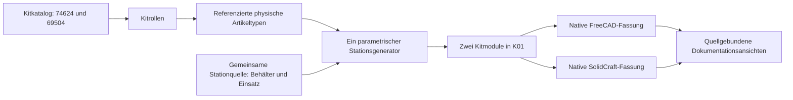

# K01 · passive Bereitstellung für Extraktionskits

K01 zeigt zwei vorbereitete Kitmodule für **QIAGEN RNeasy Protect Cell Mini
74624** und **DNeasy Blood & Tissue 69504**. Verschlossene Originalkomponenten
sollen gemeinsam in einem entnehmbaren Behälter bereitstehen. Die Station
ergänzt die [Extraktionsvorbereitung](extraction-automation.md); sie führt
keine Extraktion, Reagenzvorbereitung oder Roboterbewegung aus.

In Version 1 stehen beide Kitmodule direkt an K01 bereit. Ein Regal und eine
automatische Ein-/Auslagerung sind dafür nicht erforderlich. Die dargestellte
Lagerpose ist eine geschlossene Behälterstellung am Arbeitsplatz.

## Native Ansichten des Entwurfs



Türkis kennzeichnet RNA, Violett DNA. Die abgenommenen Hauben stehen hinter
den beiden Kitträgern. Flaschen und Packungen sind synthetische Hüllen mit
unbekannten realen Herstellermaßen.



Die [Galerie](models/README.md) ergänzt einen beschrifteten schematischen
Platzplan. Er bleibt innerhalb ihres 4-MB-Bildbudgets; diese größeren nativen
Dokumentationsansichten besitzen eine eigene
[Provenienz](media/extraction-kit-station.provenance.json).

## Ein Behältertyp, zwei Kitmodule

Beide Module verwenden denselben parametrischen, für 3D-Druck vorgesehenen
Behältertyp mit abnehmbarem Deckel und gemeinsamer Einsatzschnittstelle.
Die Kitzuordnung und Materialbelegung unterscheiden die Instanzen. Eine
zweite unabhängige Konstruktion für das andere Kit ist nicht vorgesehen.
Die [gemeinsame Stationquelle](../model/extraction-kit-station.shared.json)
führt den Behälter, die Einsätze, Hülltypen und referenzierenden Kitmodule.



Die Materialbedeutung stammt aus
`model/extraction-automation.catalog.json`: Kitrolle → Katalogmaterial.
Je Modul werden neun unterschiedliche Materialtypen als symbolische Hüllen
gezeigt. Mehrere Rollen desselben Artikeltyps werden dafür zusammengefasst;
das ist weder eine Stückzahl noch die Gleichsetzung verschiedener Gefäße
eines späteren Laufs. Insbesondere bleiben gDNA-Eliminator, RNA-Bindesäule
und ihre unterschiedlichen Fraktionsrollen im Prozessvertrag getrennt.

Zusatzmaterialien wie Ethanol, PBS, RNase A oder ein ausgewählter RNA-Lysezusatz
sind SOP-abhängige Anforderungen der Vorbereitung. Sie werden durch diese
Darstellung nicht automatisch als vorhanden, angesetzt oder lagerfähig gebucht.

## Statische Fälle

| Fall | Aussage |
|---|---|
| `stored` | Beide Kitmodule am Arbeitsplatz, Deckel geschlossen |
| `open` | Gleiche Module zur Anschauung geöffnet; Deckel hinter den Kästen abgestellt |
| `wide_open` | Breitere parametrische Behältervariante, ebenfalls mit offen abgesetzten Deckeln |

Die Ansichten sind unabhängig aufgebaute statische Zustände. Zwischen ihnen
ist keine Öffnungs-, Greif- oder Transportbahn beschrieben. Es gibt keine
Proben, geöffneten Reagenzflaschen oder laufbereiten Ansätze im Modell.
Der Referenzboden ist ein konzeptioneller Aufstellungsbezug, keine bestätigte
Einbauposition in L01 und kein vermessenes vorhandenes Möbel.

## Getrennte Griffe für Träger und Deckel

Jeder Kitträger erhält einen integrierten Frontgriff. Der abnehmbare Deckel
erhält einen eigenen Brückengriff auf dem Dach. Beide Instanzen verwenden
dasselbe parametrische Rezept. Die bisherigen Container-, Einsatz-,
Artikel- und Deckelpositionen bleiben erhalten; die Griffe erweitern deren
Außenraum. Die zugehörigen Greif- und Anfahrbezüge folgen den ausgewerteten
Maßen und der jeweiligen statischen Deckelstellung.

Der Frontgriff ist als Aufnahme des gesamten bestückten Trägers gedacht;
der Dachgriff ausschließlich als Aufnahme des Deckels. Ein Griff am Deckel
ist keine Aufhängung für das ganze Kit. Die Haube ist weiterhin abnehmbar
und besitzt keine qualifizierte Verriegelung am Träger.

Die modellierten Finger- und Anfahrfreiräume sind synthetische Annahmen.
Ein realer Greifer muss einschließlich Finger, Handgelenk, Werkzeugmasse
und Beobachtung ausgewählt und neu geprüft werden. Insbesondere erzeugt
der frontseitige Griff ein Moment aus dem nach hinten versetzten Schwerpunkt.
Zulässige Beladung, Schwerpunkt, Kipp- und Rutschsicherung der Artikel,
Deckelretention, Druckfestigkeit und Verhalten bei Energieausfall sind offen.
Vor einem Transport braucht der Träger eine dazu ausgelegte Aufnahme und
Rückhaltemaßnahmen. Das statische Modell erteilt keine Transportfreigabe.

## Lagerung und Arbeitsvorbereitung unterscheiden

Die folgenden Angaben sind konsultierte Hersteller-Lagerbedingungen für
Originalkomponenten. Das konkrete Chargenetikett hat Vorrang. Eine
Kitlagerbedingung ist keine unbegrenzte Gebrauchsdauer nach Öffnung und
keine Freigabe eines vorbereiteten Arbeitsansatzes.

| Originalkomponente | Konsultierte Lagerangabe |
|---|---|
| RNAprotect Cell Reagent | 15–25 °C; mindestens zwölf Monate, sofern das Etikett nichts anderes vorgibt |
| RNeasy Plus Mini im Kit 74624 | Trocken bei 15–25 °C; mindestens neun Monate, sofern das Etikett nichts anderes vorgibt |
| DNeasy-Säulen und Puffer in 69504 | Trocken bei 15–25 °C; ein Jahr, sofern das Etikett nichts anderes vorgibt |
| Mitgelieferte Proteinase-K-Lösung | Mindestens ein Jahr ab Lieferung bei Raumtemperatur; für längere Lagerung oder häufig über 25 °C empfiehlt QIAGEN 2–8 °C |

Quellen: [RNAprotect Cell Reagent Handbook, HB-0483-003, März 2021,
S. 5](https://www.qiagen.com/en-us/resources/download/kithandbook/hb-0483-003-hb-rna-protect-cell-0321-ww-1124208)
und [DNeasy Blood & Tissue Handbook, HB-2061-004, Juni 2023,
S. 6/22](https://www.qiagen.com/en-us/resources/download/kithandbookandprotocol/hb-2061-004-hb-dny-blood-tissue-0623-ww).
Die Quellen sind Versionsreferenzen, keine lokal qualifizierte SOP.

Arbeitslösungen erhalten eigene Ansatz-, Öffnungs- und Verfallsangaben nach
Etikett und gewählter SOP. Die DNeasy-Waschpuffer sind etwa erst nach der
vorgeschriebenen Vorbereitung Arbeitslösungen; ein RNA-Lysezusatz besitzt
einen eigenen Verwendungszeitraum. RNase A ist kein Bestandteil von 69504;
Artikel, Lagerbedingung und tatsächliche Bereitstellung sind gesondert offen.
Das Stationsmodell übernimmt keine dieser Fristen als automatische Freigabe.

RNAprotect-behandelte Zellen sind ebenfalls keine Kitkomponenten. Ihre
material- und zeitabhängige Lagerung folgt dem Zell-Handbuch, S. 18, und
der ausgewählten SOP. K01 beschreibt keine Probenlagerung. Ein geschlossener
Behälterdeckel belegt weder Temperaturhaltung noch eine Freigabe nach
Sicherheitsdatenblatt, chemische Rückhaltung oder RNase-Freiheit.

## Geometrie und Zustand

Behälter-, Einsatz- und Materialhüllenmaße sind generische synthetische
Konstruktionsannahmen. Reale Herstellerabmessungen bleiben unbekannt
beziehungsweise `null`; Hüllen sind keine nachgebildeten Herstellerartikel.
Ein Druckwerkstoff, Druckparameter, Passungen und zulässige Lasten sind
noch nicht qualifiziert. Chemikalienverträglichkeit, Reinigung, Verschleiß,
Deckelhalt und Greifbarkeit sind damit nicht nachgewiesen.

Die Druckabsicht betrifft die Körper `RNA_Container`/`DNA_Container`,
`RNA_Lid`/`DNA_Lid` und `RNA_Insert`/`DNA_Insert`. Referenzboden und
Artikelhüllen sind Anschauungsgeometrie. Fertige Druckdateien oder
druckerspezifische Einstellungen werden damit nicht freigegeben.

Die Belegung hat den Zustand `planned_unobserved`. Sie ist keine beobachtete
Bestückung, kein zweites Inventar und keine Restvolumenführung. Artikel,
Charge, Menge, Haltbarkeit und verfügbare Stückzahl müssen später an den
gemeinsamen Bestand gebunden werden. Das Modell bucht keinen Verbrauch.

## Ableiten und Nachweise lesen

```sh
python3 scripts/build_extraction_kit_station.py --backend both
```

Der Builder erzeugt die Fälle `stored`, `open` und `wide_open`. Native Dateien
liegen unter `cad/generated/<Revision>/<Fall>.FCStd` beziehungsweise `.sc`.
Quellenpins, Artefaktprüfsummen und Prüfumfang stehen unter
`exports/generated/<Revision>/build-report.json`; Revisionen heißen
`extraction-kit-station-<Quell-SHA12>` mit optionalem Revisionssuffix.
Der aktuelle Verweis ist
`cad/extraction-kit-station/shared-build-report.json`.

Einzelne Backends sind über `--backend freecad` beziehungsweise
`--backend solidcraft` auswählbar. Daraus folgt kein CAD-übergreifender
Vergleich. Ein erfolgreicher Aufbau oder ein Galeriebild belegt weder reale
Passung noch Laborbetrieb; maßgeblich sind die tatsächlich ausgeführten
Prüfungen und Grenzen des jeweiligen Berichts.

Der Griffstand `extraction-kit-station-c3b85c56a30f` besteht in FreeCAD und
SolidCraft: `stored`, `open` und `wide_open` enthalten jeweils 36 gültige
geschlossene Körper und 24 native Zuordnungsprüfungen. Je Fall und CAD wurden
16 Fingerfenster-/Finger-/Anfahrhüllen gegen sämtliche Modellkörper geprüft,
insgesamt 96 Prüfungen. Die Hüllen enthalten zusätzlich das in der Quelle
benannte Prüfspiel von 2 mm. Es gibt keine Blockaden oder Modellinterferenzen;
der STEP-Differenzvergleich ergibt 0 mm³. Acht Greif-/Anfahrbezüge werden aus
denselben Parametern abgeleitet.

Diese Prüfung betrifft die modellierten synthetischen Hüllen und statischen
Zustände, keine reale Kitpassung, Greif-, Hebe- oder Druckqualifikation. Die
nativen Bilder wurden auf vollständigen Ausschnitt und sichtbare Träger-/
Deckelgriffe geprüft; eine FreeCAD-GUI-Prüfung wurde nicht durchgeführt.
