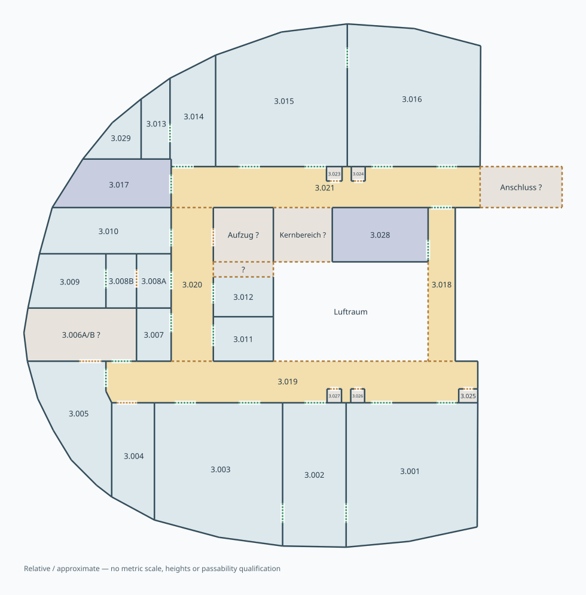
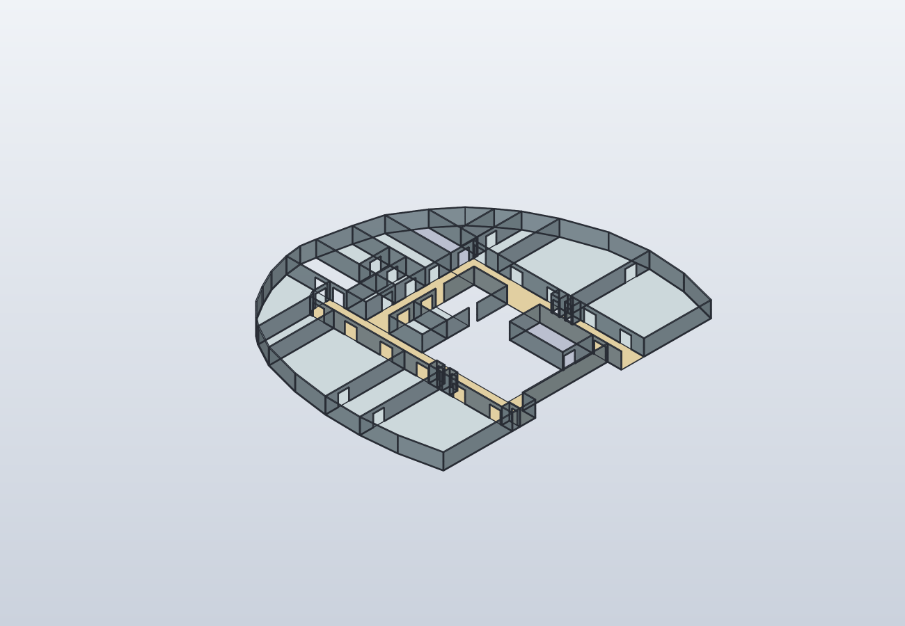

# F03 · relative Mehrraumgeometrie

F03 ergänzt eine erste relative Geschossansicht aus einem privat bereitgestellten
fotografierten Raumplan. **Nur die manuell abgeleiteten Konturen, Raumnummern
und Öffnungspositionen sind zur Veröffentlichung freigegeben. Das Originalfoto
ist nicht Bestandteil des Repositories**, weder als Bild noch als eingebetteter
Hintergrund. Die Darstellung ist eine vereinfachte Nachzeichnung, kein Aufmaß.



Die Quelle enthält 34 Bereiche: 17 als Räume interpretierte Flächen, vier
Flurabschnitte, zwei Treppenhausbereiche, einen Luftraum und zehn unbestimmte
beziehungsweise zusammengefasste Bereiche. 88 gemeinsame Eckpunkte definieren
121 gemeinsame Grenzen; 34 Öffnungssymbole sind einmalig verortet. Diese Zahlen
bezeichnen Modellobjekte, nicht bestätigte reale Räume oder Türen.

## Eine gemeinsame Wand, eine gemeinsame Öffnung

Die führende Quelle ist
[model/floor-f03.shared.json](../model/floor-f03.shared.json), Format
`solidcraftbot.relative-floorplan/1`. Das
[Schema](../model/relative-floorplan.schema.json) trennt:

- gemeinsame Eckpunkte und einmalig definierte Wand-/Grenzsegmente;
- geschlossene Bereichsränder als gerichtete Referenzen auf diese Segmente;
- Tür-/Öffnungskandidaten als Intervall auf genau einem Segment;
- physisch interpretierte Wände, offene Flurgrenzen und unbekannte Grenzen;
- die daraus abgeleitete Nachbarschaft und ihre Unsicherheit.

Eine gemeinsame Wand wird von den angrenzenden Bereichen in entgegengesetzter
Richtung referenziert. Eine Verbindungstür wird nicht für jeden Raum erneut
beschrieben. Offene Übergänge zwischen Flurabschnitten benötigen keine erfundene
Tür. Eine unbekannte Grenze begründet keine bestätigte Verbindung.
`passable` bleibt auch bei sichtbarer struktureller Nachbarschaft `null`:
Zugang, Schließzustand, nutzbare Breite und Roboternavigation sind ungeprüft.

Die Vektoransicht zeigt Räume blau, Flure ockerfarben, Treppenbereiche violett
und unbestimmte Bereiche grau. Dunkle Linien sind interpretierte Wände;
orange gestrichelte Linien beziehungsweise Öffnungen kennzeichnen Unsicherheit
oder offene Bereichsgrenzen. Grün bezeichnet erkennbare Türverbindungen mit
weiterhin nur näherungsweise erfasster Lage. Die Farben sind eigens gewählte
Modellfarben und übernehmen keine Fluchtweg- oder Sicherheitsbewertung.

## Maßstab und fotografische Unsicherheit

X zeigt in der Zeichnung nach rechts, Y nach oben. Beide Achsen verwenden
denselben Normierungsfaktor; die Koordinaten und Wandlängen sind dimensionslos.
Gerade Hauptwände wurden näherungsweise ausgerichtet, die Außenkontur als
Polygonzug nachgezeichnet. Perspektive, Bildverzerrung und Druckgenauigkeit sind
nicht kalibriert. Selbst relative Verhältnisse bleiben deshalb Näherungen.

`calibration` ist `null`. `wall_metrics` liefert relative Längen und
`length_mm: null`; `metric_geometry` verweigert eine metrische Ableitung.
Die bisherigen L01-Abmessungen sind ebenfalls vorläufig und werden nicht als
gemessener Maßstab übernommen.

Relative Wandlängen lassen sich ohne CAD auswerten:

```sh
python3 - <<'PY'
import json, sys
sys.path.insert(0, 'scripts')
import relative_floorplan as floor
print(json.dumps(floor.wall_metrics(floor.load()), indent=2))
PY
```

Eine Öffnung mit Intervall `[a, b]` auf einer Wand liegt zwischen den
entsprechenden Anteilen ihrer gerichteten Länge; ihre relative Breite ist
`(b - a) * length_relative`. Das ergibt weiterhin kein Maß in mm.

Eine Türdarstellung liefert allein keinen eindeutigen Maßstab: Es gibt mehrere
Vorzugsbreiten, und Wandöffnung, Türblatt und lichte Zargenbreite sind
unterschiedliche Maße. Das zeigt beispielsweise die
[Herstellertabelle zu den Maßzusammenhängen nach DIN 18101](https://www.novoferm-digitalisierung.de/industriekunden/planungshilfen-service/grund-und-fachwissen-tuer-systeme/grundlagen-tueren-1/).
Es wird daraus keine konkrete Normtür für dieses Gebäude ausgewählt. Ein
bekanntes, tatsächlich gemessenes Referenzmaß wäre der nächste Schritt;
eine metrische Kalibrierung ist im jetzigen Format noch nicht implementiert.

## Bezug zum bestehenden Raum L01

Der Eigentümer identifiziert den bisherigen Laborraum L01 mit **3.003**.
F03 enthält dessen relative Kontur als `R3_003`. Die führende L01-Raumquelle,
Möblierung, Gerätepositionen und bisherige CAD-/Bewegungsnachweise bleiben
unverändert. Eine gemeinsame metrische Lage oder automatische Übertragung
der Einrichtung auf F03 ist nicht eingerichtet.

Erkennbare Besonderheiten wurden berücksichtigt:

- 3.002 besitzt im südlichen Abschnitt seitliche Verbindungstüren zu 3.003
  und 3.001; dort wird keine Außentür in die gekrümmte Fassade erfunden.
- 3.013 und 3.014 teilen eine Verbindungstür; 3.014 besitzt den erkennbaren
  Zugang zum Nordflur.
- Die kleinen nummerierten Bereiche 3.023–3.027 werden näherungsweise als
  getrennte Nischen unbekannter Funktion geführt.
- 3.006A/B bleibt eine gemeinsame unbekannte Hülle. Eine innere A/B-Trennwand
  ist nicht eindeutig sichtbar; auch östliche Vorbereichslinien sind vereinfacht.
- Nordkern, Aufzugsübergang und externer Anschluss bleiben unbestimmt. Keine
  verdeckte Raumnummer, nicht sichtbare Tür oder befahrbare Verbindung wird ergänzt.

## Auswertung und native Darstellung

```sh
python3 scripts/build_relative_floorplan.py --source model/floor-f03.shared.json --display-scale 1000
```

`--display-scale` ist ausdrücklich erforderlich. Die Zahl 1000 bildet eine
relative Einheit auf 1000 **CAD-Anzeigeeinheiten** ab. Sie ist keine Aussage
über die wirkliche Gebäudegröße. Auch Wandhöhe, Wanddicke, Schnitthöhe der
Öffnungen und Flächendicke sind reine Darstellungsparameter. Native CAD-Dateien
verwenden technisch mm, und die Berichte kennzeichnen diese Zahlen als
`display_mm` beziehungsweise `display_mm3`; reale Maße bleiben unbekannt.

FreeCAD und SolidCraft erzeugen dieselbe abgeleitete Anzeigegeometrie direkt
aus der relativen Quelle. Ein Backend ist über `--backend freecad` oder
`--backend solidcraft` einzeln auswählbar; STEP ist ein zusätzlicher Vergleich
bei `--backend both`. Neue native Modelle und Berichte liegen lokal unter
`cad/generated/` und `exports/generated/`. Der aktuelle lokale Verweis steht
unter `cad/relative-floorplan/floor-f03.shared/shared-build-report.json`.

Unbekannte und offene Grenzen werden nicht als massive Wände konstruiert;
Luftraum und unbekannte Bereiche erhalten keine erfundenen Geschossplatten.
An gemeinsamen Wandknoten können sich die Darstellungsstreifen überlappen.
Eine globale Kollisionsfreiheit wird deshalb nicht behauptet. Die nativen
Öffnungsprüfungen betreffen nur den jeweiligen modellierten Wandkörper und
die synthetischen Schnitthöhen, keine reale Tür oder freie Transportstrecke.

## Ausgeführte Prüfungen



Die Revision `floor-f03-display-a430fc8e917f-r2` wurde mit FreeCAD und
SolidCraft unabhängig aufgebaut. 129 gültige geschlossene Darstellkörper
umfassen 106 Wandstreifen und 23 Flächenanzeigen. Zehn unbekannte Bereiche,
der Luftraum sowie die unbekannten und offenen Grenzen werden nicht als
zusätzliche physische Baukörper erfunden. Die unklare Liftöffnung bleibt
ausdrücklich unmodelliert.

Je CAD bestehen 33 Öffnungsprüfungen gegen den zugehörigen Wandkörper;
der zusätzliche STEP-Differenzvergleich ergibt 0 in kubischen
CAD-Anzeigeeinheiten. Das ist kein Nachweis einer global kollisionsfreien
Gebäudegeometrie oder nutzbarer realer Türen. Die native SolidCraft-Ansicht
und die Vektorbeschriftungen wurden visuell geprüft; eine FreeCAD-GUI-Prüfung
wurde nicht durchgeführt. Die ursprüngliche native Revision bleibt unverändert.

42 gezielte Tests für Schema, Graph, Darstellungsadapter, die abgeleiteten
F03-Verbindungen und die vorhandenen Galeriekontrakte bestehen ohne
übersprungene Tests. Sie prüfen unter anderem gemeinsame Grenzen, T-Knoten,
Selbstüberschneidungen, unklare Verbindungen, unbekannten Maßstab und die
Ablehnung privater Originalbezüge. Die gesamte Repository-Suite wurde hierfür
nicht erneut ausgeführt. Quellen, Artefakte, Bilder, Prüfmethoden und Grenzen
sind in der [F03-Provenienz](media/floor-f03.provenance.json) gebunden.

## Prüfgrenzen und nächste Schritte

Die Validatoren prüfen geschlossene, gegen den Uhrzeigersinn orientierte und
nicht selbstschneidende Bereichsränder, geteilte Grenzen, Überschneidungen,
T-Knoten, Öffnungsintervalle und widersprüchliche Nachbarschaften.
Vollständigkeit des Fotos, verdeckte Bauteile und richtige Bildinterpretation
können damit nicht bewiesen werden.

Fenster sind nicht vollständig aufgenommen, Türblätter und Anschläge nicht
konstruiert. Gebäudehöhe, Wandstärken, Versorgungsanschlüsse, Möblierung,
Tragwerk, Brandschutz, Barrierefreiheit, Fluchtwege, Mensch-Maschine-Verkehr,
ROS-Navigation und Hardwarebetrieb sind nicht qualifiziert. Die neue Ansicht
enthält kein Robotertransportprogramm; spätere Bewegungen müssen weiterhin
die projektweite Vorgabe fließender Bahnen erfüllen.

Als Nächstes sind die unklaren Grenzen und Türzuordnungen zu bestätigen und
ein oder mehrere definierte Referenzmaße aufzunehmen. Erst anschließend kann
eine belegte metrische Registrierung von L01 und weiteren Aufstellungen folgen.

## Bestätigter Fensterbezug von 3.003

Der geografische Fensterbezug ist jetzt separat als **Nordwest** festgehalten;
[Abgleich und Ableitung](l01-orientation.md) unterscheiden den Gebäudepunkt,
die Eigentümerbestätigung und den nominalen Azimut von einer Vermessung.
Die bestehende relative Zeichnungsgeometrie und `calibration: null` bleiben
unverändert. Insbesondere ist Zeichnung-oben weiterhin nicht geografisch Nord.
