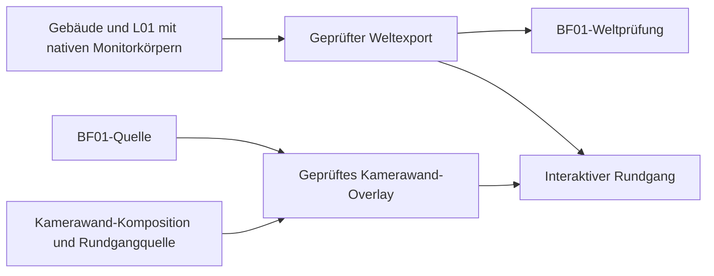

# Kamerawand im EG-Foyer

Die Außenwand des Aufzugs zum Foyer trägt 20 Monitore in fünf Spalten und vier Reihen.
Der Blickpunkt **Kamerawand · EG** im Gebäuderundgang führt dorthin.
Einen Monitor anklicken oder aus der Nähe mit der Leertaste auswählen:
Die Großansicht bietet die Kameraauswahl für diesen Platz. **Schließen**
oder Escape kehrt zum Rundgang zurück. Die Belegung gilt für diese Sitzung.

## Bilder und fehlende Quellen

Alle Bilder entstehen lokal aus dem Gebäudemodell. Es gibt keine realen
Videostreams, Videoaufzeichnungen oder Gerätebedienung. **Modellkamera /
synthetisches Livebild** bezeichnet die vorhandenen Arm-Kameramodelle.
**Virtuelle Übersicht – keine physische Kamera** bezeichnet einen vorhandenen
quellgebundenen Geräteblickpunkt. Nur Arm A besitzt die vorhandene
Demobewegung. Ein unbewegtes Modellbild bleibt ein gültiges aktuelles Bild.

Das Register folgt tatsächlich gebundenen Labor- und Robotikinstanzen,
einschließlich Basislabor-Abzügen und Mikroskop. Racks, Möbel, Büro und Küche
sind ausgenommen. Eine Gerätequelle allein ist keine aufgestellte Instanz.
Unklassifizierte Gerätetypen und fehlende Blickpunkte erscheinen als Lücken.

Im normalen Rundgang sind **25 Ansichten verfügbar**: sechs Armkameras und
19 virtuelle Geräteübersichten. Beim Start zeigen die 20 Monitore
unterschiedliche Ansichten.
Über die Auswahl auf jedem Monitor sind alle 25 erreichbar.
Für CF01, Spitzensammelstation T01, Waage, Kühlschrank,
Wasserbad und TapeStation fehlen quellgebundene Blickpunkte. Diese sechs
Einträge sind als **Kein Blickpunkt vorhanden** gekennzeichnet. Die Auswahl
beginnt mit **Transporter** und 21 Einträgen. Sie führt BF01 bis BF20 als
**Flotte nicht angebunden** und L01-TR01 als **Keine Kamera modelliert**.
Danach folgen **Roboterkameras** und **Geräte**, letztere nach Geschoss und
Raum sortiert. Die Standardbelegung verwendet weiterhin die verfügbaren
Ansichten in derselben Reihenfolge wie vor der Umstellung.

Bildalter ist verstrichene **Browserzeit** seit der Berechnung des Bildes.
Vorhandene Arm-Modellzeit wird separat angezeigt. Veraltete Bilder,
pausierte Anzeige, fehlende Quellen und Darstellungsfehler unterscheiden
sich von Gerätestörungen. **Keine Meldungsquelle angebunden** bedeutet
nicht „keine Störung“.

## Flottenansichten in der aktiven Browserfassung

Die ausdrücklich gewählte [aktive BF01-Browserfassung](building-fleet-demo.md#aktive-browserfassung)
startet pro geöffneter Seite eine neue, unabhängige Patrouille mit denselben
20 physischen Monitoren. Die Sitzung berechnet Fahrzeugbewegungen und neue
leere Testaufträge aus den vorhandenen Quellen und statischen Geometriedaten;
sie spielt keine gespeicherte Fahrt ab. Ein lokal gestarteter Python-Dienst
ist dafür nicht erforderlich. Der normale manuelle Rundgang bleibt ohne
Flottenbindung und aktiviert durch den Blick auf die Kamerawand keine Fahrt.

Beim Start gehört M01 zu BF01, M02 zu BF02 und entsprechend M20 zu BF20.
Die Kamera-IDs `BF01.BF01.Overview` bis `BF01.BF20.Overview` bleiben erhalten.
Ein Monitor verwendet ausschließlich eine bereits im synthetischen Funkmodell
empfangene Kamerareferenz seines Fahrzeugs. Vor der ersten Zustellung bleibt
ein Platzhalter. Jedes Fahrzeug wartet auf seine eigene erste empfangene
Kameraansicht, bevor es einen Patrouillenauftrag erhalten kann.

Zu Beginn stehen BF01 und BF02 im EG in **4 Anlieferung**. BF03 bis BF20
stehen im EG in **13 Logistik (Post / Abfall)**. Die Monitorbeschriftung
zeigt Geschoss und, soweit zugeordnet, den Raum der Aufnahme. Die
Monitor-Großansicht zeigt außerdem den zuletzt beobachteten Standort des
Fahrzeugs. **Fahrzeug folgen** wechselt von dort direkt in die Folgeansicht.

Das Bild entsteht aus der ursprünglichen Aufnahmepose und der damaligen
gemeinsamen Fahrzeug- und Aufzugstellung. Aufnahmezeit, Empfangszeit und
Bildalter in Modellzeit bleiben von der Zeit seit der letzten Bildberechnung
im Browser getrennt. Die Großansicht zeigt zusätzlich, wie viel Browserzeit
seit der letzten neu angezeigten Aufnahme vergangen ist. Wenn ein Fahrzeug
wartet, können aufeinanderfolgende Aufnahmen nahezu gleich aussehen.
Die Bilder sind synthetische Modellansichten und kein realer Videostream
oder Video-Netzwerklasttest. Bei einer Pause oder einem Fehler bleiben die
letzten ausgeführten Stellungen sichtbar; die Anzeige sagt keine zukünftige
Fahrt voraus. Das Schließen und erneute Öffnen der Seite beginnt eine neue
Sitzung statt der Fortsetzung eines früheren Laufs.

Die gesonderten Paket-, Worker- und Browserberichte binden die jeweils
geprüften Quellen und Ausgabebytes. Ein bestandener Paketaufbau ist keine
Bestätigung einer öffentlichen Veröffentlichung, vollständiger Gebäudebesuche
oder realer Schutzfunktionen. Die frühere Teilvorschau und ihre Nachweise
bleiben als historische Prüfstände erhalten.

## Flottenansichten in der experimentellen BF01-Vorschau

**Historischer Prüfstand:** Die frühere
[BF01-Teilvorschau](building-fleet-demo.md#experimentelle-teilvorschau) verbindet die Aufzeichnung mit
denselben 20 physischen Monitoren. Beim Start gehört M01 zu BF01, M02 zu
BF02 und entsprechend M20 zu BF20. Die vorhandenen Kamera-IDs
`BF01.BF01.Overview` bis `BF01.BF20.Overview` bleiben erhalten. Der normale
Rundgang behält seine bisherige Belegung und die Kennzeichnung
**Flotte nicht angebunden**; er aktiviert keine Fahrzeugfahrt.

Die BF01-Seite spielt die gespeicherten Fahrzeugbahnen gemeinsam mit den
Monitoransichten bis 1188,1 s ab. Einzelne Fahrzeuge fahren, warten oder
parken entsprechend der Aufzeichnung; alle 20 müssen nicht gleichzeitig
in Bewegung sein. Ein Monitor verwendet nur eine bis zur aktuellen
Wiedergabemodellzeit empfangene Kamerareferenz. Ohne passende Meldung zeigt
er einen Platzhalter. Beim Zurücksetzen der Zeit verschwinden Referenzen,
deren Aufnahme oder Empfang noch in der Zukunft liegt.

Das Bild wird aus der gespeicherten synthetischen Aufnahmepose gerendert.
Es ist keine Videoaufzeichnung und zeigt nicht automatisch die aktuelle
Fahrzeugpose in der Hauptansicht. `captured_s` bezeichnet die Modellzeit
der Aufnahme, `received_s` deren erste gespeicherte Zustellung. Das
Modellbildalter ist die aktuelle Wiedergabemodellzeit abzüglich
`captured_s`; die Zeit seit Zustellung bezieht sich auf `received_s`.
Das Meldungsalter im Leitstand verwendet weiterhin den Senderzeitstempel. Eine neue
Bildberechnung im Browser verjüngt diese Aufnahme nicht. Die Browserzeit
seit der letzten Bildberechnung bleibt eine getrennte Darstellungsangabe.

Originalbahnen, Meldungen, Aufnahmeposen und das sichtbare Aufzeichnungsende
bleiben erhalten. Der neue Darstellungsbericht bindet seine Quellen separat;
die historischen Welt- und Laufberichte werden nicht umgepinnt. Vollständige
Zielabdeckung, native Gesamtbewegungsprüfung, unabhängige Exportprüfung und
reale Sicherheitsqualifikation bleiben offen.

## Quellen und Geometrie

`model/equipment/foyer-monitor-wall.json` führt Aufstellung und lokale
Typableitung des vorhandenen Bürodisplays; der Katalog bleibt unverändert.
Der aufgelöste EG-Plan liefert W052 und die Foyerseite R0_019. Die 20 Instanzen
bestehen jeweils aus Gehäuse, Bildschirm und Halter. Dieselben 60 Körper
werden unabhängig in FreeCAD und SolidCraft erzeugt und bleiben gebäudefest.

Maßstab 1, 40 mm Zwischenräume, 1100 mm Gehäuseunterkante und 30 mm
Rückabstand sind Darstellungsannahmen. Die Typmaße ergeben 2860 × 1440 mm.
Wandlänge und Randabstände werden aus den gemeinsamen Quellen berechnet und
nativ gegengeprüft. Vermessung, Montagefestigkeit und Ergonomie fehlen.

`model/foyer-camera-wall.shared.json` führt die Quellenpins für Rundgang
und Flotte sowie die Assettyp-Richtlinie und Bildparameter. Die native
Welt und die Kamerawand haben getrennte Abhängigkeiten.



BF01 prüft `world-build-report.json`, `world-manifest.json` und
`native-mesh.json` aus dem Rundgang-Export. Diese Welteingabe bindet weder
die Flottenquelle noch die Kamerawand-Komposition. Die physischen
Monitorkörper bleiben Teil der Welt. Beim Browserexport werden Rundgang-
und Flottenpin des Overlays separat geprüft. Ein veralteter Pin bricht den
Export mit Angabe des betroffenen Bezugs ab. BF01-Einträge im normalen
Register enthalten ausschließlich abgeleitete Metadaten ohne Fahrzeugpose
oder Bild. Die aktive Browserfassung ergänzt empfangene Kamerareferenzen
ihrer eigenen Sitzung. Die historische Teilvorschau bindet weiterhin die
unveränderten Referenzen des R3-Laufs; diese Quellen werden nicht umgepinnt.

## Darstellung und Prüfung

Kamerapässe verwenden die vollständige Szene und dieselben
Objekttransformationen wie die Hauptansicht. Geschosswahl und Isolation
verändern ihre Bilder nicht. Nur native Bildschirmflächen erhalten Texturen;
in Kamerapässen bleiben sie ohne Bildtextur. Sichtverdeckung ist eine
Browserprüfung; L01-Geräte fehlen weiterhin im nativen Gebäude-CAD.
Konservative Körperhüllen begrenzen die Zeichnung auf den jeweiligen
Sichtkegel. Grenzkontakte bleiben erhalten; Geschosse oder verdeckende Wände
werden nicht pauschal entfernt. Bewegte Körper verwenden dieselbe
Objektmatrix wie im Renderer.

Hauptansicht und Kamerapässe teilen dekodierte Geometrie sowie Positions-
und Normalenpuffer. Ein eigener Indexpuffer erhält die Zeichenreihenfolge der
Kamerapässe. Der Browserbericht misst Puffer- und Upload-Zahlen vor und nach
dem ersten Kamerabild, Vorbereitungszeit und Zeichenintervalle der Hauptansicht.

Startparameter: 320×180 Pixel, bis 1 Hz je Mosaikbild, bis 5 Hz für die
ausgewählte Ansicht. Das Mosaik aktualisiert nur bei Augenhöhe innerhalb der
aus dem Gebäudemodell abgeleiteten EG-Lichthöhe, derzeit 0 bis unter 4.000
Darstellungs-mm. Das Auge muss vor der Bildschirmfläche liegen und ihr
Mittelpunkt im Sichtkegel. Die Entfernung zum Mittelpunkt beträgt höchstens
15.000 Darstellungs-mm. Diese Annahme deckt das modellierte Foyer ab und ist
im Schema auf 1.000 bis 30.000 mm begrenzt. Eine geöffnete Großansicht
aktualisiert auch außerhalb der Grenze. Ein fester Satz Bildpuffer wird
wiederverwendet. Gemessene Raten und Renderzeiten gehören zum Browserbericht.
Die Sollrate ist kein Nachweis ihrer Einhaltung oder realer Sicherheit.
Die nächste Fälligkeit beginnt nach Abschluss eines Bildes. Auch bei einer
langsamen Großansicht erhalten die übrigen sichtbaren Monitore weitere Bilder.

Die ausdrücklich synthetischen Clip-Ebenen betragen bei Armkameras
0,5–5000 mm und bei virtuellen Übersichten 25–180000 mm. Sie sind keine
Sensorreichweiten. Der Kamerapuffer verwendet 24-Bit-Tiefe; ein fertig
komponiertes Bild bleibt auch bei durchsichtigen Modellflächen undurchsichtig.

```sh
python3 scripts/build_building_stack.py --backend freecad --no-render
python3 scripts/build_foyer_monitor_wall_native.py
python3 scripts/check_foyer_monitor_wall_native.py <building-report> <neues-pruefverzeichnis> --solidcraft-report <monitor-scope-report>
python3 scripts/build_building_walkthrough.py --no-rebuild
node tests/check_camera_monitor_math.cjs
node tests/check_foyer_camera_wall_browser.cjs <index.html> <playwright-module> <chrome>
```

Neue Nachweise liegen ausschließlich unter `exports/`. Aktive BF01-Pins sind
nachgeführt; ältere Navigationscaches und Freiraum-/Fahrtnachweise gelten nur
für ihre ursprüngliche Revision. Der Flottennachweis im geänderten Gebäude
bleibt **unproven**. Historische Medien und Provenienz bleiben erhalten.

Die zusätzliche native Prüfung verwendet das vollständige FreeCAD-Gebäude
und eine unabhängig aus den gemeinsamen Operationen erzeugte SolidCraft-
Nachbarschaft. Deren Auswahl erfolgt vor dem CAD-Aufbau über konservative
Quellhüllen mit 2 m Abstand zum Monitorarray. Ausgeschlossene Körper und ihre
Abstandsuntergrenzen werden protokolliert. Das ist kein vollständiger
SolidCraft-Gebäudevergleich. Geprüft werden statische Körper; Türschwenkräume,
reale Gangfreiheit, Montagefestigkeit und Sicherheitsqualifikation bleiben offen.

## Prüfung der getrennten Welteingabe und Kamerawand

Für diese Prüfung wurde der Rundgang aus den vorhandenen geprüften CAD-Dateien
neu exportiert. Der Weltexport enthält 5.519 Körper, darunter die 60
Monitorkörper. Eine Testkopie mit geänderter BF01-Flottengröße lässt sich
weiter als Welt laden. Dasselbe Beispiel scheitert am Flottenpin des
Overlays. Ein geänderter Monitorabstand oder ein verändertes Weltmesh
sperrt dagegen den Weltlader.

Die Referenzpixel der veröffentlichten 5×4-Fassung stimmen jeweils im
gleichen Chrome-Renderer überein. Beim ersten Kamerabild steigen die
`createBuffer`-Aufrufe von drei auf vier. Zwei Positions-/Normalenpuffer
mit zusammen rund 24,58 MB Upload-Daten bleiben erhalten. Der zusätzliche
Indexpuffer lädt rund 11,52 MB. Die Zahl der Base64-Dekodierungen bleibt
bei drei. Die Bytezahlen zählen WebGL-Uploads.

| Lokaler Chrome-Renderer | Vorbereitung der Kameraszene | Zeichenintervalle der Hauptansicht bei aktivem Mosaik, Median / 95. Perzentil |
| --- | ---: | ---: |
| Metal, Apple M1 | 22,5 ms | 49,8 / 72,1 ms |
| SwiftShader | 22,8 ms | 1.008,2 / 1.689,8 ms |

In beiden Renderern aktualisieren alle 20 Monitore am Foyerblickpunkt.
In OG1, OG3 und an einer entfernten EG-Testposition wurden jeweils über
drei Sekunden null automatische Mosaikpässe gezählt. Eine geöffnete
Großansicht aktualisierte auch an der entfernten Position.
Die Messungen gelten für den lokalen Prüfstand. Die Rohberichte liegen
unter `exports/verification/foyer-camera-wall-decoupling/`.

## Prüfstand der 5×4-Fassung

Der native Vergleich bestätigt 20 Instanzen mit 60 Monitorkörpern. FreeCAD
prüft das vollständige Gebäude, SolidCraft die separat erzeugte Nachbarschaft
mit 211 Körpern. In der statischen Aufstellung betragen die kleinsten Abstände
zu anderen Körpern in beiden CADs rund 123 Darstellungs-mm. Die vorgesehenen
Halterkontakte an W052 werden getrennt ausgewiesen.

Die 102 gezielten Python-Tests und der Chrome-Test mit Metal bestehen. Vom
EG-Blickpunkt sind alle Bildflächen sichtbar. Ein Klick auf Monitor 20 und die
Leertaste auf dem mittleren Monitor öffnen die jeweilige Großansicht. Während
der Großansicht aktualisieren auch die übrigen Monitore weiter. Im kurzen
Messfenster auf Apple M1 erreichten die 20 Mosaikbilder je rund 1 Hz und die
Großansicht rund 4,6 Hz. Die Messung gilt für diesen lokalen Prüfstand.

## Prüfstand der früheren 3×3-Fassung

123 unterschiedliche Python-Prüffälle bestehen ohne Skip. Zusätzlich bestehen
die Node-Prüfungen zu Kameramathematik und konservativem Sichtkegel sowie die
Kamerawand-Browserprüfung mit SwiftShader und Metal. Auswahl per Maus und
Leertaste, Großansicht, Armkamera-FK, unveränderte Referenzpixel, fehlende
Quellen, lokale Fehlerbehandlung, Seiten-Lebenszyklus und tatsächlich gezählte
GPU-Allokationen sind geprüft. Die bestehende Roboter-Browserprüfung besteht.

Im dreisekündigen Metal-Messfenster auf Apple M1 wurden etwa 0,7–1 Hz je
Mosaikbild und 4,3 Hz für die Großansicht beobachtet. SwiftShader erreicht
deutlich niedrigere Raten; diese stehen getrennt im Bericht. Es handelt sich
um eine kurze lokale Messung, nicht um eine garantierte Bildrate.

Die native Prüfung bestätigt neun Instanzen, 27 neue Körper und 158
CAD-Vergleiche. Beide Kerne finden 387 mm Mindestabstand zu anderen Körpern;
neun vorgesehene Halterkontakte an W052 werden getrennt geführt. Beide
Original-Buildberichte und ihre nativen Eingaben sind im Audit gepinnt.

Die zusätzliche Aufzug-Browserprüfung ist **nicht bestanden**: ihre
Schrittweiten-Assertion meldet etwa 134,4 mm statt weniger als 120 mm.
Derselbe Befund wurde auf einer verifizierten Kopie der unveränderten
Ausgangsversion reproduziert. Aufzugcode und Grenzwert wurden dafür nicht
geändert. Die vorhandenen Browserprüfungen wählen lediglich die Hauptkamera
über ihre eindeutige ID, da die Großansicht ein zweites Canvas ergänzt.
Dieser bestehende Befund bleibt eine separate Nacharbeit.
