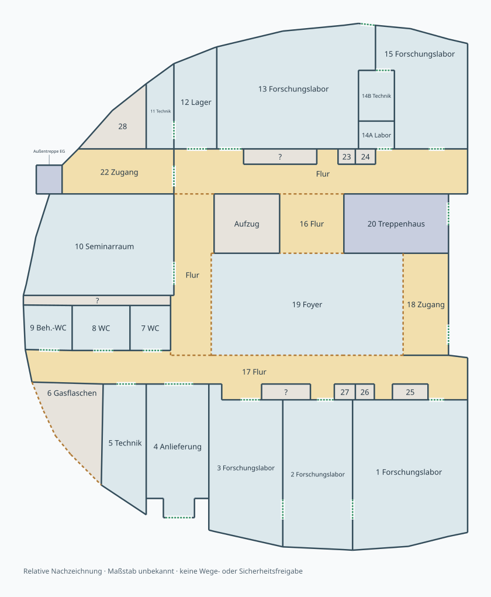

# Erdgeschoss · eigene relative Geometrie

Das EG verwendet eine eigene manuell abgeleitete Quelle mit **Seminarraum 10**,
**Foyer 19** und der veränderten Anordnung der **WC-Bereiche 7, 8 und 9**.
Der Aufzug steht allein; das innere Treppenhaus 20 und die äußere Metalltreppe
besitzen getrennte Bezüge. Die Außentreppe endet neben Zugang 22.



Die Quelle [model/ground-floor-eg.shared.json](../model/ground-floor-eg.shared.json)
enthält ausschließlich abgeleitete Vektoren und freigegebene Raumbezeichnungen.
Das Originalfoto sowie dessen Pfad, Prüfsumme und sonstige Metadaten bleiben
außerhalb des Repositories. Die [Schemaquelle](../model/ground-floor.schema.json)
und der [Loader](../scripts/ground_floor_model.py) verwenden den vorhandenen
relativen Wand-/Flächengraphen.

## Bezug zu den Obergeschossen

Die Planabbildung besitzt gegenüber F03 eine um 180° gedrehte Orientierung.
Ihre Vektoren sind bereits manuell in den gemeinsamen Darstellungsrahmen
überführt. Acht Eckpunkte von Aufzug und innerem Treppenhaus referenzieren
F03-Vertices direkt, statt eine zweite unabhängige Kerngeometrie zu speichern.
Die EG-Bezeichnungen unterscheiden sich von den Obergeschosskennungen.

Die Einpassung ist **keine starre photogrammetrische Registrierung und keine
metrische Kalibrierung**. Konturen wurden näherungsweise um diese gemeinsamen
Bezüge rekonstruiert; Fotoverzerrung und tatsächliche Maße bleiben offen.
Außerhalb der Kernpunkte sind Fassadenfluchten und Wandlängen nicht
geschossübergreifend eingemessen.
`calibration` bleibt `null`. Der Loader löst Referenzen auf und validiert den
Graphen; er wendet keine weitere Drehung oder unbemerkte Maßstabsanpassung an.

Die Ableitung besitzt 35 Flächen, 164 einmalig definierte Grenzen und 22
näherungsweise verortete Öffnungen. Diese Zahlen bezeichnen Modellobjekte,
keine vermessenen Räume oder bestätigten realen Türen. Toiletten-Inneneinrichtung,
kleine Techniknischen, genaue Anschläge, Verglasung und Fassadendetails bleiben
vereinfacht oder ungeklärt. Gezeichnete Nachbarschaft beweist keine Passierbarkeit.
Die geschossabhängige Aufzugtürregel liegt separat in der Gebäudekomposition.

In der Gebäudekomposition passt die [gemeinsame Hüllenregistrierung](building-alignment.md)
die äußere Darstellungsgeometrie an die Obergeschosse an. Aufzug und innere
Treppe bleiben im gemeinsamen Bezug fest; die hier beschriebene Originalquelle
und ihre relative Nachzeichnung bleiben unverändert.

## Bilder und Prüfung

Die native [EG-Ansicht](media/building-stack-ground.png) wird aus derselben Quelle
als Bestandteil des [Gebäudemodells](building-stack.md) aufgebaut. FreeCAD und
SolidCraft erzeugen ihre jeweiligen Geometrien direkt; kein CAD ist Eingabe
des anderen. Die statischen Prüfungen und deren Grenzen stehen in der
[Gebäudeprovenienz](media/building-stack.provenance.json).

```sh
python3 scripts/render_ground_floor.py --out exports/ground-floor-eg.svg
python3 scripts/build_building_stack.py --backend both
```

Das kompakte Galeriebild enthält ausschließlich quellabgeleitete Vektoren und
Text. Seine Darstellungskomprimierung verändert keine Modellkoordinaten.
Originalbilder werden weder eingebettet noch nachgeladen. Ein Bild ersetzt
weder Aufmaß noch eine Bau-, Transport- oder Sicherheitsqualifikation.
