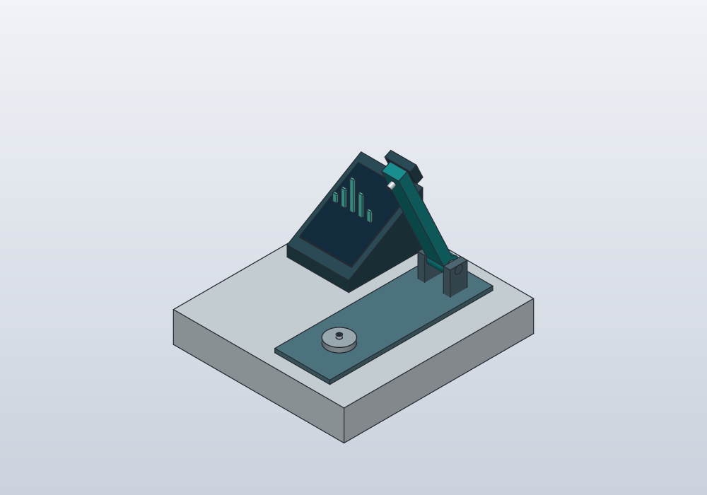
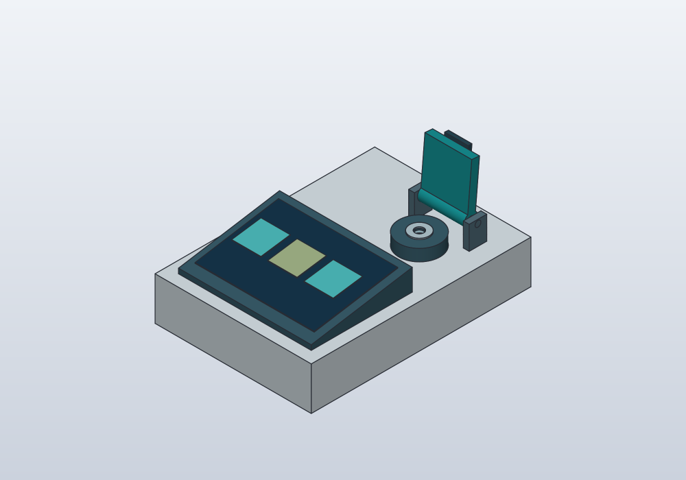

# NanoDrop und Qubit: eigenständige Anschauungsmodelle

Die beiden Modelle zeigen die für die Bedienung wesentlichen Formen. Gehäuse,
Farbgebung, Display und Proportionen sind eigene Entwürfe. Herstellergeometrie
und Herstellerlogos werden nicht verwendet. Alle Maße und Gelenkgrenzen sind
Annahmen; weder maßgetreue Gerätezwillinge noch eine Herstellungs- oder
Messgerätefreigabe werden damit behauptet. Eine rechtliche Freigabe wurde nicht
geprüft.

## NanoDrop-Konzept



Die führende Quelle ist
[`model/nanodrop-concept.shared.json`](../model/nanodrop-concept.shared.json).
Der türkisfarbene Hebel schwenkt um eine hintere Querachse. Seine obere
Messfläche steht in der geschlossenen Referenzpose über der unteren Messfläche.
Die kleine untere Säule besitzt eine **ebene Oberfläche**, keine Probenmulde.

Der blaue Tropfen ist ein eigener illustrativer Körper. Seine Halbkugel besitzt
bei der Standardquelle 1,5 mm³ = 1,5 µl Volumen. `sample_reference.volume_ul`
unterstützt 1 bis 2 µl beim Neuaufbau; der Tropfen wird für Übersichtsansichten
nicht künstlich vergrößert. Eine zusätzliche Nahansicht macht ihn sichtbar.
Die Modellform beschreibt keine Benetzung, reale Kontaktwinkel oder
Flüssigkeitsbrücken. Auch beim geschlossenen Hebel bleibt sie eine unverformte
Illustration. Der feste Referenzspalt von 1,2 mm ist keine Nachbildung der
variablen optischen Weglänge eines realen Geräts.

Die grundsätzliche Anordnung von unterer Messsäule und oberem Hebel sowie
die Mikrovolumenanwendung sind im
[NanoDrop-One-Handbuch](https://tools.thermofisher.com/content/sfs/manuals/3091-NanoDrop-One-Help-UG-en.pdf)
beschrieben. Nur dieses Funktionsprinzip wurde als Referenz verwendet.

## Qubit-Konzept



Die führende Quelle ist
[`model/qubit-4-concept.shared.json`](../model/qubit-4-concept.shared.json).
Das Modell besitzt ein geneigtes Display, eine einzelne kreisförmige
Röhrchenkammer mit echter Aussparung sowie einen schwenkbaren Deckel. Das
transluzente, generische 0,5-ml-Referenzröhrchen ist ein separater Körper.
Seine Geometrie ist keinem geprüften Artikel zugeordnet; Kapazität und Passung
sind nicht nachgewiesen. Die Displayflächen sind eine grafische Andeutung.

Die Rollen von Display, Messkammer, Röhrchen und Deckel stammen aus dem
[Qubit-4-Handbuch](https://documents.thermofisher.com/TFS-Assets/LSG/manuals/MAN0017209-Qubit4Fluorometer-UG.pdf).
Die Modelle enthalten keine qualifizierte Optik, Elektronik oder Assaychemie.

## Gemeinsame Quelle, Ableitung und Prüfung

```sh
python3 scripts/build_instrument_concepts.py
# Einzeln:
python3 scripts/build_instrument_concepts.py --device nanodrop
python3 scripts/build_instrument_concepts.py --device qubit
python3 -m unittest discover -s tests -p 'test_instrument_concepts.py' -v
```

`model/instrument-concept.schema.json` beschreibt die beiden unterstützten
semantischen Rezepte. `scripts/instrument_concept.py` wertet die Parameter und
gemeinsamen Rahmen aus. Die vorhandenen portablen Primitive, Skizzen, booleschen
Operationen und Gelenkadapter werden wiederverwendet. Kein CAD benötigt die
Datei des anderen CADs als Geometriequelle; STEP dient dem zusätzlichen Vergleich.

Der Build erzeugt native `.sc`- und `.FCStd`-Dateien, STEP sowie offene,
geschlossene und vergrößerte Detailansichten. Neue Modellstände erhalten eigene
Revisionsordner. Die aktuellen Dateien stehen in den lokalen Berichten:

- `cad/nanodrop-concept/shared-build-report.json`
- `cad/qubit-4-concept/shared-build-report.json`

Die Berichte binden Quellen, Adapter und Artefakte mit SHA-256. Pro Gerät werden
Standardmaße, eine höhere Basis und eine breitere/tiefere Variante geprüft.
Abhängige Messpunkte und Gelenkanker folgen denselben Parametern. Beide CADs
werden in offener und geschlossener Stellung nach Körpernamen, Volumen,
Schwerpunkt und Begrenzungsbox verglichen. Die gespeicherte offene Stellung
erhält zusätzlich einen STEP-Vergleich per symmetrischer Differenz.

FreeCAD prüft je Variante 16 Gelenkstellungen gegen die gemeinsame Rotation und
auf Überschneidungen zwischen Rahmen und beweglichem Hebel beziehungsweise
Deckel. Überlappungen innerhalb derselben starren Komponente werden getrennt
aufgeführt. Die NanoDrop-Prüfung verbindet die tatsächliche Fläche, Tropfenlage
und Tropfenvolumen; beim Qubit wird die freie Kammerachse geprüft. Native
Wiederöffnung und FreeCAD-Darstellungsmetadaten werden ebenfalls geprüft.

Diese Stichproben sind kein kontinuierlicher Bewegungsraum-, Roboterzugangs-,
Fertigungs-, Passungs-, Reinigungs-, Lichtdichtheits- oder Messleistungsnachweis.
Die FreeCAD-Darstellung wurde als gespeicherte Metadaten geprüft; die gezeigten
Bilder stammen aus den nativen SolidCraft-Modellen.

## Verhältnis zu den synthetischen Abläufen

Die bestehenden NanoDrop- und Qubit-Kataloge, Profile und Protokolle bleiben
logische Laufzeitverträge. Diese Anschauungsmodelle ergänzen eigenständige
Geometriequellen. Die [synthetische Laboraufstellung](synthetic-lab-workflow.md#geometrische-aufstellung)
referenziert beide Geräte inzwischen als Instanzen auf der Referenzbank.
Ein Modellröhrchen ist kein zusätzliches Laufzeitgefäß. Die Gerätehebel sind
nicht an Protokollschritte gekoppelt; neue Roboterwege sind nicht implementiert.
