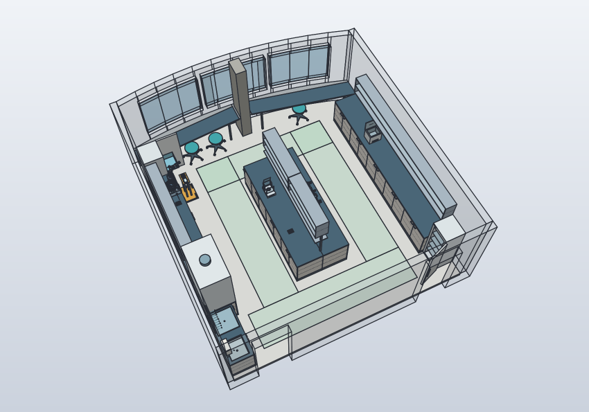

# L01 equipment placement and access study

The furnished scene places three instances of the existing six-axis arm,
CF01, floor transporter TR01, the existing T01 used-tip collector, three
24-place tube cassettes, an analytical balance, a refrigerator and a −20 °C
drawer freezer, a water bath and a fume hood in the current L01 room. The
referenced furnishings add three stools, functional cupboards and the wet bench.
The leading source is
[`model/lab-layout-l01.shared.json`](../model/lab-layout-l01.shared.json).
The room geometry remains in its own shared source. Measurements are still
pending; every room dimension retains its provisional status.



The manual cellar ULT remains a separate equipment-library profile. No cellar
room, basement placement or automated long-term-storage access is added.

## Open and rebuild

The [current build report](../cad/lab-layout-l01/shared-build-report.json)
contains the current FreeCAD and SolidCraft paths, source/native asset hashes,
validation evidence and render paths. Run:

```powershell
python scripts/build_lab_layout.py
```

`--prepare-only` builds the source snapshots and native SolidCraft insert
models. It requires both CAD runtimes. For the final scene through SolidCraft
MCP, execute the generated `scene.commands.json`, save the scene and measurements at
the paths in its context, then use `--finish <context.json>`. When MCP restricts
file access, stage the source-derived STEP snapshots in its permitted temporary
directory and replace only those input paths. Keep the original command file
for the reproducible CLI path.

Resolve current native paths from the build report rather than an older
revision directory. The [curated overview](models/images/l01-overview.png) and
[schematic placement plan](models/images/l01-equipment.svg) have source/image
bindings in the [gallery provenance](models/provenance.json).

## Proposed arrangement

The room origin is the inside left corner at the entrance wall; X points right,
Y towards the windows and Z upwards. Dimensions below are in mm. Coordinates
are placement origins, rather than footprint corners.

| Instance | Placement | Position X, Y, Z | Yaw |
|---|---|---|---|
| ArmA | Right-hand middle bench, entrance side of pair | 3800, 3070, 965 | 70° |
| ArmB | Same bench, window side of pair | 3800, 3730, 965 | −110° |
| ArmC | Left wall bench, before the freezer bay | 600, 5550, 1060 | 0° |
| CF01 | Left bench beside ArmC | 500, 5250, 900 | 270° |
| TR01, Floor_Mixed | Parked beside left bench | 930, 5450, 0 | 90° |
| T01 | Between the pair, towards the wall | 3550, 3400, 900 | 0° |
| RackPair | Between the pair, towards the aisle | 3900, 3400, 900 | 0° |
| RackCF | Left bench, entrance side of CF01 | 500, 4775, 900 | 0° |
| RackManual | Left half of the middle bench | 2850, 2700, 900 | 0° |
| Balance01 | Free left middle worktop | 2850, 4050, 900 | 0° |
| Freezer01 | Left wall, between side bench and window bench | 585, 6105, 0 | 90° |
| Fridge01 | Back against the right sidewall behind Door B | 6011, 681.5, 0 | 270° |
| WaterBath01 | Free right wall bench | 6250, 4400, 900 | 0° |
| Hood01 | Left wall, immediately after the wet bench toward the windows | 778, 2120, 0 | 90° |

The wet bench starts at Y=100 mm on the left wall beside Door A, with the basin
nearest the entrance and the separate drip/drying area toward the windows. Its
1,400 mm span is followed by a 20 mm nominal gap and the 1,200 mm hood. The
remaining left bench and open upper storage start at Y=2,800 mm; their window
ends and the established freezer/CF01 group remain in their previous positions.
The hood faces the aisle. Water supply, waste and extraction connections remain
unconnected geometric interfaces.

Three adjustable stools are parked below the open window worktops. All upper
storage is open shelving. The scene's lower cupboard doors start closed; their
native joints and shared two-door compartments, with two shelves per compartment,
are described in the
[furniture documentation](lab-room-l01.md). Opening a cupboard can occupy an
aisle or vehicle space and requires that work area to be clear.

The left side bench and its upper storage are shortened by 640 mm. The
600-mm-wide freezer stands in this bay with 20 mm at each end and its back
20 mm from the left wall; its front faces the aisle. Its local `max_open`
and `access_angle` overrides are 90°. Larger opening angles hit the sloping
window worktop, so this instance uses a quarter-turn opening limit.

The refrigerator now backs onto the right sidewall and opens toward the
aisle. Its back is 20 mm from that wall, and its window-side edge ends 20 mm
before the right bench. The right bench and upper storage retain their original
length and starting position. The door swings toward the entrance side,
away from the bench. Straight line probes from the aisle into all five shelf
levels check the installed approach as well as the appliance's own opening.
These geometric probes and nominal gaps do not qualify human reach,
installation or ventilation clearance.

The balance occupies the free left island worktop with its draft shield open.
The existing CF01, ArmC, TR01 and RackCF group shifts 800 mm toward the
entrance through one `left_station_shift_y` parameter. Relative placements,
reach targets and the legacy geometric transfer-waypoint references move
together. This does not create or qualify a new transport program.

The pair faces a shared work area with bases 660 mm apart. The third arm can
turn between the centrifuge and parked transporter. Its displayed shoulder
pose is raised to prevent its tip-camera housing intersecting the closed lid.
Two open 65 mm concept risers support the pair; ArmC uses a 160 mm riser; their attachment details and
bench loads are unqualified. They are portable box/cut props in the layout
adapter, rather than independently drawn equipment models.

The transporter uses the existing mixed plate/tube configuration with its deck
regenerated at 900 mm. Its transport cover is omitted in this access view;
cover removal and handling are not implemented. The three bench racks reuse
the exact existing TR01 B2 tube-cassette geometry, including its illustrative
closed tubes. The cassettes are not newly qualified commercial racks.

## Checks and interpretation

The build checks cross-instance BRep intersections, open-lid clearance and four
walking strips through a 2000 mm high volume. The strips are 1000 mm wide along
both sides of the island and across the entrance, and 900 mm wide across the
window end. Green floor patches show these reserved study areas. They are
geometric planning choices, not established safety separation distances or an
egress/accessibility assessment. Building-door leaves remain absent. Appliance
doors, draft-shield panels and freezer drawers are modeled and sampled.

The TR01 footprint study passes through Door A and shifts to X=1,200 mm beside
the wet bench/hood, returning to the existing parked position after Y=3,400 mm.
It is checked along every segment of the placement-source polyline
at positions spaced no more than 200 mm apart. Its 412 mm cross-route
envelope fits inside the provisional 900 mm door opening. At the parked
position its right edge is X=1136; the left walking strip begins at X=1450,
leaving 314 mm between that edge and the strip. This is a static layout gap,
not a protective separation. The vehicle route crosses the entrance walking
strip; shared traffic management remains necessary. No steering, dynamics,
localization, occupied-person detection or inter-lab corridor is simulated.

Seven position-only flange inverse-kinematics checks use the original arm
dimensions and limits, verified with its forward kinematics: both arms at the
shared work point, both at the T01 approach, and ArmC above CF01 and the two
vehicle bays. These endpoints do not establish tool orientation, a real TCP,
graspability, collision-free arm motions, cables or coordinated collaboration.
No gripper or pipette tool is added. Full arm sweeps are not checked.

The native layout check covers all current FreeCAD scene bodies, four walking strips,
the sampled vehicle route, the open CF01 lid and seven position-only flange
targets. It additionally checks installed appliance poses against all other
scene bodies, including intermediate opening positions, plus storage-access
probes, five refrigerator approaches from the aisle, bay alignment and floor/worktop support. Each appliance
bodies is compared individually between the independent CAD constructions;
equipment/riser aggregates are compared for every instance. Detailed errors,
sample counts and pass/fail results belong to the current build report.

The new devices also have sampled installed access checks, including the
water-bath lid, hood sash and hood-base cupboard fronts. These are discrete geometric checks, not continuous collision-free paths,
mechanical accuracy or operating qualifications. The separate
[legacy sample-transfer study](lab-transfer-l01.md) retains its stated limits.

Known construction overlaps inside each upstream rigid assembly are retained
and excluded from cross-instance collision checking. Valid individual shapes
and agreement between CAD instances do not qualify upstream mechanisms,
containment, payload, stability or human-machine operation.

## Shared-source boundary

Each equipment asset is pinned to its source and native FreeCAD artifact by
SHA-256 and checked against its upstream build report. FreeCAD source models
are posed through their controllers and copied into named placement groups.
The room remains native parametric geometry. The three new appliances are
constructed independently in SolidCraft from their shared equipment recipes,
then inserted as linked, posed models. Read-only derived equipment dimensions
in the FreeCAD scene support placement expressions; changing appliance
dimensions requires regeneration of the snapshots.

The arms likewise use their checked native SolidCraft source model, posed and
inserted with its existing manufacturer-part decomposition. This avoids the
known importer failure on some posed, combined servo STEP bodies. The native
parent artifact, instance model and input-command checksums bind cache reuse;
manufacturer geometry is not replaced by a concept envelope.
Different native body subdivisions are compared as
instance aggregates, not presented as identical body counts.

CF01 also uses its existing native SolidCraft recipe, because the STEP snapshot
import does not preserve a closed rotor on this runtime. TR01, racks, T01 and
risers keep their existing STEP path. For nine servo housing pieces SolidCraft
cannot integrate the surfaces after the final world placement. All are closed
and measured in the local native arm model. Their volumes and centres are
therefore carried through the single rigid placement, which is checked against
all directly measurable arm bodies. The raw world-integration errors, local
measurement hashes and explicit derivations remain in the report. These nine
properties are derived, not direct world-surface measurements.

Adjust layout parameters, equipment poses and room dimensions in the leading
sources and rebuild both targets together. FreeCAD placement-group translation
expressions also expose layout values for inspection; the SolidCraft equipment
instances are placed snapshots. Native scene edits are experiments and must
return to the shared source before regeneration. Original arm and CF01 models
retain their editable joints; this combined scene does not duplicate those
live controllers. No ROS environment or coordinated laboratory protocol is
generated by this layout adapter.

The separate transport motion profile remains pinned to the earlier environment.
Changing this room invalidates that native motion evidence; its strict source
check deliberately requires reconciliation and a new motion build. This layout
change does not silently repin or qualify the robot's transport program.
