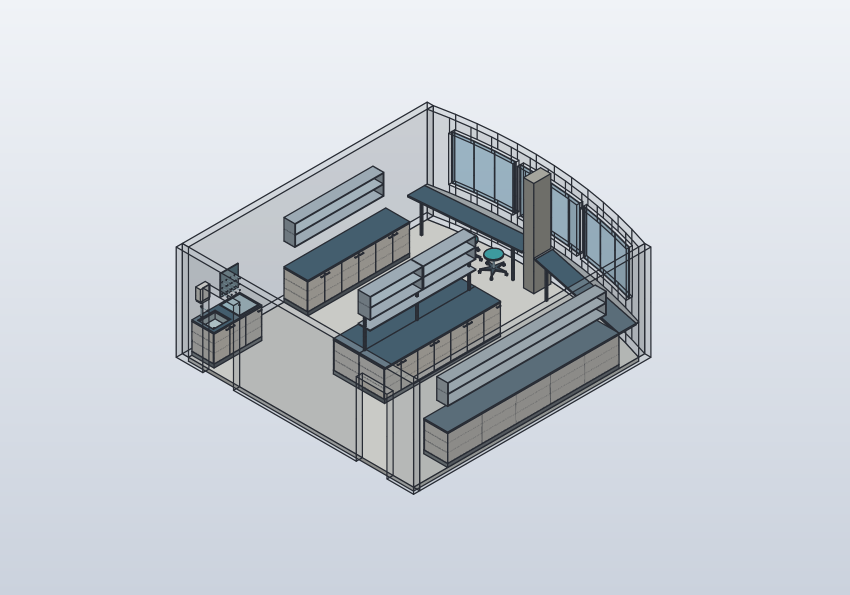

# Abstract laboratory room — L01

Prepared on 28 October 2026 from the owner's description of a room analogous to
the institute environment in Rostock. This is an editable spatial sketch with
provisional dimensions. It is not a measured room or a reconstruction of the
institute's building. A privately supplied floor-plan photograph is now used
for the [separate relative F03 model](floorplan-f03.md). The owner identifies
L01 with room 3.003. The existing L01 sources remain unchanged; no metric
registration has been established.

Updated on 29 October 2026: the window-side bench is split by a vertical concrete
support close to the windows. The owner reports approximately 300 mm width and
500 mm depth, with its front aligned to two straight bench runs toward the room
corners. The window curvature stays unchanged. Heating covers occupy the space
behind the straight bench backs and around the support in this provisional
interpretation. The support's exact lateral position and window setback remain
unknown. The render colours were chosen for legibility, not obtained from a
photograph or measured finish information.

The central unit has an open shelf at 1,500 mm and two open shelving modules
whose underside starts at approximately 1,750 mm, following the owner's
height references. The intervening 250 mm band has no back panel; narrow uprights
leave open spans for reaching through to the other side. The window benches no
longer have cupboards or plinths underneath; two open leg envelopes support each
worktop. Actual reach, fixings and load capacity remain unverified.

The left side bench and its upper storage now end 640 mm earlier to reserve
the window-end freezer bay. The right side bench and upper storage retain
their original length; the refrigerator occupies the entrance-side pocket
with its back against the right wall. Furnishing reservations contain no equipment geometry; the referenced devices
belong to the [separate L01 equipment layout](lab-layout-l01.md).




## Source layers for L01

The entry point `model/lab-room-l01.shared.json` is now a pinned composition of
`model/environments/l01.geometry.json`, `model/furniture/laboratory.catalog.json`
and `model/furnishings/l01.furnishings.json`. The shell can be evaluated without
furniture. The furnished room retains its body IDs, named frames and existing
frame identities. The appliance reservations and the explicit shift of the
left station are recorded in their respective source layers. The four-level target and the current implementation scope
are documented in [ARCHITECTURE.md](../ARCHITECTURE.md).

The front of the left wall now holds a wet bench beside Door A, followed toward
the windows by the separate fume hood. The remaining left bench and upper
shelving start at Y=2,800 mm. Three mobile laboratory stools are parked below
the open window benches. Lower cupboards contain separate compartments, each
with two internal shelves. Two doors with opposite outer hinges enclose one
shared compartment without a central stile; an odd final door encloses its own
compartment. Every upper module is open, including
both sides of the central shelving; historical cupboard IDs remain stable.

The catalog sets `door_grouping: "paired"` for storage and wet benches. An
instance can override this with `door_grouping: "single"` to give every door a
separate compartment. Leaf count is derived from bench length and the maximum
nominal leaf width; pairs and the optional final single therefore fill the
whole run. Each pair has two mounted bar handles near its centre seam and needs both doors
open for full compartment access. Native access checks probe both openings,
including states with only one door of each pair open. The fume-hood base uses
the same recipe. Regenerate both CAD models after changing grouping or leaf count.
The handles stand proud of the fronts, so neighbouring open compartments do not
fold flat against each other. The gallery's `inspection` pose opens only the
first compartment of each bench to 75°; the remaining fronts stay closed.
The `open` pose opens that same compartment to 90° for access checks and raises
the stool seats. Individual door limits remain 0–90°; simultaneously folding
all fronts together is not a demonstrated pose.

The build entry remains `python scripts/build_lab_room.py`. Run
`python scripts/validate_assembly_schemas.py` with the optional `jsonschema`
development dependency to validate the source contracts. Furniture placement is
currently translation plus yaw. General device attachments and metric building
registration remain future work; F03 adds a separate relative multi-room and
corridor adjacency description.

The native five-case build was also executed with the installed macOS runtimes
(FreeCAD 27.1 and SolidCraft 0.40.0-rc.2):

```sh
PYTHONPATH=/Applications/FreeCAD.app/Contents/Resources/lib \
python3 scripts/build_lab_room.py \
  --freecad-python /Applications/FreeCAD.app/Contents/Resources/bin/python \
  --solidcraft-cli /Applications/SolidCraft.app/Contents/MacOS/solidcraft-cli
```

The old/new native comparison and current cross-CAD build are recorded locally
in `cad/lab-room-l01/shared-build-report.json`; exports remain ignored by Git.

## Layout and orientation

The origin is the inside left corner of the entrance wall at finished floor
level. Looking from the doors toward the windows, +X is right, +Y points toward
the windows, and +Z is up. Both sidewalls meet the entrance wall at 90 degrees.
The right sidewall is shorter. The exterior/window boundary is represented by
an adjustable curve influenced by the building's oval outline.

Two door openings occupy the entrance wall, which has no bench. Left and right
wall benches and two window-side bench sections surround an island of two long benches
placed back to back. Both end passages and both side aisles are kept open in
this provisional geometry in the default closed-door state. Four lower cupboards
remain below the side benches and central island; the wet bench adds another.
The two window worktops have open lower space and simple legs. Open shallow
storage runs along the sidewalls, and two open modules stand above the island's
centre line. Each upper module includes an internal shelf and has no front panel.

The default model contains 197 final bodies, including the wet bench and three
stools, grouped into room shell, perimeter benches, island, island shelf, upper
storage, building services and their movable fronts/seats. Three grey heating-cover envelopes
fill the rear gaps and the clearances around the concrete support. Their slots,
airflow and small-object retention are not modeled or tested. Walls are translucent for inspection; no ceiling is
drawn. Cabinet interiors and discrete opening positions are checked. The three window
divisions and exact door locations are assumptions, not observations.

The [current placement plan](models/images/l01-equipment.svg) shows the
revised worktop outlines and device reference points.

## Adjustable provisional dimensions

| Dimension | Starting value |
|---|---:|
| Inside width | 6,600 mm |
| Left / right wall length | 7,000 / 6,600 mm |
| Facade bulge relative to endpoint chord | 450 mm |
| Room height / wall thickness | 2,800 / 180 mm |
| Two door openings | 900 × 2,150 mm each |
| Door left-edge positions on entrance wall | 600 / 5,100 mm |
| Perimeter bench depth / worktop height | 700 / 900 mm |
| Left rear equipment bay / additional right entrance setback | 640 / 0 mm |
| Additional left front reservation / wet bench | 1,800 mm / 650 × 1,400 mm |
| Cabinet panels / door gap / maximum nominal leaf width | 18 / 3 / 550 mm |
| Stool seat / height / base envelope | 400 × 420 / 450–650 / Ø640 mm |
| Window-side bench depth | 500 mm, provisional |
| Concrete support width / depth | approximately 300 / 500 mm, owner-reported |
| Support lateral offset from room centre | 0 mm, provisional |
| Support setback from central facade reference | 75 mm, provisional |
| Heating-cover thickness / gap at room corners | 20 / 75 mm, provisional |
| Central island length / total width | 3,400 / 1,500 mm |
| Island distance from entrance wall | 1,700 mm |
| Upper-storage depth / underside / height | 320 / 1,550 / 600 mm |
| Central shelf length / depth / thickness | 3,100 / 350 / 25 mm |
| Central shelf top height / end setbacks | 1,500 / 150 mm |
| Three central shelf upright sections | 40 × 40 mm |
| Central cupboard underside / height / depth | 1,750 / 600 / 350 mm |
| Open band above shelf | 250 mm |
| Window-bench legs | Four 40 × 40 mm leg envelopes |

Every parameter has an unknown measured value (`measured_mm: null`). The numbers
above are editable placeholders; only the support width/depth also carry the
owner's approximate reported values. Shelf height and cupboard underside also
record the owner's 1,500/1,750 mm references. At the starting values the side aisles are
1,850 mm, the entrance-end passage is 1,700 mm, and the window-end passage is
about 1,460 mm to the straight window-bench fronts. Sidewall upper storage is set back 380 mm from the side-bench front and
starts 650 mm above the worktop. These are geometric distances, not qualified
human/robot passing, head-clearance, accessibility or egress dimensions.

The facade uses a 12-segment quadratic bulge:

`x(t) = t × room_width`

`y(t) = (1−t) × left_depth + t × right_depth + 4t(1−t) × facade_bulge`

This is a portable approximation, not a fitted ellipse. Facade, glazing and the
rear edge of the heating covers use the same samples. Each window-bench section
is a straight quadrilateral, with its front aligned to the support at the inner
end. The covers fill the varying strip between the straight bench backs and
curved facade. The support does not cut or reshape the glazing. Rear wall
thickness, support depth and window-bench depth are measured along Y. Detailed
joinery between side benches and window sections is not modeled.

The old central frame `L01.WindowBench.Worktop` is replaced by
`L01.WindowBenchLeft.Worktop` and `L01.WindowBenchRight.Worktop` so a work reference
does not sit inside the concrete support. The support has `L01.ConcreteSupport`.
Its position, width/depth, bench depth and cover dimensions are native parameters.

The central shelf is centred on the seam between the two island worktops. Its
length follows `island_length - 2*island_shelf_end_inset`. The default board
underside is 575 mm above the worktops, and it leaves a 575 mm worktop strip on
each side. Three uprights extend from bench height to the board underside; their
positions follow the island length and shelf setbacks. The named reference
`L01.IslandShelf.Top` follows the board. Three narrow upper uprights extend
from the 1,500 mm shelf top to the 1,750 mm cupboard underside. Two cupboard
modules occupy the upper level, with a provisional 10 mm gap between them and
their own named bottom frames. The band between shelf and cupboards has no back
panel. Cupboard depth and height are provisional. All are layout envelopes,
without selected fixings, load rating, rigidity or item-retention design.

## Current native files and source

- [FreeCAD room](../cad/generated/lab-room-l01-7f455f722169/default.FCStd).
- [SolidCraft room](../cad/generated/lab-room-l01-7f455f722169/default.sc).
- [STEP exchange file](../exports/generated/lab-room-l01-7f455f722169/default.step).
- [Leading shared source](../model/lab-room-l01.shared.json), format `solidcraftbot.lab-room/2`.
- [Current comparison report](../cad/lab-room-l01/shared-build-report.json).

FreeCAD exposes the dimensions under `ModelParameters`. SolidCraft exposes the
same named user parameters. Boxes, polygon points, extrusion depths and the
FreeCAD named door/bench frames follow parameter expressions. Both programs
can therefore adjust dimensions natively. Native edits do not return to the
shared source. For a durable change, edit `parameters` in the JSON and regenerate:

```powershell
python scripts/build_lab_room.py
python -m unittest discover -s tests -v
```

The loader rejects overlapping/out-of-wall doors, reversed sidewall lengths,
nonpositive passages and invalid vertical arrangements. Native editors do not
enforce all these source-level conditions; revalidate after changes.

Portable room, bench and storage semantics live in
[lab_room_model.py](../scripts/lab_room_model.py). Both adapters consume the same
operations. FreeCAD independently creates native boxes, expression-constrained
polygon sketches, extrusions and cuts; it does not import STEP as its source.
SolidCraft uses parameter-driven primitives and sketch points. The default
SolidCraft model was generated through MCP; the same commands run through the
CLI in the reproducible build.

Five cases compare every generated body for validity, volume, centre, bounding box
and symmetric STEP difference. Door and bench frames are checked against their
parameter-derived positions, including worktop heights. A wider room with more
facade bulge is also tested by native parameter edits in both CADs. A second
native edit and fourth build case shift and resize the support. Checks verify
the aligned bench fronts and no intersection between support, bench sections
and heating covers. Source tests verify that support edits leave facade and
glazing geometry unchanged. The deeper case changes wall lengths, bench height
and upper-storage depth. A fifth case and third native edit change island length,
shelf/cupboard depth, height and end setbacks. Checks verify that the shelf stays centred,
inside the island footprint and above both worktops, with the uprights meeting
the worktops and shelf underside without penetrating the worktops. Upper-post
contact heights and cupboard-bottom frames are checked. Two cross-island line
probes between uprights pass through the open band; they establish geometric
openness only, not hand-size, reach distance or ergonomic qualification. Window
legs are checked against floor and worktop heights. Source tests verify that
window cupboards and their plinths are absent. Saved FreeCAD
files are reopened, and their colors/visibility/camera are stored. SolidCraft
isometric and top views were visually inspected; FreeCAD GUI rendering was not
separately tested.

The additional native furniture checks move every door and stool seat through
four intermediate/end positions, compare observed centres with the common
kinematics and check self-intersections within each furniture instance. Line
probes observe blocked cupboard access when closed and clear access to all
three levels of the selected open compartment. Upper shelving is accessible in both states.
These are sampled geometric observations; opened doors can occupy a walking
strip or the parked transporter's space. Clear that work area before opening;
the model does not implement a person/vehicle interlock.

In FreeCAD, `Controller.LeftBench_Door1` and the other door properties use
degrees; `Controller.Stool1_SeatLift` uses millimetres. SolidCraft has the
corresponding native joints. `lab_room_model.pose(..., "closed"/"open"/"inspection")` and
`storage_interfaces` expose the same states and access references. Changing
the module count requires regeneration. After native SolidCraft dimension
experiments regenerate the model to update joint anchors and access metadata.

The [Labsit reference](https://www.inwerk-bueromoebel.de/alle-bueromoebel/buerostuehle/arbeitsplatz/arbeitsstuehle/662/laborhocker-bimos-labsit)
provides the stool envelope and height range. The five-star base, casters,
gas lift and seat contour are simplified. The wet bench has a hollow basin,
tap, paper-towel dispenser, separate drained drip tray and twelve drying pegs
above it. Its dimensions, fittings and utility connections are assumed. Water,
waste, load capacity, rolling behaviour and seating ergonomics remain unverified.

Current case counts, source pins and individual geometric results are in the
build report. Earlier offline-suite totals and older motion reports are
historical evidence, rather than proof for this changed furnished environment.

## Completing the environment

The room model reserves stable room, door and bench IDs. A separate
[equipment layout study](lab-layout-l01.md) now places three arms, CF01, TR01,
T01 and racks while retaining this room source. Its static checks and
position-only reach screens are documented there. Robot navigation, traffic,
door/furniture sweeps, utilities and physical operating clearances remain
unvalidated. No ROS environment or building model is generated.

From the floor-plan photograph, establish a readable scale or one known length,
the room's location in the building, wall endpoints and facade shape, door
positions/widths/swings, window positions and actual bench/storage dimensions.
Then register L01 in a building coordinate frame; that pose is currently null.
Keep observed dimensions separate from assumptions as the remaining rooms are
added.
