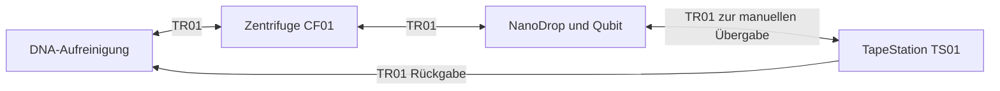

# TR01 zwischen DNA-Aufreinigung, CF01 und Analytik

Der neue Einstieg führt **synthetische Transportaufgaben** mit dem vorhandenen
Bodenroboter TR01 aus. DNA-Aufreinigung, CF01, die gemeinsame NanoDrop-/Qubit-
Analytikstation und die manuelle TapeStation sind getrennte Übergabeorte.
Er ersetzt weder die bisherige lokale CF01-Armbewegung noch den bestehenden
Gesamtlauf auf einer einzigen Referenzbank.



Die Demo besucht DNA → CF01 → QC → TS01 → DNA. Diese Reihenfolge prüft die
Transportübergaben; sie ist **keine DNA-Aufreinigungs-SOP**. Insbesondere wird
eine Zentrifugation nicht durch einen Stationsbesuch ersetzt. Zwischen NanoDrop
und Qubit am selben Arbeitsplatz wird keine Bodenfahrt eingefügt.

## Ausführen und nach Unterbrechung abgleichen

```sh
python3 scripts/run_lab_station_transport.py --world-id SYN.TR01.Demo01 demo
python3 scripts/run_lab_station_transport.py --world-id SYN.TR01.Demo01 status
```

Der Standard ist derselbe Journal-Store wie bei den manuellen Abläufen.
`--store exports/station-transport/tasks.sqlite3` wählt ausdrücklich einen
separaten Store. Nur Sitzungen im selben Store koordinieren Reservierungen.
`world-id` bezeichnet eine synthetische Testwelt. Derselbe Name kann nicht
neu initialisiert und damit zurückgesetzt werden.

Die führende Quelle ist
[lab-station-transport.protocol.json](../model/lab-station-transport.protocol.json).
Sie referenziert TR01, Extraktionsvorbereitung/K01, CF01, die vorhandene
Analytikaufstellung und TS01. `Floor_T48`, Kassette 1 und `TR01.LoadDeck`
werden gegen die bestehende Transporterquelle geprüft. Die einzige Demo-Probe
wird aus Produkt-, Elutionsgefäß- und Ursprungsplatz-ID des vorhandenen
DNA-Vorbereitungsprofils abgeleitet. Das Profil erzeugt damit kein DNA-Eluat:
Die Demo erklärt dieses ausdrücklich zu einem synthetischen Transport-Fixture.
Es entstehen keine zweite Materialbilanz, keine Mengen oder realen Bestände.

Jeder Streckenabschnitt hat drei getrennte Absichten und Bestätigungen:

1. **Laden:** stationär gehaltenes Fahrzeug, freie Übergabe, lokal bestätigte
   Lage sowie vollständige Proben-, Gefäß-, Rack- und Platzidentität bestätigen.
   Die abgebende Station muss die Last ausdrücklich freigeben und die
   empfangende Station ihre Bereitschaft bestätigen; dies sind hier
   synthetische Eingaben, keine automatisch beobachteten Geräteabschlüsse.
2. **Transportaufgabe:** bestätigten Verschluss und Rückhaltung erhalten.
   Die Ankunft braucht eine eigene explizite synthetische Beobachtung am Ziel.
3. **Entladen:** vollständige Identität und Übergabe am Ziel bestätigen.
   Erst diese Bestätigung erlaubt den nächsten Abschnitt.

Die Last bleibt während der Fahrtaufgabe auf dem Fahrzeug. Stationäre Arme
beziehungsweise bei TS01 eine Person sind spätere Ausführungsadapter;
synthetische Personenbestätigungen belegen keine Roboterbeladung.
Absichten werden vor Bestätigungen dauerhaft gespeichert. Fehlerhafte oder
wiederverwendete Beobachtungen halten die Aufgabe an; offene Absichten und
Reservierungen bleiben erhalten. Alte Sitzungen verlieren bei Wiederaufnahme
ihren Schreibzugriff. Quellenänderungen blockieren eine stille Fortsetzung.

Für einzeln gelieferte Eingaben stehen `init` und `resume` mit `--actions DATEI`
zur Verfügung. Die Datei enthält JSONL mit `command`, `actor_id` und den
Argumenten der Methoden `accept`, `intent`, `confirm` oder `reconcile` aus
[scripts/lab_station_transport.py](../scripts/lab_station_transport.py).
Eine Absicht sieht beispielsweise so aus:

```json
{"command":"intent","actor_id":"SYN.Operator01","operation_id":"Leg0.load","kind":"load"}
```

Bestätigungen enthalten `observation` mit `world_id`, frischer `observation_id`,
`evidence: synthetic_operator_confirmation`, vollständigem `cargo`, `vehicle_at`,
`cargo_at`, `cargo_on_vehicle` und den booleschen Beobachtungen `stationary`,
`holding_confirmed`, `closure_and_retention_confirmed`,
`local_registration_confirmed`, `handoff_area_clear`,
`station_release_confirmed` und `receiving_station_ready`. Alle müssen zur
angeforderten Zustandsänderung passen. Der Demogenerator erzeugt solche
Beobachtungen ausschließlich bei ausdrücklich aufgerufener Demo.

Nach `resume` ist `reconcile` zwingend. Eine offene Absicht braucht eine
explizite Auflösung `performed` oder `not_performed` mit `operation_id` und
vollständiger Beobachtung. Ohne offene Absicht wird der bestätigte Zustand
mit `unchanged` abgeglichen. Eine Zeitüberschreitung oder ein Neustart bestätigt
niemals automatisch Ankunft oder Entladung. Es gibt keine automatische
Wiederholung unklarer Fahrten.

## Was noch fehlt

Implementiert sind Journalzustände, Quellenbindung, Identitätserhaltung,
Reservierungen, Reihenfolgeprüfung und Wiederaufnahme für ein synthetisches
Fixture. Die bestehenden Geräteabläufe und deren Inventar bleiben unverändert;
dieser Runner importiert keine offenen realen oder synthetischen Produktionsläufe.
K01 bleibt passive Kitbereitstellung und ist keine arbeitende Aufreinigungsmaschine.

Geometrische Parkpunkte und fließende Fahrkurven sind inzwischen separat für
L01 implementiert und geprüft; siehe den folgenden Abschnitt. Reale Navigation,
Antrieb, Lokalisierung, Halterückmeldung, Greifer und Armübergabebahnen bleiben
offen. Die ältere L01-Eingangspolyline bleibt eine statische Aufstellungsprüfung
und wird nicht als aktuelles Fahrprogramm umetikettiert.

Die Demo führt keine Aufreinigung, CF01-Charge oder Messung aus. Eine
Stationsquittung ist kein Messende und keine Freigabe biologischer Ergebnisse.
TapeStation-Assistenz und Planungsmodell sind in [tapestation.md](tapestation.md)
beschrieben.

## Geometrische Umsetzung in L01

Die bisher abstrakten Übergabeorte referenzieren jetzt die gemeinsame Quelle
[tr01-l01.motion.json](../model/tr01-l01.motion.json). Sie bindet die aktuelle
L01-Aufstellung und die unveränderte TR01-Konstruktion über Prüfsummen.
Koordinaten werden ausschließlich in dieser Bewegungsquelle gepflegt;
das Aufgabenprotokoll referenziert die Stations-IDs.

| Station | Bestehender Geräte-/Übergabebezug | Parkpunkt X / Y, mm | Parkrichtung |
|---|---|---:|---|
| DNA | `RackManual`, linke Mittelbank | 1625 / 2700 | +Y |
| CF01 | `CF01`, linke Wandbank | 1625 / 5250 | +Y |
| QC | `RackPair`, rechte Mittelbank mit NanoDrop/Qubit | 4975 / 3400 | −Y |
| TS01 | TapeStation auf der linken Mittelbank | 1625 / 3250 | +Y |

Die Tabelle ist eine abgeleitete Ansicht der aktuellen Gangmitten-Wartepunkte.
Die getrennten Andockpositionen und Arm-/Menschenübergaben stehen in
[tr01-workcell-animation.md](tr01-workcell-animation.md). Eine belegte oder
unbekannte Bench sperrt deren Annäherung; Durchfahrten bleiben auf der Gangmitte.

Die DNA-Station bleibt ein Vorbereitungsarbeitsplatz, keine implementierte
Aufreinigungsmaschine. Der TS01-Rückweg nach DNA ist eine ausdrücklich
rückwärts gefahrene Gerade bei unveränderter Chassisausrichtung. Winkel sind
modulo 2π zu interpretieren; aus unterschiedlichen Winkelrepräsentationen
folgt kein Drehmanöver am Übergabeplatz. Die vier Parkpunkte sind geometrische
Entwurfsbezüge im weiterhin ungemessenen Raum, keine kalibrierten Docks.
Armreichweite, Lade-/Entladebahn und menschliche Ergonomie werden dadurch
nicht bestätigt.

```sh
python3 scripts/build_lab_layout.py
python3 scripts/build_tr01_floor_motion.py
python3 -m unittest discover -s tests -p 'test_tr01_floor_motion.py' -v
```

Der aktuelle Bericht `cad/tr01-l01/shared-build-report.json` löst Programm,
Prüfergebnisse, voll bestücktes Fahrzeug der tatsächlich aufgebauten Backends und native
FreeCAD-Inspektionsstellungen auf. Die Inspektionsstellungen sind alternative
Ansichten desselben Fahrzeugs, keine gleichzeitig vorhandenen Roboter.
Die statische TR01-Ansichtsposition der bisherigen L01-Aufstellungsstudie bleibt
als Vergleich erhalten; das Fahrprogramm setzt die referenzierte Instanz an
seine eigenen, oben angegebenen Parkpunkte. Die Prüfung entfernt dafür die
alte TR01-Ansichtsgeometrie aus der Hindernisliste.

### Kurven und Grenzen

Geraden und lokale siebengradige Bézier-Kurvenblenden verwenden das vorhandene
`CornerPath`-Rezept. Eine gemeinsame ruckbegrenzte Wegfortschrittskurve aus der
PVA-Bibliothek taktet jede Fahrt ohne Wegpunkthalt. Daraus wird eine C2-PVA-
Referenz für X, Y und Gierwinkel erzeugt. Die tatsächliche exportierte Referenz
besteht aus quintischen Segmenten und wird nach Millisekunden-Zeitquantisierung
neu geprüft und bei Bedarf zeitlich gestreckt. Jerk darf an Knoten springen;
dies ist kein C3-Programm.

Die unveränderten synthetischen Grenzwerte sind: Translation 200 mm/s,
100 mm/s², 200 mm/s³; Gierbewegung 0,35 rad/s, 0,5 rad/s², 1,4 rad/s³;
mitgeführte Referenzpunkte 250 mm/s, 150 mm/s², 300 mm/s³. Die Punktgrenzen
verwenden konservativ den maximalen Radius der vollständigen Fahrzeughülle,
einschließlich Zentripetal- und Drehbeschleunigungsanteilen. Die Probe bleibt
aufrecht; ihre Gierorientierung folgt dem Fahrzeug. Dies sind keine
mechanisch oder biologisch qualifizierten Grenzen.

Die Prüfung untersucht Polynomextrema und beide Knotenseiten. Das Kein-Halt-
Kriterium prüft sämtliche möglichen gemeinsamen Nullstellen der beiden
Translationsgeschwindigkeiten einschließlich der Intervalle zwischen den
Knoten. Ruhe ist nur an den Streckenenden für stationäre Übergabe und
Stationsfreigabe vorgesehen. Export und erneutes Einlesen müssen dieselben
Grenz- und Kein-Halt-Nachweise ergeben. Die Daten sind eine geometrische
Chassis-Referenz; Antrieb, Radlenkung, Traktion und ein nicht-holonomer
Regler sind damit nicht qualifiziert.

### Kollisionsnachweis und Betriebszustand

Der native FreeCAD-Nachweis enthält sämtliche Körper von `Floor_T48` mit
900-mm-Deckhöhe, **alle 48 Gefäßhüllen und die Transporthaube**. Er prüft gegen
die feste native L01-Szene einschließlich der drei stationären Arme, Geräte,
Regale, Stützen und geschlossenen Unterschrankfronten. Ausschließlich die
Boden-Aufstandsfläche wird als beabsichtigter Kontakt ausgenommen.
Planungsmarkierungen sind keine physischen Hindernisse.

Für jedes Kurvenintervall wird ein nativer Abstand am Mittelpunkt beziehungsweise
eine konservative AABB-Abstandsuntergrenze um die maximal mögliche Starrkörper-
bewegung im gesamten Intervall reduziert. Positions- und Winkelhüllen stammen
aus den tatsächlichen Polynomen. Reicht die Untergrenze nicht für **15 mm**,
wird das Intervall verfeinert. Eine tatsächliche Unterschreitung oder ein bei
der deklarierten Auflösungsgrenze unklarer Abschnitt schlägt fehl; freie
Einzelstichproben reichen nicht zum Bestehen. Die Mindestuntergrenze ist ein
konservativer Modellnachweis, kein vermessener Abstand im Labor.

Menschen, mobile Hocker außerhalb ihrer Modellstellung und geöffnete
Unterschränke dürfen die reservierte Strecke nicht belegen. Die Kurven kreuzen
bestehende Gehbereiche; die bisher grünen Streifen sind keine gleichzeitige
Freigabe für Mensch und Fahrzeug. Echtzeit-Hinderniserkennung, Verkehrsregelung,
Sicherheitsfunktionen, Türflügel sowie reale Navigation und Hardwareausführung
bleiben offen. Geräteprozesse und lokale Armübergaben bleiben getrennte Abläufe.

### Historischer Nachweis vor der Umstellung auf Gangmitten

Die folgenden Abstände und SolidCraft-Parkprüfungen gehören zur vorherigen
seitlichen Fahrbahnrevision. Sie sind kein Nachweis der neuen Gangmitten oder
der zusätzlichen Übergabekomposition. Den aktuellen Nachweis immer aus
`cad/tr01-l01/shared-build-report.json` und für Übergaben zusätzlich aus
`cad/tr01-workcell/shared-build-report.json` auflösen.

L01: 20 Geräte-/Propinstanzen, 878 native Körper, keine statischen
Instanzüberschneidungen. Beladener TR01: 79 Körper, CAD-übergreifend verglichen;
316 native SolidCraft-Körper-/Parkstellungsprüfungen. Der kontinuierliche
Fahrnachweis berücksichtigt 817 feste Hinderniskörper. Die konservativen
Abstandsuntergrenzen betragen 23,12 mm (DNA → CF01), 17,92 mm (CF01 → QC),
102,03 mm (QC → TS01) und 153,48 mm (TS01 → DNA). Die Auflageprüfungen aller
drei ergänzten Instrumente und der TapeStation-Installationsraum bestehen.

34 gezielte Tests bestehen; eine optionale JSON-Schema-Prüfung ist mangels
`jsonschema` übersprungen. Die Galerieprüfung besteht mit weniger als 4 MB.
Die vollständige Offline-Suite wurde für diese Änderung nicht erneut ausgeführt.
Fahrtzeiten sind konservative synthetische Resultate der Kurven-, Grenz- und
Zeitquantisierungsprüfung, weder qualifizierte Prozesszeiten noch zeitoptimale
Routen. Es wurde keine Hardwarefahrt ausgeführt.
