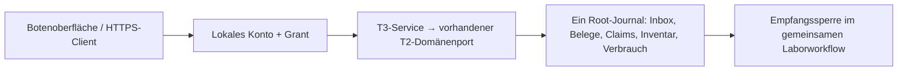

# T3: Botenoberfläche und Transport-HTTPS

T3 ergänzt den [synthetischen T2-Laborworkflow](async-lab-transport.md#t2-transport-im-gemeinsamen-synthetischen-laborworkflow)
um lokale Konten, eine Botenoberfläche und einen tatsächlich ausgeführten
HTTPS/JSON-Vertrag. Proben, Übergaben und die erfundene Beam-Ausführung bleiben
synthetisch. Anmeldung und Transportnetzwerk sind geprüft; eine reale Person,
ein Scan oder ein physischer Racktransport werden dadurch nicht nachgewiesen.

## Einstieg

Der Server benötigt Python mit `cryptography` (Version im vorhandenen
`requirements/sila2.lock`); ein SiLA-Server oder SiLA-SDK wird nicht gestartet.
Ein neues privates Verzeichnis unter `exports/` wählen:

```sh
python3 scripts/run_lab_transport_network.py --directory exports/courier-demo init --prepare-demo
python3 scripts/run_lab_transport_network.py --directory exports/courier-demo serve
```

`init` erzeugt einmalig einen neuen T3-Root, Konto- und Dienstkonfiguration sowie
ein lokales TLS-Zertifikat. `--prepare-demo` bestätigt ausdrücklich fiktive
CF01-Eingaben und führt CF01 bis zur Grenze vor NanoDrop aus. Es werden dabei
keine Transportaufträge dispatcht und keine Übergaberollen bestätigt. Ohne den
Schalter entsteht nur der frische Lauf; die Gerätevorbereitung gehört weiterhin
zum vorhandenen lokalen Workflowkern. Ein vorhandenes Verzeichnis oder Journal
wird nicht zurückgesetzt. Alte V1-/T2-Läufe werden nicht übernommen.

`serve` nennt URL, Zertifikatspfad und den Pfad zu `bootstrap.json`, aber keine
Passwörter oder Tokens. Die zufälligen Erstpasswörter aus dieser privaten Datei
lokal dem jeweiligen Testkonto zuordnen. `users.json` enthält gesalzene
PBKDF2-SHA256-Prüfwerte, Principal und ausdrückliche Grants. Die Dateien haben
Modus 0600, das Dienstverzeichnis 0700 und bleibt ignorierte Laufzeitinformation.
Zugriffsdaten gehören weder in Git noch in URL, Journal oder Fehlermeldung.

Die ausgegebene HTTPS-URL im Browser öffnen und das lokale Zertifikat bewusst
als vertrauenswürdig prüfen. Der Python-Client erhält denselben Zertifikatspfad
explizit; Zertifikats- und Hostnamenprüfung bleiben aktiv. Die Anwendung
installiert kein systemweites Vertrauen und bietet keinen unverschlüsselten
Ausweichpfad. Der Dienst lauscht ausschließlich auf `127.0.0.1` beziehungsweise
`localhost`; der tatsächliche Port wird ausgegeben.

Im Browser zunächst als `owner` anmelden und die Schreibsitzung ausdrücklich
übernehmen. An der vorbereiteten CF01-Grenze sind anschließend Gefäßliste,
Arbeitsbereich, Armfreiraum und leerer Greifer einzeln synthetisch abzugleichen.
Danach kann der Owner die angebotene Route mit neuer Jobkennung vorbereiten und
in einem eigenen Schritt dispatchen. Dispatch erzeugt keine Rollenquittung.
Die getrennten Endpunkt- und Agentenkonten bestätigen jeweils nur ihre Rolle:

| Grant | Befugnis |
|---|---|
| `owner` | Sitzung übernehmen, bereite Route vorbereiten, dispatchen, halten, abbrechen und ausdrücklich abgleichen |
| `endpoint` | Abgabe am zugeordneten Quellendpunkt oder Aufnahme am zugeordneten Zielendpunkt bestätigen |
| `agent` | Übernahme und spätere Abgabe für den zugeordneten Boten-/Roboteragenten getrennt bestätigen |
| `observer` | Status lesen; keine Wirkung auslösen |

Die zwei Seiten jeder Übergabe werden getrennt gespeichert. Erst beide
Abhol- und beide Ablieferungsbelege sowie die fachliche Vorgängerfreigabe öffnen
die Empfangsstufe. Ein Owner-Grant berechtigt nicht nebenbei zur Bestätigung
aller Übergaberollen. Nicht zuständige Konten erhalten keine fremden Jobs.
Die Botenoberfläche bedient Transporte und den engen Wiederaufnahmeabgleich;
NanoDrop-/Qubit-Messarbeit bleibt bei den vorhandenen Geräteoperationen.

Ein vollständig automatisierter **synthetischer Testtreiber** verwendet dieselben
HTTPS-Endpunkte, getrennte Konten und vier einzelne Rollenrequests je Transport:

```sh
python3 scripts/run_lab_transport_network.py --directory exports/courier-full-demo demo
python3 scripts/run_lab_transport_network.py --directory exports/courier-full-demo report
```

Auch hierfür ein neues Verzeichnis verwenden. Dieser ausdrücklich gewählte
Treiber erzeugt sämtliche Rollenbelege und führt CF01, NanoDrop und Qubit
vollständig aus; `init --prepare-demo` bereitet nur die oben beschriebene
CF01-Grenze vor. Login, Polling und Wiederverbindung bestätigen nichts.

## Ein Root, keine zweite Bilanz

`model/synthetic-lab-workflow.network.json` referenziert die unveränderte
T2-Komposition und `model/lab-transport-network.protocol.json`.
`model/lab-transport-network.schema.json` beschreibt Profil, Login, Cursor und
Requesthülle; der Loader prüft zusätzlich Quellenpins und semantische Regeln.
`NetworkWorkflow` erweitert `TransportWorkflow` um die ausdrückliche Laufart
`solidcraftbot.synthetic-lab-network-state/3`. Es gibt keine stille Migration.



Jeder Schreibrequest speichert seine Originalbytes, authentifizierten
Kontobezug, Grant, Fingerabdruck und Quittung **mit der ersten Root-Wirkung in
derselben CAS-Transaktion**. Inventar, Mengen und die Transportzustandsmaschine
werden nicht im HTTP-Server nachgebaut. Geräteoperationen und Transport teilen
weiter dieselben Claims und dieselbe Verbrauchsautorität.

## Netzwerkvertrag

| Methode und Pfad | Wirkung |
|---|---|
| `GET /api/info` | Öffentliche Dienstkennung, Lauf und Bootkennung |
| `POST /api/login` | Lokales Konto anmelden; kurzlebiges Bearer-Token erhalten |
| `POST /api/logout` | Token widerrufen; keine Workflowänderung |
| `GET /api/session` | Authentifizierte Kontokennung und Grants lesen |
| `GET /api/snapshot` | Zugelassene Jobs, Aktionen, Cursor und Abgleichbedarf lesen |
| `GET /api/requests/{request_id}` | Eigenen dauerhaften Beleg und aktuellen Status lesen |
| `POST /api/requests` | Einen ausdrücklich benannten Domänenrequest ausführen |

Login enthält genau `username`, `password`, `server_uuid`. Authentifizierte
Aufrufe tragen `Authorization: Bearer …`. Tokens gelten 900 Sekunden und liegen
nur im Arbeitsspeicher; Logout, Ablauf und Serverneustart erfordern eine neue
Anmeldung. Die Autorisierung wird unmittelbar vor dem Speichern erneut geprüft.

Die Schreibhülle enthält genau diese vier Felder, zum Beispiel nach Abruf der
aktuellen Bootkennung und Queueepoche:

```json
{
  "request_id": "Client.Request.001",
  "grant_id": "Owner",
  "operation": "prepare_route",
  "args": {
    "boot_id": "<aktuelle Bootkennung>",
    "assignment_epoch": 1,
    "route_id": "CF01ToNanoDrop",
    "job_id": "Client.ToNanoDrop.001"
  }
}
```

Der Server leitet Principal, Konto und erlaubte Ressource aus der Sitzung ab;
der Client kann sie nicht als Autoritätsfelder mitsenden. Ownerrequests
`resume`, `prepare_route`, `dispatch`, `hold`, `cancel` und `reconcile` binden
aktuelle `boot_id` und `assignment_epoch`. Die Epoche wird auch im endgültigen
Root-Vorschlag geprüft. Ein neuer Ownerwechsel zwischen Vorprüfung und Commit
macht einen alten Auftrag damit ungültig.

`attest` enthält `job_id`, `role`, `observation_id`, `assignment_epoch`,
`handover_id`, `manifest_sha256`, `observed_rack_id` und `confirmed: true`.
Hier stammen Epoche und Übergabe-ID aus dem **eingefrorenen Jobumschlag**, nicht
aus einer nachträglich aktualisierten Queue. Quelle, Ziel und Agent werden
serverseitig ergänzt. Eine berechtigte, aber widersprüchliche Rack-/Manifest-
oder Epochenbeobachtung bleibt als Konflikt beziehungsweise alter Beleg erhalten
und hält den Auftrag. Ungültige Syntax oder eine fremde Rolle bewirken nichts.

`reconcile` unterscheidet `scope: job` mit expliziter Disposition, Ort, Manifest
und Begründung von `scope: workflow`. Der zweite Fall ist nur an einer noch
nicht begonnenen manuellen Empfangsstufe nach Sitzungsneustart verfügbar:
vollständige Gefäßbeobachtungen und vier positive Einzelbestätigungen sind
erforderlich. Begonnene Gerätearbeit, offene Entnahmen, aktive CF01-Ausführungen
und widersprüchliche Transportclaims lassen sich hier nicht pauschal freigeben;
sie benötigen die vorhandenen lokalen Abgleichwege.

## Verbindungsverlust, Neustart und Konkurrenz

Vor dem ersten POST speichert der Browser die unveränderte Requesthülle mit
Dienst-, Lauf- und Kontobindung in `sessionStorage`. Passwort und Token werden
dort nicht gespeichert. Fehlt die Antwort, bleibt der Request offen. Nach
erneuter Anmeldung zuerst den Beleg abrufen; nur wenn er fehlt, dieselben Bytes
mit derselben Kennung ausdrücklich erneut senden. Der Browser führt diese
Wiederholung nicht beim Laden oder Polling von selbst aus. Fremde oder kaputte
lokale Entwürfe sperren neue Meldungen bis zur ausdrücklichen Klärung. Das
Verwerfen eines lokalen Entwurfs bricht keinen Serverauftrag ab.
Scheitert bereits der Login-Handschlag vor dem bestätigten Sitzungsabruf, wird
der unvollständige lokale Login verworfen; der offene Request bleibt erhalten.
Vor dem Bestätigen eines Belegs prüft die Oberfläche Konto, vollständigen Grant
und SHA-256 der ursprünglichen UTF-8-Requestbytes. Eine bloß gleiche Request-ID
reicht nicht. Fehlende Prüfmöglichkeit oder Widerspruch lässt den Entwurf offen.

Deduplizierung bindet Request-ID, Konto (`subject`), Grant, Principal und genaue
Originalbytes. Geänderter Inhalt oder ein anderes Konto ist ein Konflikt, auch
wenn beide Konten denselben fachlichen Principal besitzen. Eine bereits
gespeicherte passende Quittung ist nach Neustart lesend wiederholbar; sie
übernimmt keine alte Schreibsitzung. Bei konkurrierenden CAS-Vorschlägen kann
HTTP 409 zurückkommen. Beleg abrufen und gegebenenfalls **denselben** Request
wiederholen; eine neue ID oder still veränderte Epoche klärt den alten Ausgang
nicht.

Serverstart, Login und Reconnect sind zunächst lesend. Erst ein eigener
Owner-`resume` eröffnet neue Schreibwirkungen, fencet Sitzung und Queueepoche
und hält offene Jobs. Dispatchte, unklare Arbeit wird weder neu ausgeführt noch
durch Zeitablauf freigegeben. Das gilt für Boten und Robotermock gleichermaßen.

Ein optionaler `X-Lab-Cursor` enthält Base64url-kodiertes JSON mit `server_uuid`,
`run_id`, `sequence` und `sha256`. Er prüft einen bekannten Journalpräfix und
erkennt fremde Stores oder einen Rückstand hinter bereits beobachtete Ereignisse.
Unabhängige neue Root-Ereignisse entwerten keinen passenden alten Beleg. Dies
ist kein globaler Schutz gegen absichtlich geklonte Datenbanken samt Konfiguration
oder gegen getrennt schreibende Laborserver.

HTTP ist an denselben Origin gebunden, ohne Cookies, CORS-Freigabe, Redirects
oder externe Browserressourcen. Nachrichten sind begrenzt, doppelte JSON-Schlüssel
und mehrdeutige Header werden verworfen. Antworten sind `no-store`; Fehler und
Zugriffslogs enthalten keine Zugangsdaten. Die lokale Dateisperre verhindert
zwei Dienste auf demselben Dienstverzeichnis, kein verteiltes Ownerproblem.

## Prüfungen und Grenzen

```sh
python3 -m unittest discover -s tests -p 'test_lab_transport_access.py' -v
python3 -m unittest discover -s tests -p 'test_lab_transport_network*.py' -v
python3 -m unittest discover -s tests -p 'test_lab_transport_http.py' -v
python3 -m unittest discover -s tests -p 'test_lab_transport_courier_ui.py' -v
```

Die Quellen-/Schemaprüfung benötigt `jsonschema` aus dem bestehenden Testlock.
Die Browserprüfung benötigt Node, Playwright und Chromium; abweichende Pfade
lassen sich mit `SOLIDCRAFTBOT_PLAYWRIGHT` und `SOLIDCRAFTBOT_CHROME` setzen.
Fehlende Browserabhängigkeiten werden übersprungen und zählen dann nicht als
bestandener Oberflächennachweis. Die TLS-Prüfungen benötigen erlaubte lokale
Socketbindungen. Die unten genannten Läufe hatten keine übersprungenen Fälle.

Geprüft wurden 55 T3-Fälle: 14 Kern-, neun Konto-, 18 HTTP/TLS-, sieben
HTTPS-/Workflow-Abnahme-, sechs Quellen-/CLI- und ein echter Chromium-Test.
Die Browserprüfung verwendet einen kontrollierten HTTP-Fixtureserver für
Bedienung und Antwortverlust; die separate HTTPS-Abnahme verwendet den echten
Dienst und Root. Zusätzlich bestanden die 122 bisherigen T0/T1/T2-Transporttests.
Ein vollständiger frischer HTTPS-CLI-Lauf erhält zwölf Originale, 24 Buchungen,
36,5 µl bekannte Restmenge je Original und die unbekannte Menge als `null`.

Berichte unterscheiden `transport_network_executed` von
`instrument_network_executed`, `hardware_executed` und `robot_motion_executed`.
Nur tatsächlich angenommene HTTPS-Requests setzen den Transportnachweis; ein
direkter In-Prozess-Aufruf tut das nicht. Ein aktiver HTTP-Listener allein
beweist weder Übergabeabschluss noch einen erfolgreichen Laborlauf.

Geprüft sind lokale Konto-/Rollenregeln, HTTPS-Loopback und das synthetische
Modell auf macOS/POSIX mit Dateisperre. Offen bleiben Windows-Dienstbetrieb,
LAN-/Produktionsbetrieb, institutionelle Identitäten, reale Personenzuordnung,
Scans, physische Übergaben, Instrumentnetzwerk, Roboterbahnen, biologische und
Sicherheitsqualifikation. T3 ergänzt keine SiLA-FDL, keine ROS-Ausführung und
keine neue CAD-Geometrie. Die T2-Grenzen bleiben erhalten: ein Job je Route,
keine Wiederholungs-API nach abgeglichener Stornierung, keine Freigabe gehaltener
terminaler Jobs und keine Stock-/Ownerübernahme oder Föderation.
