<!-- Generated by scripts/render_model_gallery.py from docs/models/catalog.json and this template. -->

# Modellgalerie

[← Projektübersicht](../../README.md) · [Architektur und Quellen](../../ARCHITECTURE.md)

Ein Labor lässt sich aus vier getrennten Ebenen zusammensetzen. Möbel und Geräte
werden einmal konstruiert und anschließend als Varianten oder Instanzen verwendet.
Die Bilder führen von diesen Einzeldefinitionen zu konkreten Aufstellungen und Abläufen.
Auf ein Bild klicken, um es größer zu öffnen; darunter stehen Quelle und Fachdokumentation.

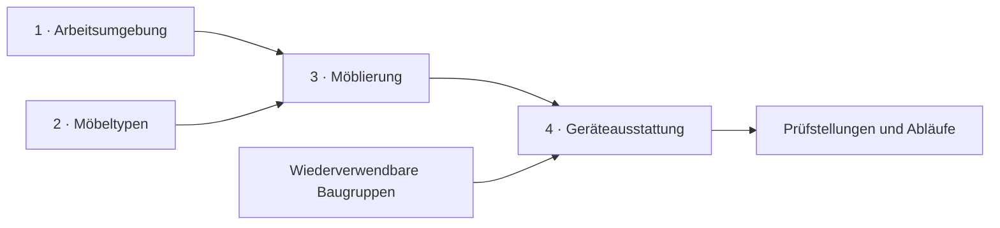

Die Galerie zeigt **Konzeptmodelle**. Ein Rendering ist keine Fertigungsfreigabe
und kein Nachweis realer Roboterfunktion. CAD-Ansichten und schematische Bilder
sind in den jeweiligen Bildunterschriften unterschieden.


<a id="umgebungen"></a>

## 1 · Arbeitsumgebungen

L01 besitzt eine vorläufige Raumgeometrie. Die synthetische Umgebung ist ausdrücklich unbegrenzt. Weitere Räume und Flure gehören zum Zielmodell der Architektur.

| Modell | Modell |
| --- | --- |
| **L01 · Raumgeometrie**<br><a href="images/l01-geometry.png"></a><br>Raumhülle, Fenster und Betonstütze. Die Maße sind vorläufig.<br>[Quelle](../../model/environments/l01.geometry.json) · [Details](../../docs/lab-room-l01.md) | **Synthetischer unbegrenzter Raum**<br><a href="images/unbounded-space.svg">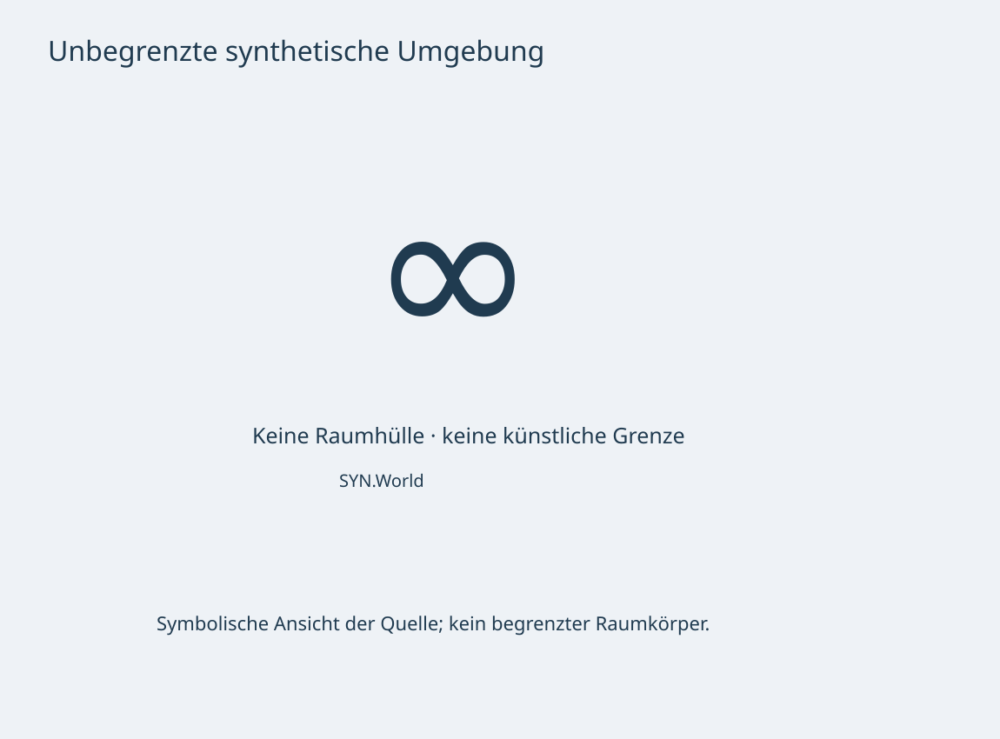</a><br>Symbolische Darstellung: Die Quelle erzeugt keinen Raumkörper und keine künstliche Raumgrenze.<br>[Quelle](../../model/environments/synthetic-unbounded.json) · [Details](../../ARCHITECTURE.md) |


<a id="moebeltypen"></a>

## 2 · Möbeltypen

Ein Typ enthält das wiederverwendbare Rezept. Die Beispiele zeigen Abmessungen und Einpassungen aus benannten L01-Instanzen; diese Instanzen sind keine zusätzlichen Möbelkonstruktionen. Die Referenzbank ergänzt den Katalog für die Minimalumgebung.

| Modell | Modell | Modell |
| --- | --- | --- |
| **Stauraumbank**<br><a href="images/furniture-storage-bench.png"></a><br>Typbeispiel aus der L01-Instanz IslandLeft. Abmessungen und Einpassung stammen aus deren Bindungen.<br>[Quelle](../../model/furniture/laboratory.catalog.json) · [Details](../../ARCHITECTURE.md) | **Offene angepasste Bank**<br><a href="images/furniture-open-shaped-bench.png">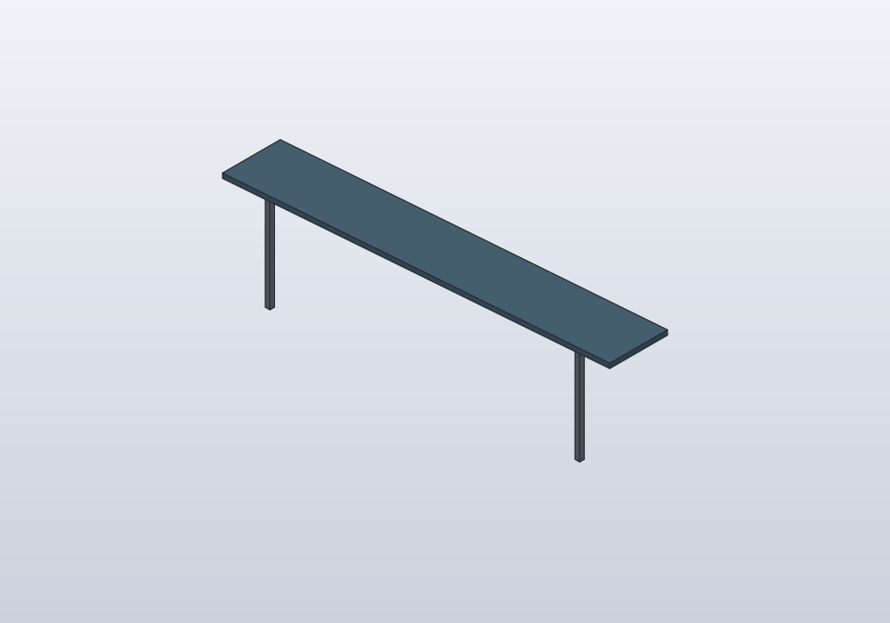</a><br>Typbeispiel aus der L01-Instanz WindowBenchLeft. Abmessungen und Einpassung stammen aus deren Bindungen.<br>[Quelle](../../model/furniture/laboratory.catalog.json) · [Details](../../ARCHITECTURE.md) | **Regalbrett**<br><a href="images/furniture-shelf-board.png">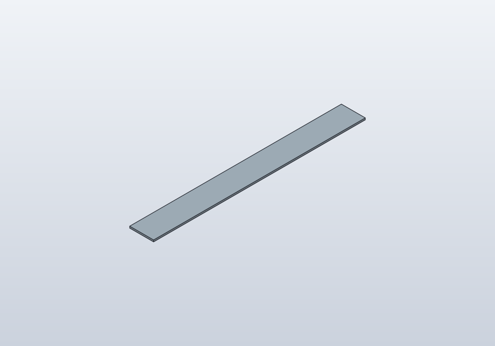</a><br>Typbeispiel aus der L01-Instanz IslandShelf_Board. Abmessungen und Einpassung stammen aus deren Bindungen.<br>[Quelle](../../model/furniture/laboratory.catalog.json) · [Details](../../ARCHITECTURE.md) |
| **Stütze**<br><a href="images/furniture-upright.png">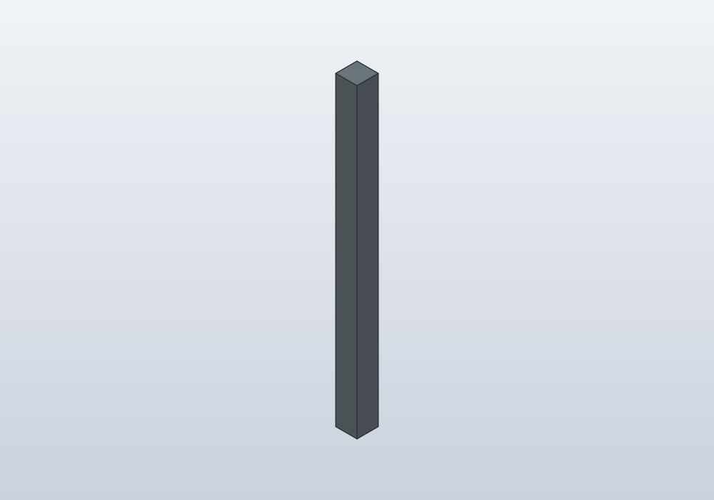</a><br>Typbeispiel aus der L01-Instanz IslandShelf_Post1. Abmessungen und Einpassung stammen aus deren Bindungen.<br>[Quelle](../../model/furniture/laboratory.catalog.json) · [Details](../../ARCHITECTURE.md) | **Schrank**<br><a href="images/furniture-cupboard.png">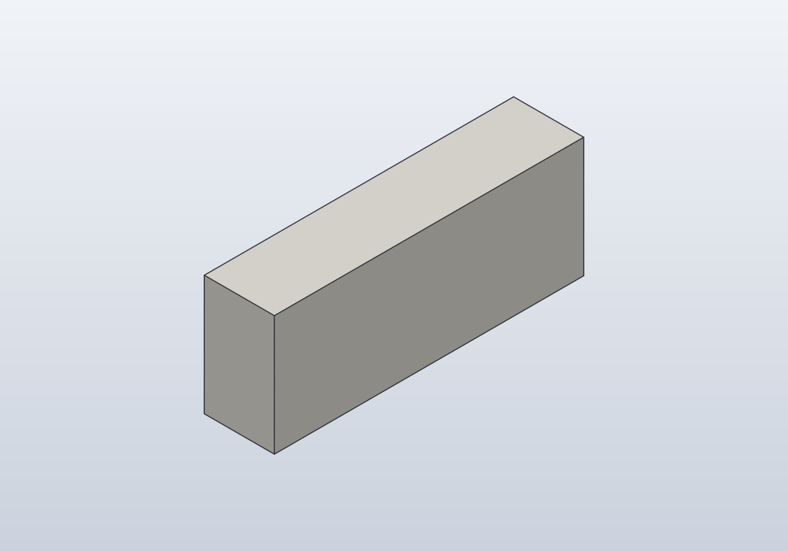</a><br>Typbeispiel aus der L01-Instanz IslandCupboard1. Abmessungen und Einpassung stammen aus deren Bindungen.<br>[Quelle](../../model/furniture/laboratory.catalog.json) · [Details](../../ARCHITECTURE.md) | **Seitliche Abdeckung**<br><a href="images/furniture-side-gap-cover.png">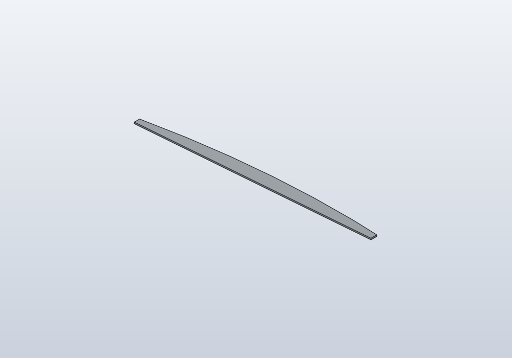</a><br>Typbeispiel aus der L01-Instanz HeatingCoverLeft. Abmessungen und Einpassung stammen aus deren Bindungen.<br>[Quelle](../../model/furniture/laboratory.catalog.json) · [Details](../../ARCHITECTURE.md) |
| **Abdeckung an der Betonstütze**<br><a href="images/furniture-support-gap-cover.png">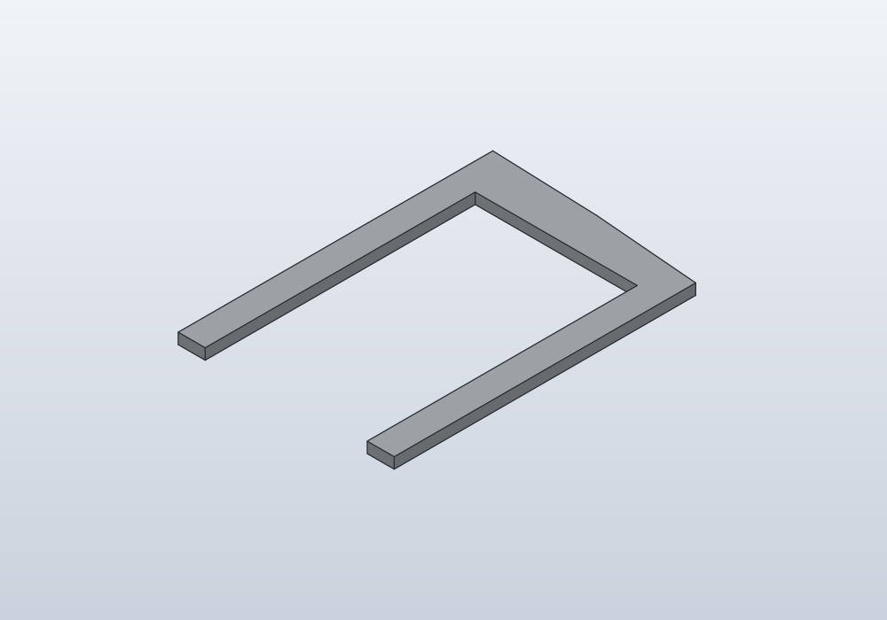</a><br>Typbeispiel aus der L01-Instanz SupportGapCover. Abmessungen und Einpassung stammen aus deren Bindungen.<br>[Quelle](../../model/furniture/laboratory.catalog.json) · [Details](../../ARCHITECTURE.md) | **Referenzbank**<br><a href="images/reference-bench.png">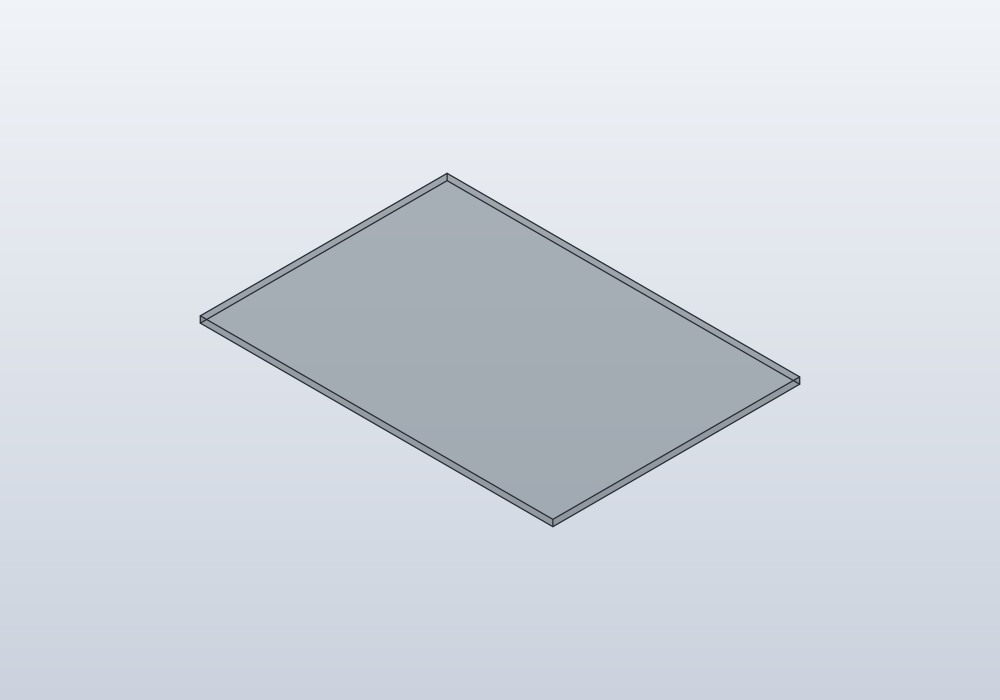</a><br>Referenzfläche der synthetischen Umgebung; keine ausgearbeitete tragende Tischkonstruktion.<br>[Quelle 1](../../model/furniture/reference-bench.catalog.json) · [Quelle 2](../../model/furnishings/cf01-reference-bench.json) · [Details](../../ARCHITECTURE.md) |  |


<a id="moeblierung"></a>

## 3 · Möblierung

Hier werden die Typen mehrfach verwendet und im Raum aufgestellt. Raumgeometrie, Katalog und Möblierung bleiben getrennte Quellen.

### L01 · Möblierung

[](images/l01-furnished.png)

Die Möbeltypen werden mehrfach aufgestellt. Die Raumkomposition bindet die Quellen zusammen.

[Quelle 1](../../model/furnishings/l01.furnishings.json) · [Quelle 2](../../model/lab-room-l01.shared.json) · [Details](../../docs/lab-room-l01.md)


<a id="ausstattung"></a>

## 4 · Geräteausstattung

Die Ausstattung referenziert Gerätequellen und ordnet ihre Instanzen an. Der aktuelle L01-Plan stammt direkt aus den heutigen Quellen; er ersetzt die inzwischen überholte ältere Gesamtansicht. Die Minimalumgebung zeigt eine native SolidCraft-Prüfstellung.

### L01 · Geräteausstattung

[](images/l01-equipment.svg)

Aktueller schematischer Aufstellungsplan. Nummern markieren Gerätebezugspunkte; die Symbole sind keine Kollisionshüllen.

[Quelle](../../model/lab-layout-l01.shared.json) · [Details](../../docs/lab-layout-l01.md)

### Minimalumgebung · Arm, CF01 und Rack

[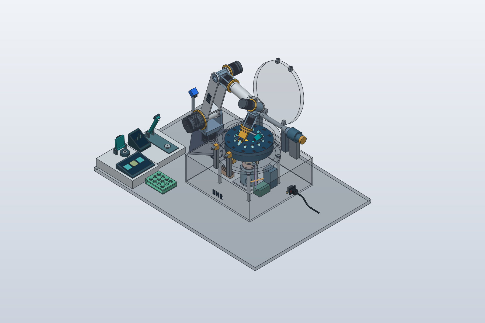](images/synthetic-workspace.png)

Referenzbank mit Arm, CF01 und Rack sowie NanoDrop/Qubit auf der Armseite. Zwei native CAD-Fassungen; statische TCP-Reichweite und Annäherungen geprüft, keine ausgelegten Messwerkzeuge oder verbindenden Roboterbahnen.

[Quelle 1](../../model/synthetic-cf01-workspace.shared.json) · [Quelle 2](../../model/equipment/cf01-workspace.json) · [Quelle 3](../../model/centrifuge-cf01.robot-pickup.shared.json) · [Quelle 4](../../model/nanodrop-concept.shared.json) · [Quelle 5](../../model/qubit-4-concept.shared.json) · [Details](../../docs/synthetic-lab-workflow.md)


<a id="baugruppen"></a>

## Wiederverwendbare Baugruppen

Diese Konstruktionen lassen sich in realen und synthetischen Aufstellungen referenzieren. Parameter und Gelenke bleiben in ihrer jeweiligen gemeinsamen Quelle.

| Modell | Modell | Modell |
| --- | --- | --- |
| **Sechsachsiger Laborarm**<br><a href="images/robot.png">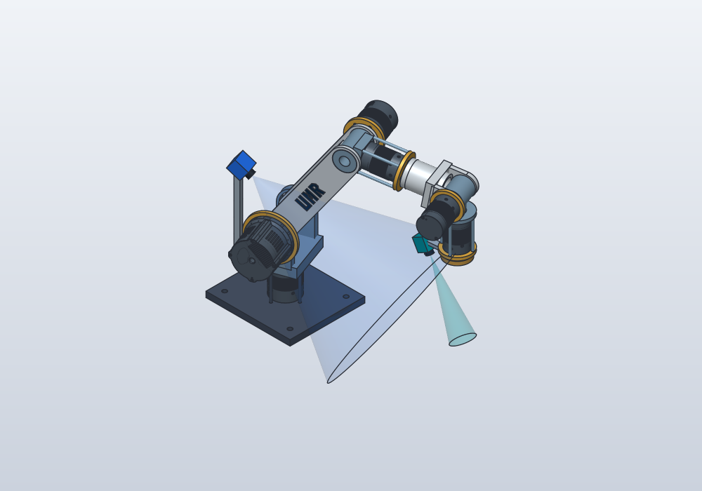</a><br>Arm mit registrierten Servos, Montageplatten und zwei provisorischen Kameras. Sichtkegel sind illustrative Modellgeometrie.<br>[Quelle](../../model/robot.json) · [Details](../../docs/design.md) | **Mobile Armbasis MB01**<br><a href="images/mobile-base.png">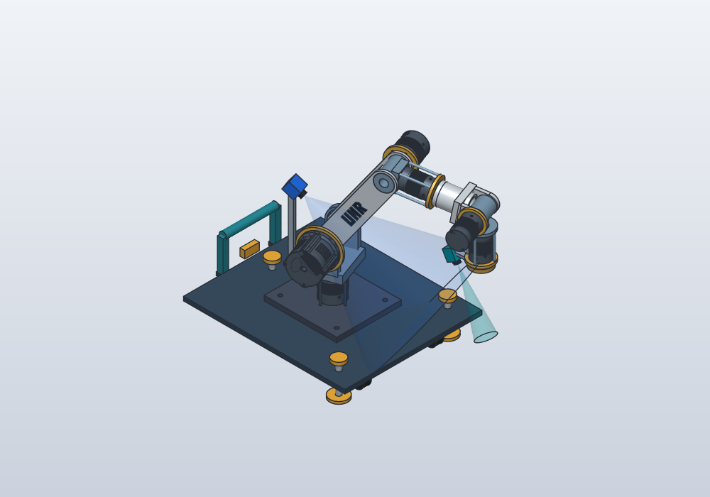</a><br>Der referenzierte Arm auf einer manuell versetzbaren, abgestützten Basis.<br>[Quelle](../../model/mobile-base-mb01.shared.json) · [Details](../../docs/mobile-base-mb01.md) | **Deckelstation C01**<br><a href="images/cap-station.png">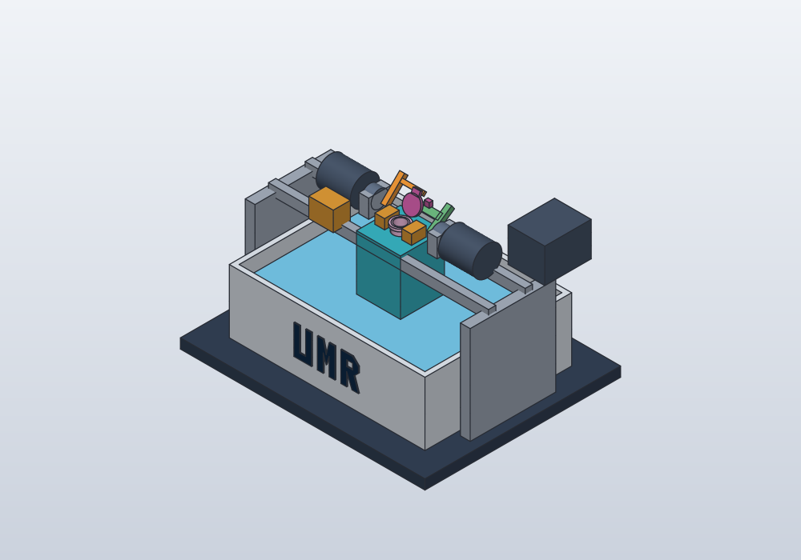</a><br>Gemeinsame Stationskonstruktion für geführte Gefäß- und Deckelhandhabung.<br>[Quelle](../../model/tube-station-c01.shared.json) · [Details](../../docs/tube-station-c01.md) |
| **Spitzenabwurf T01**<br><a href="images/tip-collector.png">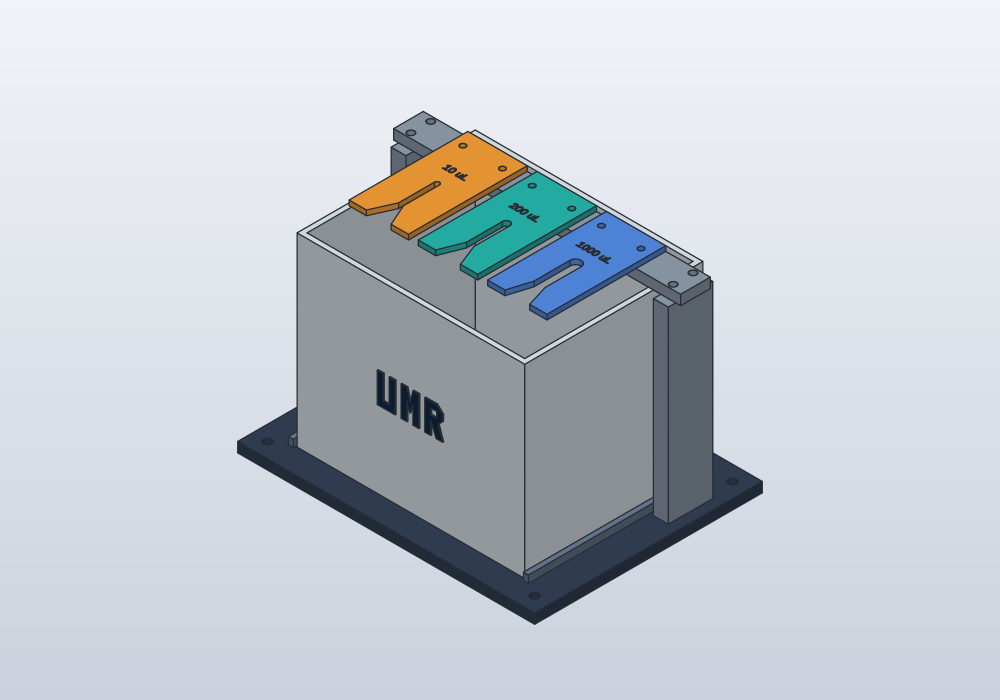</a><br>Abstreifgabel mit drei beschrifteten Nuten und Auffangbehälter.<br>[Quelle](../../model/tip-collector-t01.shared.json) · [Details](../../docs/tip-collector-t01.md) | **Zentrifuge CF01**<br><a href="images/centrifuge.png">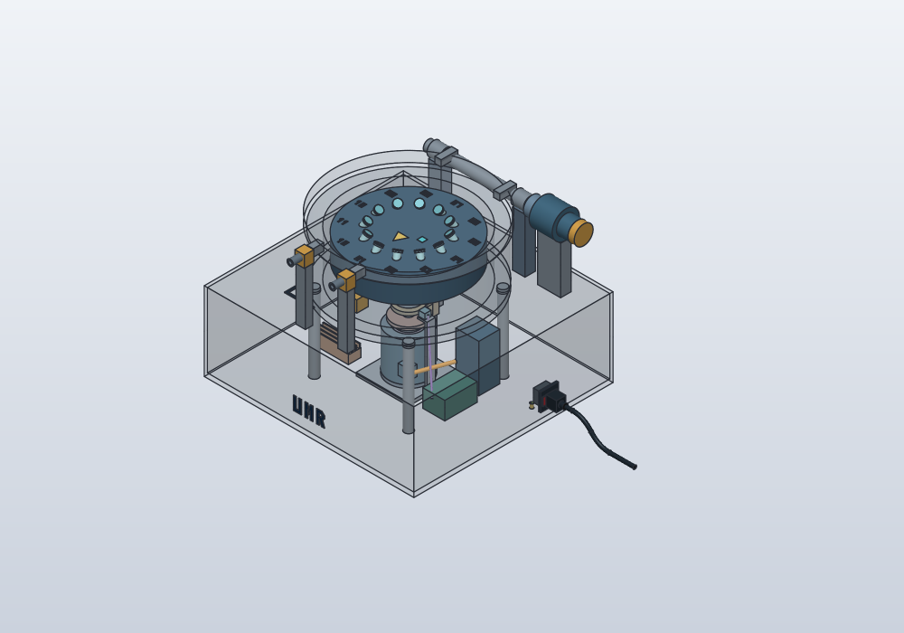</a><br>Rotor, geneigte Probenaufnahmen, Deckelmechanik und Übergabestelle.<br>[Quelle](../../model/centrifuge-cf01.shared.json) · [Details](../../docs/centrifuge-cf01.md) | **Gefäßträger H01**<br><a href="images/carrier.png">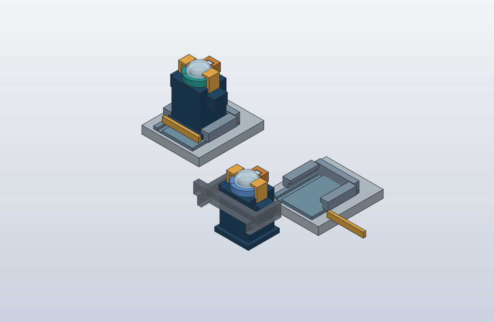</a><br>Die Varianten für 1,5 und 2,0 ml werden gemeinsam gezeigt.<br>[Quelle](../../model/tube-carrier-h01.shared.json) · [Details](../../docs/tube-carrier-h01.md) |
| **Offener Gefäßrahmen H02**<br><a href="images/frame.png">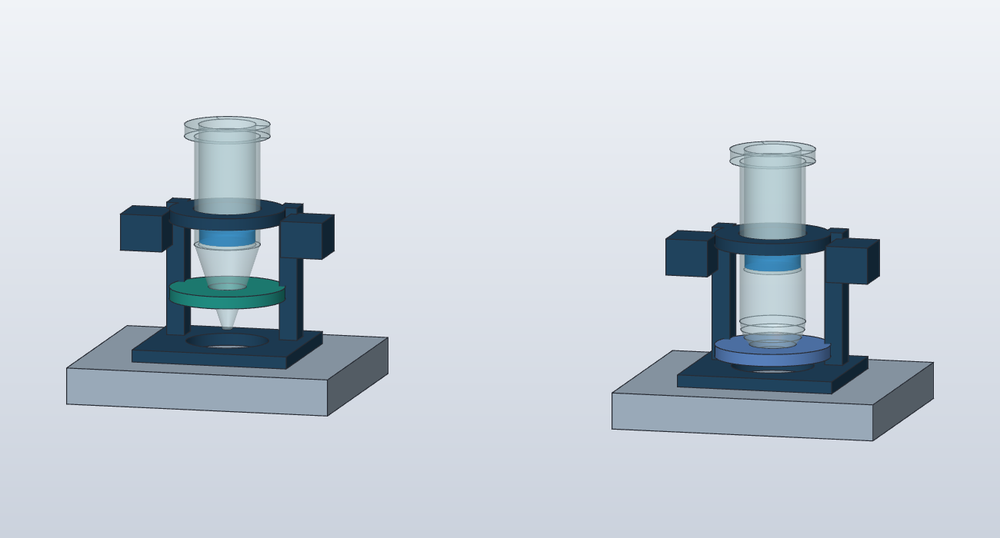</a><br>Offener Rahmen mit Sicht auf das Gefäß; Flüssigkeit ist eine illustrative Referenz.<br>[Quelle](../../model/tube-frame-h02.shared.json) · [Details](../../docs/tube-frame-h02.md) | **Kurvenantrieb H03**<br><a href="images/cam.png">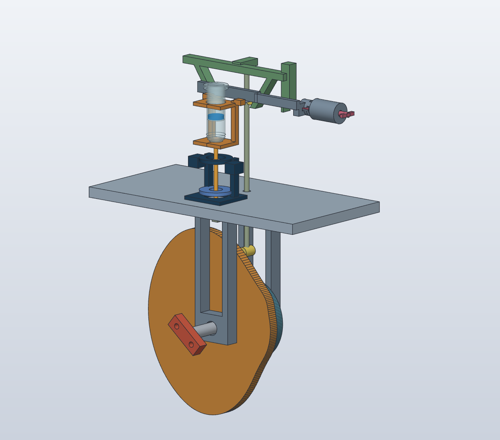</a><br>Kurven, Rollenfolger und Verriegelungsmechanik aus der gemeinsamen Quelle.<br>[Quelle](../../model/tube-cam-h03.shared.json) · [Details](../../docs/tube-cam-h03.md) | **Geführtes Probenrack**<br><a href="images/guided-rack.png">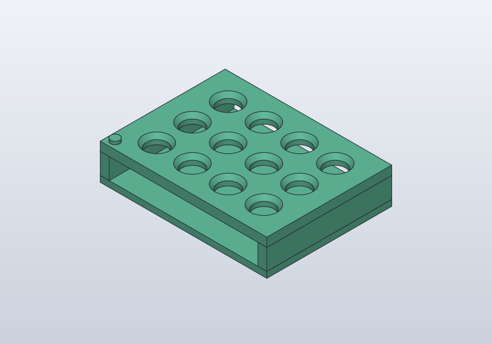</a><br>Eigenständige Rackquelle mit zwölf geführten, am Boden abgestützten Probenplätzen. Das Bild blendet Probe und Greifer aus.<br>[Quelle](../../model/guided-tube-rack.shared.json) · [Details](../../docs/centrifuge-cf01-robot-pickup.md) |
| **NanoDrop · Hebel und Tropfenmessfläche**<br><a href="images/nanodrop-concept.png">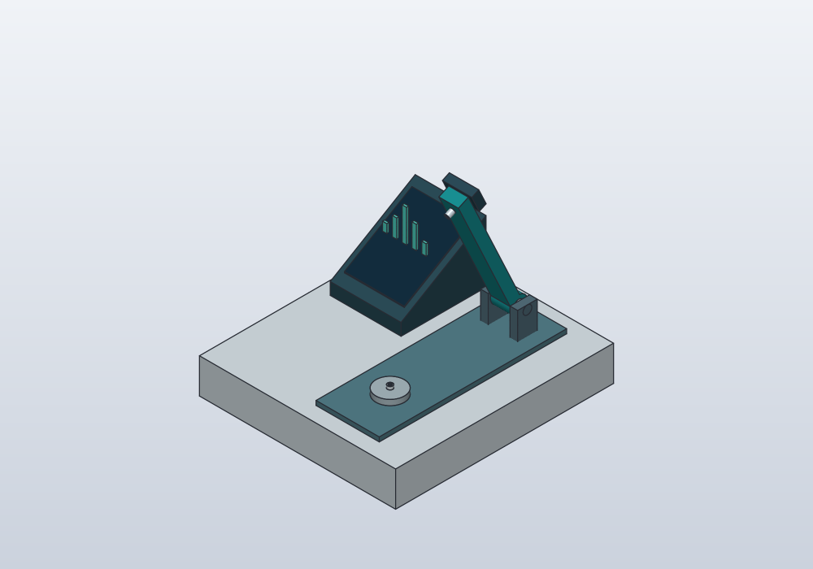</a><br>Eigenständiges Anschauungsmodell mit schwenkbarem Hebel, ebenen Messsäulen und separatem 1,5-µl-Tropfen. Maße und Optik unqualifiziert.<br>[Quelle](../../model/nanodrop-concept.shared.json) · [Details](../../docs/instrument-concepts.md) | **Qubit · Einzelröhrchenkammer**<br><a href="images/qubit-4-concept.png">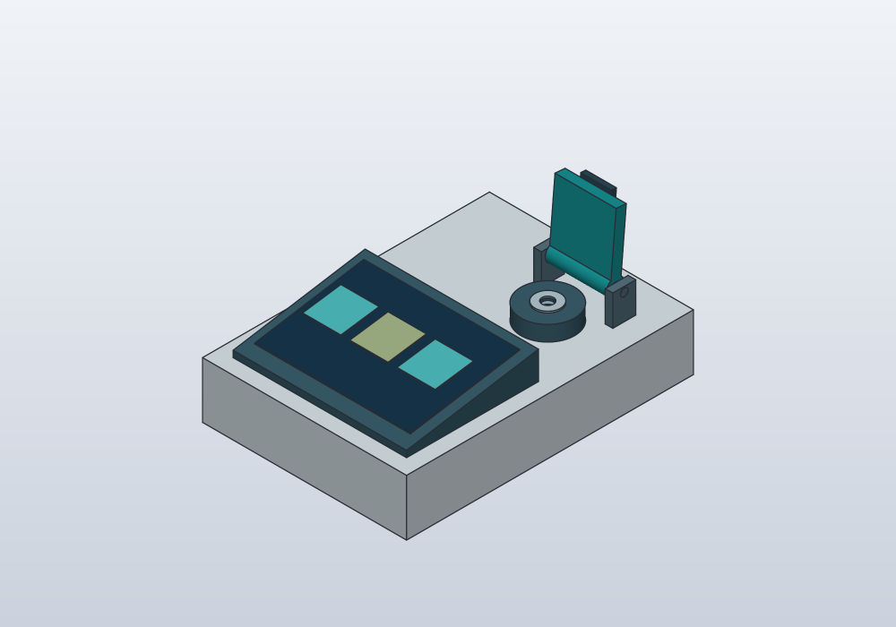</a><br>Eigenständiges Anschauungsmodell mit Display, einzelner Messkammer, Referenzröhrchen und Klappdeckel. Keine geprüfte Gerätegeometrie.<br>[Quelle](../../model/qubit-4-concept.shared.json) · [Details](../../docs/instrument-concepts.md) |  |


<a id="transport"></a>

## Benannte Transportvarianten

Drei Beladungen derselben TR01-Konstruktion. Es handelt sich nicht um drei unabhängig gepflegte Fahrzeugmodelle.

| Modell | Modell | Modell |
| --- | --- | --- |
| **TR01 · zwei Platten**<br><a href="images/transport-floor-p2.png">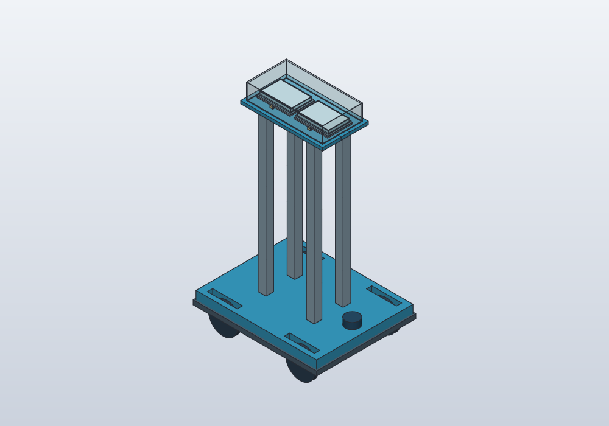</a><br>Zwei Plattenplätze. Benannte Variante derselben Konstruktion.<br>[Quelle](../../model/sample-transport-tr01.shared.json) · [Details](../../docs/sample-transport-tr01.md) | **TR01 · 48 Gefäße**<br><a href="images/transport-floor-t48.png">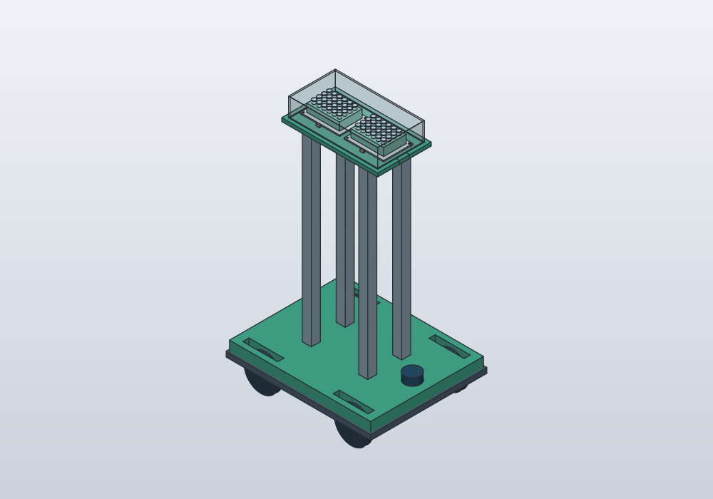</a><br>Zwei Kassetten mit jeweils 24 Gefäßen. Benannte Variante derselben Konstruktion.<br>[Quelle](../../model/sample-transport-tr01.shared.json) · [Details](../../docs/sample-transport-tr01.md) | **TR01 · gemischte Beladung**<br><a href="images/transport-floor-mixed.png">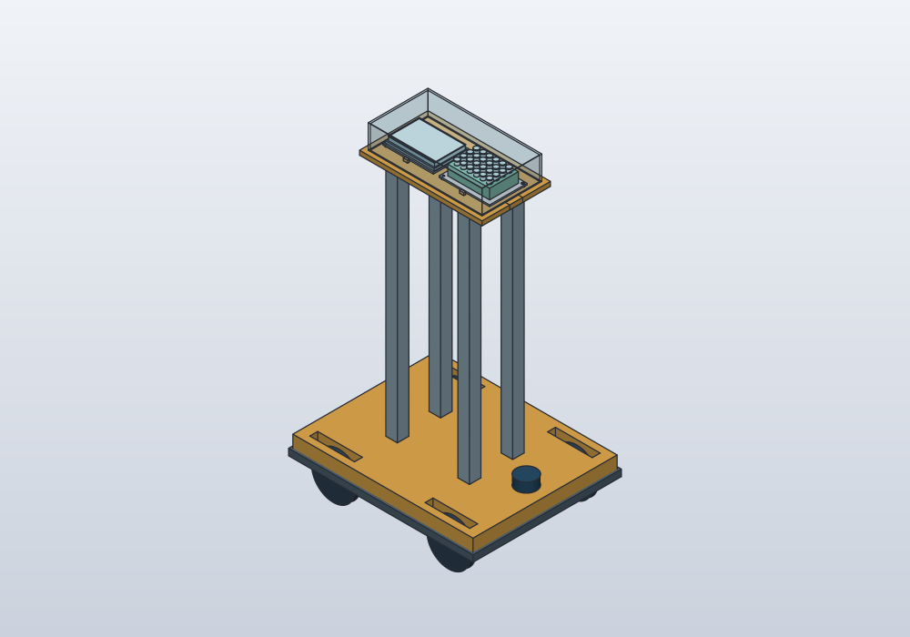</a><br>Platte und Gefäßkassette auf demselben Fahrzeugtyp. Benannte Variante derselben Konstruktion.<br>[Quelle](../../model/sample-transport-tr01.shared.json) · [Details](../../docs/sample-transport-tr01.md) |


<a id="ablaeufe"></a>

## Prüfstellungen und Abläufe

Die geometrische H03-Darstellung und das lokale CF01-Mock-Protokoll zeigen unterschiedliche Prüfebenen. Die [README-Demo](../media/README.md) ergänzt den unabhängigen 60-s-Bewegungsbaustein des Arms.

### H03 · Übergabe und Rückstellung

[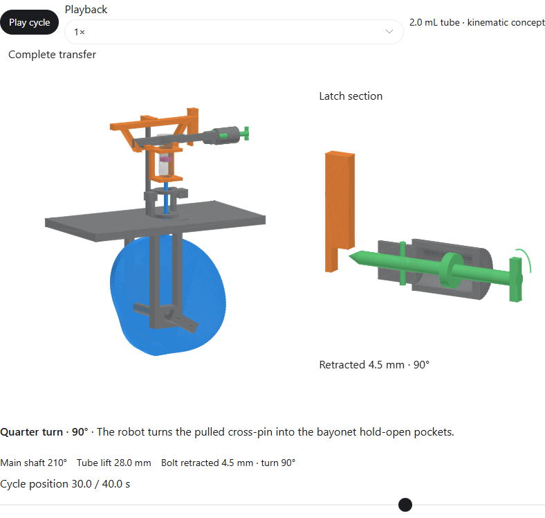](images/cam-cycle.png)

Ansicht aus der geprüften geometrischen Ablaufdarstellung. Ein erfolgreicher Modellzyklus ist kein Hardwareversuch.

[Quelle](../../model/tube-cam-h03-cycle.shared.json) · [Details](../../docs/tube-cam-h03.md)

### Rack → CF01 → ursprüngliche Rackplätze

[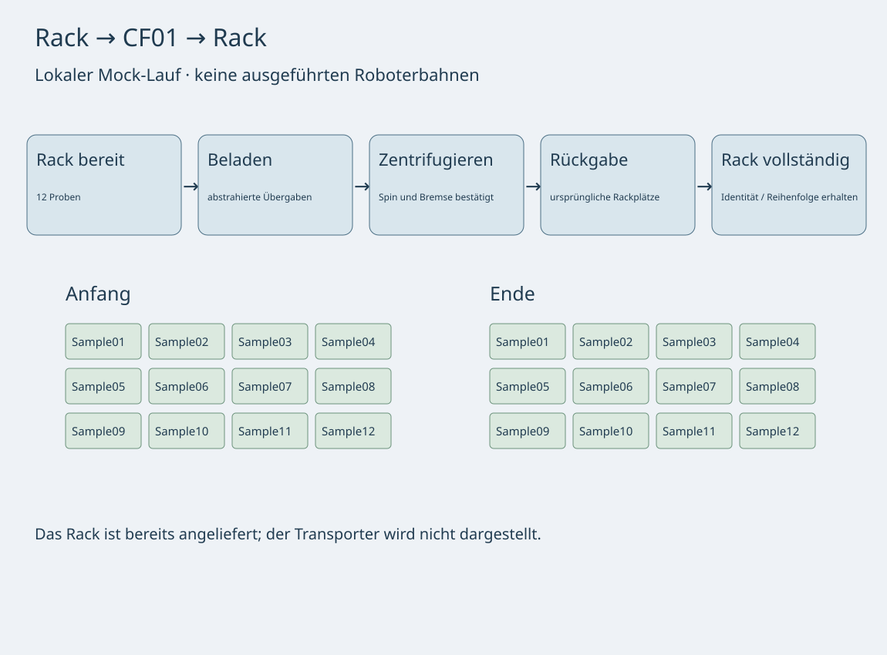](images/rack-batch.svg)

Lokaler Mock-Chargenlauf mit zwölf Proben. Alle Roboterübergaben sind abstrahiert; der Transporter ist nur Vorbedingung.

[Quelle](../../model/cf01-rack-batch.protocol.json) · [Details](../../docs/centrifuge-cf01-robot-pickup.md)

### CF01 → NanoDrop → Qubit 4

[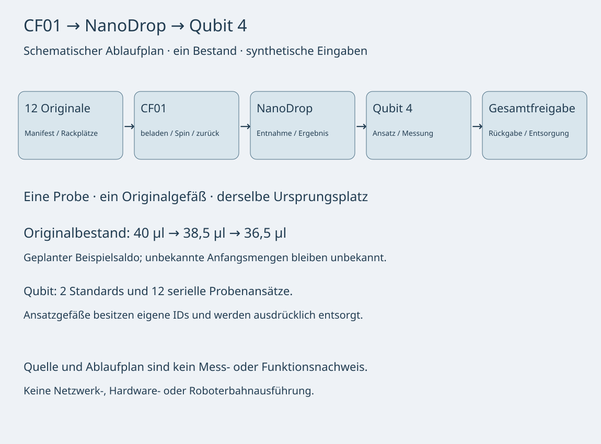](images/lab-workflow.svg)

Schematischer Plan für zwölf Originale mit einem Inventar und durchgängiger Verbrauchsbuchung. Kein Geräte- oder Funktionsnachweis.

[Quelle 1](../../model/synthetic-lab-workflow.shared.json) · [Quelle 2](../../model/synthetic-lab-workflow.manifest.json) · [Quelle 3](../../model/synthetic-lab-workflow.schema.json) · [Details](../../docs/synthetic-lab-workflow.md)


## Herkunft und Aktualisierung

Alle aktuellen Baugruppen- und Aufstellungsquellen sowie die beiden Umgebungen,
Möbelkataloge und Möblierungen besitzen eine Ansicht. Die kuratierte Auswahl liegt
vollständig im Repository; CAD-Dateien bleiben lokale Build-Ausgaben.

[Provenienz](provenance.json) führt Quell-, Modell- und Bildprüfsummen, verwendete
Prüfberichte sowie die Art der Darstellung. Bereits geprüfte Modellbilder werden
weiterverwendet, wenn ihr Modellstand passt. Bei T01 ist die unveränderte Geometrie
zusätzlich durch Gleichheit aller CAD-Befehle außer Dokumentmetadaten belegt.
Die historische Provenienz der README-Medien wird dadurch nicht umgeschrieben.
Übernommene Bauprüfungen gelten für den jeweils dokumentierten Buildstand;
die Galerie führt keine erneute vollständige CAD- oder Bewegungsprüfung aller
abgebildeten Baugruppen aus.

Auswahl, Bildunterschriften und Gruppierung werden in `catalog.json` gepflegt;
diese Seite entsteht aus der gemeinsamen Auswahl und einer Markdown-Vorlage.

Ohne CAD-Installation lässt sich die gespeicherte Galerie prüfen:

```sh
python3 scripts/render_model_gallery.py --check
```

Für neue Bilder die betroffenen lokalen Modelle zunächst aus ihren Quellen
bauen und prüfen. Anschließend mit SolidCraft CLI vom Projektstamm aus:

```sh
python3 scripts/render_model_gallery.py
```

Der Renderer nutzt die geprüften lokalen Build-Berichte und kopiert bewusst
wiederverwendete, bereits geprüfte Ansichten. Er erzeugt keine neuen führenden
Modelldefinitionen. Nach dem Lauf alle Bilder sichten und die visuelle Prüfung
in der Provenienz festhalten. Die Bildauswahl hat ein Budget von höchstens 4 MB.
