# Manueller NanoDrop-Ablauf: synthetischer erster Durchstich

Der lokale Ablauf verbindet ein bereitgestelltes Rack, eine menschliche Aufgabe,
Mikrovolumenmessungen, Dateiimport und bestätigte Rückgabe an die ursprünglichen
Rackplätze. **Alle Bedienhandlungen, Proben, Volumina, SOPs und Messdateien sind
synthetisch.** Er führt keine Geräte-, Roboter- oder Netzwerkbefehle aus.

Ein separates [NanoDrop-Anschauungsmodell](instrument-concepts.md#nanodrop-konzept)
ergänzt inzwischen Hebel und Tropfenmessfläche in FreeCAD und SolidCraft. Seine
angenommene Geometrie ist nicht an Gerätepositionen oder Laufzustände gekoppelt.

NanoDrop One und UltraC verwenden dasselbe Protokoll für die Fähigkeit
`microvolume_absorbance`. Der erste Ergebnisvertrag unterstützt die Methode
`dsDNA`. Die Küvettenfähigkeit des UltraC ist eine Katalogangabe; ein
Küvettenablauf ist damit noch nicht implementiert. Der separate
[Qubit-4-Ablauf](qubit-4-manual-workflow.md) nutzt denselben manuellen Kern.

## Quellen, Parameter und räumliche Bindung

| Datei | Verantwortung |
|---|---|
| `model/nanodrop.catalog.json` | Zwei logische Gerätetypen mit Fähigkeiten und Herstellerreferenzen |
| `model/nanodrop-manual.protocol.json` | Ein gemeinsames Protokoll und eine ausdrücklich fiktive SOP mit Revision |
| `model/nanodrop-manual.synthetic.json` | Instanzen, drei Proben, Quellenbindungen und synthetische Parameter |
| `model/nanodrop-manual.schema.json` | Formaler Vertrag des Laufprofils; der Lader prüft zusätzlich Semantik und Prüfsummen |
| `scripts/manual_tasks.py` | Transaktionales Laufprotokoll, Originalartefakte und exklusive Ressourcen |
| `scripts/manual_workflow.py` | Gemeinsame Profilbindung, Sitzung, Inventar, Verbrauch, Wiederaufnahme und Importhülle |
| `scripts/nanodrop_manual.py` | NanoDrop-Blank, Messungs-/Entnahmebestätigung und Ergebnisabgleich |
| `scripts/nanodrop_csv.py` | Eng begrenzter Offline-Berichtsadapter |
| `scripts/run_nanodrop_manual.py` | Demo, Arbeitskarte, Sitzung, Bericht und Artefaktexport |
| `scripts/manual_workflow_cli.py` | Gemeinsame CLI für NanoDrop und Qubit mit getrennten Laufarten |

Das Profil referenziert die vorhandenen Quellen für unbegrenzten Raum,
Referenzbank und Rack mit SHA-256. Es enthält keine kopierte Geometrie und keine
neuen Gerätepositionen. Der Arbeitsflächenrahmen wird gegen die Möblierung
geprüft. Eine logische NanoDrop-Instanz reserviert einen Arbeitsbereich; eine
CAD-Aufstellung oder reale Erreichbarkeit wird dadurch nicht nachgewiesen.

`sample_volume_ul` und `task_deadline_s` sind unabhängige positive, endliche
Parameter in µl beziehungsweise s. Das Beispiel verwendet **fiktive** 1,5 µl
und 3600 s. Dies sind keine empfohlenen Laborparameter. Zusätzliche oder
unimplementierte Parameter werden zurückgewiesen. Für UltraC kann ein eigenes
Laufprofil denselben Protokollverweis mit einem anderen Gerätetyp und einer
anderen synthetischen Seriennummer verwenden.

## Vollständigen synthetischen Lauf ausführen

Im Projektordner, ohne CAD oder zusätzliche Python-Pakete:

```bash
python3 scripts/run_nanodrop_manual.py demo --run-id SYN-ND-DEMO01
python3 scripts/run_nanodrop_manual.py status SYN-ND-DEMO01
python3 scripts/run_nanodrop_manual.py report SYN-ND-DEMO01
```

Die Demo liefert positive **synthetische** Beobachtungen ausdrücklich selbst,
misst drei Originalproben und erzeugt einen fiktiven CSV-Bericht in umgekehrter
Messungsreihenfolge. Die Zuordnung benutzt die Messungsnamen. Auch die positive
Ergebnisbewertung ist eine dokumentierte synthetische Entscheidung.

Standardmäßig liegen SQLite, Demo-CSV und JSON-Berichte unter
`exports/manual-workflows/`. Dieser bereits ignorierte Ordner ist Laufzeitdaten,
keine zusätzliche Modellquelle. `--store` wählt eine andere SQLite-Datei innerhalb
von `exports/`; CSV und Standardberichte liegen dann neben diesem Store im
jeweiligen Laufunterordner. Der gemeinsame Store ist für gegenseitige Reservierungen nötig.
Getrennte Datenbanken koordinieren ihre Ressourcen nicht miteinander. Qubit
verwendet denselben Standardpfad. Auch Originalgefäß-IDs sind nun reserviert,
damit unterschiedliche Rack-IDs keine gleichzeitige Doppelzuteilung erlauben.

## Zustände und Übergaben

```mermaid
flowchart LR
    R[Rack und Plätze bestätigt] --> C[Arbeitsbereich frei]
    C --> H[Person übernimmt Verantwortung]
    H --> B[Blank bestätigen]
    B --> I[Gefäß nehmen und Messabsicht speichern]
    I --> M[Entnahme, Messung und Reinigung bestätigen]
    M --> P[Gefäß am Ursprungsplatz bestätigen]
    P --> I
    P --> E[Ergebnisse importieren und zuordnen]
    E --> Q[Ergebnisse ausdrücklich bewerten]
    Q --> F[Arbeitsbereich zurückgeben und fortsetzen]
```



Verantwortlichkeit und physischer Ort sind getrennt. Die Person übernimmt das
Rack, während die Gefäße zunächst darin bleiben. Eine Position besteht aus
**Rackinstanz plus stabiler Platz-ID**; dieselbe Rackdefinition kann mehrfach
instanziiert werden. Im ersten Durchstich wird jeweils höchstens ein Original-
gefäß außerhalb des Racks gehalten.

Jedes Gefäß wird nach seiner Messung einzeln zurückgestellt, damit die nächste
Probe bearbeitet werden kann. Die Verantwortung und Reservierungen bleiben
bis zum abschließenden Abgleich und zur Freigabe bei der Person. Eine zusätzliche
Abstellfläche oder eine erfundene Roboterbahn ist dafür nicht erforderlich.

`begin_measurement` speichert eine eindeutige Entnahmeabsicht **vor** der
synthetischen Durchführung. `confirm_measurement` benennt genau diese Absicht,
die beobachtete Proben-ID, entnommenes Volumen und Reinigung. Erst diese
Bestätigung erzeugt den Aliquot-/Abstammungsdatensatz und verbucht den Verbrauch.
Eine Abweichung vom geplanten Volumen verlangt einen Grund. Ein unbekanntes
Ausgangsvolumen bleibt unbekannt; eine offene Entnahmeabsicht macht das aktuelle
Restvolumen ebenfalls ungewiss. Das Aliquot wird nach der synthetischen Reinigung
als verworfen geführt, nicht in die Originalprobe zurückgebucht.

Alle Bestätigungen tragen `synthetic_input`; sie sind weder Scan noch Sensor-
beobachtung. Akteursnamen sind lokale Testkennungen, keine Benutzeranmeldung.
Initiales und abschließendes „Arbeitsbereich frei“ sind Ablaufnachweise im Mock,
keine Schutzfunktion oder Freigabe für Mensch-Maschine-Betrieb.

## Aufgaben einzeln bedienen

```bash
python3 scripts/run_nanodrop_manual.py create --run-id SYN-ND-FIXTURE
python3 scripts/run_nanodrop_manual.py session SYN-ND-FIXTURE
```

Eine Sitzung liest je Zeile eine JSON-Bestätigung. `status` zeigt die Arbeitskarte,
`quit` beendet die Sitzung. Alternativ liest `--actions DATEI.jsonl` dieselben
Eingaben aus einer Datei. Es gibt keinen automatisch erfolgreichen Standard-
Rückkanal in den Zustandsübergängen.

Beispiel für das Anfangsinventar, dann Freigabe und Übernahme:

```json
{"command":"rack_ready","actor_id":"SYN.Operator01","data":{"observations":[{"sample_id":"Sample01","vessel_id":"Tube01","location":{"kind":"rack","rack_id":"SYN.NanoDropRack01","place_id":"CF01.OutputRack.Slot01"}},{"sample_id":"Sample02","vessel_id":"Tube02","location":{"kind":"rack","rack_id":"SYN.NanoDropRack01","place_id":"CF01.OutputRack.Slot02"}},{"sample_id":"Sample03","vessel_id":"Tube03","location":{"kind":"rack","rack_id":"SYN.NanoDropRack01","place_id":"CF01.OutputRack.Slot03"}}]}}
{"command":"workspace_clear","actor_id":"SYN.Operator01","data":{"confirmed":true}}
{"command":"claim","actor_id":"SYN.Operator01","data":{}}
{"command":"blank","actor_id":"SYN.Operator01","data":{"reference_id":"SYN.Buffer01","cleaned":true}}
{"command":"take","actor_id":"SYN.Operator01","data":{"sample_id":"Sample01","observed_sample_id":"Sample01","rack_id":"SYN.NanoDropRack01","place_id":"CF01.OutputRack.Slot01"}}
{"command":"begin_measurement","actor_id":"SYN.Operator01","data":{"sample_id":"Sample01","measurement_id":"SYN-ND-FIXTURE.A01.M001"}}
```

Die Arbeitskarte zeigt nun `pending_measurement.intent_id`. Diese Kennung
aus der Ausgabe übernehmen; sie wechselt bei einer ausdrücklich verworfenen
Absicht und verhindert die Annahme einer alten Bestätigung:

```json
{"command":"confirm_measurement","actor_id":"SYN.Operator01","data":{"intent_id":"KENNUNG_AUS_DER_ARBEITSKARTE","observed_sample_id":"Sample01","volume_ul":1.5,"cleaned":true}}
{"command":"place","actor_id":"SYN.Operator01","data":{"sample_id":"Sample01","observed_sample_id":"Sample01","rack_id":"SYN.NanoDropRack01","place_id":"CF01.OutputRack.Slot01"}}
```

Für Sample02 und Sample03 denselben Baustein mit deren Messungsnamen und Plätzen
verwenden. Danach passt die eindeutig synthetische Testdatei genau zu diesem
Laufnamen:

```json
{"command":"import_results","actor_id":"SYN.Operator01","file":"tests/fixtures/nanodrop/one-synthetic.csv"}
{"command":"review_results","actor_id":"SYN.Operator01","data":{"decision":"accepted","reason":"Explizite synthetische Testentscheidung"}}
{"command":"release","actor_id":"SYN.Operator01","data":{"workspace_clear":true}}
```

## Ergebnisvertrag und Provenienz

- Ein Lauf besitzt eine Versuchskennung `.A01` und pro Probe einen geplanten
  Messungsnamen. Genau dieser Name steht in der Spalte `Sample Name`. Zeit,
  Zeilenfolge und interne Geräte-UUIDs sind keine Ersatzschlüssel.
- Der Adapter liest UTF-8, UTF-8-BOM oder UTF-16 mit BOM und Komma, Semikolon oder
  Tabulator als Feldtrenner. Dezimalkomma wird bei Semikolon/Tabulator unterstützt.
  Konzentrationen müssen in einer `ng/µL`- beziehungsweise `ng/uL`-Spalte stehen.
  Reine Spektren-TSV, andere Einheiten oder beliebige Herstellerlayouts werden
  nicht als unterstützt ausgegeben.
- Konzentration, A260/A280, A260/A230, A260, A280, A230 und Faktor sind benannte
  Messgrößen. Nicht exportierte Zusatzgrößen bleiben `null`. Originalzellen und
  Gerätemeldungen bleiben unverändert; zusätzliche Reinheits- oder Verdünnungs-
  korrekturen werden nicht vorgenommen. Negative endliche Messwerte bleiben für
  die ausdrückliche Bewertung erhalten; NaN und Unendlich werden zurückgewiesen.
  Absorption und Verhältnisse sind dimensionslos; die Weglängennormierung bleibt
  als unbekannt gekennzeichnet. Die Einheit eines nur als `Factor` exportierten
  Faktors bleibt `null`, statt aus dem Zahlenwert abgeleitet zu werden.
- Methode und Seriennummer werden geprüft, soweit sie im Vorspann oder in
  Berichtsspalten stehen. Fehlen sie, ist ihre Herkunft die Profildeklaration;
  das gilt nicht als vom Gerät gelesene Bestätigung.
- Jeder Import archiviert die **Originalbytes** in derselben SQLite-Transaktion
  wie Ereignis und Abgleich. SHA-256, Dateiname, Bytezahl und Ergebnisursprung
  bleiben erhalten. Derselbe Dateiinhalt wird nicht doppelt verbucht.
- Fremde, fehlende, doppelte oder widersprüchliche Messungen landen im
  zurückgehaltenen Import. `discard_import` verlangt Prüfsumme und Begründung;
  auch ein verworfener Import bleibt mit Originaldatei im Verlauf. Neue Dateien
  überschreiben keine bereits akzeptierten Ergebnisse.
- Eine ausdrücklich als `synthetic_manual_entry` deklarierte, von Hand erzeugte
  Tabelle durchläuft denselben Import und Abgleich. Sie wird nicht als Geräte-
  export umetikettiert.
- Das Ende einer Messung, die fachliche Bewertung und die Rückgabe des
  Arbeitsplatzes sind getrennte Bedingungen. Erst vollständige Ergebnisse,
  angenommene Bewertung, aufgelöste Importkonflikte, alle bestätigten Ursprungs-
  plätze und erneute Arbeitsplatzfreigabe erlauben `completed`.

Mit `artifact PRÜFSUMME --out exports/.../original.csv` lassen sich die
archivierten Bytes ausgeben. `report` enthält Quellen-/Profilprüfsummen,
Inventar, Abstammung, Messgrößen, Bewertungen und den vollständigen Verlauf.

## Unterbrechung, Frist und Abbruch

SQLite speichert Ereignis, Zustand nach dem Ereignis, Dateibytes und Ressourcen-
reservierung atomar mit vollständiger Synchronisierung. Die Ereignisse werden
fortlaufend ergänzt. Die Zustandsansicht wird aus dem letzten gültigen Ereignis
gelesen; eine Prüfsummenkette erkennt versehentliche Beschädigungen, ersetzt aber
keine signierte oder gegen Datenbankmanipulation geschützte Aufzeichnung.

Der lokale Store verwendet SQLite-Rollback-Journale im Modus `DELETE` mit
`synchronous=EXTRA`. Dadurch sind keine WAL-Shared-Memory-Dateien nötig. Diese
hatten auf dem hier fast vollen Systemlaufwerk wiederholt
`SQLITE_IOERR_SHMSIZE` ausgelöst. Die Änderung betrifft die Speichertechnik;
Transaktions-, Neustart- und Ressourcentests prüfen denselben Ablauf erneut.
Die zusätzliche Verzeichnissynchronisierung ist in der
[SQLite-Dokumentation](https://www.sqlite.org/pragma.html#pragma_synchronous)
beschrieben. Volle oder fehlerhafte Datenträger können weiterhin Schreibfehler
verursachen; solche Fehler werden nicht als erfolgreiche Übergabe ausgegeben.

```bash
python3 scripts/run_nanodrop_manual.py demo --run-id SYN-ND-PAUSE01 --pause-after-intent
python3 scripts/run_nanodrop_manual.py session SYN-ND-PAUSE01
```

Die zweite Sitzung verlangt einen Abgleich. Nach einem harten Prozessabbruch
bleibt zusätzlich die alte Sitzung offen; dann ist `session LAUF --resume`
erforderlich. Eine alte Sitzung kann anschließend keine weiteren Bestätigungen
abgeben. Ein geänderter Kern-Quellstand verlangt eine bewusste Migration; ein
bereits begonnener Lauf wird damit nicht stillschweigend weitergeführt. Die
gespeicherte Laufzeitquellenliste umfasst nun auch den gemeinsamen Kern, die
CLI und Text-Codecs. Ältere offene Läufe ohne diesen Quellenvertrag benötigen
Prüfung beziehungsweise Migration; ihre alten Zustandsfelder und lesbaren
Berichte bleiben erhalten. Die deklarierte NanoDrop-Uhr wird ebenfalls geprüft.

`reconcile` braucht eine vollständige Beobachtung aller Gefäßidentitäten und
Orte sowie ausdrückliche Aussagen zu Arbeitsplatz und weiter gültigem Blank.
Ein offener Messversuch braucht zusätzlich `pending_resolution` mit derselben
`intent_id` und einem der Ausgänge:

- `performed`: beobachtete Probe, tatsächlich berichtetes Volumen und Reinigung
  bestätigen; genau diese Messung wird einmalig verbucht.
- `not_performed`: die Absicht ausdrücklich aufheben; eine spätere Durchführung
  benötigt eine neue Absicht mit neuer Kennung.
- `unknown`: den Zustand ungewiss lassen; Reservierungen und Sperre bleiben.

Ein Abgleich kann auch einen anderen tatsächlich beobachteten Rackplatz führen.
Für den Abschluss muss das Gefäß dennoch ausdrücklich zum Ursprungsplatz
zurückgebracht werden. Fehlende Gefäße oder unaufgelöste Entnahmen können nicht
mit einem pauschalen „fertig“ bestätigt werden.

Eine überschrittene Aufgabenfrist erzeugt bei der nächsten Aktion oder
`check_deadline` Klärungsbedarf. Sie gibt weder Proben noch Ressourcen frei.
Es gibt keinen Hintergrunddienst und keine Benachrichtigung. Eine Frist ersetzt
keinen Heartbeat einer Maschinensteuerung. Ereigniszeiten sind lokale Audit-
Zeitstempel; Tests können eine synthetische Uhr injizieren.

`cancel` hält ein bereits übergebenes Rack reserviert und verlangt Abgleich.
`finish_cancel` gibt erst nach bestätigter vollständiger Rückgabe und klarem
Arbeitsbereich frei. Ein abgebrochener Lauf wird nicht als erfolgreich gemeldet.

## Prüfungen und Grenzen

```bash
python3 -m unittest discover -s tests -p 'test_nanodrop_manual.py' -v
python3 -m unittest discover -s tests -v
```

Die Tests prüfen unter anderem umsortierte Messungen, falsche Identitäten und
Plätze, unbekannte Volumina, Entnahmeabweichungen, Importkonflikte, Fristen,
Ressourcenkonflikte, Transaktionsabbruch und einen tatsächlichen Prozessabbruch
mit Neustart. Die CSV-Fixtures sind in
[fixtures/nanodrop/README.md](../tests/fixtures/nanodrop/README.md) als synthetisch
belegt. Ein echter NanoDrop-Export wurde auf Eigentümerwunsch noch nicht benutzt.

Ungeprüft bleiben reale Bedienhandlungen, SOPs, Geräteexportvarianten, Mess-
leistung, Netzwerkkommunikation und Hardware. Nach jeder Entnahme ist eine
frühere Massenbestätigung überholt; eine CF01-Fortsetzung würde eine aktuelle
gemessene Gesamtgefäßmasse und die bestehenden CF01-Vorbedingungen benötigen.
Dieser Ablauf führt sie nicht aus. Geräte-CAD, Scan-Hardware und Netzwerkadapter
sind gesonderte spätere Schritte. Qubit hat einen eigenen synthetischen Ablauf;
eine automatische Verbindung beider Läufe mit gemeinsamer Volumenbilanz ist
noch nicht implementiert. Anfangsmengen bleiben Profildeklarationen.
