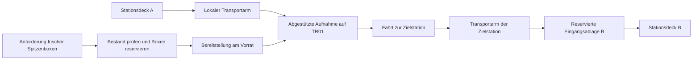

# PS01 · Rackübergabe und Spitzenbox-Nachschub

Stand: 19. November 2026. **Ursprünglicher Umsetzungsplan.**
Die umgesetzte synthetische V1-Laufzeit und ihre verbleibenden Grenzen stehen
in [PS01/TR01-Logistik](ps01-logistics.md). Die folgenden Abschnitte erhalten
den ursprünglichen Zielumfang; sie sind keine Hardwarefreigabe.
Dieser Ausbau verbindet den vorhandenen
PS01-Transportarm mit dem mobilen Transporter TR01 und ergänzt die Anforderung
frischer Spitzenboxen für 10, 200 und 1000 µl.

## Zielablauf

Der lokale Arm bewegt einen identifizierten Träger samt Rack, Well-Platte oder
Spitzenbox zwischen Deck und Übergabeplatz. TR01 übernimmt die Fahrt zur nächsten
Station. Dort nimmt der Stationsarm denselben Träger auf. Das Rack wird unterwegs
nicht umgepackt; Gefäßkennungen, lokale Rackplätze und Inhaltsrevisionen bleiben
erhalten. Eine unterstützte Übergabe auf eine feste Aufnahme genügt; eine freie
Arm-zu-Arm-Übergabe ist nicht vorgesehen.

Der Vorrat benötigt ebenfalls eine bestätigte Bereitstellung. Im ersten
synthetischen Testfall darf diese ausdrücklich eine Testperson übernehmen;
ein automatisches Lager wird dadurch nicht vorausgesetzt. Eine Anforderung
beauftragt die interne Bereitstellung, keinen Einkauf bei einem Lieferanten.

## Vorhandene Grundlagen und fehlende Bindungen

| Grundlage | Wiederverwendung | Für diesen Ausbau noch erforderlich |
|---|---|---|
| [PS01](pipetting-station-ps01.md), [LT01](../model/labware-transfer.shared.json) | Zweiter Sechsachsarm, Parallelgreifer, gemeinsame Trägerquelle | Vollständige Übergabebahnen und ausgeführte Rückmeldungen |
| [PS01-Transferaufstellung](../model/pipetting-transfer-ps01.setup.json) | `PS01.InfeedTips`, `PS01.InfeedRack`, `PS01.Outfeed` | Bindung an Fahrzeugpose, Umgebung und erreichbare Übergabegeometrie |
| [TR01](../model/sample-transport-tr01.shared.json) | Mobile Bodenplattform und referenzierte Kassettenaufnahme | Neue Aufnahmevariante für ganze LT01-Träger mit Rückhaltung |
| [Asynchroner Transport T0–T3](async-lab-transport.md) | Gemeinsamer Domänenkern, dauerhafte Jobs, vier Rollenquittungen | Versionierter Vertrag für die zusätzlichen Frachtarten und PS01-Anbindung |
| [Spitzenquelle](tip-supply.md) | Varianten, Artikelreferenzen und lokale 96er-Plätze | Bestätigter Verbrauchsmittelbestand und Anforderungsfunktion |
| [Bestandsfortsetzung](stock-continuation.md) | Geplanter gemeinsamer Stock-/Root-Vertrag | Umsetzung und ausdrückliche Erweiterung um diskrete Verbrauchsmittel |

Die PS01-Plätze liegen auf der Referenzbank; sie sind keine registrierten
TR01-Andockstellen. PS01 besitzt noch keinen vermessenen Bezug zu L01 oder einem
Gebäuderaum. Die vorhandenen [TR01-Armübergaben](tr01-workcell-animation.md)
betreffen einzelne Gefäße und belegen diesen Gesamtracktransport nicht.
[S01](synthetic-storage-s01.md) prüft einen separaten RNA-Kitträger; es ist kein
Spitzenlager. Bestehende Quellen und historische Nachweise werden nicht umgedeutet.

## Mechanische Schnittstelle und Stationen

Auf TR01 soll eine ausdrücklich neue, aus den gemeinsamen Quellen abgeleitete
Aufnahmevariante verbleiben. Der Arm entnimmt daraus den LT01-Träger samt Nutzlast.
Die vorhandenen TR01-Varianten bleiben erhalten. Dass der LT01-Träger 134 × 94 mm
und die nominale TR01-Kassette 140 × 104 mm messen, beweist keine Passung: Stifte,
Verriegelung, Greiferauflagen und Anfahrraum müssen gemeinsam konstruiert werden.

Je Station ist ein referenzierender Übergabevertrag vorzusehen:

- Stations-/Umgebungsidentität, Übergabeplatz und lokale Bezugssysteme für
  Arm, Werkzeug, Ablage und parkendes Fahrzeug einschließlich Registrierfehler.
- Unterstützte Träger-/Nutzlastvarianten, zulässige Masse, Schwerpunkt, Höhe,
  Orientierung, Rückhaltung und gegebenenfalls Probenbedingungen.
- Fahrzeugwarteplatz getrennt von Andockpose und exklusivem Übergabebereich;
  bestätigter Stillstand, Halten und gesperrte Fahrt während des Armzugriffs.
- Belegungs- und Identitätsbeobachtung an Aufnahme und Zielablage; bestätigte
  Unterstützung vor Greiferfreigabe und bestätigter freier Armraum vor Abfahrt.

Die tatsächliche Bankhöhe muss mit TR01s Deckhöhe und der Armreichweite verbunden
werden. PS01s Arbeitsflächenursprung bei Z = 0 ist keine Bodenhöhe. Ein Hubwerk
ist in TR01 nicht implementiert und darf nicht als Höhenausgleich angenommen
werden. Eine unpassende Aufstellung muss konstruktiv angepasst werden.

Die Spitzenboxhüllen sind bisher Maßannahmen; die ausgewählten Artikel sind
Reload-Trays. Reale Box, Trayaufnahme, Deckel, Verriegelung und ihre Handhabung
müssen deshalb ausgewählt beziehungsweise vermessen werden. Für die erste
Transportausführung sind geschlossene Röhrchen und verschlossene Well-Platten
vorgesehen. Die vorhandene offene Matrixplatte erhält daraus keine Fahrfreigabe.
Deckel-/Siegelhandhabung bleibt ein ausdrücklicher Prozessschritt; ein automatischer
Öffner ist bisher weder an TR01 noch für die Spitzenboxen nachgewiesen.

## Racktransport und bestätigte Übergabe

Der erste Ausbau verwendet einen Workflow-Owner und einen autoritativen Store.
Jeder Fahrjob übernimmt genau einen Träger; eine Rückfahrt ist ein eigener Job
mit den dann bestätigten Endpunkten. Mehrere unabhängige Jobs können offen sein.
Weitere Stationen werden über denselben Übergabevertrag eingebunden, sobald
Aufnahme und Reichweite geprüft sind. Eine Gerätefähigkeit wie Zentrifugieren
belegt noch keine Fähigkeit zur Annahme eines ganzen LT01-Racks.

1. **Bereitstellen und reservieren.** Station A beendet den benötigten Prozess
   und bestätigt den abgabebereiten Träger. Träger, Inhalt, Quellplatz,
   Zielablage und Fahrzeugkapazität werden atomar zugeteilt. Der Quellplatz
   bleibt entsprechend dem bestehenden Transportvertrag für eine geklärte
   Rückführung gehalten. Es gibt keine Abholung ohne reservierbares Ziel.
2. **Abholen.** TR01 hält an der registrierten Position. Arbeitsbereich,
   lokale Referenz und zugängliche Aufnahme sind bestätigt. Die Bewegungsabsicht
   wird vor dem Armauftrag gespeichert. Der Arm setzt den Träger abgestützt ab;
   Unterstützung, Identität, Rückhaltung und Freigabe werden beobachtet.
   `pickup_release` der Station und `pickup_accept` des Transporters bilden das
   vollständige Abholpaar. Erst dann ist der neue Gewahrsam bestätigt.
3. **Fahren.** Armraum und Abdeckung sind freigegeben, Nutzlast gesichert und
   Route verfügbar. Der Transport ändert keine Mengen oder Inhaltsrevisionen.
4. **Annehmen.** Station B bestätigt Empfangsbereitschaft und freien reservierten
   Platz. Nach Stillstand übernimmt ihr Arm den Träger auf die Ablage.
   `delivery_release` des Transporters und `delivery_accept` der Station bilden
   das Ablieferpaar. Erst die vollständige, kausal gültige Übernahme erlaubt
   Folgeschritte. Ein belegter Zielplatz bleibt auch nach Jobabschluss belegt.
5. **Weiterarbeiten.** Der lokale Stationsvertrag führt die Ablage zum Deck.
   Bei PS01 gelten dessen vorhandene Bedingungen: kein aktiver Flüssigkeitstransfer,
   Pipettierarm bestätigt frei und gemeinsame Zone exklusiv zugeteilt. Pipettieren
   beginnt wieder nach bestätigtem Sitz, Identifikation und Rückzug des Transportarms.

Die Übergabepaare verwenden den bestehenden Transportkern
[`async_transport_domain.py`](../scripts/async_transport_domain.py). Der bisherige
Vertrag für ein geschlossenes Rack benötigt eine additive, versionierte Erweiterung
für Trägerhierarchie, Well-Platten und Spitzenboxen. Eine Verbrauchsmittelbox wird
nicht als Probengefäß ausgegeben. Ihr Manifest referenziert den führenden Bestand;
es ist keine zweite beschreibbare Inventarliste.

Claim, Fahrzeugankunft und Quittung ersetzen keine Orts- oder Griffbeobachtung.
Principal, ausführender Agent, Workflow-Verantwortung und physischer Gewahrsam
bleiben getrennt. Bei unvollständigen oder widersprüchlichen Belegen bleibt die
Übergabe ungeklärt; der Folgeprozess und die betroffenen Ressourcen bleiben gesperrt.

## Frische Spitzenboxen anfordern

Die erste Anforderungsfunktion soll gezielt **eine Anzahl frischer Boxen einer
Spitzenvariante** an einen benannten Stationseingang liefern lassen. Der
Protokollplaner kann zusätzlich den Bedarf in einzelnen Spitzen melden. Eine
Box bedeutet hier eine identifizierte, einsatzbereite Aufnahme mit einem
96er-Tray, nicht die Lieferverpackung mit mehreren Reload-Trays.

| Bindung einer Anforderung | Geplanter Inhalt |
|---|---|
| Identität | Eindeutige Request-ID, Fingerabdruck, Owner, Station und optionaler Protokoll-/Schrittbezug |
| Artikel | Referenz auf `tip_10_ul`, `tip_200_ul` oder `tip_1000_ul` der bestehenden Quelle, mit Revision |
| Menge | Positive ganze Boxenzahl; Einzelspitzenbedarf und Reservepolitik bei abgeleiteter Anforderung separat |
| Qualität | Bestätigte volle Belegung mit 96 unbenutzten Spitzen, passende Box-/Tray-/Werkzeugvariante und geforderter Reinheitsstatus |
| Lieferung | Reservierbarer Eingang, Priorität, benötigter Zeitpunkt und Grund |

Dies sind geplante Vertragsinhalte, keine heute verfügbaren API-Felder. Die
ausgewählten PCR-clean-Referenzen werden nicht pauschal als steril bezeichnet.
Andere Artikel oder Größen ersetzen eine Anforderung nicht automatisch.

Der Ablauf lautet: **anfordern → Bestand und Ziel prüfen → konkrete Boxen
reservieren → Transport beauftragen → Empfang prüfen → lokal bereitstellen**.
Bei fehlendem Bestand oder belegtem Eingang wartet die Anforderung mit benanntem
Grund. Transportfortschritt wird aus den bestehenden Jobs abgeleitet; für Nachschub
entsteht keine zweite Transportzustandsmaschine.

Der Bestand führt Box-/Trayidentität, Variante und die konkreten lokalen Plätze.
Verfügbar sind nur bestätigte, kompatible, unbenutzte und nicht anderweitig
reservierte Spitzen. Unbekannte Belegung gilt nicht als voll oder leer.
Angeforderte oder unterwegs befindliche Boxen decken bereits zugeteilten Bedarf
für die Vermeidung doppelter Anforderungen, sind aber noch kein pipettierbarer
Stationsbestand. Erst bestätigter Empfang und anschließende lokale Bereitstellung
erlauben die Nutzung. Eine am Vorrat bereits eingebuchte Box wechselt ihren Ort;
die Annahme erzeugt weder erneut 96 Spitzen noch neue Identitäten.

Die gleiche Request-ID mit identischem Inhalt liefert denselben Auftrag;
abweichender Inhalt ist ein Konflikt. Änderungen oder Stornierung nach Dispatch
verlangen einen geklärten Ausgang. Leere, teilweise verbrauchte oder kontaminierte
Boxen werden mit ihrer tatsächlichen Belegung zurückgeführt und nicht als neue
volle Boxen gezählt. Bestätigte unbenutzte Restspitzen bleiben gemäß ihrer
Eignung im Bestand erhalten. Ein Boxwechsel benötigt auch einen freien Ausgabepfad für die
alte Box; Rücktransport und Anlieferung werden entsprechend angeordnet.

### Beispiel am vorhandenen 96-Well-Protokoll

Ein Matrixlauf benötigt 28 Spitzen à 10 µl und 240 Spitzen à 200 µl. Die folgende
Bedarfsrechnung zeigt einen **hypothetischen zweiten Lauf**, falls die im aktuellen
Plan errechneten Reste zuvor tatsächlich bestätigt wurden. Sie behauptet keinen
ausgeführten Verbrauch oder realen Lagerbestand; Sicherheitsreserve und andere
Reservierungen sind in diesem Beispiel null.

| Klasse | Bestätigter Rest, hier angenommen | Bedarf | Fehlende Spitzen | Neue volle 96er-Boxen |
|---|---:|---:|---:|---:|
| 10 µl | 68 | 28 | 0 | 0 |
| 200 µl | 48 | 240 | 192 | 2 |
| 1000 µl | 96 | 0 | 0 | 0 |

Die vorhandene `Carrier.ReserveTips200` ist nur ein synthetisches Transferobjekt.
Sie darf den Fehlbedarf erst nach bestätigter Bestandsaufnahme und geeigneter
Zuordnung reduzieren. Eine spätere automatische Bedarfsanforderung benötigt
einen Compilerbericht über Bedarf und Verfügbarkeit, bevor Spitzenmangel den
Ausführungsplan sperrt. Der heutige Compiler reserviert oder bestellt nichts.
Die zwei Boxen werden nacheinander über den einzelnen Eingang bereitgestellt;
der zweite Transport wartet, bis dessen Belegung und erforderliche Deckplätze
geklärt sind. Die Station hält keine Probe in einem Greifer, während sie auf
unbekannten Nachschub wartet.

## Dauerhafter Zustand und Wiederaufnahme

Jobs, Anforderung, Inbox/Outbox, Reservierungen, Belegung und Verbrauch gehören
in denselben Root des vorhandenen Journals. Effekte werden erst nach dem
erfolgreichen Commit dispatcht. Datenbanksperren werden nicht über Fahrt oder
Wartebedingungen gehalten. Sämtliche lokalen Pipettier-/Transferoperationen
müssen die Transport-Unterclaims für Träger und Inhalt beachten.

Der erste synthetische Lauf nimmt seine eindeutig identifizierten Vorratsboxen
einmalig in diesen Root auf und führt sie bei Wiederaufnahme fort. Laufübergreifender
Nachschub erfordert den noch zu implementierenden [Stockvertrag](stock-continuation.md)
samt Verbrauchsmittelerweiterung: Root-/Stockbuchung, Bestandskopf und Ressourcen
atomar, mit Versionsprüfung und persistenten, gegen veraltete Schreiber gesicherten
Leases. Keine separate Spitzen-Datenbank und kein Auffüllen durch Profilneustart.
Mehrere unabhängige Stores oder Ownerwechsel sind nicht Teil des ersten Ausbaus.

Neustart, Zeitablauf, Netzwerkverlust oder eine fehlende Quittung belegen keine
Durchführung oder Freigabe. Dispatchte unklare Effekte werden nicht automatisch
wiederholt. Ein expliziter Abgleich benötigt tatsächliche Identitäts-, Orts- und
Belegungsbeobachtungen; er rekonstruiert keine erfundenen historischen Quittungen.
Späte Konflikte müssen auch abhängige Folgeaufträge sperren. Laufzeitdaten bleiben
außerhalb von `model/`; bestehende Journale erhalten keine stille Migration.

## Umsetzungsschritte und Abnahme

1. **Gemeinsamer Vertrag und Planung.** Frachtarten, Aufnahmevariante,
   Stationsreferenzen und Nachschubanforderung versionieren; bestehende PS01-,
   LT01-, TR01- und Spitzenquellen referenzieren. Bedarf von tatsächlich verfügbarer
   Belegung trennen. Abnahme: ein Rackauftrag und Anforderungen aller drei
   Spitzenklassen, mit belegtem Ziel, Artikelkonflikt und Fehlbestand als Gegenfällen.
2. **Aufnahme und Übergabegeometrie.** Reale Box-/Deckelmaße ergänzen, LT01-Aufnahme
   und TR01-Adapter aus gemeinsamer Quelle direkt in beiden CAD-Zielen ableiten.
   Quelle, Fahrzeug und Zielstation registrieren. Abnahme: Greiffreiheit,
   Unterstützung, Rückhaltung, Nachbarlasten, Deckel und erreichbare Armstellungen
   für jede Frachtvariante; statische Befunde ausdrücklich von Bahnen trennen.
3. **Synthetische Laufzeitanbindung.** Vorhandenen Transportkern und Journal
   verwenden; Nachschub und lokalen Deckwechsel im selben Owner ausführen.
   Abnahme: unveränderte Rack-/Gefäß-/Platzidentitäten bei Hin- und Rückfahrt;
   keine doppelte Spitzenbuchung; doppelte Requests, parallele Reservierungen,
   falsche Box, Teilbelegung, fehlende Belege und Abbruch/Neustart an jeder
   Übergabegrenze. Veraltete Sitzung und Schreibkonflikte dürfen keine Teilwirkung
   oder Freigabe hinterlassen. Mock-Fahrzeit ist kein Bewegungsnachweis.
4. **Durchgehende Bewegung und Demonstration.** Gesamte Entnahme, Übernahme,
   Fahrt und Ablage mit tatsächlicher Geometrie prüfen. Gemeinsame PVA-/FK-
   Mathematik verwenden; Selbstkollision, Nachbarobjekte und vollständige Last
   samt Orientierung in beiden CAD-Modellen sowie zwischen Knoten und nach Export
   prüfen. Leere und beladene Profile getrennt begründen, Geschwindigkeit,
   Beschleunigung und Ruck begrenzen. Halte nur für Griff, Ablage und ausdrücklich
   benötigte Rückmeldung; Durchgangsmarken erzwingen keinen Halt. Die Bewegung
   soll schneller als die vergleichbare manuelle Aufgabe sein. Modellzeit,
   Wiedergabefaktor und gemessenen menschlichen Vergleich getrennt ausweisen;
   ohne Vergleich bleibt dieses Akzeptanzziel offen.

Eine spätere Netzwerkbindung kann auf T3 aufbauen; sie ersetzt keine
Stationsbeobachtung oder Motorsteuerung. Hardware, Tragfähigkeit, reale
Liquidretention und Schutzfunktionen benötigen eigene Nachweise. Dieser Plan
ändert weder native Modelle noch Runtime-Verträge oder deren Prüfstatus.
