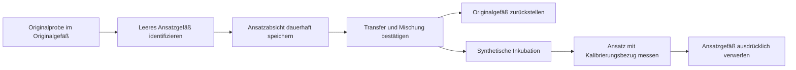

# Qubit 4: synthetischer manueller Ablauf

Der Ablauf verbindet Originalproben, identifizierte Standard- und Ansatzgefäße,
eine laufbezogene Kalibrierung, Messungsbestätigungen und einen Dateiimport.
**SOP, Assay, Chargen, Mengen, Zeiten und Ergebnisse sind vollständig fiktiv.**
Es wird weder ein Qubit noch ein Netzwerkadapter angesprochen. Die ausdrücklich
synthetische CSV ist kein qualifizierter nativer Qubit-Export.

## Einstieg

```bash
python3 scripts/run_qubit_manual.py demo --run-id SYN-QB-DEMO01
python3 scripts/run_qubit_manual.py status SYN-QB-DEMO01
python3 scripts/run_qubit_manual.py report SYN-QB-DEMO01
```

Die Demo führt zwei Standard- und drei Probenmessungen aus. Alle Originalgefäße
kehren an ihre ursprünglichen Rackplätze zurück. Jedes Standard- und Ansatz-
gefäß wird einzeln als verworfen bestätigt. Erst danach, nach vollständigem
Ergebnisabgleich und einer ausdrücklichen synthetischen Bewertung, wird der
Arbeitsplatz freigegeben. Ein Aliquot ist ein Transferdatensatz, kein zusätzlich
erfundenes physisches Gefäß.

Beide Instrumentabläufe verwenden standardmäßig denselben bestehenden Store
`exports/manual-workflows/nanodrop.sqlite3`. Der historische Dateiname bleibt
erhalten; eine Datenbank wird nicht automatisch verschoben. `--store` wählt eine
andere Datei innerhalb von `exports/`. Nur Läufe im selben Store koordinieren
ihre Reservierungen. CSV und Standardberichte liegen im Laufunterordner neben
dem Store. Sämtliche Laufzeitdaten bleiben über die bestehende Regel ignoriert.

## Gemeinsamer Kern und führende Quellen

| Quelle oder Modul | Verantwortung |
|---|---|
| `model/qubit-4.catalog.json` | Logischer Qubit-4-Typ mit Fähigkeit `fluorometric_assay` |
| `model/qubit-4-manual.protocol.json` | Ein fiktives Assay, seine Standards, Parameterverträge und synthetische SOP |
| `model/qubit-4-manual.synthetic.json` | Geräteinstanz, Quellenpins, Originalproben, Chargen und logische Gefäßplätze |
| `model/qubit-4-manual.schema.json` | Formaler Profilvertrag; zusätzliche semantische Prüfungen im Lader |
| `scripts/manual_tasks.py` | Transaktionales SQLite-Journal, Originalbytes und Ressourcenbesitz |
| `scripts/manual_workflow.py` | Gemeinsame Sitzung, Profilbindung, Inventar, Verbrauch, Wiederaufnahme, Importhülle und Freigabe |
| `scripts/manual_workflow_cli.py` | Gemeinsame Arbeitskarte, JSONL-Sitzung, Berichts- und Artefaktausgabe |
| `scripts/manual_results.py` | Numerische und Text-Codecs, keine gemeinsame Instrument-CSV-Grammatik |
| `scripts/qubit_manual.py`, `scripts/qubit_csv.py` | Qubit-spezifische Ansatz-, Kalibrierungs-, Messungs- und Ergebnisverträge |

Die vorhandenen Raum-, Bank- und Rackquellen werden mit Prüfsummen referenziert.
Das Beispiel nutzt dasselbe Originalrack und dieselbe Referenzarbeitsfläche wie
das NanoDrop-Profil. Deren bestehende Instanzkennungen bleiben erhalten.
Ansatz- und Standardplätze sind ausdrücklich logische Identitätsorte mit
`holder_id` und `place_id`; sie besitzen keine CAD-Geometrie und belegen keine
reale mechanische Eignung des Racks oder Geräts.

Qubit besitzt den Zustandstyp `qubit-manual-state/1`. NanoDrop behält
`nanodrop-manual-state/1` und seine Befehle. Beide Runner prüfen die Laufart auch
beim Lesen, Wiederaufnehmen und Ausführen; ein fremder Lauf wird zurückgewiesen.

## Ansatzbildung und Inventar



`begin_preparation` nennt Zielprobe beziehungsweise Standard, ein bereits
identifiziertes leeres Gefäß und seinen deklarierten logischen Platz. Der
Gefäßeintrag entsteht **bei der Absicht**, mit ungewissem Inhalt. So kann das
Gefäß nach einem Prozessabbruch im Abgleich beobachtet werden.

`confirm_preparation` bestätigt genau diese Absicht, Gefäßidentität, Quelle,
übertragenes Volumen, Gesamtvolumen und Mischung. Ein Transfer verbindet Quelle
und Zielgefäß. Nur bei einer Originalprobe wird deren Restvolumen einmalig
vermindert und eine frühere Massenbestätigung ungültig. Standardstocks sind
deklarierte Reagenzreferenzen; ihre Vorratsmengen werden nicht bilanziert.

Mengenabweichungen erfordern einen Grund. Eine unbekannte Anfangsmenge bleibt
unbekannt. `initial_volume_source` kennzeichnet die Anfangsmenge ausdrücklich
als Profildeklaration: Es gibt noch **kein laufübergreifendes Volumenbuch**.
Ein späterer neuer Lauf übernimmt Restvolumina nicht automatisch aus einem
früheren NanoDrop- oder Qubit-Lauf.

Der gemeinsame Kern reserviert neben Rack, Gerät und Arbeitsbereich auch die
Originalgefäß-IDs. Dasselbe Gefäß kann deshalb nicht durch eine andere Rack-ID
parallel einem zweiten Lauf zugeteilt werden. Neue Ansatz- und Standardgefäße
werden ebenfalls reserviert. Verantwortung und physischer Ort bleiben getrennt.
Ein beobachtetes handgehaltenes Ansatz- oder Standardgefäß verhindert die
Entnahme eines weiteren Gefäßes aus dem Originalrack.

## Synthetische Zeit und Kalibrierung

Die Qubit-Prozesszeit liegt als `logical_time_s` im Lauf. Ausschließlich
`advance_time` mit einer positiven endlichen Dauer verändert sie und schreibt
dabei ein Ereignis. `clock_mode: synthetic_events/1` ist an den Lauf gebunden;
ein Öffnen mit einem anderen Modus wird abgelehnt. Ein Neustart ersetzt diese
Zeit nicht durch `time.time`. Die Journalzeit ist davon getrennte Auditzeit.

Inkubation beginnt bei der Mischungsbestätigung (`incubation_basis:
confirmation_event`). Ein Minimum und ein gegebenenfalls deklariertes Maximum
werden geprüft. Die wirkliche physische Mischungszeit bleibt `null`; für einen
realen Ablauf wäre das Minimum ab Bestätigung konservativ, ein tatsächliches
Höchstfenster damit aber noch nicht nachgewiesen. Die Aufgabenfrist muss bereits
im Profil die Standard- und Probeninkubation abdecken. Ein Fristablauf gibt
keine Ressourcen frei und führt nicht zu automatischer Wiederholung.

Standards werden wie Ansätze über identifizierte Gefäße vorbereitet, inkubiert
und gemessen. Anschließend bestätigt `approve_calibration` ausdrücklich:

- Geräteinstanz und deklarierte Seriennummer;
- Assay-ID und Revision sowie Kit- und Standardcharge;
- vollständige Zuordnung jeder Standard-ID zu ihrer Messungs-ID;
- synthetische Freigabe mit Begründung.

Es wird genau eine Kalibrierung innerhalb des Laufs freigegeben. Ihre Gültigkeit
beginnt mit dem letzten bestätigten Standardmesszeitpunkt; ein späterer Klick
verlängert sie nicht. Eine Kalibrierkurve wird nicht berechnet. Der abschließende
Import muss auch die zugeordneten Standardmessungen enthalten.

Jede Probenmessabsicht friert `preparation_id`, `calibration_id` und den
Kalibrierungsbezug mit `binding_source: workflow_record` ein. Dieser Bezug ist
eine Aussage des Ablaufs, **keine vom Gerät gelesene Kalibrierungs-ID**. Eine
außerhalb des Ablaufs erfolgte Neukalibrierung wäre nicht erkennbar.

Ein nicht passender, nicht freigegebener oder abgelaufener Bezug verhindert
neue Probenmessungen. Läuft die Gültigkeit zwischen Messabsicht und Bestätigung
ab, wird die bestätigte Durchführung trotzdem mit Ungültigkeitsgrund gespeichert.
Sie erlaubt keine Ergebnisannahme oder Freigabe. Bereits zuvor gültig beendete
Messungen bleiben historisch gültig, wenn die Kalibrierung erst danach abläuft.

## Dateiimport und Ergebnisbasis

Der interne Testvertrag beginnt mit
`Format,solidcraftbot.synthetic-qubit-report/1`. Er kennt Standard- und Proben-
zeilen, laufbezogene `Measurement ID`, Ansatzkonzentration und ausdrückliche
Einheiten. Optionale Felder liefern Originalkonzentration, Probenvolumen und
Metadaten für Konsistenzprüfungen. Die Testdatei enthält bewusst keine als
Geräteaussage ausgegebene Kalibrierungs-ID.

Die Zeilenfolge ist beliebig. Erwartet werden genau die Messungen der bestätigten
aktuellen Ansätze sowie der freigegebenen Standards. Unbenutzte Ansatzversuche
gehören nicht zur erwarteten Menge. Fremde, fehlende oder doppelte IDs, falsche
Zeilentypen, widersprüchliche Metadaten und abweichende berichtete Probenvolumina
führen zu einem zurückgehaltenen Import. Die gemeinsame Hülle archiviert auch
diese Originalbytes mit SHA-256; Entscheidungen zum Verwerfen verlangen Gründe.
Gleiche Datei-Inhalte werden nicht doppelt verbucht.

`ng/µL` beziehungsweise `ng/uL` und `ng/mL` werden mit ausdrücklichem Faktor
auf `ng/uL` abgebildet. Eine berichtete Originalkonzentration bleibt als
`basis: reported` erhalten und wird nicht nochmals verdünnungskorrigiert.
Fehlt sie, wird ausschließlich folgende Größe abgeleitet:

```text
C_original = C_ansatz_in_ng_pro_uL × V_gesamt_in_uL / V_probe_in_uL
```

Das Ergebnis trägt `basis: derived`, Formel, tatsächliche bestätigte Volumina
und Einheitenfaktor. Weitere Vorverdünnungen werden in diesem Vertrag nicht
unterstützt. Originalzellen, Meldungen und eigene Bewertungen bleiben getrennt.
Ohne importierte Metadaten wird deren Herkunft als `workflow_declaration`
ausgewiesen. Die Ergebniserfassung beweist keine analytische Messleistung.

## Unterbrechung und einzelne Bestätigungen

```bash
python3 scripts/run_qubit_manual.py demo --run-id SYN-QB-PAUSE01 --pause-after-intent
python3 scripts/run_qubit_manual.py session SYN-QB-PAUSE01
```

Die Sitzung zeigt die Arbeitskarte und liest wie NanoDrop eine JSON-Bestätigung
je Zeile; alternativ `--actions DATEI.jsonl`. `status` zeigt den Stand, `quit`
beendet die Sitzung. Ein harter Prozessabbruch erfordert zusätzlich `--resume`.
Nach Wiederaufnahme bleiben alle Original-, Ansatz- und Standardgefäße im
vollständigen Abgleich erforderlich. Der Qubit-Abgleich nennt
`calibration_still_valid`; NanoDrop behält `blank_still_valid`.

Bei einem offenen Vorgang nennt `pending_resolution` die gespeicherte
`intent_id` und `performed`, `not_performed` oder `unknown`:

- `performed` bestätigt die tatsächlichen Ansatz- oder Messungsdaten; eine
  Entnahme wird genau einmal verbucht.
- Eine nicht durchgeführte Ansatzabsicht hinterlässt ein identifiziertes leeres
  Gefäß. Es muss ausdrücklich verworfen werden. Ein neuer Versuch bekommt eine
  neue Ansatz-, Gefäß- und Messungs-ID.
- Eine ungewisse Durchführung bleibt gesperrt. Sie wird weder als Erfolg noch
  als nicht ausgeführt behandelt.
- Eine ausdrücklich nicht ausgeführte Messung kann im Abbruch abgeglichen werden;
  eine automatische Wiederholmessung wird nicht gestartet.

Der Abschluss und auch `finish_cancel` verlangen bestätigte Ursprungsplätze der
Originalgefäße sowie bestätigte Entsorgung aller zusätzlich ausgewählten Gefäße.
Es gibt keine Lagerung von Ansätzen über das Laufende hinaus.

Die Laufzeitquellenliste einschließlich des gemeinsamen Kerns wird je Lauf
gespeichert und bei Wiederaufnahme geprüft. Die Kernextraktion verändert diese
Dateien: Bereits offene ältere NanoDrop-Läufe werden deshalb ausdrücklich zur
Prüfung beziehungsweise Migration zurückgewiesen. Ihre Zustandsversion und
lesbaren historischen Berichte bleiben erhalten; eine stille Migration findet
nicht statt. Der gemeinsame Store und die vorhandenen NanoDrop-Profilpins werden
hierfür nicht umbenannt oder neu gebunden.

## Tests und Prüfgrenzen

```bash
python3 -m unittest discover -s tests -p 'test_qubit_manual.py' -v
python3 -m unittest discover -s tests -v
```

Die Tests umfassen Kalibrierungs- und Ansatzidentität, Einheiten, Ergebnisbasis,
Zeitgrenzen, getrennte Runner, gemeinsame Ressourcen, Abbruch und einen
harten Prozessneustart während der Ansatzbildung. Ein vor der Kernextraktion
aufgenommener NanoDrop-Vergleichsdatensatz prüft dessen fachliches Verhalten.
Die vorgesehenen zusätzlichen Gefäßreservierungen und Mengen-Herkunftshinweise
sind ausdrücklich getrennte Erweiterungen.

Das [Qubit-4-Herstellerhandbuch](https://documents.thermofisher.com/TFS-Assets/LSG/manuals/MAN0017209_Qubit_4_Fluorometer_UG.pdf)
beschreibt assaybezogene Standards, Ansatz-/Originalkonzentrationen und Exporte.
Unser enger Testvertrag ersetzt weder eine lokale SOP noch die Qualifikation
echter Dateien oder Gerätestände. Die vollständig synthetischen Fixtures stehen
unter [tests/fixtures/qubit-4](../tests/fixtures/qubit-4/README.md).
Netzwerk, Hardware, Scanner, reale Inkubations- oder Messleistung, RFU-Kurven,
weitere Assays und eine CF01-Fortsetzung bleiben spätere Schritte.
