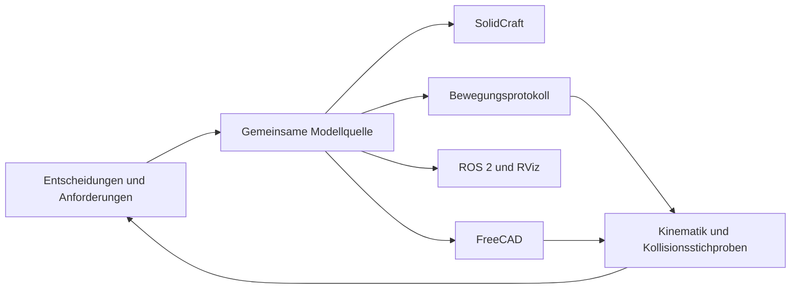

# Gemeinsames Modell und Entwicklungsschleife

Die [L01-Aufstellung](lab-layout-l01.md) verwendet zusätzlich
`model/lab-layout-l01.shared.json`, Format `solidcraftbot.lab-layout/1`.
Instanz-IDs, Quell-/Artefaktprüfsummen, Platzierungen, Posen, Gehbereiche,
Fahrwegstichproben und Reichweitenziele bilden die gemeinsame Szenenquelle.
`python scripts/build_lab_layout.py` erzeugt die native Raumgeometrie plus
statische Ausrüstungsinstanzen in FreeCAD und SolidCraft. Der Adapter leitet
die Ausrüstung aus vorhandenen nativen Modellen ab; das ist keine zweite
führende Bauteilkonstruktion. Bewegungssteuerung und ROS-Szene sind nicht
implementiert.

`model/lab-transfer-l01.protocol.json`, Format `solidcraftbot.lab-transfer/1`,
ergänzt Besitzwechsel des Gefäßes, Werkzeugannahmen, orientierte Anfahrziele,
gerade axiale Ein-/Ausfahrten und geometrische Prüfschritte. ArmC und CF01
behalten in der abgeleiteten Transferbaugruppe native Gelenkhierarchien in
beiden CADs. Die Sequenz läuft mit stehendem Rotor. Der gemeinsame Einstieg
ist `python scripts/build_lab_transfer.py`; Grenzen und Nachweise stehen im
[Transferentwurf](lab-transfer-l01.md).

Die führende Quelle ist [model/robot.json](../model/robot.json), Format
`solidcraftbot.robot/1`. Das [Schema](../model/robot.schema.json) beschreibt die
Dateistruktur. Der Python-Lader prüft zusätzlich unter anderem eindeutige Namen,
positive Abmessungen, Parameterabhängigkeiten, Gelenkrahmen und die sechsachsige
Kette. Die Implementierung verwendet keine Auswertung beliebigen Python-Codes.

Das Ziel ist ein kurzer Weg von einer Konstruktionsidee über ein programmiertes
Protokoll zu einer überprüfbaren 3D-Ausführung. Gemeinsame Namen verbinden
Bauteile, Gelenke, Protokollschritte und Prüfmeldungen.



## Erzeugen und prüfen

Im Projektverzeichnis unter PowerShell:

```powershell
python scripts/build_models.py --ros2
python -m unittest discover -s tests -v
```

Voraussetzungen: normale Python-Installation, SolidCraft-CLI und Python aus
FreeCAD. Standardmäßig werden `solidcraft-cli` aus PATH und die vorhandene
FreeCAD-Installation 27.1 verwendet. Andere Pfade können über
`--solidcraft-cli` und `--freecad-python` angegeben werden.

Der Aufbau öffnet keine neue CAD-Oberfläche und verändert keine dort offene
Konstruktion. Jeder Lauf schreibt einen eigenen Unterordner unter
`cad/generated/` und `exports/generated/`. Der Ordnername enthält einen Teil
der SHA-256-Prüfsumme der Modellquelle; wiederholte Läufe erhalten einen Zusatz
wie `-r2`. Bestehende CAD-Dateien werden dabei nicht ersetzt.

Farben, sichtbare Endkörper, ausgeblendete Hilfsgeometrie und eine isometrische
Kamera werden direkt im nativen FCStd-Container gespeichert. Dafür wird kein
Qt-Offscreen-GUI-Prozess gestartet. Die drei UMR-Körper erscheinen damit auch
beim direkten Öffnen der FCStd-Datei. Die frühere Kopie ohne UMR direkt in
`cad/generated/` und die direkt erstellten Ausgangsmodelle wurden auf
Eigentümerwunsch entfernt; die Kinematikreferenz ist als Zahlenbestand erhalten.

Der [aktuelle Prüfbericht](../exports/generated/build-report.json) enthält die
gültigen Dateipfade, Quell- und Produktprüfsummen sowie den Körpervergleich.
Frühere einfachere Aufbauten lagen bei etwa 9–11 s. Der 72-Körper-X6-Stand
benötigte rund 116 s; die aktuelle 92-Körper-Fassung mit allen Motorplatten,
Stiften und Kopfhüllenprüfungen rund 170 s. ROS-Mesherzeugung und die mobile Basis kommen hinzu. Das sind
Beobachtungen dieser Umgebung, keine garantierten Laufzeiten.

SolidCraft: Die im Prüfbericht genannte `.solidcraft`-Datei öffnen. Unter
**Assemble → Drive Joints** lassen sich die sechs Gelenke bewegen.

FreeCAD: [Laborarm_Neutral_Bewegung.FCMacro](../cad/generated/Laborarm_Neutral_Bewegung.FCMacro)
öffnen und ausführen. Das Makro wählt die aktuelle erzeugte Datei anhand des
Prüfberichts, blendet Zwischengeometrie und Referenzebenen aus und ergänzt die
vorhandenen sechs Regler um **Run protocol: base_sweep_return**.
Der neue Protokollknopf ist vorbereitet; seine interaktive Bedienung wurde
bisher noch nicht separat visuell geprüft. Die zugrunde liegende Sequenz und
ihre Gelenkstellungen sind ohne Oberfläche geprüft.

## Inhalt und Abstraktionshöhe

Die optionale `mobile_base.source`-Referenz in `robot.json` verweist auf
`mobile-base-mb01.shared.json` und den Vertrag `mobile-base.schema.json`. Die
externe Baugruppe erweitert nicht die feste Siebenglieder-/Sechsachsenkette.
`manual_mobile_base`, `retractable_support_tripod` und `repositioning_handle`
werden einmal in gemeinsame Körper, Stützrahmen und Zustände übersetzt. Der
SolidCraft-Armcompiler unterstützt dafür einen gemeinsamen `root_offset`; der
native FreeCAD-Arm erhält dieselbe Montagehöhe über seinen Elterncontainer.
Beide Adapter verwenden denselben Arm und dieselbe Basisauslegung. Der normale
Build-Einstieg erzeugt beide CADs einschließlich Arbeits- und Parkvarianten.
[MB01, Protokoll und Prüfgrenzen](mobile-base-mb01.md).

| Inhalt | Zweck |
|---|---|
| `parameters` | Maße und daraus berechnete Abmessungen |
| `links` | Sieben starre Baugruppen; Struktur, Schnittstellen und Bauräume |
| `recipe` | Portable Konstruktionsoperationen für die jeweilige Baugruppe |
| `joints` | Sechs Drehachsen mit benannten Rahmen, Standwinkeln und Grenzen |
| `flange_reference` | Gemeinsamer Referenzpunkt am freien Flansch |
| `profiles` | Modellannahmen und bewusst ausgelassene Physik |
| `scenarios` | Ausführbare Gelenkfolgen und zugehörige Prüfungen |
| `services` | Nicht dargestellte Servorückmeldung, logische Leitungsverbindungen und offene physische Randbedingungen |

Längenwerte und Längenausdrücke werden in mm interpretiert, Gelenkwinkel in °,
Zeiten in s. Unterstützt werden Zahlen, Parameternamen sowie `+`, `-`, `*`, `/`
und Klammern. Für native FreeCAD-Ausdrücke ist Version 1 auf lineare
Längenausdrücke ausgelegt. Ein vollständiges physikalisches Einheitensystem
ist noch nicht implementiert. ROS-Ausgaben verwenden ausdrücklich m und rad.

Die erste Version unterstützt Quader, Zylinder, Vereinigungen, Ausschnitte,
Verschiebungen und eine semantische Kennzeichnung. Beispiel aus dem Oberarm:

```json
{
  "id": "UMR",
  "action": "label",
  "text": "UMR",
  "origin": [12, -34, "shoulder_z + upper_len/2"],
  "u_axis": [0, 0, 1],
  "v_axis": [-1, 0, 0],
  "height": 24,
  "depth": 0.8,
  "tracking": 2,
  "color": [15, 45, 75]
}
```

Der Text wird einmal beschrieben und in beiden CADs in dieselben kräftigen
Konturen übersetzt. Die drei Buchstaben sind eigene starre Körper auf dem
Oberarm. ROS übernimmt ihre Geometrie und eine separate dunkle Darstellung.
Es werden keine installierten Schriftarten benötigt. Bisher sind nur U, M und
R in diesem kleinen Kontursatz implementiert.

Weitere semantische Rezepte wie Lochbilder, Lagerstellen oder Getriebestufen
können die wiederholte Detailarbeit später kapseln. Fasen können in einer
Bewegungsdarstellung entfallen, sofern sie für die jeweilige Prüfung ohne
Bedeutung sind. Bei Getrieben kann eine Untersuchung der Armbewegung mit
Übersetzung und Bauraum auskommen; Zahnkontakt, Spiel, Tragfähigkeit und
Fertigung brauchen dafür geeignete detaillierte Modelle und Nachweise.
Solche Getriebe- oder Fasenrezepte sind noch nicht implementiert.

Servoantriebe und Leitungen sind ein erstes Beispiel für Inhalte jenseits der
sichtbaren Geometrie. Die Quelle enthält sechs Servoanforderungen, sechs logische
Versorgungs-/Rückmeldeverbindungen und ihre beweglichen Gelenkdurchführungen.
Die Topologie wird geprüft; unbekannte Kabeldaten und Führungsmaße werden
explizit als `null` geführt. Physische Kabelprüfungen und flexible Geometrie sind
noch nicht implementiert. Details: [Servos und Leitungen](servo-cables.md).

## Provisorische Kameras und Sichtkegel

Die semantische `camera`-Operation in den Rezepten von L1 und L6 beschreibt
jeweils optischen Rahmen, Gehäusebauraum, Objektivbauraum, provisorische
Halterquader, Farbe, Sichtkegel und offene Anschlussdaten. `part: null`,
`status: provisional` und `manufacturing_released: false` sind verpflichtend.
Der Vertrag steht in `model/camera.schema.json`; `scripts/robot_cameras.py`
prüft und übersetzt ihn ohne CAD-Abhängigkeiten. Beide CAD-Adapter erhalten
dieselben ausgerichteten Quader, Zylinder und nativen Kegel. Native FreeCAD-
Längenausdrücke binden die Bauräume, Rahmen und Kegel an `ModelParameters`.
Für SolidCraft wird nach gemeinsamen Maßänderungen wie bisher neu aufgebaut.

Kameragehäuse und Objektive tragen die Rolle `camera_envelope`, Halter
`camera_mount`. Die Rolle `viewing_cone` kennzeichnet nicht physische,
transparente Hilfsvolumen. Sie werden beim CAD-Geometrievergleich erfasst,
aber von den physischen BRep-Kollisionsstichproben und den URDF-Kollisionsquadern
ausgenommen. RViz erhält pro Kamerakörper ein getrenntes farbiges Mesh mit
Alpha, ohne es nochmals in das Strukturmesh einzubauen.

Die optischen Frames verwenden +Z nach vorn, +X rechts und +Y unten und sind
unkalibriert. FreeCAD speichert sie als native Container an L1 und L6; ROS
erhält feste optische Kindrahmen. `config/cameras.json` und der versionierte
`cameras-report.json` führen Entwurfsrahmen, Kegelmaße, offene Kabeldaten und
benötigte Gelenkdurchführungen. Die Kamera auf L6 benötigt zusätzlich J6;
dieser Anschlussweg wird getrennt von den sechs Servokreisen auditiert.
Bildthemen, Treiber, Kalibrierung, reale Optik und Verdeckungsrechnung sind
nicht implementiert. [Anordnung und Prüfgrenzen](design.md#konzeptoption-zwei-armkameras-und-stationäre-laboransichten).

## Protokolle und Rückmeldung

`base_sweep_return` definiert die Standpose, J1 bei 25° nach 2 s und die
Rückkehr zu 20° nach weiteren 2 s. Die übrigen fünf Achsen bleiben stehen.
Der gemeinsame Compiler erzeugt Gelenkstellungen und Flanschpositionen.
FreeCAD prüft 11 Posen mit maximal 1° Abstand entlang dieser Gelenkfolge.
ROS erhält dieselben Wegpunkte als `FollowJointTrajectory`-Ziel in rad.

Der jetzige Rückkanal besteht aus maschinenlesbaren Prüfberichten: Welche
Körper weichen zwischen den CADs ab, welche Gelenkgrenze ist verletzt und in
welchem Protokollschritt wurden Überschneidungen gefunden? Ein gescheiterter
Aufbau wird als Fehler beendet. Ein Laborprotokoll mit Flüssigkeitstransfers,
Wahrnehmung und Wiederanlauf ist noch kein Bestandteil dieser Version.

## Nachweise und Grenzen

92 Körper einschließlich Kennzeichnung, Vendor-Komponenten, Motorplatten, eigenen Zentrierstiften,
Kamerabauräumen und zwei rein visuellen Sichtkegeln werden zwischen den beiden CADs
verglichen: Schwerpunktabweichung höchstens 0,01 mm und relative
Volumenabweichung höchstens 0,1 %. Die Toleranzen berücksichtigen die
tessellierte SolidCraft-Auswertung gegenüber analytischen FreeCAD-Körpern.
Die sieben starren Baugruppen und sechs Gelenke bleiben erhalten.

Vorwärtskinematik, ursprünglicher A01-Gelenkstand, eine Längenänderung,
URDF-Rahmen einschließlich mm/m-Umrechnung und Trajektoriendaten haben
automatisierte Prüfungen. Die Kollisionsprüfung erfasst Stichproben mit einem
Schwellwert von 0,0001 mm³ für Körper verschiedener starrer Baugruppen.
Der gesamte Bewegungsraum und die Zwischenbewegungen sind nicht kontinuierlich
kollisionsgeprüft. Materialdichten der CAD-Standardmaterialien sind keine
festgelegten realen Robotermassen.

## Integrierte Vendor-Komponenten und Motorplatten

`vendor_component` bindet eine registrierte Gehäuse- oder Ausgangsgeometrie mit
Installationsrahmen, Teil-ID und Prüfsumme ein. `mount_plate` erzeugt eigene
Platten und Freibohrungen aus den zugehörigen Schnittstellendaten. Beide
Operationen liegen in `model/robot.json`; die dort mit SHA-256 gebundene
`cad/vendor/myactuator/component-library.json` ergänzt Geometrie und Lochbilder.
`scripts/robot_components.py` prüft und übersetzt diese Ebene gemeinsam.

Die CAD-Adapter erhalten zwölf getrennte Vendor-Körper und zwölf native Platten.
Der ROS-Exporter übernimmt die Vendor-Details nicht in Strukturmeshes, sondern
erzeugt sechs Gehäusequader und getrennte Kollisionshüllen. Änderungen an
gemeinsamen Längen bewegen auch Vendor-Platzierungen und Gelenkanker. Der
[Integrationsbericht](servo-integration.md) erklärt die direkte J3-Anordnung,
verlängerte J6-Baugruppe. Die [X6-Lochbildklärung](x6-interface-resolution.md)
korrigiert die frühere Maßpfeilzuordnung und ergänzt die Zentrierhülsen.

Die [X6-Auslegung](x6-fits-fasteners.md) ergänzt in derselben Schnittstellenquelle
eine H7-Rundbohrung, ein radiales Entlastungslangloch, Kopfsenkungen und gemessene
Schraubenstapel. Der gemeinsame Adapter zerlegt das Langloch in zwei Zylinder
und einen ausgeschnittenen Polygonprisma-Mittelteil. Beide CAD-Adapter unterstützen
diesen Ausschnitt; FreeCAD bindet seine Tiefe an `x6_plate_t`. Eine Änderung der
Plattendicke ohne erneute Schraubenauslegung wird beim Neuaufbau zurückgewiesen.
Die separate Berechnung prüft Eingriff, Abstand zum Gewindeende und Kopf-/Boden-
freiräume unter expliziten Annahmen. Reale Gewindetragfähigkeit und Anziehdrehmoment
bleiben offen. Maximal angenommene Kopfhüllen werden zusätzlich gegen physische
Endkörper in der Standpose geprüft, einschließlich desselben starren Glieds.

Die Komponentenregistrierung ist eine geometrische Auslegungshilfe. Unbekannte
Passungen, elektrische Rückmeldeparameter und mechanische Freigaben bleiben
offen; ein erfolgreicher Build erteilt keine Fertigungsfreigabe.

Die [X2-/X4-Erweiterung](x2-x4-fits-fasteners.md) verwendet dieselbe
CAD-unabhängige Schraubenstapelrechnung unter `scripts/servo_mounting_design.py`.
`mount_plate` erzeugt aus den beiden Schnittstellenquellen zusätzlich blinde
Stiftaufnahmen und eigene gestufte Rund-/Entlastungsstifte mit der Rolle
`locating_pin`. Die 20 Stifte bleiben auf den jeweiligen starren Plattenlinks
und erscheinen in RViz als eigene Strukturgeometrie. Die 92 Armkörper werden
zwischen beiden CADs verglichen. Alle 70 Schraubenkopfhüllen werden gegen
physische Endkörper geprüft; Stiftköpfe müssen Vendor-Material freihalten,
während das kleine Pressübermaß am eigenen Sitz ausdrücklich beabsichtigt ist.
Diese Geometrieprüfungen ersetzen keine Montage-, Last- oder Retentionsprüfung.

Für Änderungen ist diese Quelle maßgeblich. Native CAD-Änderungen werden nicht
automatisch zurückübersetzt. Vor ihrer Übernahme muss die Konstruktionsabsicht
in der Quelle oder in einem neuen portablen Rezept beschrieben werden.
`scripts/migrate_a01_spec.py` ist ausschließlich der bereits verwendete
Erstimport; er ersetzt keine bestehende Modellquelle.

## Deckelstation C01: gemeinsame Beschreibung für zwei CAD-Kerne

Die Station führt ihre Geometrie jetzt separat in
[model/tube-station-c01.shared.json](../model/tube-station-c01.shared.json), Format
`solidcraftbot.station/1`. Körper, Ausschnitte, starre Gruppen, Gelenkrahmen,
Winkelgrenzen und Posen sind dort CAD-unabhängig beschrieben. Das Roboterschema
mit seiner festen Sechsachskette wird dafür nicht zweckentfremdet.

`python scripts/build_tube_station.py` erzeugt daraus natives SolidCraft und
natives FreeCAD. In FreeCAD bleiben Grundkörper, boolesche Features,
Längenausdrücke und Winkelsteuerung editierbar. SolidCraft erhält bei einem
Neuaufbau die gemeinsam ausgewerteten Maße und Gelenkrahmen. Eine Rückübersetzung
nativer Bearbeitungen in die Quelle ist auch hier nicht eingerichtet.

Vier Geometriefälle vergleichen jeweils 32 Körper einschließlich der drei
UMR-Buchstabenkörper und ihrer
symmetrischen Differenz im STEP-/BRep-Vergleich. Eine Änderung der Arbeitshöhe
prüft zusätzlich die Kopplung von Geometrie und Gelenkankern. Der
[aktuelle Bericht](../cad/tube-station-c01/shared-build-report.json) hält
Quelle, Adapter, Modellpfade und Prüfgrenzen fest. Die ungelöste Beladung der
Station bleibt eine mechanische Entwurfsaufgabe; ein erfolgreicher
CAD-Vergleich weist sie nicht nach.

## Spitzenabwurf T01: gemeinsame Entwicklung mit UMR

[model/tip-collector-t01.shared.json](../model/tip-collector-t01.shared.json),
Format `solidcraftbot.collector/1`, führt die T01-Maße und portablen
Konstruktionsoperationen. `python scripts/build_tip_collector.py` erzeugt daraus
neue SolidCraft- und FreeCAD-Dateien in einem eigenen Modellstandsordner und
vergleicht beide CAD-Kerne. Die ursprünglichen T01-Dateien bleiben Historie.

Die Quelle ergänzt Quader und Bohrungen um ein semantisches Abstreifprofil,
portable quadratische Beschriftungskurven und die UMR-Umrisse des Robotermodells.
Damit bleiben die vorhandenen Kapazitätsmarkierungen und die neue UMR-Schrift
ohne installierte Schriftart in beiden CADs gleich. FreeCAD erhält native
Grundkörper, maßgesteuerte Skizzen der Nuteinläufe, Extrusionen und Ausschnitte;
es übernimmt keine STEP-Geometrie als Modellquelle. SolidCraft behält seine
Parameter und ausdrucksgesteuerten Profile. Die FreeCAD-Parameter verwenden
vorzeichenbehaftete Abstände, damit negative Front-/Linkskoordinaten erhalten
bleiben. Kontur-/Textänderungen an Beschriftungen erfolgen durch Neuaufbau aus
der Quelle.

14 Körper werden in drei Fällen einschließlich analytischer Volumina und
Schwerpunkte sowie symmetrischer STEP-/BRep-Differenzen verglichen. Native
Änderungen von `groove_M` und `bin_h` prüfen beide Programme zusätzlich. Der
[Bericht](../cad/tip-collector-t01/shared-build-report.json) hält die aktuellen
Dateipfade und Grenzen fest. Der feste Spitzenabwurf benötigt keine künstlichen
Bewegungsgelenke; die Roboterkette bleibt unverändert. Eine Rückübersetzung
nativer Bearbeitungen und ein Nachweis der echten Pipettenpassung sind weiterhin
nicht eingerichtet.

## Raumumgebung L01

[model/lab-room-l01.shared.json](../model/lab-room-l01.shared.json), Format
`solidcraftbot.lab-room-composition/1`, bindet die getrennten Quellen für Raumgeometrie,
Möbeltypen und Möblierung (siehe [Architektur](../ARCHITECTURE.md)), unabhängig von CAD
und Roboterkette. Parameter besitzen vorläufige Werte und unbekannte Messwerte.
Semantische Operationen für Raumschale, Türöffnungen, Fassaden-/Fensterband,
Randbänke, doppelte Mittelbank und geschlossenen Stauraum werden einmal in
gemeinsame Körper und Rahmen übersetzt. Die Fassadenkurve ist eine verstellbare
quadratische Näherung mit zwölf Segmenten; sie ist keine Gebäudevermessung.

`python scripts/build_lab_room.py` erzeugt native FreeCAD- und SolidCraft-Modelle
in neuen Modellstandsordnern. Beide behalten ausdrucksgesteuerte Maße und Profile.
Fünf Maßfälle, native Breiten-/Wölbungs-, Stützen- und Regaländerung, Körpervergleich, STEP-Differenz
und benannte Tür-/Bankrahmen stehen im
[Bericht](../cad/lab-room-l01/shared-build-report.json). Die Einordnung in einen
Gebäuderahmen bleibt `null`; ein Gesamtgebäude, ROS-Umgebung und geprüfte
Mensch-/Maschinenwege sind nicht implementiert. Einstieg: [L01](lab-room-l01.md).

`shared_central_island_shelf` ergänzt ein erhöhtes Regalbrett und drei
Stützen zwischen den mittleren Bankrückseiten. Gemeinsame Parameter steuern
Tiefe, Oberkante, Dicke, Endabstände und Stützenquerschnitt. Der Rahmen
`L01.IslandShelf.Top`, Brett und Stützen folgen denselben Maßen. Geometrische
Zentrierung, Auflage und Arbeitsflächenfreiraum werden in allen Fällen geprüft.
`central_upper_cupboards` ergänzt zwei geschlossene Module ab 1,75 m und schmale
obere Stützen. Das Regal liegt auf 1,50 m; der rückwandfreie Bereich dazwischen
wird mit geometrischen Querlinien geprüft. `open_window_bench_supports` erzeugt
offene Beine; fensterseitige Unterschrank-/Sockelkörper werden nicht mehr erzeugt.

## Probentransport TR01: Bodenfahrzeug

[model/sample-transport-tr01.shared.json](../model/sample-transport-tr01.shared.json),
Format `solidcraftbot.sample-transport/2`, beschreibt die Bodenfahrzeug-Entscheidung, offene
Betriebsdaten, Fahrzeug-/Kassettenmaße, Konfigurationen und Protokollanforderungen.
`scripts/sample_transport_model.py` übersetzt semantische Operationen für
Bodenfahrzeug-Bauräume, Zweiplatzdeck, Plattennest, Gefäßrack und
Transporthaube einmal in gemeinsame Körper und Rahmen. Beide CAD-Adapter nutzen
diese Ableitung; das feste Sechsachsenschema bleibt unverändert.

`python scripts/build_sample_transport.py` erzeugt drei Boden-Konfigurationen
und zwei Maßfälle in neuen Revisionsordnern. Der
[Bericht](../cad/sample-transport-tr01/shared-build-report.json) ordnet Quellstand,
Generatoren, Körpervergleich, STEP-Differenz, Haubenfreiraum und Abgleich der
Last-/Kassettenrahmen mit der tatsächlichen Deckgeometrie zu. Ein niedrigerer
Übergabestand und ein größerer/höherer Plattenwagen prüfen die gemeinsame
Maßableitung. Native Maßänderungen erfordern für gekoppelte Rahmen einen
Neuaufbau. Alle aktuellen Aufbauten sind statisch; die frühere Tischtranslation
und die Tisch-/Spurmodelle bleiben ausschließlich Historie.

Die Proben bleiben zur Armübergabe auf dem geparkten Fahrzeug. Das Ziel ist
Zugang für jeden beteiligten stationären Arm; registrierte Stationen,
Werkzeug-/Parkposen, Reichweiten- und Anfahrnachweise fehlen noch. Die Quelle
führt diese Prüfaufgaben und einen gemeinsamen `TR01.LoadDeck`-Rahmen.
Spurgenaue Fahrt oder ein Präzisionsdock sind nicht gefordert; lokale
Probenreferenz und stationäre Haltefunktion müssen aufgabengerecht geprüft werden.

Unbekannte Zentrifugen-Chargengrößen und Leistungsdaten bleiben `null`.
Protokoll- und Dienstbeschreibungen sind Anforderungen; ausführbare
Transportsteuerung, ROS/SiLA-Anbindung und reale Rückmeldung sind nicht
implementiert. Details und aktuelle Dateien: [TR01](sample-transport-tr01.md).

## Robotergesteuerte Drehmechanik H03

Die [H03-Erweiterung](tube-cam-h03.md) verwendet eine per SHA-256 gebundene
H02-Basis und ergänzt gemeinsame Kurvengesetze, Rollen-Hüllkonturen, Keilflächen,
Bolzen, Federtasche und Bajonettschlitze. Gemeinsame Adapter unterstützen dafür
gemischte Dreh-/Schubgelenke mit °/mm, beliebige Zylinderachsen, axiale
Profilrotationen und portable Polygonprismen. SolidCraft besitzt geometrische `joint.cam`-Kopplungen; FreeCAD
verwendet denselben Ablauf in nativen Ausdrücken. Latch-Zustand und mechanischer
Kontakt werden getrennt geführt; es wird keine Feder-/Kontaktdynamik zugesichert.
Die Generatoren bleiben getrennte Ableitungen derselben Konstruktionsabsicht.

`model/tube-cam-h03-cycle.shared.json` ergänzt einen SHA-256-gebundenen,
vollständig geschlossenen Übergabe-/Rücksetzablauf. `tube_cam_cycle.py` verwendet
die bestehenden Kurven- und Riegelgesetze; `build_tube_cam_animation.py` erzeugt
eine synchronisierte Gesamt-/Riegelschnittansicht aus geprüften nativen Körpern.
Die Exportstufe entfernt zuerst die gespeicherte Referenzpose aus den Netzen,
damit Schieber und verschachtelte Drehungen bei der Wiedergabe nicht doppelt
angewandt werden. 483 native FreeCAD-Stellungen werden mit Quelle und
Rotationsmatrizen verglichen; Abspielzeit und Kontaktphysik bleiben unqualifiziert.

## Offener Gefäßrahmen H02

[tube-frame-h02.shared.json](../model/tube-frame-h02.shared.json) beschreibt
optische Fenster, untere Außenwandsitze, Bodenzugang und einen geteilten Empfänger.
`tube_frame_model.py` übersetzt diese semantische Operation einmal in gemeinsame
Geometrie, zehn ideale Schieber, Hierarchie und unterstützte Protokollzustände.
Die H01-Adapter werden wiederverwendet und um verschachtelte Bewegungsgruppen,
maßabhängige Schiebergrenzen und abgeleitete Parameter ergänzt. Natives FreeCAD
und SolidCraft entstehen mit `python scripts/build_tube_frame.py`.
Der [H02-Bericht](../cad/tube-frame-h02/shared-build-report.json) trennt
CAD-Vergleich, gesampelte Übergabe und geometrisch freie Kamerasegmente von noch
offenen optischen und mechanischen Messungen. Einzelheiten: [H02](tube-frame-h02.md).

## Zentrifuge CF01

`model/centrifuge-cf01.robot-pickup.shared.json` referenziert Arm, Zentrifuge und
Protokoll für die neue Entnahmeszene. `centrifuge_robot_pickup.py` führt gemeinsame
Pose-Ziele, Sechsachsen-IK, Greiferoperation und starren Gefäßübergang.
`build_centrifuge_robot_pickup.py` erzeugt native Prüfstellungen beider CADs,
FreeCAD-Playback und Animation. SolidCraft erhält eingefrorene Prüfstellungen;
der dynamische Eigentumswechsel ist dort noch keine native Motion-Study.

Die CF01-Szene ergänzt nun `robot_parameter_overrides_mm` als Auswahl einer
Armvariante aus derselben Quelle. `robot_spec.load(..., parameter_overrides=...)`
prüft die ausgewertete Variante und erhält die ursprünglichen semantischen
Rezepte. Die längeren Glieder und Gelenkanker werden gemeinsam abgeleitet;
die globale Armquelle und andere Layoutinstanzen werden dadurch nicht verändert.
`guided_tube_rack` erzeugt gemeinsame Boden-/Führungsgeometrie, konische Einläufe
und zwölf stabile Slot-IDs. Ein zweiter starrer Besitzwechsel lässt das Gefäß
beim Öffnen der Finger im Rack zurück. Native BRep-Prüfungen verfeinern die
tatsächlich abgespielte Gelenkinterpolation adaptiv; die ROS-Raumszene und
physische Kontakt-/Sensormodelle sind weiterhin nicht implementiert.

Die ergänzende Quelle `model/centrifuge-cf01.protocol.json` führt Befehle,
Argumenttypen, Interaktionsregeln und die animierte Deckel-/Heberfolge.
`build_centrifuge_animation.py` erzeugt daraus eine native SolidCraft-Motion-Study,
GIF und FreeCAD-Posenmakro auf Basis der geprüften Geometrie.
`build_centrifuge_interfaces.py` erzeugt ROS-Actions/Services und eine SiLA-FDL;
`centrifuge_protocol.py` prüft deren gemeinsame Mock-Ausführungssemantik.
Eine ROS-/SiLA-Netzwerklaufzeit ist noch nicht implementiert.

[centrifuge-cf01.shared.json](../model/centrifuge-cf01.shared.json), Format
`solidcraftbot.centrifuge/1`, führt Maße, Festwinkel-Lochmuster, Beschriftung,
Gelenke/Posen und Interaktionsanforderungen getrennt vom Sechsachsenschema.
`python scripts/build_centrifuge.py` erzeugt SolidCraft, natives FreeCAD, STEP,
Renderings und einen Vergleichsbericht in neuen Revisionen. Geometrie und Anker
verwenden dieselbe portable Expansion. Maßänderungen erfordern Neuaufbau;
native Bewegungskoordinaten bleiben editierbar.

CF01 ergänzt Stahlfamilie mit offener Güte, Kammer-/Boden-/Deckeldicken,
Stützpfad und den Dienstvertrag `solidcraftbot.centrifuge-services/1` für
Netzeingang, PE-Anforderungen und A/B/Z-Spindelgeber. Die portable Operation
`round_cable` beschreibt einen runden Querschnitt mit Linien-/Kreisbogenpfad;
SolidCraft und FreeCAD erzeugen daraus native Sweeps. Dienstframes und
Geberbandbreite werden aus denselben Parametern abgeleitet und im Bericht
ausgegeben. Die Materialzuordnung ist kein Festigkeitsnachweis; die
Programmierschnittstelle liefert weiterhin ausschließlich simulierte Rückmeldung.

`display_pose: closed` speichert die montierte Baugruppe mit geschlossenem Deckel,
eingesetzten Gefäßen und geparktem Heber. `presentation.translucent_roles` und
`presentation.opacity` steuern die gemeinsame Darstellung von Gehäuse, Kammer,
Boden und Deckel in beiden CADs; 0,18 Opazität verändert keine Materialdaten.

`centrifuge_mechanisms.py` erweitert diese gemeinsame Ableitung um Motorstator,
Rotorkern, Lager, Parkscheibe/-sattel, angetriebenes Scharnier und zwei Stifte.
`solidcraftbot.centrifuge-mechanisms/1` beschreibt die Architektur und offenen
Leistungsdaten. Acht Koordinaten und 44 Prüfstellungen pro Fall verbinden beide
CADs. Die Mock-Steuerung ergänzt eine zeitliche Bremsphase und vollständige
motorische Deckel-/Stiftsequenzen ohne manuelle Schritte; reale Antriebs- und
Sensorschnittstellen sind nicht implementiert.

Die Python-/JSONL-Mock-Schnittstelle verwendet die gemeinsamen Maße/Grenzwerte.
Hochgeschwindigkeitsfreigaben bleiben ohne qualifizierte Daten gesperrt. ROS-Laufzeit,
SiLA-Server, Kameradetektion und physische Prüfungen sind nicht implementiert.
Details und Prüfgrenzen: [CF01](centrifuge-cf01.md).

## Referenzierte Baugruppen und Parametervarianten

Die [NanoDrop- und Qubit-Anschauungsmodelle](instrument-concepts.md) verwenden
`model/nanodrop-concept.shared.json` und `model/qubit-4-concept.shared.json` als
jeweils führende Quelle. Die semantischen Rezepte für Messsäule/Hebel und
Einzelröhrchenkammer/Deckel senkt `scripts/instrument_concept.py` in die vorhandenen
portablen Operationen ab. `python3 scripts/build_instrument_concepts.py` erzeugt
beide nativen CADs und prüft drei Maßfälle einschließlich gemeinsam abgeleiteter
Gelenkanker. Die Geometrie bleibt eine eigenständige, unvermessen angenommene
Darstellung; bestehende Geräteprofile und Aufstellungen werden nicht umgebunden.

Eine Baugruppe wird einmal konstruiert. Das Laborlayout referenziert ihre Quelle
und beschreibt Instanzen mit ID, Aufstellung in mm/deg, Zustand und optionalen
`overrides`. Der Vertrag liegt in `model/assembly-reference.schema.json`, die
Layoutkomposition in `model/lab-layout.schema.json`. `scripts/assembly_model.py`
prüft Pfade, Quellenbindungen und Parameter; die jeweiligen Modellmodule prüfen
zusätzlich ihre geometrischen Grenzen. Die vorhandenen Formate werden damit
konkretisiert, nicht durch ein allgemeines Roboterschema für alle Stationen ersetzt.

Die formalen JSON-Schemas lassen sich zusätzlich mit dem optionalen
Entwicklungswerkzeug prüfen (keine CAD-Laufzeit, keine Laufzeitabhängigkeit der
Generatoren):

```sh
python3 -m pip install jsonschema
python3 scripts/validate_assembly_schemas.py
```

Beispiel einer Instanz im Layout (die Assetreferenz enthält `source` und optional
`source_sha256`, `report`, `case`):

```json
{
  "id": "ArmA",
  "asset": "arm",
  "host": "IslandRight",
  "xyz": [3500, 3000, 965],
  "yaw_deg": 70,
  "joints_deg": [20, 35, 65, 0, 80, 15],
  "overrides": {"upper_len": 220}
}
```

Overrides verwenden die Einheit der referenzierten Parameterdefinition; es gibt
keine implizite Einheitenumrechnung. Zulässig sind endliche Zahlen oder
arithmetische Ausdrücke über Szenenparameter, etwa
`"floor_deck_z": "vehicle_deck_z"`. Unbekannte Parameter, Überschreibungen
abhängiger Größen, fehlende Einheiten und verletzte deklarierte Wertebereiche
werden abgewiesen. `elbow_z` bleibt beispielsweise aus `upper_len` abgeleitet.
Einheitenlose Parameter müssen ausdrücklich mit `unit: ""` deklariert sein.

Die Layoutadapter verwenden dieselbe ausgewertete Quelle für Geometrie,
Gelenkrahmen, Darstellung und Reichweitenprüfung. Verschiedene Parameterstände
werden getrennt erzeugt; identische Stände werden beim Szenenaufbau wiederverwendet.
TR01 und die wiederverwendeten Kassetten beziehen ihre Maße aus der tatsächlichen
Fahrzeuginstanz. Die Transferberechnung verwendet die ausgewählte Arminstanz und
deren Maße statt unabhängig den Standardarm zu laden.

Ein Asset bindet keine konkrete native Revisionsdatei mehr. `report` und der
benannte `case` lösen die aktuelle geprüfte Datei und deren Prüfsumme auf. Der
Bericht muss zur Quellprüfsumme passen und bestanden sein; die Datei wird erneut
gegen die im Bericht aufgezeichnete Prüfsumme geprüft. Auf einem frischen Checkout
sind zuerst die referenzierten Baugruppen zu bauen. Quellenbindungen bleiben
bewusst über `source_sha256` versioniert; eine Quellrevision ist ausdrücklich zu
übernehmen. Historische CAD-Berichte werden durch diese Umstellung nicht zu
Nachweisen der neuen Generatoren oder Varianten.

Aktuell unterstützt: Layout-Parameterstände der vorhandenen Arm-, CF01-, T01-
und TR01-Adapter; benannte TR01-Kassettenvarianten; Gelenkstellungen des Arms und
benannte CF01-Posen. Ein anderer Parameterstand erbt keine mechanische Freigabe
und keine Kollisionsfreigabe des Standardstands. `robot_parameter_overrides_mm`
der CF01-Entnahme nutzt dieselbe Parameterprüfung und hat einen ergänzenden
Vertrag in `model/centrifuge-cf01.robot-pickup.schema.json`; deren Station und
Protokoll bleiben ausdrücklich die vorhandenen CF01-Quellen.

Die T01-Nutmetadaten enthalten keine zweite Maßtabelle mehr. `grooves(spec, p)`
liefert eine abgeleitete Ansicht mit den tatsächlichen Positionen und Breiten.
`actuator-selection.json` verweist auf die registrierte Komponentenbibliothek
und die Schnittstellenquellen; Registrierungs- und Auslegungsergebnisse werden
dort nicht nochmals kopiert. Die Bibliothek bleibt eine gekennzeichnete,
prüfsummengebundene Ableitung. Die Gelenk-/Servo-Zuordnung steht in `robot.json`.

Die alten C01-/T01-Quellen liegen ausschließlich unter `model/history/`.
Ihre früheren Generator-Einstiege und der alte T01-Validator brechen vor dem
Schreiben ab. Historische Test-Fixtures und README-Medien bleiben unverändert.

Validierungsgrenze dieser Umstellung: Quell-, Parameter-, Kinematik- und
Adapterprüfungen sind ohne CAD ausführbar. Ein neuer nativer Vergleich erfordert
lauffähiges FreeCAD und SolidCraft. Bei der Umstellung am 7. November 2026
fehlt auf diesem Mac SolidCraft; der
FreeCAD-/Qt-Kern bricht beim Import mit der Prozessoranforderung `neon` ab.
Es wurden daher keine neuen nativen CAD-Dateien oder qualifizierten
Build-Berichte erzeugt. Die ausgewählte README-Demo ist weiterhin der explizit
historische, mit Prüfsummen dokumentierte Stand.


### Synthetic CF01 composition

`model/synthetic-cf01-workspace.shared.json` pins the unbounded environment,
reference-bank catalogue, furnishings and equipment layout. The equipment
`host` names a composed furniture frame and uses the supported
`assembly-reference.schema.json#/$defs/equipment_instance` subset of the common
assembly instance contract. No second placement contract is maintained.
Arm overrides use the existing robot parameter
validation (`robot_spec.load` / `parameter_variant`); no second parameter engine
is introduced. The pickup adapter materializes compatibility views, preserving
the old positions and motion. `model/cf01-rack-batch.protocol.json` supplies a
separate local mock batch, with explicit empty-rotor initialization, fictitious
masses and original-rack-slot returns. All batch robot handoffs are abstract;
the existing animated motion component is independent. Device sources are
resolved from equipment assets into derived adapter views; the leading scene
contains only its protocol reference. Internal workspace context is not
serialized into scene, mesh or HTML outputs. Rack place IDs and row-major
numbering come from `rack_slots.places` and the rack source `slot_order`; batch
reports expose the same place IDs as the geometry.
