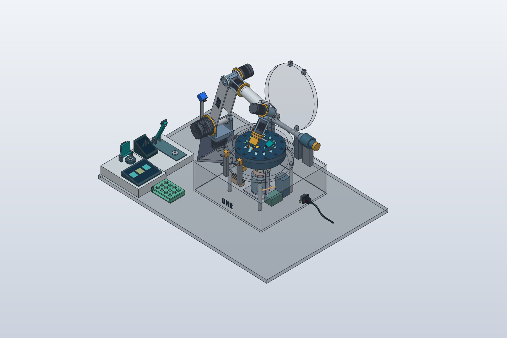

# Gemeinsamer synthetischer Laborablauf

Der lokale Gesamtlauf verbindet zwölf Originalproben und Originalgefäße über
**CF01 → NanoDrop → Qubit 4**. Ein Manifest, ein Journal, eine Prozessuhr und
eine Ressourcenverantwortung gelten über alle Stufen. Alle Proben, SOPs,
Mengen, Gesamtgefäßmassen, Zeitannahmen und Ergebnisse sind fiktiv.

## Einstieg

```sh
python3 scripts/run_lab_workflow.py demo --run-id SYN.LAB.DEMO01
python3 scripts/run_lab_workflow.py report SYN.LAB.DEMO01
```

`--transport sila2` am Demobefehl wählt den anderen lokalen CF01-Vertragsdecoder.
Es wird kein Netzwerkserver gestartet. Die CLI verwendet denselben historischen
Standard-Store `exports/manual-workflows/nanodrop.sqlite3` wie die Einzelabläufe.
Eine eigene Datei wählt `--store exports/manual-workflows/lab-demo.sqlite3` vor
dem Unterbefehl. Nur Läufe im selben Store koordinieren ihre Reservierungen.

Die Demonstration liefert die synthetischen Beobachtungen ausdrücklich selbst.
Für einzelne Eingaben gibt es `create`, `status` und eine JSONL-Sitzung:

```sh
python3 scripts/run_lab_workflow.py demo --run-id SYN.LAB.PAUSE01 --pause-after nanodrop_intent
python3 scripts/run_lab_workflow.py session SYN.LAB.PAUSE01
```

Alternativ pausiert `--pause-after cf01` an der bestätigten CF01-Stufengrenze;
`qubit_intent` pausiert nach der ersten Probenansatzabsicht. Eine neue Sitzung
verlangt einen ausdrücklichen Abgleich. Nach hartem Prozessabbruch ist zusätzlich
`--resume` nötig. `--actions DATEI.jsonl` liest Bestätigungen aus einer Datei.
`quit` beendet die Sitzung; `status` zeigt den aktuellen Stand.

Ein Stufenbefehl sieht beispielsweise so aus:

```json
{"stage_id":"nanodrop","command":"claim","actor_id":"SYN.Operator01","data":{}}
```

Rootbefehle lassen `stage_id` weg. Unterstützt sind `accept_rack`,
`confirm_mass`, `run_cf01`, `handover`, `advance_time`, `cancel`,
`reconcile_initial_cf01` und `finish_cf01_abort`. Der Dateiimport nennt
`stage_id`, `command: import_results`, `actor_id` und `file`. Die Gerätebefehle
verwenden weiterhin die dokumentierten NanoDrop-/Qubit-Datenfelder; im Gesamtlauf
sind Rackplätze lokale IDs wie `Slot01`. Ein Arbeitsbereich wird durch den
Rootbefehl `handover` übergeben, nicht durch eine isolierte Stufenfreigabe.

## Führende Quellen und Zustände

| Datei | Aufgabe |
|---|---|
| `model/synthetic-lab-workflow.manifest.json` | Zwölf stabile Proben-/Gefäßidentitäten, Rackplätze und einmalige Anfangsmengen |
| `model/synthetic-lab-workflow.shared.json` | Gebundene Aufstellung, Stufenprofile, Uhrmodus, Frist und Qubit-Platzrollen |
| `model/synthetic-lab-workflow.schema.json` | Formale Verträge für Komposition, Manifest und synthetische Massenbestätigung |
| `scripts/lab_workflow_sources.py` | Prüfsummenprüfung, semantische Validierung und abgeleitete Stufeneingaben |
| `scripts/lab_workflow_ledger.py` | Kanonisches Inventar, Buchungen und kompatible Adapteransichten |
| `scripts/lab_workflow_stages.py` | Getrennte Gerätekontexte mit gemeinsamen Operationen |
| `scripts/lab_workflow.py` | Journalübergänge, Reservierungen, Uhr, CF01-Checkpoints und Abschlussaudit |

Die zwölf Originale stehen nur im gemeinsamen Manifest. Die bisherigen
Dreierprofile bleiben unabhängige Standalone-Fixtures; deren Probenlisten werden
nicht zum Gesamtbestand addiert. CF01 verlangt für diesen Chargenrunner zwölf
vollständig belegte Rotorplätze. Dies ist keine allgemeine Freigabe anderer
Beladungen. Die Paarmassentoleranz bleibt ein expliziter Fixtureparameter.

Inventar, Buchungen, Massenbestätigungen, Uhr und Reservierungen gehören zum Root.
Messungen, Blank/Kalibrierung, Importe, Bewertungen, Akteure und Stufenfristen
liegen unter `stages[stage_id]`. Die Adapter arbeiten auf ausdrücklich
übersetzten Ansichten dieses Bestands; sie speichern keine zweite Probenbilanz.
Die Wiederverwendung erfolgt über `ManualOperations`, `NanoDropOperations` und
`QubitOperations`. Die bestehenden Einzelläufe behalten ihre eigenen Formate,
Kommandos und historische NanoDrop-Vergleichsfixture.

Das Paar `(Rack, Slot01)` bezeichnet einen kanonischen Platz der vorhandenen
Aufstellung. `CF01.OutputRack.Slot01` bleibt dessen abgeleiteter Geometriebezug.
Die bisherigen Standalone-Rack-/Platzbezeichnungen werden an der Adaptergrenze
übersetzt; es entsteht keine dritte physische Rackinstanz. Der gemeinsame
Arbeitsbereich `SYN.NanoDrop.WorkArea` bindet `SYN.Bench.Worktop` auf der bereits
vorhandenen Referenzbank. `SYN.CF01` ist die räumliche Kompositions-ID. Zwischen
den Stufen wird kein Racktransport eingeführt. NanoDrop und Qubit besitzen nun
zusätzlich geometrische Instanzen. Ihre statische Erreichbarkeit wird getrennt
vom manuellen Ablauf geprüft, wie im folgenden Abschnitt beschrieben.

## Geometrische Aufstellung



`model/equipment/cf01-workspace.json` referenziert die vorhandenen Gerätekonstruktionen
und bindet alle fünf Instanzen an `SYN.Bench.Worktop`. `SYN.NanoDrop01` und
`SYN.Qubit401` verwenden dieselben IDs wie die logischen Messprofile. Ihre
Geometrie stammt aus den [eigenständigen Anschauungsmodellen](instrument-concepts.md).
Es gibt keine zweite Gerätebeschreibung in der Aufstellung.

```sh
python3 scripts/build_synthetic_lab_scene.py
python3 -m unittest discover -s tests -p 'test_synthetic_lab_scene.py' -v
```

Der Build erzeugt neue native FreeCAD- und SolidCraft-Gesamtmodelle in zwei
bestehenden CF01-/Arm-Prüfstellungen sowie eine Gesamt- und Draufsicht.
Bank, Arm, CF01 und Rack behalten ihre bisherigen Maße und Positionen. NanoDrop
und Qubit stehen auf der Armseite links vor CF01. NanoDrop ist von oben gesehen
um 90° nach links gedreht, sodass sich der Hebel seitlich zum Arm öffnet. Auch
Qubit besitzt eine 90°-Ausrichtung. Die Gerätepositionen berücksichtigen die
gedrehte Stellfläche und die Gelenkgrenzen des Arms.
Ihre Hebel beziehungsweise Deckel bleiben in der geöffneten Referenzpose der
jeweiligen Quelle. Der Einstieg verwendet
die vorhandenen nativen CAD-Adapter beziehungsweise deren geprüfte Build-Berichte.
Auf einem frischen Checkout zuerst Arm und die Anschauungsmodelle mit ihren
bestehenden Build-Einstiegen erzeugen. FreeCAD erzeugt CF01 beim Gesamtbuild
direkt aus dessen Quelle. Kein CAD verwendet Dateien des anderen CADs als
notwendige Geometriequelle.

`--core-report PFAD` kann eine vorhandene geprüfte native CF01-Aufstellung
wiederverwenden. Artefakte und Geometriequellen müssen passen. Bei geänderten
Kompositionsreferenzen müssen zusätzlich sämtliche Konstruktionsbefehle und
Körper-IDs gleich sein sowie die Matrizen der beiden alten Prüfstellungen
numerisch übereinstimmen. Diese Äquivalenz steht getrennt im neuen Bericht;
historische Quellenprüfsummen und Dateien werden nicht umgeschrieben.

`cad/synthetic-lab-scene/shared-build-report.json` löst die aktuellen Gesamtmodelle,
Bilder, Quellen und Prüfsummen auf. Die Prüfung vergleicht Volumen und Schwerpunkt
je Instanz zwischen beiden CADs. Für beide Prüfstellungen werden die neuen Geräte
gegen die übrigen Gerätekörper auf BRep-Überschneidungen geprüft; ihre Begrenzungen
liegen innerhalb der bestehenden Bankfläche und die Füße auf deren Oberfläche.
Zusätzlich leitet der Build die Messfläche und Kammerachse aus den jeweiligen
Gerätequellen ab. Der vorhandene sechsgelenkige Arm erreicht beide Messpunkte
mit senkrechtem Referenz-TCP innerhalb seiner Gelenkgrenzen. Je eine
Annäherungsstellung 150 mm darüber wird in FreeCAD gegen Geräte, Rack und Bank
sowie auf Überschneidungen nicht benachbarter Armglieder geprüft. Die zugehörigen
Gelenkwinkel, Zielmatrizen, Restfehler und nativen Prüfmodelle stehen im Bericht
unter `instrument_reachability` und `approach_geometry_checks`.

`instrument_motion_validation` prüft außerdem sämtliche 241 Stellungen der
bestehenden CF01-Bewegungsfolge gegen beide Messgeräte. Für diese Stellungen
und die beiden Annäherungen wird der Abstand der NanoDrop-Hebelkörper zum Arm
zusätzlich in 5°-Schritten von geschlossen bis zur maximalen Quellenöffnung
gemessen. Der erforderliche Abstand stammt aus dem vorhandenen CF01-Prüfvertrag.
Getrennte Hüllboxen liefern konservative Abstandsuntergrenzen; können sie den
Mindestabstand nicht belegen, wird der native BRep-Abstand berechnet. Der Bericht
nennt die kleinste belegte Untergrenze, kein exaktes globales Minimum.
Das sind diskrete Geometrieprüfungen, kein kontinuierlicher Hüllraumnachweis.

Der TCP verwendet den vorhandenen illustrativen Gefäßgreifer als Bezug; dieser
ist keine Pipette und kein qualifiziertes Qubit-Ladewerkzeug. Die Messpunkte
selbst erhalten nur den kinematischen Nachweis, keinen Kontakt- oder
Kollisionsnachweis mit diesem Greifer. Die Prüfung umfasst weder kontinuierliche
Bewegungen noch Bedienfreiräume, verbindende Roboterbahnen zu den Messgeräten,
Traglast, Messoptik oder Hardwarequalifikation.
Die bisherige CF01-Bewegungsdarstellung bleibt ein eigener Baustein mit Arm,
Station und Rack; die neue Gesamtansicht ist eine separate statische Komposition.

Die neue Aufstellungsrevision ist in CF01-Profil, Entnahmeszene und Gesamtprofil
neu mit SHA-256 gebunden. Der geänderte räumliche Lader gehört zum Laufzeitmanifest
des Gesamtlaufs; ältere offene Gesamtläufe werden bei abweichenden gespeicherten
Quellen weiterhin zur ausdrücklichen Prüfung zurückgewiesen. Es gibt keine stille Migration.

## Ablauf und Verbrauch

1. Alle zwölf Originalgefäße und Plätze werden beobachtet und reserviert.
2. Für CF01 wird jedes Gesamtgefäß synthetisch massenbestätigt. Der lokale
   Runner belädt, zentrifugiert und gibt die Originale an ihre Ursprungsplätze
   zurück. Ein Stopp-Ack belegt keinen Stillstand. Die erfolgreiche Stufengrenze
   verlangt abgeschlossenen Spin, bestätigten Stillstand, gehaltene Bremse,
   leeren Rotor/Greifer und vollständige Rückgabe.
3. Die Person übernimmt den freigemeldeten Arbeitsbereich ausdrücklich. NanoDrop
   bucht jede bestätigte Entnahme einmal und ordnet zwölf Ergebnisse zu.
4. Qubit bestätigt zwei Standards und eine laufbezogene Kalibrierung. Danach
   folgt pro Probe Ansatz → Inkubation → Messung → bestätigte Entsorgung.
   Die Originalgefäße kehren jeweils an ihren Ursprungsplatz zurück. Die zwölf
   Halterplätze werden wiederverwendet; `measurement_chamber` ist kein Lager-
   oder Vorbereitungsplatz. Die Standardgefäße werden ebenfalls entsorgt.
5. Der Gesamtabschluss prüft alle Stufenartefakte und die Journalintegrität,
   Rückgaben, aufgelöste Buchungen, Bewertungen und Entsorgungsbestätigungen.
   Erst dann werden die verbleibenden Ressourcen freigegeben.

NanoDrop-Verbrauch wird bei Messbestätigung gebucht, Qubit-Verbrauch beim
bestätigten Transfer ins Ansatzgefäß. Die spätere Qubit-Messung und Entsorgung
buchen keinen weiteren Originalverbrauch. Ein Aliquot ist ein Datensatz, kein
zusätzlicher Behälter. Anfangsmenge minus eindeutige bestätigte Buchungen liefert
die Restmenge: im fiktiven Beispiel `40 − 1,5 − 2 = 36,5 µl`. `Sample03` startet
mit unbekannter Menge; deren Rest bleibt `null`, während beide tatsächlichen
Entnahmen dokumentiert sind. Reagenz-/Standardvorräte werden nicht bilanziert.

Eine Buchung ist an Gesamtlauf, Stufe, Versuch und Absicht gebunden. Erneute
Bestätigungen erledigter Absichten werden abgelehnt. Identische Importbytes sind
ohne zusätzliche Buchung wiederholbar. Eine unbekannte Durchführung bleibt mit
unbekanntem Istvolumen gesperrt; die Sollmenge ist keine behauptete Obergrenze.
Eine spätere explizite Auflösung als `performed` oder `not_performed` ist möglich.
Ein dauerhaft unbekannter Entnahmeausgang lässt sich nicht durch einen einfachen
Freigabe-Override oder durch `finish_cancel` erledigen.

## Massen, Uhr und Ressourcen

Massenbestätigungen enthalten `confirmation_id`, `vessel_id`, `mass_g`,
`content_revision`, `actor_id`, `time_s` und `evidence: synthetic_input`.
Sie sind neue Runtime-Verträge, keine Messgeräteanbindung. Offene Entnahmeabsichten
und tatsächliche Entnahmen entwerten die Bestätigung. Der CF01-Adapter verwendet
nur Bestätigungen für die aktuelle Inhaltsrevision. Massen werden niemals aus
Restvolumen oder angenommener Dichte berechnet. Die ursprüngliche synthetische
CF01-Profilvariante bleibt unverändert; ihre integrierten Eingaben werden aus
den neuen Bestätigungen abgeleitet und gesondert zugeordnet.

`clock_mode: synthetic_events/1` gilt von Anfang an. Jede Zeitfortschreibung wird
gespeichert. CF01 benutzt dieselbe Uhr bei Polls und Heartbeats; NanoDrop bei
Fristen und Qubit bei Inkubation und Kalibrierung. Auditzeit bleibt davon getrennt.
Stufenwechsel und Wiederaufnahme setzen weder Uhr noch Anfangsmengen zurück.
Eine Stufenfrist kann nach ausdrücklich erfolgtem Abgleich neu beginnen; die
ursprüngliche Gesamtfrist wird dadurch nicht verlängert. Bedienhandlungen der
Demo sind zeitlos, Inkubation und CF01-Warten schreiten ausdrücklich fort. Diese
Annahmen belegen keine reale Prozessdauer.

Der Root hält Rack, Originalgefäße und Bankarbeitsbereich durchgehend. CF01
reserviert zusätzlich Station und Arm, die manuellen Stufen ihr Instrument.
Hinzugekommene Ansatz-/Standardgefäße bleiben inventarisiert und reserviert.
Die Akteursverantwortung ist vom Gefäßort getrennt; eine Person kann für ein Rack
verantwortlich sein, dessen Gefäße weiterhin auf Rackplätzen stehen. Während CF01
bleiben bestätigte Buchführung, synthetische Ortsbeobachtung und offene
Übergabe getrennt. Historische beobachtete Orte tragen Herkunft und Prozesszeit.

## Unterbrechung und CF01-Abbruch

Vor zustandsändernden CF01-Kommandos und Roboterübergaben wird eine Absicht
gespeichert. Rohe Antworten, vollständige Quittungen und Fehler folgen als
eigene Checkpoints. Jobphasen und die letzte Stationssicht werden kompakt
gespeichert; erfolgreiche Heartbeatdetails sind als Zähler gebündelt. Der
vollständige CF01-Endbericht wird einmal als unverändertes Artefakt archiviert.
Fehlgeschlagene Journal-Checkpoints sperren die weitere Runner-Ausführung.

Nach Neustart wird ein aktiver CF01-Versuch nicht durch `Runner()` mit leerem
Rotor ersetzt. Er bleibt gehalten. Ein noch nicht gestarteter CF01-Schritt kann
über `reconcile_initial_cf01` mit vollständigen synthetischen Bestätigungen erneut
für seine erste Ausführung freigegeben werden. Nach vollständig bestätigter
CF01-Stufengrenze ist die manuelle Folge nach Inventarabgleich fortsetzbar.
Die Fortsetzung eines unterbrochenen CF01-Jobs selbst ist nicht implementiert.

Für einen Abbruch während CF01 gilt zunächst `cancel` mit Grund. Anschließend
verlangt `finish_cf01_abort` die vollständigen Originalplätze, eine Liste aller
zwölf leer beobachteten Rotorplätze (`rotor_empty: [1,2,...,12]`), leeren Greifer,
bestätigten Stillstand, gehaltene Parkbremse, geparkten Heber, freien Arm und
Arbeitsbereich sowie `retire_attempt: true` mit Grund und Akteur. Die Evidenz ist
ausdrücklich `synthetic_operator_confirmation`. Diese Eingaben sind keine nach
Neustart abgefragten Stationsdaten. Sie werden vollständig aufgezeichnet;
die frühere offene Ausführung bleibt im stillgelegten Kontext und in der
Ereignishistorie erhalten. Der Lauf endet als abgebrochen, niemals nachträglich
als erfolgreicher Spin. Unvollständige Angaben geben keine Ressourcen frei.

Bei manuellen Stufen verwenden `reconcile`, Rückgabe, Entsorgung und
`finish_cancel` die bestehenden Geräteverträge. Offene Entnahmeausgänge müssen
auch für einen endgültigen manuellen Abbruch explizit aufgelöst werden.
Quellenänderungen oder ein anderer Uhrmodus blockieren die Wiederaufnahme;
historische Läufe werden nicht still auf neue Bytes migriert.

## Prüfung und Belastungsmessung

```sh
python3 -m unittest discover -s tests -v
python3 scripts/benchmark_manual_journal.py --events 400 --out exports/manual-workflows/journal-benchmark.json
python3 scripts/benchmark_lab_workflow.py --mode cached --transport all --out exports/manual-workflows/lab-workflow-benchmark.json
```

Das Journal bietet einen gegen den aktuellen Datenbankstand geprüften Präfixpfad
über `get_current`. Revisionsvergleich und Reservierungen bleiben in derselben
SQLite-Transaktion. Vollständige Kettenprüfungen erfolgen beim Öffnen, Bericht
und endgültigen Abschluss. Fremde SQLite-Änderungen und Rollbacks invalidieren
den Cache; Zustandskopien sind voneinander getrennt. Eine unbemerkte direkte
Rohdateimanipulation außerhalb von SQLite ist kein gleichwertig überwachter
Live-Schreibpfad; vollständige Audits bleiben erforderlich.

Belastungsberichte messen den echten Zwölferablauf und enthalten Ereigniszahl,
Datenbank-/Artefaktgröße, Laufzeit und Quellenprüfsummen. Vergleichsmessungen
mit zusätzlichem Vollaudit vor jedem Anhängen sind keine erfundene Messung einer
historischen Implementierung. Die Messwerte sind Beobachtungen dieser Umgebung,
keine Laufzeitgarantie. Datenbanken und Berichte bleiben ignorierte Runtime-Ausgaben.

## Nachweis der Erstimplementierung am 9. November 2026

Alle 405 Offline-Tests bestehen, einschließlich der bestehenden Einzelabläufe,
der neuen Quellen-/Ledgerprüfungen, Journal-Korruption/Parallelität/Rollback,
CLI, harter Prozessabbrüche, beider CF01-Decoder und synthetischer
Abbruchfreigaben. Die 15 Schema-Dokumentprüfungen und die Galerieprüfung mit
28 Bildern bestehen. Der neue Galerieeintrag ist ein visuell geprüfter
schematischer Quellenplan, kein Ausführungsnachweis.

Der gemessene vollständige Zwölferablauf hat mit beiden Decodern 951 Ereignisse,
26 Gefäße, 24 Originalentnahmen und 33 s synthetische Prozesszeit. Die Datenbank
benötigt rund 64 MB; die beobachtete Laufzeit liegt bei rund 7 s, ein zusätzlicher
Vollkettenaudit bei rund 0,5 s. Diese Zahlen sind keine garantierten Obergrenzen.
Der unabhängige Bericht `exports/manual-workflows/lab-workflow-benchmark-final.json`
bindet Laufzeiten, Datenmengen und Quellenprüfsummen. Der generische
400-Übergänge-Vergleich bindet seine eigenen Quellen separat. Historische
README-Medien und die NanoDrop-Vergleichsfixture bleiben unverändert.

## Prüfgrenzen

Keine Netzwerkadapter, Hardware, neuen CAD-Modelle, ausgeführten Roboterbahnen,
realen Exporte, echten SOPs, Kalibrierkurven oder qualifizierten Schutzfunktionen.
Der Kalibrierungsbezug ist `workflow_record`; eine externe Gerätekalibrierung wäre
nicht erkennbar. Berichtete Originalkonzentrationen werden nicht erneut korrigiert;
ihre im synthetischen Export berichteten Volumina müssen dem Ansatz entsprechen.

Die Bilanz gilt innerhalb dieses Gesamtlaufs einschließlich Wiederaufnahme.
Unabhängige neue Gesamtläufe übernehmen keine Bestände automatisch. Ein erneutes
Profil darf deshalb nicht als Nachweis einer laufübergreifenden Mengenfortführung
ausgegeben werden; dafür fehlt ein eigener Bestandsübernahmevertrag.
