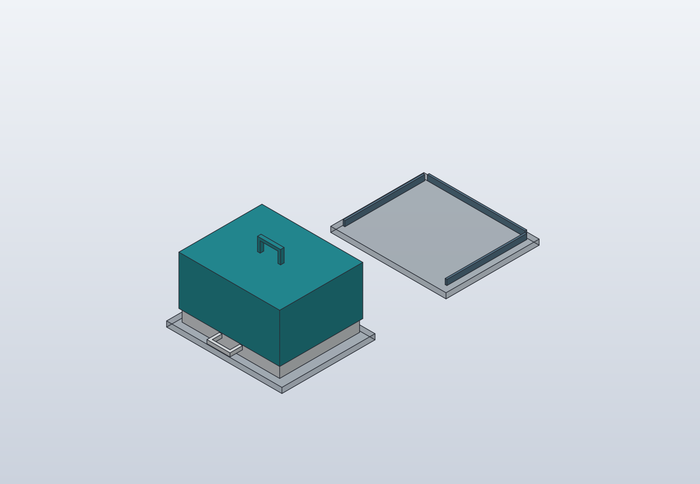
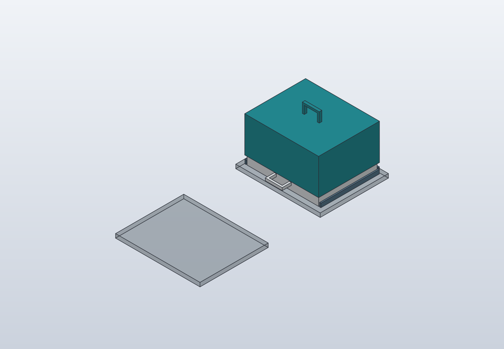
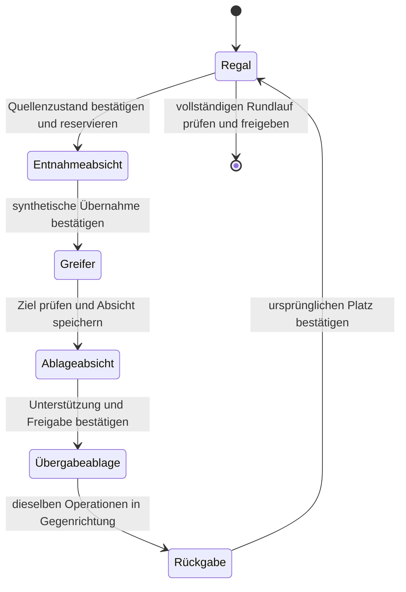

# S01 · erster synthetischer Storage-Testfall

S01 verbindet genau einen Regalplatz, einen geschlossenen RNA-Kitträger aus
K01 und eine feste, abgestützte Übergabeablage. Der lokale Mock-Rundlauf
führt denselben Träger vom Regal zur Ablage und zurück. Er prüft die
Zuordnung und Bestätigungsreihenfolge einer ausdrücklich synthetischen Testwelt.

Zwei unabhängig abgeleitete CAD-Stellungen prüfen die Aufstellung am Regal
beziehungsweise an der Ablage. Zwischen ihnen ist keine Roboterbahn beschrieben.
Eine Schienenanlage, ein Greifer oder echte Lager- und Transporthardware sind
damit nicht implementiert. Beide Kits bleiben in der ersten praktischen
Version direkt an K01; S01 ist eine separate synthetische Testumgebung.

## Native Prüfstellungen





Beide Auflagen liegen im ersten Testfall auf derselben synthetischen Höhe.
Die Darstellungen enthalten Referenzflächen, kein reales Regaltragwerk und
keine Schienenmechanik. Der kleine [Galerie-Zustandsplan](models/README.md)
ergänzt die Identitäts- und Belegungszuordnung. Native Bilder, Quellen und
Nachweise sind in der [Provenienz](media/storage-s01.provenance.json) gebunden.

## Einstieg

```sh
python3 scripts/run_kit_storage.py --fixture-id S01-example-001 demo
python3 scripts/run_kit_storage.py --fixture-id S01-example-001 status
python3 scripts/build_kit_storage.py --backend both
```

Die erste Zeile erzeugt eine neue synthetische Testwelt. Eine Wiederholung
mit derselben ID wird abgewiesen, auch nach erfolgreichem Abschluss. Eine
andere Fixture-ID bezeichnet eine andere Testwelt; sie übernimmt keinen
Bestand. Der Standard-Store ist derselbe wie bei den vorhandenen manuellen
Workflows; `--store` wählt ausdrücklich eine andere lokale Journaldatei.

`init` initialisiert nur einen unbeobachteten Fixturezustand. Die CLI-Befehle
`status` und `resume` führen keine Bestätigung oder automatische Wiederholung
aus. `resume` prüft und erneuert die Sitzung, schließt sie anschließend wieder
und erhält aktive Reservierungen. Abgleich und schrittweise Fortsetzung sind
derzeit über die Python-API
[StorageRunner](../scripts/kit_storage_workflow.py) möglich:
`open(..., resume=True)`, `reconcile`, `intent` und `confirm`. Die
[Tests](../tests/test_kit_storage_workflow.py) enthalten konkrete Beispiele
für bestätigte beziehungsweise nicht durchgeführte Entnahmen nach Neustart.

Die CAD-Backends sind auch einzeln mit `--backend freecad` oder
`--backend solidcraft` auswählbar. Jeder baut direkt aus den gemeinsamen
Quellen. STEP ist nur beim zusätzlichen Vergleich beider CADs beteiligt.
Der aktuelle lokale Bericht steht unter
`cad/kit-storage-s01/shared-build-report.json`; native Dateien und unveränderliche
Berichte liegen in neuen Revisionsordnern unter `cad/generated/` und
`exports/generated/`.

## Quellen und wiederverwendete Konstruktion

Die Komposition `model/kit-storage-s01.shared.json` referenziert die vorhandene
unbegrenzte Umgebung, den Möbelkatalog und
`model/furnishings/kit-storage-s01.json`. Sie bindet die unveränderte K01-Quelle
und wählt daraus genau das geschlossene RNA-Modul. Maße, Artikelrollen,
Geometrie und Griffe des Trägers werden nicht nochmals konstruiert.

Die lokale K01-Bezugslage wird einmal auf den ausgewählten Auflagerahmen
abgebildet. Dieselbe Transformation gilt für alle ausgewählten Körper,
Greif-/Anfahrbezüge und angenommenen Fingerfreiräume. Ein Fall enthält
genau eine Trägerinstanz; die beiden CAD-Stellungen sind Alternativen.
Die ursprüngliche K01-Aufstellung und L01 bleiben eigenständig.

Die Referenzauflagen und ihre Führungen sind synthetische Bauräume. Sie
belegen kein ausgewähltes Regalprodukt, keine Montage oder Tragfähigkeit.
Herstellerabmessungen, Lasten, Schwerpunkt und reale Passungen bleiben offen.

## Ein Fixturezustand im vorhandenen Journal

Der Runner verwendet `manual_tasks.Journal` und den vorhandenen Standard-Store.
Es gibt keinen zusätzlichen Materialbestand und keine Reagenz- oder
Verbrauchsbilanz. Ein explizit identifiziertes synthetisches Fixture besitzt
einen dauerhaften Zustand. Eine erneute Initialisierung derselben Identität
darf seine Positionen oder offenen Vorgänge nicht zurücksetzen.

Träger, symbolische Inhaltselemente, Plätze und abstrakter Greifer haben
getrennte Identitäten. Die Inhaltselemente werden aus den referenzierten
K01-Material-/Slotrollen abgeleitet und ausdrücklich als synthetische
Fixtureinstanzen geführt. Sie sind keine beobachtete Kitstückzahl oder
Einführung realer Artikel in den gemeinsamen Laborbestand.



Das Diagramm zeigt logische Übergänge, keine Bewegungs- oder Zeitkurve.
Jede Durchführung benötigt eine vorher gespeicherte Absicht und eine
ausdrückliche synthetische Beobachtung. Erwartete Zustände ersetzen keine
Beobachtung. Richtiger Träger, vollständige Inhaltszuordnung, Quellen-/
Zielplatz, Greifer und abgestützte Ablage sind getrennt zu prüfen.

Reservierungen, Ereignis und Zustandsprojektion werden durch die vorhandenen
Journaltransaktionen gespeichert. Die Revision schützt gegen veraltete
Schreibversuche. Eine Wiederaufnahme prüft Journal und Quellenbindung;
offene Absichten und Reservierungen bleiben erhalten. Ein unklarer Ausgang
benötigt einen ausdrücklichen synthetischen Abgleich. Prozessende, Frist
oder ein neuer Aufruf beweisen weder Rückgabe noch Freigabe.

## Prüfgrenzen

- Der Mock führt logische Orts-/Gewahrsamswechsel in einer isolierten Testwelt
  aus. Er kommuniziert mit keiner Hardware und misst keinen Zustand.
- Die neun K01-Materialtypen und ihre synthetischen Fixtureelemente sind keine
  Mengenangabe, reale Packungszählung oder bestätigte Bestückung.
- Statische CAD-Stellungen und angenommene Fingerfreiräume beweisen keine
  kollisionsfreie Entnahme- oder Transportbahn, reale Greifbarkeit, Rückhaltung,
  Traglast, Druckfestigkeit oder mechanische Sicherheit.
- Für ein künftiges Transportprogramm gilt die projektweite fließende Bewegung:
  Freiraum- und Transitmarken erzwingen keinen Halt. Die tatsächliche Kurve
  braucht eigene PVA-/FK-, Last-/Orientierungs- und Exportprüfungen.
- Laufübergreifender Materialbestand, Reagenzmengen, Bestandsübernahme,
  verteiltes Geräte-Fencing, ROS-Ausführung, SiLA-Netzwerk und GENtle-Bindung
  sind durch diesen Testfall nicht implementiert.
- Kitvorräte, Arbeitslösungen und Probenlagerung behalten ihre unterschiedlichen
  Bedingungen. Eine positive Modellprüfung ist keine Freigabe für reale Lagerung.

Der [Storage-Ausbauplan](automated-storage-plan.md) beschreibt die weiteren
Schritte. Der [K01-Entwurf](extraction-kit-station.md) dokumentiert die
ursprünglichen Griffe, Artikelhüllen und deren eigene native Nachweise.

## Ausgeführte Nachweise

Der native Stand `kit-storage-s01-62cc073c35c0` besteht in FreeCAD und
SolidCraft. Beide Fälle enthalten jeweils 22 gültige geschlossene Körper,
22 Zuordnungsprüfungen, vier abgeleitete Greif-/Anfahrbezüge und acht aus K01
übernommene Freiraumhüllen. Die 32 Prüfungen der aufgeweiteten Zugangshüllen
über beide Fälle und CADs ergeben keine Blockaden; auch sämtliche Modellkörper
sind ohne positive Volumenüberschneidungen. Der STEP-Differenzvergleich ergibt
0 mm³. Alle 28 gebundenen Quelldateien und die erzeugten Artefakte wurden geprüft.

Zusätzlich schneidet ein dünner geometrischer Zeugenquader die gesamte
Trägergrundfläche am vorgesehenen Auflagez. Beide CADs müssen unabhängig die
erwarteten Teilvolumina in Trägerboden und Auflage bestätigen. Dieser Nachweis
belegt die modellierte vollflächige Auflage und erkennt Lücke, Überstand oder
Durchdringung; er berechnet keine reale Kontaktkraft, Stabilität oder Traglast.
Die nativen SolidCraft-Bilder wurden visuell geprüft; eine FreeCAD-GUI-Prüfung
wurde nicht durchgeführt.

Der ausgeführte lokale Mock-Rundlauf kehrt mit derselben Träger-ID und allen
neun symbolischen Inhalts-/Slot-/Materialzuordnungen zum ursprünglichen Platz
zurück. Sechs getrennt gespeicherte und bestätigte Vorgänge decken Entnahme,
Aufsetzen und Greiferfreigabe in beiden Richtungen ab. Der Abschluss prüft die
vollständige Quittungsfolge und gibt erst danach Reservierungen frei.

135 gezielte Tests bestanden ohne übersprungene Tests: S01-Modell, Schema,
Builder, native Nachweisbindung, Workflow und Galerie sowie Regressionen für
K01, Extraktionsvorbereitung, vorhandene Galerie und Journal. Dazu gehören
asymmetrische Randabstände, falsche Identität oder Belegung, fehlende/umgeordnete
Quittungen, Speicherfehler, veraltete Sitzungen und ein harter Prozessabbruch
nach dauerhaft gespeicherter Absicht mit anschließendem Neustart. Dies ist
keine Ausführung der gesamten Repository-Suite oder eine Hardwarequalifikation.
