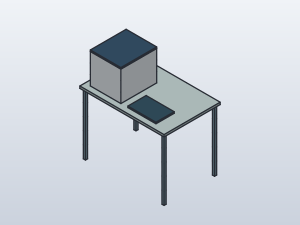

# TS01 · TapeStation mit manueller Assistenz

TS01 ergänzt die Laborgeräte um einen zunächst **manuell bedienten
QC-Arbeitsplatz**. Agilent beschreibt TapeStation als Elektrophoreseplattform
zur Untersuchung von Größe, Menge und Integrität von DNA/RNA. Die interne
Geräteautomatisierung belegt keine automatische Beladung durch unseren Arm.
[Herstellerübersicht](https://www.agilent.com/en/product/automated-electrophoresis/tapestation-systems/tapestation-instruments).



Die konkrete Ausführung ist noch nicht ausgewählt (`selected_model: null`).
Für die Platzplanung dient zunächst die **4200** als Referenz: 435 × 510 ×
445 mm, zusätzlich etwa 250 mm oberer Raum für den Deckel und 75 mm rundum
für Luftzirkulation und Anschlüsse. Daneben ist eine generische PC-Fläche
vorgesehen. Grundlage ist Agilent D0009034, Revision A.05 vom 5. August 2025,
S. 4–5: [Site Preparation Checklist](https://www.agilent.com/cs/library/sitepreparationchecklists/TapeStation%20Site%20Preparation%20Checklist.pdf).

Das Modell ist eine geschlossene, vereinfachte Hülle mit statischer Deckelfuge,
kein Hersteller-CAD und keine konstruierte Öffnungsmechanik. Die eigene
synthetische Referenzbank misst 1200 × 800 mm bei 900 mm Arbeitshöhe.
Das Freihaltevolumen beträgt 585 × 660 × 695 mm über der Bank und wird als
Installationsanforderung geführt, nicht als physischer Körper.

In L01 steht die Gerätehülle jetzt bei **X=2605, Y=3000, Z=900 mm** auf
`IslandLeft`, Ausrichtung 0°. Der PC steht längs dahinter auf derselben Bank.
Der Adapter verwendet das Instrument-only-Rezept aus derselben Quelle und
fügt die eigenständige Referenzbank nicht nochmals ein. Die Wandbank wurde
wegen der zu niedrigen oberen Regale verworfen. Die seitlich versetzte
Mittelbankposition lässt die Deckelreserve am mittleren Regal vorbeigehen.
Auflage, Stellflächen und Freihaltevolumen werden nativ gegen L01 geprüft.
Der TR01-Übergabeparkplatz liegt bei X=2150, Y=3250 mm; die Gerätebedienung
bleibt manuell. Eine Registrierung in F03 ist weiterhin nicht vorhanden.
Belastbarkeit, Schwingungen, Anschlüsse und reale Wartungszugänge bleiben offen.

## Quellen und native Modelle

[tapestation.shared.json](../model/tapestation.shared.json) führt Gerätefunktion,
Planungsmaße, Bedienart und Assistenzidee. Der portable Generator verwendet die
vorhandenen Grundkörperoperationen für beide CADs unabhängig voneinander.

```sh
python3 scripts/build_tapestation.py
python3 scripts/build_tapestation.py --backend freecad
python3 scripts/build_tapestation.py --backend solidcraft
```

Der lokale Bericht `cad/tapestation/shared-build-report.json` bindet neue
Revisionen unter `cad/generated/`, Quellen, CAD-Dateien und Bildprüfsummen.
Geprüft werden gültige geschlossene Einzelkörper, statische Überschneidungen,
FreeCAD-Wiederöffnung sowie Körpervolumen, Schwerpunkte und Begrenzungen im
CAD-Vergleich. Die acht Körper umfassen Bank, Füße, Gerätehülle und PC-Hülle.
Das ist kein Funktions-, Öffnungs-, Greif- oder Sicherheitsnachweis.
ROS, Geräteadapter und Ergebnisimport sind nicht implementiert.

## Idee für menschliche Assistenz

Der [TR01-Aufgabenrunner](lab-station-transport.md) enthält TS01 als manuellen
Übergabeort. Seine synthetische Entladebestätigung ist implementiert; der
folgende Messablauf ist **ein Entwurf**, kein ausführbarer Geräteworkflow:

1. Person übernimmt eine eindeutig benannte Aufgabe und gleicht Originalprobe,
   Gefäß und ursprünglichen Rackplatz ab. TR01 bleibt während der Übergabe stehen.
2. Person wählt Assay/SOP. Eine Aliquotentnahme muss vor der Durchführung im
   gemeinsamen Material-Ledger beabsichtigt und danach bestätigt werden;
   kein zusätzlicher TapeStation-Bestand und kein angenommener Verbrauch.
3. Person bereitet vor und belädt das Gerät. Laufkennung, Assay und Lane/Platz
   werden ausdrücklich auf die Probe abgebildet; Reihenfolge oder Probenname
   allein gelten nicht als Identitätsbeweis.
4. Originalexport bleibt erhalten. Geräte-Laufende, fachliche QC-Bewertung und
   Freigabe des Arbeitsplatzes sind getrennte Bestätigungen.
5. Restoriginale werden mit Identität und Rackplatz zurückgegeben; Ansatzgefäße
   und Verbrauch brauchen einen eigenen bestätigten Verbleib.

Eine Gerätewarteschlange könnte die Person später benachrichtigen, sobald
TR01 angekommen und stationär gehalten ist. Nach Unterbrechung oder ausbleibender
Antwort bleiben Übergabe und Messauftrag offen. Es werden aktuell keine
Benachrichtigungen versendet und keine Messungen automatisch angenommen.
