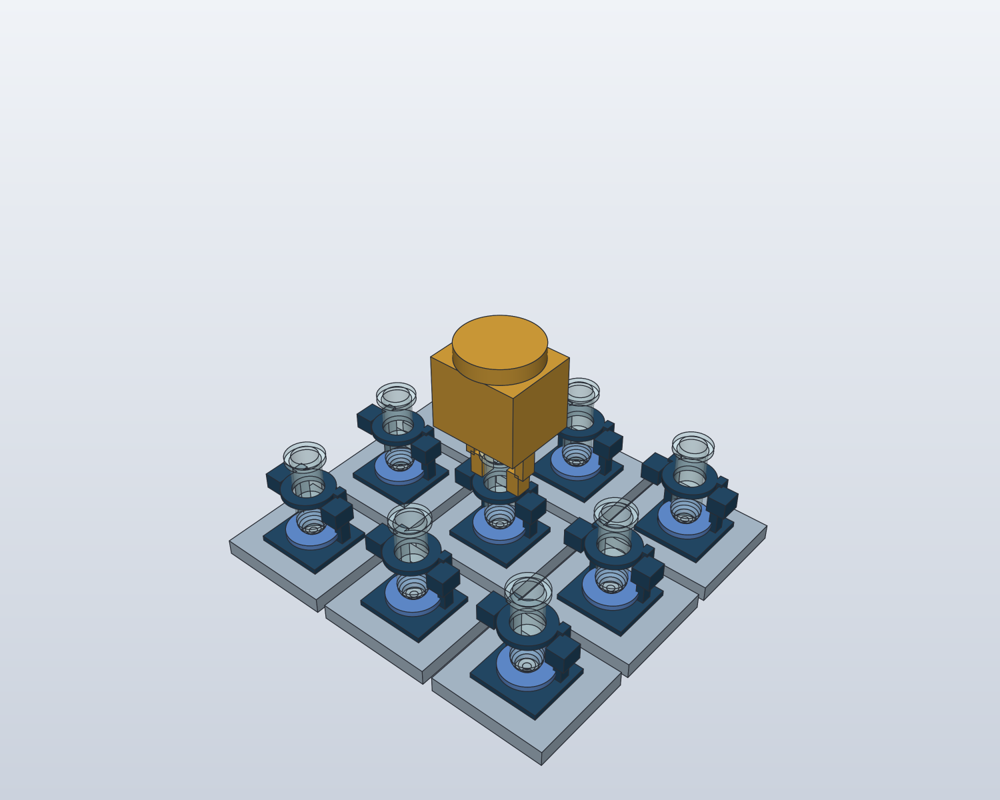
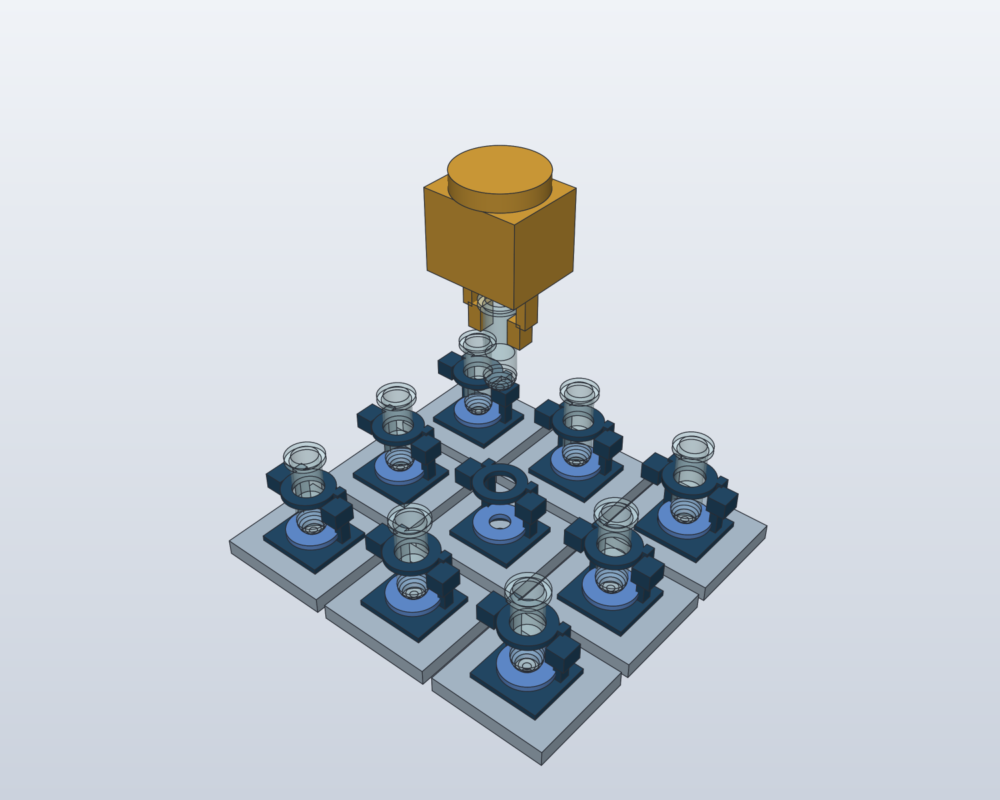

# Open tube frame, bottom lifter and receiving cradle — H02

H02 is the preserved open-frame, bottom-lifter and split-receiver baseline.
The later [H03 cam mechanism](tube-cam-h03.md) is now a historical comparison concept.
The current direction is [direct gripping and cooperating robots](requirements.md#direkter-gefäßgriff-und-kooperierende-roboter). The [direct-pickup variant below](#direct-pickup-variant) now checks the existing gripper against passive H02 parts in both CADs. The historical lifter/receiver geometry and evidence remain unchanged.

Revised on 28 October 2026 following the owner's request to expose the liquid,
provide bottom ejection access, and hold the tube after it leaves its frame.
H02 supersedes H01's enclosing sleeve for this optical-access investigation.
The [H01 source and checked models](tube-carrier-h01.md) remain historical.


The donor is an open frame with two narrow locating bands and two rear posts.
The green/blue lower seats support the outside of the conical/rounded tube at
different heights. The upper band guides the cylindrical body. The front remains
open between the bands and above the upper guide. The blue fluid patch is an
illustration of a sample region; it is not a simulated volume, refractive image,
or evidence that a real 1 µL wall droplet can be detected.

## Direct pickup variant

The reference composition [h02-direct-pickup.scene.json](../model/h02-direct-pickup.scene.json)
pins the existing H02 source and the CF01 pickup scene's gripper definition.
It selects the H02 dock base, open carrier, lower seat, tube reference and mouth
keepout. Lifter, drive and split receiver are omitted from this passive variant.
No holder dimensions or gripper dimensions are changed. The original H02 and
H03 sources and their historical build evidence are preserved.

The tool approaches vertically from above, with its closing axis along X.
An Rx(180°) placement maps the existing gripper's +Z-at-tube convention into this
frame. The grip reference is 33 mm above the dock origin. Pads occupy Z=31–40 mm,
between the upper guide ending at Z=30 mm and collar starting at Z=42 mm.
The jaws close from 22 mm gap to the illustrative 10.8 mm tube body diameter.
After the required grasp confirmation, tool and tube rise together by 60 mm.
This is a local tool-space test; no whole-arm IK, reach or self-collision claim
is made, and the test endpoint is not a required stop in a future transport route.





Both the conical 1.5 mL and rounded 2.0 mL references are checked in complete
3 × 3 arrays at an illustrative 48 × 44 mm pitch. The continuous audit covers
open-finger approach, jaw closure and the entire loaded withdrawal, including
finger-to-finger and finger-to-tool-body checks. Contacts between rigidly
attached tool pieces and intended pad/tube contact are explicitly distinguished.

| Checked clearance | Nominal result for both variants |
|---|---:|
| Finger pads to selected holder | 1.0 mm |
| Finger stems to reserved mouth/cap envelope | 0.9 mm |
| Carried tube envelope through upper guide | 0.2 mm radial |
| Tool to neighboring holder/tube assemblies | at least 15 mm |

The lower seat intentionally supports the tube at the start: zero distance
there is expected, with no material penetration. These small local clearances
are geometric results, not manufacturing tolerances or measured fit. The mouth
keepout is the existing reserved envelope; a real closed lid and hinge have not
been modeled or qualified. Grip force, friction, retention, alignment uncertainty
and actual article dimensions remain open.

### Continuous proof and native deliverables

`scripts/h02_direct_pickup.py` compiles the same referenced geometry and rigid
instance placements for FreeCAD and SolidCraft. Axis-translated boxes and
cylinders have exact continuous swept solids. The tube sweep fills its hollow
interior conservatively and derives its outer swept profile from H02; it does
not replace the tube by a radius that could miss the collar. No intermediate
positions are skipped by a sampled collision test.

For each variant and backend, 806 scoped pairs cover these continuous envelopes
against all selected-holder and neighboring material/keepout bodies. SolidCraft
uses native world bounding boxes as conservative separation bounds for distant
pairs and exact distance/boolean tests for nearby pairs; FreeCAD tests every
pair with native OCC distance and boolean operations. Both detect a lowered
finger intersecting the upper guide and a blocker intersecting only the middle
of extraction while the start and end tube poses remain clear.

The common quintic polynomial kernel supplies C2 local approach, closing and
extraction episodes, with finite bounded jerk. Thirteen native evaluated poses
per variant/backend verify the tool, fingers and tube placements, including
interior curve positions. The six-second episode durations and motion limits
are synthetic test choices; waits for closing and grasp confirmation are separate.
There is no new hardware, workflow or multi-robot execution adapter.

```sh
python3 scripts/build_h02_direct_pickup.py --backend both
python3 scripts/build_h02_direct_pickup.py --backend freecad --no-render
python3 scripts/build_h02_direct_pickup.py --backend solidcraft --no-render
python3 -m unittest discover -s tests -p 'test_h02_direct_pickup.py' -v
```

Each CAD can construct its model directly from the shared references without
the other CAD executable. In the combined build, STEP is used only for the
additional cross-CAD comparison. The report at
`cad/h02-direct-pickup/shared-build-report.json` resolves current native paths,
source pins, all pair results, motion bounds, reopened-model checks and views.
The models retain four named slider coordinates for inspection; continuous
proof bodies are grouped separately and hidden in saved presentation metadata.
FreeCAD GUI rendering was not checked.

The [published image evidence](media/h02-direct-pickup.provenance.json) records
the checked build and native artifact hashes. Both cases contain 71 closed
bodies including tube keepouts, continuous witnesses and negative controls;
42 physical/reference bodies are visible. All 71 STEP differences in each
case are zero. The regression suite has nine passing tests.

## Bottom access and capture

| Part | Proposed function |
|---|---|
| Base opening | 5.2 mm diameter through the base; unobstructed path to the exterior tube bottom |
| Open foot and lower seat | Central openings continue the pusher path through the frame |
| Amber lifter | Small shaped cup supports the external bottom; 2 mm approach followed by 28 mm tube lift |
| Amber receiving halves | Close around the lifted lower exterior to form a split supporting seat |
| Upper receiver band | Locates the tube body below the collar, with nominal clearance |
| Rear receiver bridge | Carriage/drive envelope for the two halves; actual actuation is not selected |
| Purple keepout, hidden in these renders | 8 mm-radius region around the collar/mouth checked against other rigid components |

The receiving lower seat carries weight through the lower exterior shape; the
upper guides limit tipping. It does not depend on squeezing the sealing lip.
The pusher can withdraw through the central opening while the receiver remains
closed. Handling is upright; retention under acceleration, vibration or inversion
is not qualified. Shaped seat edges and cups need real contact and force tests.


The grey actuator housing has a shaft bore. The shaft retains a nominal 8 mm
overlap inside that envelope at full stroke. This is a coherent space model,
not a selected actuator, bearing, drive or force calculation. Receiver slide
shoes touch the rear rail at their concept interface; detailed guidance,
fasteners, compliance, sensing and loss-of-power retention remain open.


## Handoff sequence

1. Secure and locate the donor frame. Confirm receiver alignment and open halves.
2. For real transfer, close and verify the tube lid. H02 omits lids and their mechanism.
3. Move the bottom cup through the initial 2 mm gap and confirm gentle contact.
4. Lift under continuous pusher support to the receiver's capture height.
5. Close both receiving halves around the lower exterior and body. Independently
   confirm tube presence, seating and closure before allowing pusher withdrawal.
6. Retract the pusher while the split seat supports the tube.
7. Move the receiver away only after confirming that the pusher is fully clear.

There is no free-flight stage. The source's pure protocol checker rejects
unsupported tube states, early receiver closure and departure before pusher
withdrawal. This is an executable design check, not a running hardware
controller. Manual CAD sliders do not enforce those protocol interlocks.

## Shared source and two native adapters

Checked native snapshot, 28 October 2026:
[FreeCAD H02](../cad/generated/tube-frame-h02-34a52d3bd79f/TubeFrame_H02.FCStd),
[SolidCraft H02](../cad/generated/tube-frame-h02-34a52d3bd79f/TubeFrame_H02.sc),
[STEP](../exports/generated/tube-frame-h02-34a52d3bd79f/default.step).

The leading source is [tube-frame-h02.shared.json](../model/tube-frame-h02.shared.json).
It defines units, driving/derived parameters, tube variants, a semantic recipe,
interfaces, motion states, support rules and limitations. The CAD-independent
[tube_frame_model.py](../scripts/tube_frame_model.py) expands that recipe once.
Both native CAD adapters consume the same operations and hierarchy.

```powershell
python scripts/build_tube_frame.py
python scripts/render_tube_frame.py
python -m unittest discover -s tests -p "test_tube_*model.py" -v
```

The H02 entry points reuse the H01 command adapter, native FreeCAD primitive/
sketch/revolution adapter, build comparer and renderer. The shared adapters now
support nested moving components, named slider-limit parameters and derived
length parameters. H01 remains separately reproducible through its own source
and entry points. No independent FreeCAD-only construction is maintained.

The [current build report](../cad/tube-frame-h02/shared-build-report.json) points
to default native `.sc`, `.FCStd` and STEP files under `cases[0].files`; every
build gets a new source-hash revision directory. The
[render manifest](../cad/tube-frame-h02/render-manifest.json) identifies model,
source, scene poses and PNG checksums. Model health is recorded
[separately](../cad/tube-frame-h02/model-health.json).

Ten ideal sliders describe both examples. Per variant, the pusher travels
0–30 mm, tube visualization 0–48 mm, receiver 0–20 mm and each receiving half
0–8 mm outward. All are **mm**, with no rotary joints. Parent receiver motion
also moves its two jaw children. `TubeLift` is an imposed visualization
coordinate, not an extra physical actuator or contact simulation.

Native SolidCraft uses slider assembly joints; FreeCAD uses expression-driven
App::Part placements and exposes positions in `Controller`. Use named states
`ready`, `contact`, `lifted`, `captured`, `supported`, `carried` or `comparison`.
`comparison` shows V15 ready and V20 captured with the pusher still supporting it.
Rebuild from the source after changing geometry or frame references. Native
geometry edits do not write back to the source or recalibrate numeric SolidCraft
joint frame origins.

## Checks and physical limits

The build compares names/counts, volumes, centers of mass, bounding boxes and
STEP symmetric difference in default, lower-bound and upper-bound cases. Stroke
changes move the receiving seats, guide, limits and protocol positions together.
Selected native edits cover tube radius, guide clearance and module spacing.

For each case, named states and intermediate support, closing, retraction and
departure states are solved in SolidCraft and checked in native FreeCAD. BRep
checks distinguish different rigid components from construction overlaps within
one component. The tube/keepout overlap is intentional; frame/seat overlaps are
mounting envelopes, not qualified fits.

At `ready`, four front camera segments at Z=25.5 mm and Z=36 mm are checked for
opaque obstruction, one pair for each variant. Those segments test frame access,
not field of view, refraction, reflection, focus, cap occlusion, real liquid
visibility or dose recovery. Test those with actual articles, cameras, lighting
and samples before accepting an optical result.

Lids, pipette, robot and their swept envelopes are not integrated. The mouth
keepout does not represent the full parked cap. These samples do not prove a
complete robot trajectory or physical safety. H02 is a separate stationary
demonstration; it does not provide a qualified detachable H01 dock, automatic
rack loading or integration into C01/CF01/TR01.

The open frame deliberately gives up H01's large cooling contact area. Cooling
near the visible liquid region, sample temperature, stiffness, cleaning,
holding/release forces and measured repeatability remain test tasks.
