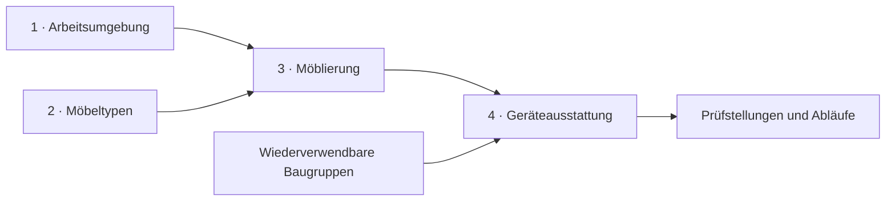

<!-- Generated by scripts/render_model_gallery.py from docs/models/catalog.json and this template. -->

# Modellgalerie

[← Projektübersicht](../../README.md) · [Architektur und Quellen](../../ARCHITECTURE.md)

Ein Labor lässt sich aus vier getrennten Ebenen zusammensetzen. Möbel und Geräte
werden einmal konstruiert und anschließend als Varianten oder Instanzen verwendet.
Die Bilder führen von diesen Einzeldefinitionen zu konkreten Aufstellungen und Abläufen.
Auf ein Bild klicken, um es größer zu öffnen; darunter stehen Quelle und Fachdokumentation.



Die Galerie zeigt **Konzeptmodelle**. Ein Rendering ist keine Fertigungsfreigabe
und kein Nachweis realer Roboterfunktion. CAD-Ansichten und schematische Bilder
sind in den jeweiligen Bildunterschriften unterschieden.

__MODEL_GROUPS__

## Herkunft und Aktualisierung

Alle aktuellen Baugruppen- und Aufstellungsquellen sowie die beiden Umgebungen,
Möbelkataloge und Möblierungen besitzen eine Ansicht. Die kuratierte Auswahl liegt
vollständig im Repository; CAD-Dateien bleiben lokale Build-Ausgaben.

[Provenienz](provenance.json) führt Quell-, Modell- und Bildprüfsummen, verwendete
Prüfberichte sowie die Art der Darstellung. Bereits geprüfte Modellbilder werden
weiterverwendet, wenn ihr Modellstand passt. Bei T01 ist die unveränderte Geometrie
zusätzlich durch Gleichheit aller CAD-Befehle außer Dokumentmetadaten belegt.
Die historische Provenienz der README-Medien wird dadurch nicht umgeschrieben.
Übernommene Bauprüfungen gelten für den jeweils dokumentierten Buildstand;
die Galerie führt keine erneute vollständige CAD- oder Bewegungsprüfung aller
abgebildeten Baugruppen aus.

Auswahl, Bildunterschriften und Gruppierung werden in `catalog.json` gepflegt;
diese Seite entsteht aus der gemeinsamen Auswahl und einer Markdown-Vorlage.

Ohne CAD-Installation lässt sich die gespeicherte Galerie prüfen:

```sh
python3 scripts/render_model_gallery.py --check
```

Für neue Bilder die betroffenen lokalen Modelle zunächst aus ihren Quellen
bauen und prüfen. Anschließend mit SolidCraft CLI vom Projektstamm aus:

```sh
python3 scripts/render_model_gallery.py
```

Der Renderer nutzt die geprüften lokalen Build-Berichte und kopiert bewusst
wiederverwendete, bereits geprüfte Ansichten. Er erzeugt keine neuen führenden
Modelldefinitionen. Nach dem Lauf alle Bilder sichten und die visuelle Prüfung
in der Provenienz festhalten. Die Bildauswahl hat ein Budget von höchstens 4 MB.
